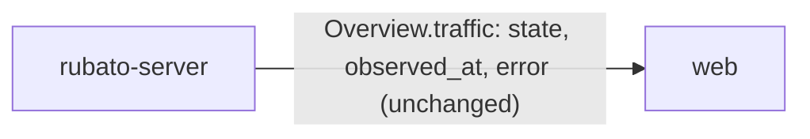

# Traffic source wording and status are per workspace

Traffic sources are per workspace on the server (ADR 0075): one settings row, one fetch task and
one report each. A few places still speak as if there were one source, or one workspace called
`default`. This change makes the wording, the settings view and the startup drift warning agree
with the server, and adds the scenarios that were missing. Issue #278 (set the sources by hand)
depends on the status line.

## What the change does

- The Traffic lens of a workspace without a source says "This workspace has no traffic source.
  Set one in Configure workspace." instead of "Rubato has no traffic source."
- Configure workspace shows the state of this workspace's stored source under the Source
  select: working with the last report's age, no report yet, or failing with the reason. A
  workspace without a source, or a source not saved yet, shows no state.
- The startup drift warning reports a `RUBATO_TRAFFIC_*` variable (and
  `RUBATO_TRAFFIC_FETCH_SECS`) as differing when any workspace's row differs from it, not only
  `default`'s.
- Two scenarios: `@settings.traffic-per-workspace` and `@settings.traffic-status`.

## How we'll know it works

- [ ] `web/src/features/map/traffic.test.tsx`: the `not_configured` sentence names the workspace
  and Configure workspace.
- [ ] `web/src/features/settings/settings.test.tsx`: one case per state (fresh, stale, failing,
  not configured, draft differs from stored); the test prints how many states it checked.
- [ ] `crates/rubato-server/src/workspace_settings/tests.rs`: two rows seeded from the
  environment, `shop`'s source changed, the variables still set: the drift list says they
  differ. The test fails without the change (today only `default` is compared).
- [ ] `web/e2e/settings.spec.ts`: a source set in `shop` shows there with its state; `default`
  shows none and its Traffic lens has the new sentence. Cites both scenario ids.
- [ ] `pnpm scenarios check` passes with the two new ids covered.

## What it must not break

- The protocol and `schema/protocol/*.json`: nothing changes; `ObservedTraffic` already carries
  `state`, `observed_at` and `error`. Guarded by the schema drift check.
- The settings API, sealing of secrets and the fetch tasks: untouched;
  `workspace_settings/api_tests.rs` and `traffic/prometheus_tests.rs` stay green.
- The `rubato_workspace` metric label stays as ADR 0047 has it (`default` unlabelled); the alert
  tests in `observability/alerts/tests/rubato.test.yml` are untouched.
- The drift check for `RUBATO_MAP_*` still compares with `default`: those variables define that
  one entry. Guarded by `a_legacy_deploy_seeds_default_alone`.
- The slice layout: `web/src/features/features.test.ts` stays green (settings may not make a
  cycle with map).

## How we'll debug it at 3 am

See the O-row. No new log line, span or finding: the status line shows what the overview
already carries, and the existing `traffic source failing` log line and `TrafficReportStale`
alert are per workspace.

## Affected parts

| Node | Status | What changes | Seams |
| --- | --- | --- | --- |
| web | affected | The no-source sentence; a status line in Configure workspace read from the overview | web-server |
| rubato-server | affected | The drift warning compares traffic variables with every workspace's row | |

## Data models

None.

## Data flow

## Tasks

1. `traffic.test.tsx`: expect the new sentence (fails); change `unknownSentence`.
2. `settings.test.tsx`: the status cases (fail); add the status line to `SettingsView.tsx`.
3. `workspace_settings/tests.rs`: drift with two rows (fails); compare every row in `seed.rs`.
4. `features/settings.feature`: the two scenarios; `web/e2e/settings.spec.ts`: the test citing
   them. `pnpm scenarios check` warns on the uncovered ids until the test cites them.
5. `AGENTS.md`: the settings row of the web block mentions the source status.

## Assumed, not yet approved

| # | Decision | Chosen | Alternatives | Scope |
| --- | --- | --- | --- | --- |
| A1 | Where the status sentences live | In the settings feature, its own wording ("Working", "Failing"); the lens keeps "Traffic unknown" | Reuse the lens sentence from the map feature | node |
| A2 | Spend cap and attempt limit drift | The same any-row rule: both are seeded to every row | Leave them on `default` | node |

## Decisions

| # | Decision | Chosen | Why | Decided by |
| --- | --- | --- | --- | --- |
| 1 | The `rubato_workspace` label on `default`'s traffic metrics | Leave as ADR 0047 has it | No superseding ADR for a wording change; the alert summary already names `default` | Mattias Jonsson, 2026-11-18 |
| 2 | Scope | Wording, status line, drift warning, scenarios; no new kinds of source | The server is already per workspace | Mattias Jonsson, 2026-11-18 |

## O-rows

| Seam | Breaks like | Signal | Panel | Owner |
| --- | --- | --- | --- | --- |
| web-server | Configure workspace shows a source as working while its fetch fails, or the other way round | Log line `traffic source failing` with `rubato.workspace`; metric `rubato.traffic.fetches` by outcome; alert `TrafficReportStale` | rubato-overview: "Traffic report age" | rubato-server |

## Flows

| From | To | Seam | Kind | Carries |
| --- | --- | --- | --- | --- |
| rubato-server | web | web-server | data | Overview.traffic of the page's workspace: state, last report time, error (already carried) |

## ADRs proposed

None.

## Review map

1. `web/src/features/settings/SettingsView.tsx`: the status line shows the stored source only, never the draft.
2. `crates/rubato-server/src/workspace_settings/seed.rs`: `drift` over every row; values compared, never logged.
3. `web/e2e/settings.spec.ts`: the new test leaves `shop` without a source for the tests chained after it.
