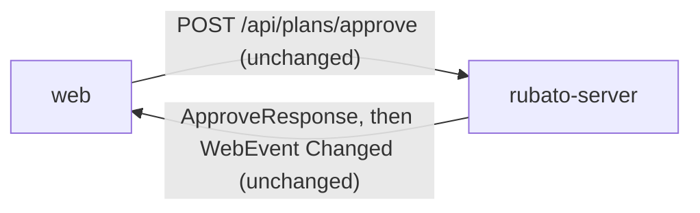

# Accept plan says what it did, where you pressed it

Pressing *Accept plan* looked as if nothing happened, although the approval was posted (#281,
2026-11-18). The button only went disabled while the comment was posted, and once the approval
counted, the row moved from Proposed to Open and the Accept plan block went away with its
"Accepted: …" line. Only the notice banner at the top of the page said what happened.

## What the change does

- The button reads "Accepting…" and is marked busy while the approval is posted.
- The sentence that says what Accept plan did stays on the plan after the approval counts: on
  its row on the plans board, also after the row moves to Open, and under the plan where it is
  read in place.
- A refusal stays under the button as before, and the button is offered again.

## How we'll know it works

- [ ] `web/src/features/plans/plans-board.test.tsx`: the busy label while the post is held; the
  sentence on the row before and after the overview counts the approval. Fails when the board
  does not keep the sentence (checked by taking the prop away).
- [ ] The same file: a refused post leaves its reason and an enabled button.
- [ ] `web/e2e/plans.spec.ts`, citing `@plans.accept-says-so`: the same on the dev server, with
  the GitHub post answered by the test.

## What it must not break

- What Accept plan posts, who may press it and when it is offered: `AcceptPlan`'s request and
  its `why` rules are untouched; `plans.test.tsx` and `@plans.unfit-cannot-be-accepted` guard them.
- A finished plan and a draft still have no Accept plan: `plans-board.test.tsx`,
  `web/e2e/done.spec.ts` and `plans.spec.ts` assert `accept-plan` is absent. The kept sentence
  has its own test id, `plan-accepted`.
- The notice banner still shows the same sentence.

## How we'll debug it at 3 am

See the O-row. Nothing new is emitted: the web shows what the server already answers.

## Affected parts

| Node | Status | What changes | Seams |
| --- | --- | --- | --- |
| web | affected | Accept plan's busy label; the board keeps what it said per issue | web-server |

## Data models

None.

## Data flow

## Tasks

1. `plans-board.test.tsx`: the two cases (fail); `AcceptPlan.tsx` and `PlansBoard.tsx`.
2. `features/plans.feature`: `@plans.accept-says-so`; `web/e2e/plans.spec.ts`: the test citing it.

## Assumed, not yet approved

| # | Decision | Chosen | Alternatives | Scope |
| --- | --- | --- | --- | --- |
| A1 | Where the sentence is kept | In the plans board, by issue, for as long as the board is open | In the server; in browser storage | node |
| A2 | A plan accepted in its detail view, then read on the board | The detail keeps the sentence while it is open; the board does not show it afterwards | Lift the state to the shell | node |

## Decisions

| # | Decision | Chosen | Why | Decided by |
| --- | --- | --- | --- | --- |
| 1 | Its own issue and pull request, not part of #282 | Yes | Another capability (plans, not settings) | Mattias Jonsson, 2026-11-18 |

## O-rows

| Seam | Breaks like | Signal | Panel | Owner |
| --- | --- | --- | --- | --- |
| web-server | The page says a plan was accepted and no comment is on the issue, or the other way round | Span of `POST /api/plans/approve` with `rubato.issue`, and the server's span of the GitHub comment call | rubato-overview: "GitHub calls by endpoint" | rubato-server |

## Flows

| From | To | Seam | Kind | Carries |
| --- | --- | --- | --- | --- |
| rubato-server | web | web-server | data | ApproveResponse: the state of the approval just posted (already carried) |

## ADRs proposed

None.

## Review map

1. `web/src/features/plans/AcceptPlan.tsx`: when the approval counts, the sentence is shown without the button.
2. `web/src/features/plans/PlansBoard.tsx`: the sentence is kept by issue, so it follows the row from Proposed to Open.
3. `web/e2e/plans.spec.ts`: the post to GitHub is answered by the test; nothing is posted.
