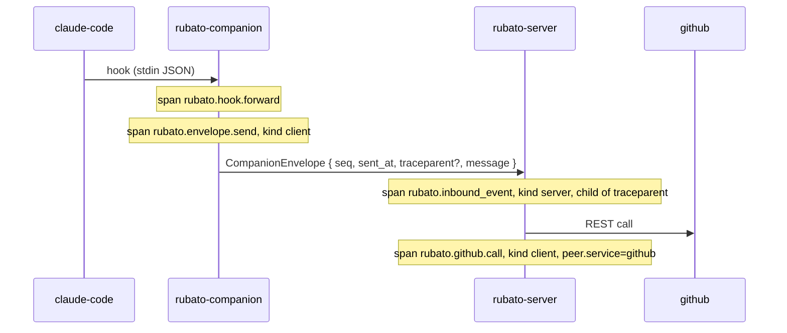

# Design: Rubato's own calls show on its Traffic lens

Plan: `docs/plans/287.md`. Decisions: ADR 0081 (proposed), ADR 0080 (namespace, proposed),
ADR 0059 (matching), ADR 0040 (the service graph as source).

## Why nothing shows today

1. No part of `docs/design/rubato-map.yml` declares its `service`, so no observed end can match.
2. No Rust span has a kind, and no trace crosses a process: the service graph has no client and
   server pair to draw `companion-server` from.
3. The server's `rubato.github.call` spans have no `peer.service`, so no virtual `github` node.

ADR 0080 (merged as #291) gives every part the namespace `rubato`. This plan does the other three.

## The pieces

### 1. The map (`docs/design/rubato-map.yml`)

| Part | `service` |
| --- | --- |
| rubato-server | `{ namespace: rubato, name: rubato-server }` |
| rubato-companion | `{ namespace: rubato, name: rubato-companion }` |
| skill-rubato | `{ namespace: rubato, name: rubato }` (the skill's `service.name`) |
| plan-check | `{ namespace: rubato, name: plan-check }` |
| claude-code | `{ namespace: rubato, name: claude-code }` |
| github | `{ name: github }` (a virtual node from `peer.service`: no namespace) |

Nodes only; no seam of the map changes. The contract parts (`plan-file`, `system-map`,
`rubato-protocol`) and `web` emit nothing and get no `service`.

### 2. The envelope (`crates/rubato-protocol/src/message.rs`)

`CompanionEnvelope.traceparent: Option<String>`, `#[serde(default, skip_serializing_if = "Option::is_none")]`.
A pure function in `rubato-protocol` parses and formats the value (55 characters, version `00`,
lower-case hex, non-zero ids); no OpenTelemetry type enters the protocol crate.

### 3. Companion (`server_link`)

`Client::envelope()` is the one place envelopes are built (`server_link/client.rs:88`). It opens
`rubato.envelope.send` with `otel.kind = "client"` under the current span and reads the span's
context for the `traceparent`. The outbox stores the envelope as built, so a resend carries the
same value. With no OTLP endpoint there is no valid span context and the field is left out.

### 4. Server (`companion_link`)

`on_envelope` (`companion_link/ws.rs:282`) adds `otel.kind = "server"` to `rubato.inbound_event`
and, for a valid `traceparent`, sets the remote context as the span's parent before entering
it. It counts `rubato.inbound.traceparent` by `rubato.outcome`: `linked`, `absent`, `invalid`.

### 5. GitHub calls (`kernel/github/api.rs`)

The 26 `#[instrument(name = GITHUB_CALL, …)]` sites gain `otel.kind = "client"` and
`peer.service = "github"`. A test walks the file and fails when a site lacks either.

## Idempotency and replay

An envelope is applied once (`companion_events`, by `seq`); a replay is answered from the store.
The span for a replay is still made, as today, now under the same parent, so a trace shows the
resend. No new table, no migration.

## Trust

The `traceparent` comes from a paired companion over its authenticated websocket. It is parsed
strictly and used only as a span's parent. A companion can attach its spans to a trace id of its
choosing; that is true of any service that exports to the same stack, and gives it nothing in Rubato.

## What it costs

One span per envelope on the companion. A companion sends a heartbeat a minute, a snapshot per
reconcile and one envelope per hook; the plan's third task reads envelopes per hour of a
working session from the envelope `seq` at the start and end of an hour, and states the number.

## Order of work, one pull request each

1. Protocol: the field, the parser, the schema and generated types. Nobody sets or reads it yet.
2. Server: kind, parent and the counter. Old companions keep working (`absent`).
3. Companion: the client span and the field.
4. Server: GitHub client spans with `peer.service`.
5. The map's `service` fields, with the dev traffic fixtures and tests that read the map.

## Risks

1. **The map change moves tests.** `web/test/fixtures.ts` and the e2e seed read the real map;
   declaring `service` makes quiet-seam findings possible in traffic fixtures. Task 5 runs the
   whole web and e2e suites and adjusts fixtures, not behaviour.
2. **Clock or sampling differences** between machines do not break the link: parenting needs only ids.
3. **Grafana Cloud's generator** must carry `service.namespace` as a dimension, or both ends
   arrive without a namespace and nothing matches. That is setup on the stack, checked by hand in #278.
