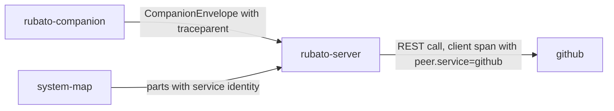

# Rubato's own calls show on its Traffic lens

With a traffic source set (#278), Rubato's own map shows no calls. Its spans have no kind, no
trace crosses from companion to server, the server's GitHub calls name no peer, and no part of
its map declares the service it is. This plan makes `companion-server` and `server-github`
carry observed calls. Design: `docs/plans/287-own-service-graph/design.md`.

## What the change does

- A companion's envelope may carry a W3C `traceparent` (ADR 0081). The companion sends each
  envelope under a client span; the server handles it under a server span in the same trace.
- The server's GitHub calls are client spans with `peer.service=github`.
- The parts of Rubato's map declare their service: `rubato-server`, `rubato-companion`,
  `skill-rubato`, `plan-check` and `claude-code` in namespace `rubato`, and `github` without one.
- An old companion with a new server, and a new companion with an old server, keep working.

## How we'll know it works

- [ ] `rubato-protocol`: the `traceparent` parser accepts the W3C form and refuses a wrong
  length, upper case, version `ff` and all-zero ids; the fixture replay in both suites reads an
  envelope with and without the field. The schema snapshot test shows the one new property.
- [ ] Server, `companion_link`: an envelope with a `traceparent` gives an inbound span of kind
  server whose trace id and parent are the ones sent (read from an in-memory exporter); one
  without, and one that does not parse, start their own trace and count `absent` and `invalid`.
  Fails on purpose when the parent is not set.
- [ ] Companion, Gherkin: the envelope the stand-in server receives for a hook carries a
  `traceparent`, and a resend after a reconnect carries the same one.
- [ ] Server, `kernel/github`: a test reads `api.rs` and fails when a `GITHUB_CALL` site lacks
  `otel.kind` or `peer.service`; it prints how many sites it checked.
- [ ] `e2e/run.ts`: the OTLP receiver sees one trace with a `rubato.envelope.send` span from
  `rubato-companion` and a `rubato.inbound_event` span from `rubato-server` as its child.
- [ ] By hand after deploy (#278): the Traffic lens of `default` shows calls on
  `companion-server` and `server-github`.

## What it must not break

- Envelope handling, at most once by `seq`: `companion_link` tests and the companion's Gherkin
  suite; a replay is still answered from the store.
- Wire compatibility: the field is optional and skipped when absent; the fixtures in
  `crates/rubato-protocol/fixtures/` without it still parse (the seam's guard).
- The span and attribute names in `otel.rs` stay the list both binaries use; the names test
  covers the new span, counter and outcome values.
- The web's map tests and e2e that read the real map: task 5 runs them all after the map change.
- The flaky inbound span capture test (#272) is in the file this plan changes; the new span test
  uses its own in-memory exporter and does not share that capture.

## How we'll debug it at 3 am

See the O-rows. New: span `rubato.envelope.send`; counter `rubato.inbound.traceparent` with
`rubato.outcome` `linked`, `absent` or `invalid`.

## Affected parts

| Node | Status | What changes | Seams |
| --- | --- | --- | --- |
| rubato-protocol | affected | `CompanionEnvelope.traceparent`, its parser, the schema; new names in `otel.rs` | companion-server |
| rubato-companion | affected | A client span per envelope, and its `traceparent` in the envelope | companion-server |
| rubato-server | affected | The inbound span is kind server under the sent parent; GitHub calls are client spans with a peer | companion-server, server-github |
| web | quiet | Generated types gain the optional field; the web does not read it | web-server |
| system-map | affected | Rubato's own map: `service` on six parts; the `companion-server` flow names the trace context | server-system-map |

## Data models

| Model | Kind | Part | Change | Crosses | Note |
| --- | --- | --- | --- | --- | --- |
| CompanionEnvelope | type | rubato-protocol | changed | companion-server | optional `traceparent`, left out when absent |
| companion_envelope.schema.json | schema | rubato-protocol | changed | companion-server | one new optional property |
| rubato-map.yml | file | system-map | changed | server-system-map | `service` on six nodes; one flow's text |

## Data flow

## Tasks

One pull request each, in this order.

1. Protocol: the parser tests (fail), the field, the schema and generated types, the names.
2. Server: the inbound span tests (fail), kind and parent, the counter.
3. Companion: the Gherkin steps (fail), the client span, the field; the envelopes-per-hour number.
4. Server: the `api.rs` site test (fails), kind and `peer.service` on the GitHub call spans.
5. The map's `service` fields and the flow text; fixtures that read the map; `e2e/run.ts` check.

## Assumed, not yet approved

| # | Decision | Chosen | Alternatives | Scope |
| --- | --- | --- | --- | --- |
| A1 | Which envelopes get a client span | Every one, heartbeats and acks included | Only hook and snapshot envelopes | node |
| A2 | An invalid `traceparent` | The envelope is handled as without one, and counted | Refuse the envelope | node |
| A3 | Server to companion direction | Not in this plan | A `traceparent` on `ServerEnvelope` too | node |
| A4 | `skill-rubato`'s service name | `rubato`, the name the skill emits today | Rename the skill's `service.name` to `skill-rubato` | node |

## Decisions

| # | Decision | Chosen | Why | Decided by |
| --- | --- | --- | --- | --- |
| 1 | How the trace crosses companion-server | An optional `traceparent` in the envelope | A service graph needs a client and a server span in one trace; `peer.service` alone draws a virtual node that matches no part | Mattias Jonsson, 2026-11-18 |
| 2 | The service identities on Rubato's map | Server, companion, skill, plan check and claude-code in `rubato`; `github` without a namespace | As proposed | Mattias Jonsson, 2026-11-18 |

## O-rows

| Seam | Breaks like | Signal | Panel | Owner |
| --- | --- | --- | --- | --- |
| companion-server | Envelopes handled without the parent the companion sent, or refused by an old side | Counter `rubato.inbound.traceparent` by `rubato.outcome`; span `rubato.inbound_event` with `rubato.companion_id`; `rubato.events.dropped` | rubato-overview: "Companions", "Events dropped" | rubato-server |
| server-github | GitHub calls missing from the service graph, or failing | Span `rubato.github.call` with `rubato.github.endpoint` and `peer.service`; `rubato.github.rate_limit.remaining` | rubato-overview: "GitHub calls by endpoint" | rubato-server |
| server-system-map | The map fails to load or a part's `service` matches nothing | Log line `workspace config` and the map load error; finding `ObservedOnlyPart` for a Rubato service on the Traffic lens | rubato-overview: "Map versus territory" | system-map |
| web-server | The web's generated types drift from the schema | CI job "Web (types in step…)" | none: a build check | rubato-server |

## Flows

| From | To | Seam | Kind | Carries |
| --- | --- | --- | --- | --- |
| rubato-companion | rubato-server | companion-server | data | The W3C trace context of the companion's send span, in each envelope (ADR 0081) |

## ADRs proposed

| ADR | File | Blob |
| --- | --- | --- |
| 0081 | docs/decisions/0081-a-companion-envelope-may-carry-a-traceparent.md | d231acfb8a62d602dbdbcf913c37e7337373c2a9 |

## Review map

1. `docs/decisions/0081-a-companion-envelope-may-carry-a-traceparent.md`: what may ride on the envelope, and that the server uses it only to parent a span.
2. `docs/plans/287-own-service-graph/design.md` "Order of work": each step leaves old and new sides working together.
3. The Affected parts row for `system-map`: Rubato's own map changes, nodes and one flow's text.
