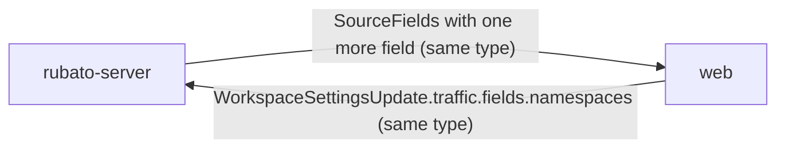

# A workspace's traffic source reads only the service namespaces it lists

A traffic source reads every service on the stack it points at. On a stack shared by several
applications, a workspace's map then shows the others' services as ghosts. The Prometheus
source gets a list of service namespaces to include.

## What the change does

- The Prometheus source has a field "Service namespaces to include (empty: all)", a
  comma-separated list of at most 20 names.
- With a list, a call is kept when its client or its server is in a listed namespace. A call to
  something without a namespace (GitHub, seen through `peer.service`) still shows; calls wholly
  between other namespaces are not read.
- The filter is in the query, so the cut at 500 edges applies to this workspace's calls.
- `RUBATO_TRAFFIC_PROMETHEUS_NAMESPACES` seeds the field once, like the other fields.
- A value that is not a namespace (anything but letters, digits, `.`, `_`, `-`) is refused when
  the settings are saved, with the reason.

## How we'll know it works

- [ ] `traffic/prometheus_tests.rs` `listed_namespaces_narrow_the_query`: the exact query the
  fake query API receives with a list, trimmed and without repeats, for both metrics; and no
  matcher without a list. Prints what it checked.
- [ ] The same file, `config_is_checked_and_headers_never_print`: a value that would break out
  of the matcher, a regex, and 21 names are refused.
- [ ] `traffic/fields.rs` `the_field_list_covers_what_the_adapter_reads`: the new field is in
  the published list.
- [ ] `web/e2e/settings.spec.ts`, citing `@settings.traffic-namespaces`: the form draws the
  field, a bad list is refused with the reason, a good one is stored.

## What it must not break

- A source without the field sends the query it sent before: the existing assertion on the
  exact query in `prometheus_tests.rs` is unchanged.
- Matching an end to a part (ADR 0059) and the wire type `TrafficEdge`: untouched. The settings
  wire type carries fields as a map, so `schema/protocol/*.json` does not change.
- Secrets and the address guard: `workspace_settings/api_tests.rs` stays green.

## How we'll debug it at 3 am

See the O-row. A wrong list shows as an empty report: `traffic source recovered` with
`edges=0`, and the page says nothing was observed (#285).

## Affected parts

| Node | Status | What changes | Seams |
| --- | --- | --- | --- |
| rubato-server | affected | The Prometheus adapter's field list, its validator and its query | |
| web | quiet | Draws the new field from the adapter's list; no code change | web-server |

## Data models

None.

## Data flow

## Tasks

1. `prometheus_tests.rs`: the query and refusal cases (fail); `prometheus.rs`: `namespaces` in
   the config, `is_namespace`, the query with `or`.
2. `fields.rs`: the field in the published list.
3. `features/settings.feature` and `web/e2e/settings.spec.ts`; `docs/QUICKSTART.md`.

## Assumed, not yet approved

| # | Decision | Chosen | Alternatives | Scope |
| --- | --- | --- | --- | --- |
| A1 | Where the filter runs | In the query, as two selectors joined with `or` | After the fetch, in the server, which would spend the 500-edge cut on other applications | node |
| A2 | What a namespace may contain | Letters, digits, `.`, `_`, `-`, at most 63; only the dot is escaped | Any text, escaped as a regex | node |

## Decisions

| # | Decision | Chosen | Why | Decided by |
| --- | --- | --- | --- | --- |
| 1 | Which calls a list keeps | A call with either end in a listed namespace | Calls to externals without a namespace, such as GitHub, must still show | Mattias Jonsson, 2026-11-18 |

## O-rows

| Seam | Breaks like | Signal | Panel | Owner |
| --- | --- | --- | --- | --- |
| web-server | A list is saved and the lens goes empty, or other applications' services still show | Log lines `traffic from the service graph` and `traffic source recovered` with `edges` and `rubato.workspace`; metric `rubato.traffic.fetches` by outcome | rubato-overview: "Traffic report age" | rubato-server |

## Flows

| From | To | Seam | Kind | Carries |
| --- | --- | --- | --- | --- |
| rubato-server | web | web-server | data | The Prometheus source's field list, now with the namespaces field (the type is unchanged) |

## ADRs proposed

None.

## Review map

1. `crates/rubato-server/src/traffic/prometheus.rs` `query`: the two selectors and `or`; a series matching both is counted once.
2. The same file, `is_namespace`: what may reach the query text.
3. `crates/rubato-server/src/traffic/prometheus_tests.rs`: the exact query, and the refused values.
