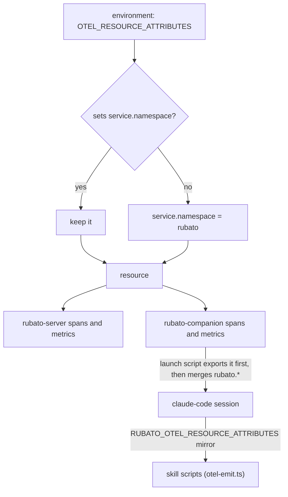

# Design: Rubato's own telemetry carries `service.namespace` `rubato`

Plan: `docs/plans/290.md`. Decision: ADR 0080 (proposed).

## Where a namespace comes from today

| Emitter | Resource built in | Namespace today |
| --- | --- | --- |
| `rubato-server` | `crates/rubato-server/src/kernel/telemetry.rs` (`Resource::builder()`, which reads `OTEL_RESOURCE_ATTRIBUTES`) | the environment's, else none |
| `rubato-companion` | `crates/rubato-companion/src/kernel/telemetry.rs`, the same | the environment's, else none |
| a launched session (Claude Code's own export) | `crates/rubato-companion/src/launch/script.rs`: the developer's `OTEL_RESOURCE_ATTRIBUTES`, with the `rubato.*` attributes merged after it | the developer's, else none |
| skill scripts, plan check | `skills/rubato/scripts/otel-emit.ts` `config()`: `OTEL_RESOURCE_ATTRIBUTES`, or its `RUBATO_` mirror inside a session | what they read, else none |

## What changes

One constant, `rubato_protocol::otel::DEFAULT_SERVICE_NAMESPACE = "rubato"`, and one rule at each
of the four places: add it when the resource has no `service.namespace`.

- **Server and companion.** `resource(service_name)` builds the SDK resource as before, then
  `namespaced()` adds the default when the key is absent. The SDK has already read the
  environment at that point, so "absent" means the environment did not set it.
- **Launch script.** One `case` line before the merge: when `,$OTEL_RESOURCE_ATTRIBUTES` has no
  `,service.namespace=`, the namespace is put first. The existing merge then appends `rubato.*`,
  and the mirror loop copies the result, so skills inside the session read it too.
- **`otel-emit.ts`.** `config()` starts the resource from the default and spreads the parsed
  attributes over it. The TypeScript constant is checked against `otel.rs` by `otel-names.test.ts`.

## What does not change

- The protocol's wire types and `schema/protocol/*.json`: a constant is not a schema.
- Matching (ADR 0059): a service Rubato observes keeps what it emits.
- The envelopes on `companion-server`: the namespace is not sent; each side reads the same constant.

## Concurrency, idempotency, migration

None: a resource is built once per process, and the launch script once per launch. Existing
series without a namespace are not rewritten; new series carry it.

## Risks

1. **A dashboard or alert that groups by namespace sees a new value.** No committed alert
   rule or dashboard query in `observability/` selects on the namespace (checked by search; two
   panel descriptions mention it in words), so nothing fires or draws differently.
2. **A developer's own namespace is overwritten.** Guarded at each place by a test that fails
   on purpose when the default wins over the environment.
3. **Two Rubato instances on one stack look like one.** Stated in the ADR; the environment is
   the way out.
