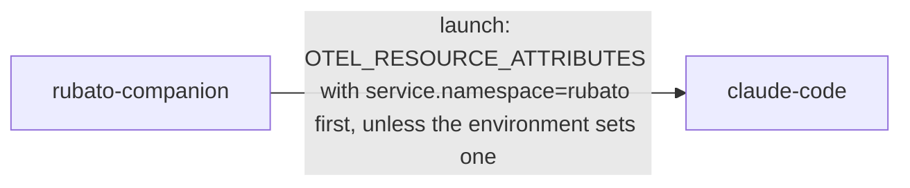

# Rubato's own telemetry carries service.namespace rubato by default

Rubato's parts got a `service.namespace` only from their environment, and the deploy sets none.
On a shared stack their telemetry then has no namespace: it cannot be matched to Rubato's own
map, nor selected by a workspace that lists the namespaces it reads (#288). Each part of Rubato
now emits `rubato` unless its environment sets another (ADR 0080). Design:
`docs/plans/290-rubato-namespace/design.md`.

## What the change does

- `rubato-server` and `rubato-companion` export spans and metrics with
  `service.namespace=rubato` when the environment sets no namespace.
- A session a companion launches has `service.namespace=rubato` in its
  `OTEL_RESOURCE_ATTRIBUTES` (and the `RUBATO_` mirror) when the developer's environment has none.
- The skill scripts and the plan check send their spans in `rubato` when the resource
  attributes they read have none.
- A namespace set in the environment is kept everywhere.

## How we'll know it works

- [ ] `kernel/telemetry.rs` in server and companion,
  `the_namespace_defaults_to_rubato_and_the_environment_wins`: a resource without a namespace
  gets `rubato` and keeps its other attributes; one with `team` keeps `team`.
- [ ] `launch/script.rs`, `without_an_inherited_namespace_the_session_is_in_rubato`: the
  script run under `sh`, with no inherited attributes and with another attribute; and
  `the_resource_attributes_are_merged_and_mirrored` fails if `rubato` is added over `team`.
- [ ] `crates/rubato-companion/features/worktree.feature`: the stand-in claude of a real launch
  received `service.namespace=rubato`.
- [ ] `skills/rubato/test/otel-emit.test.ts`: the default, another attribute beside it, the
  environment's and the mirror's namespace winning; `otel-names.test.ts`: the TypeScript
  constant equals the one in `otel.rs`.
- [ ] `e2e/run.ts` session-telemetry check: every stand-in log's attributes include
  `service.namespace=`.

## What it must not break

- A developer's or a deploy's own namespace: the tests above each have a case that fails when
  the default wins.
- The launch script stays valid `sh` and an id with a quote stays text:
  `a_node_id_with_a_quote_stays_text` (its expected output now starts with the namespace).
- Matching a call's end to a part (ADR 0059) and the protocol schema: untouched; the schema
  drift check guards the second.
- Hook delivery and the rest of the launch: the companion's Gherkin suite (104 scenarios).

## How we'll debug it at 3 am

See the O-rows. No new span, metric or log line: the change is one resource attribute.

## Affected parts

| Node | Status | What changes | Seams |
| --- | --- | --- | --- |
| rubato-protocol | affected | `DEFAULT_SERVICE_NAMESPACE` in `otel.rs`; no wire type, no schema change | |
| rubato-server | affected | Its telemetry resource gets the default namespace | |
| rubato-companion | affected | Its telemetry resource, and the launch script's resource attributes | companion-claude-code |
| skill-rubato | affected | `otel-emit.ts` starts its resource from the default | |
| plan-check | quiet | Sends through `otel-emit.ts`, so it follows; no code change | |

## Data models

None.

## Data flow

## Tasks

1. `otel.rs`: the constant.
2. Server and companion `kernel/telemetry.rs`: the test (fails), then `resource()` and `namespaced()`.
3. `launch/script.rs`: the tests (fail), then the `case` line; the Gherkin step in `worktree.feature`.
4. `otel-emit.ts`: the tests (fail), then the default in `config()`.
5. `e2e/run.ts`: the session-telemetry check asks for the namespace.
6. ADR 0080, `docs/QUICKSTART.md`, `AGENTS.md`.

## Assumed, not yet approved

| # | Decision | Chosen | Alternatives | Scope |
| --- | --- | --- | --- | --- |
| A1 | A skill run by hand in a connected repo | In `rubato`, like every other part of Rubato | The repo's own namespace | node |
| A2 | `service.namespace=` set to nothing in the environment | Kept as the environment's choice | Treated as unset | node |
| A3 | Rubato's map declaring `service` on its parts, and client and server spans | Not in this change; issue #287 | In this change | node |

## Decisions

| # | Decision | Chosen | Why | Decided by |
| --- | --- | --- | --- | --- |
| 1 | How Rubato's own telemetry gets a namespace | Rubato sets a default, the environment wins | No setup on each machine | Mattias Jonsson, 2026-11-18 |
| 2 | The default's value | `rubato` | One team, one Rubato | Mattias Jonsson, 2026-11-18 |

## O-rows

| Seam | Breaks like | Signal | Panel | Owner |
| --- | --- | --- | --- | --- |
| companion-claude-code | A launched session's telemetry has no `service.namespace`, or a developer's own is replaced | `e2e/run.ts` check `session-telemetry`; in production, `rubato.skill.command` spans and Claude Code metrics for a `rubato.issue` without `service.namespace` | rubato-overview: "Cost per issue" | rubato-companion |

## Flows

| From | To | Seam | Kind | Carries |
| --- | --- | --- | --- | --- |
| rubato-companion | claude-code | companion-claude-code | control | launch: OTEL_RESOURCE_ATTRIBUTES, now with service.namespace=rubato unless the environment sets one |

## ADRs proposed

| ADR | File | Blob |
| --- | --- | --- |
| 0080 | docs/decisions/0080-rubatos-own-telemetry-carries-the-rubato-namespace.md | 26a2da70db88c2ff5a55673342b62253bd05866f |

## Review map

1. `crates/rubato-companion/src/launch/script.rs`: the one `case` line of shell, and that a developer's namespace is never replaced.
2. `docs/decisions/0080-rubatos-own-telemetry-carries-the-rubato-namespace.md`: what it supersedes in ADR 0061 and narrows in ADR 0059.
3. `crates/rubato-server/src/kernel/telemetry.rs` `namespaced()` (the companion's is the same).
