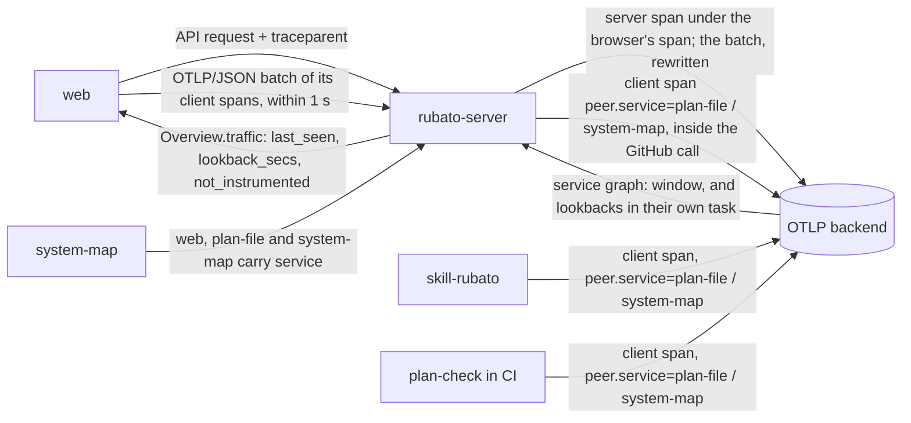

# Every Rubato part shows on its Traffic lens, and parts that cannot be seen are drawn as such

The Traffic lens on Rubato's own map shows only the companion and the server. The other parts are missing for different reasons:

- The skill and plan-check already send call spans to `plan-file`, `system-map` and `github` (ADR 0061). But `plan-file` and `system-map` name no service, so those calls match no part.
- plan-check in CI has no OTLP settings.
- The browser sends nothing at all.

And since #298 the lens fades every part without calls in the window. That reads "silent" for parts nobody can observe and for parts that run a few times a day. This plan makes the web, the skill, plan-check, the two files and the server's reads of them show up where they can, and draws the rest for what it is. Design note: [`300-every-part-on-traffic/design.md`](300-every-part-on-traffic/design.md).

## What the change does

- In the Traffic lens, calls from the web to the server show as a live `web-server` pipe. The browser makes its own client spans and the server relays them, so the service graph sees both ends of each call (ADR 0082).
- The skill's and plan-check's reads and writes of the plan file and the map show on `skill-plan-file`, `plan-check-plan-file` and `skill-system-map`, because `plan-file` and `system-map` carry a `service`, as `github` does.
- The server's own reads of plan files and the map, through GitHub, show on `server-plan-file` and `server-system-map`.
- plan-check runs in CI with OTLP settings, so a pull request's plan check is a span and a call on the map.
- Every part and seam in the Traffic lens is in one of three states (ADR 0083):
  - **observed**: calls in the report's window, drawn as since #298;
  - **quiet**: it carries `service` but had no calls in the window. Drawn plainly with "last seen within 6 h", "within a day" or "within a week". It is faded with "not seen in 7 d" only when a lookback has run and did not see it. Before any lookback it is plain, with no chip.
  - **not instrumented**: it carries no `service` (or a seam has such an end). Drawn neutral and hatched with "not instrumented", never faded as silent.

## How we'll know it works

- [ ] `web/src/shared/trace.test.ts`:
  - every `request()` sends a valid `traceparent`;
  - the recorded client span has that trace and span id, the method, the route template and the status;
  - a batch flushes within 1 s of its first span and is cut at 60 KiB;
  - the relay post itself is not traced;
  - a 404 from the relay turns sending off for the page;
  - a 401 from the relay does not raise needs-login.
- [ ] `crates/rubato-server/src/telemetry_relay/tests.rs`:
  - the relay forwards a valid batch with its resource set to `web` in Rubato's namespace;
  - each span is renamed from its method and a route template the server knows, its other attributes, status message and out-of-range times dropped;
  - a span with an unknown route or not client-kind is dropped;
  - refusals: no login (401), over 256 KiB (413), not OTLP/JSON or no spans or over 512 (400), past the per-login token bucket (429);
  - 404 when the server exports no traces;
  - each outcome counts once in `rubato.telemetry.relay`.
- [ ] `crates/rubato-server/tests/http_trace.rs` (with an OTel layer installed, so a missing parent cannot pass by accident):
  - a request with a valid `traceparent` makes a server-kind `rubato.http.request` span whose parent is the browser's span;
  - a request without one, or with an invalid one, makes none;
  - each case counts once in `rubato.http.traceparent` by `rubato.outcome`.
- [ ] Server GitHub reads: a test that reading a plan file at a branch, and the map, makes a client span with `peer.service=plan-file` and `peer.service=system-map` inside the `rubato.github.call` span.
- [ ] `crates/rubato-protocol` `derive_traffic` tests:
  - on Rubato's own map, a `web(rubato)` → `rubato-server(rubato)` edge lights `web-server`;
  - a quiet instrumented part or seam gets the shortest lookback it was seen in;
  - without a lookback, nothing is last seen and nothing is claimed;
  - a part without `service` and its seams are `not_instrumented` and never `SeamQuiet`;
  - an old report reads with neither field.
- [ ] `crates/rubato-server/src/traffic/` lookback tests:
  - the lookback runs on the first fetch and then every tenth, in its own task with its own timeout;
  - a fake whose 7 d query hangs leaves the window's report `fresh`;
  - a failing lookback keeps the last one's result, and with none keeps "unknown";
  - it keeps every edge it saw, in the window or not.
- [ ] `e2e/run.ts`: a `callPairs` check that a relayed web client span and the server's `rubato.http.request` span share a trace, registered in `e2e/run-checks.ts`.
- [ ] `web/src/features/map/traffic.test.tsx`:
  - an instrumented quiet part reads "last seen within 6 h" at full opacity;
  - before any lookback it has no chip and is not faded;
  - a part without `service` is hatched with "not instrumented";
  - "not seen in 7 d" fades only with a lookback.
- [ ] e2e `@map.traffic-three-states` and `@map.web-on-traffic` (new scenarios in `features/map.feature`) pass; `@map.traffic-first` (from #299) is updated so "a part with no calls steps back" reads as the three states; `pnpm scenarios check` passes.
- [ ] Observed after deploy:
  - within 10 minutes of using the web, the `web-server` pipe is live on Rubato's own Traffic lens;
  - after a plan check in CI, `plan-check-plan-file` shows "last seen" or is live.

## What it must not break

- **Unknown is never quiet (ADR 0039):** a stale, failing or unconfigured source still draws no state at all. Missing lookback data draws no "not seen". Guarded by the `derive_traffic` tests, the `chevronsOn` tests and `@map.empty-report-says-so`.
- **`SeamQuiet` (ADR 0059):** it keeps requiring both parts to carry `service`. With the server naming its reads, `server-plan-file` and `server-system-map` are not falsely quiet: a `derive_traffic` test pins it.
- **CSP:** the page loads under its Content-Security-Policy with no new origin, because the relay is same-origin (`@security.content-security-policy`).
- **A server without telemetry:** the web gets one 404, then silence, with no console noise (`trace.test.ts`).
- **A slow backend:** a slow lookback never fails the window's report (the hanging-fake test).
- **Reduced motion:** nothing new animates (`motion.spec.ts`).
- **Overview size:** `seen` is capped at `MAX_EDGES` in `TrafficReport::validate`.
- **Unknown API paths:** the probe in `app.rs`'s tests lists the new route.

## How we'll debug it at 3 am

See the O-rows. New signals:

- counter `rubato.telemetry.relay` by `rubato.outcome` (`forwarded`, `off`, `unauthenticated`, `too_large`, `invalid`, `rate_limited`, `export_failed`), and the number of spans dropped per batch, `rubato.telemetry.relay.dropped`;
- counter `rubato.http.traceparent` by `rubato.outcome` (`linked`, `absent`, `invalid`);
- counter `rubato.traffic.lookback` by `rubato.outcome` (`ok`, `failed`, `timeout`), and the log line `traffic lookback` with `rubato.traffic.seen`;
- the log line `telemetry relay export failed` with the status.

## Affected parts

| Node | Status | What changes | Seams |
| --- | --- | --- | --- |
| web | affected | Client spans for its own requests with `traceparent`, posted to the relay within 1 s; carries `service: { namespace: rubato, name: web }`; the Traffic lens draws observed, quiet with last seen, and not instrumented | web-server |
| rubato-server | affected | New slice `telemetry_relay` (`POST /api/telemetry/traces`, checked, rewritten, forwarded over OTLP); HTTP requests with a `traceparent` become server spans under it; its plan-file and map reads through GitHub name `plan-file` and `system-map`; the lookback task beside the Prometheus adapter | web-server, server-system-map, server-plan-file |
| rubato-protocol | affected | `TrafficReport.seen` and `lookback_secs`, `ObservedTraffic.last_seen`, `lookback_secs` and `not_instrumented`, `derive_traffic`; the relay's route and limits; new `otel` names | web-server |
| system-map | affected | `web`, `plan-file` and `system-map` carry a `service`, through the shared draft and the map's pull request | server-system-map, skill-system-map |
| plan-file | affected | Matched by its readers' and writers' `peer.service`, so their calls show on its seams | skill-plan-file, plan-check-plan-file, server-plan-file |
| plan-check | affected | Runs in CI with OTLP settings from repository secrets and `service.namespace=rubato` | plan-check-plan-file |
| skill-rubato | quiet | Unchanged; its existing call spans now match `plan-file` and `system-map` | |

## Data models

| Model | Kind | Part | Change | Crosses | Note |
| --- | --- | --- | --- | --- | --- |
| `TrafficReport.seen`, `TrafficReport.lookback_secs` | type | rubato-protocol | changed | web-server | Additive: every edge a lookback saw, with the shortest lookback, `within_secs`; the longest lookback asked, absent before any |
| `ObservedTraffic.last_seen`, `lookback_secs`, `not_instrumented` | type | rubato-protocol | changed | web-server | Additive: quiet parts and seams with `within_secs`; the lookback asked; parts and seams without a `service` end |
| OTLP/JSON trace batch | event | web | new | web-server | The web's own client spans, `POST /api/telemetry/traces`; the standard OTLP shape, not a Rubato type |
| `traceparent` request header | event | web | new | web-server | W3C Trace Context on each API request the web makes |
| `MapNode.service` on `web`, `plan-file`, `system-map` | file | system-map | changed | server-system-map | `{namespace: rubato, name: web}`; `{name: plan-file}`; `{name: system-map}` in `docs/design/rubato-map.yml` |
| `.github/workflows/ci.yml` plan-check step | file | plan-check | changed | | `OTEL_EXPORTER_OTLP_ENDPOINT`, `OTEL_EXPORTER_OTLP_HEADERS` from secrets, `OTEL_RESOURCE_ATTRIBUTES` |

## Data flow

## Tasks

1. **Protocol.**
   - Failing `derive_traffic` tests:
     - Rubato's map lights `web-server` from a `web(rubato)` edge;
     - a quiet instrumented part and seam are last seen;
     - without a lookback nothing is claimed;
     - a part without `service` and its seams are not instrumented and never quiet;
     - `server-plan-file` is not quiet when the server names its reads;
     - an old report reads with neither field;
     - `validate` rejects a bad lookback and caps `seen`.
   - Then the types, `derive_traffic`, the relay's route and limits, and the `otel` names.
   - Regenerate `schema/protocol` and `web/src/protocol.ts`.
2. **Server, lookback.** Failing tests:
   - first fetch, then every tenth, in its own task and timeout;
   - a hanging 7 d fake leaves the window `fresh`;
   - a failing lookback keeps the last result or "unknown";
   - every edge kept.

   Then the task, the queries and `rubato.traffic.lookback`.
3. **Server, HTTP spans.** Failing `tests/http_trace.rs` with an OTel layer installed: linked, absent, invalid, each counted. Then `make_span_with` on the `TraceLayer`, parsing with `otel::TraceParent::parse` and `set_parent` as `companion_link/ws.rs` does.
4. **Server, its reads.** A failing test that a plan-file read and a map read make client spans with `peer.service`. Then those spans inside the GitHub calls that read a plan file or the map.
5. **Server, relay slice `telemetry_relay`.**
   - Failing tests for each refusal, for the rewrite (a batch claiming `service.name=rubato-server` becomes `web`; an unknown route is dropped; a status message and a far-off time are dropped), and for the token bucket.
   - Then the route with `DefaultBodyLimit`, the forwarder (5 s timeout, OTLP headers read once into `Config` with a names-only `Debug`), and the counters.
   - Add the slice to AGENTS.md's block: the layout test fails until it is there.
   - Add the route to the `known_routes` probe.
6. **Web, the tracer.** Failing `trace.test.ts`, then `web/src/shared/trace.ts` and its use in `api.ts`. Flush within 1 s with `fetch(…, {keepalive: true})` and JSON, at most 60 KiB, untraced.
7. **Web, the lens.**
   - Failing `traffic.test.tsx` cases:
     - quiet with "last seen", unfaded;
     - quiet before any lookback, plain;
     - hatched for not instrumented;
     - "not seen in 7 d" only with a lookback.
   - Then `PartCard`, `SeamChip`, `MapView` and the styles.
   - Add contrast checks for the hatch tokens to `styles.test.ts`.
8. **Scenarios and e2e.**
   - Add `@map.traffic-three-states` and `@map.web-on-traffic`, and update `@map.traffic-first`.
   - The Playwright tests that cite them.
   - The `callPairs` check in `e2e/run.ts`, registered in `e2e/run-checks.ts`.
9. **Map.** Set `service` on `web`, `plan-file` and `system-map`. Done in Rubato's Edit map as a proposed draft, or in the map file in this pull request; either way the map's pull request is merged by a person.
10. **CI.** The plan-check step reads `RUBATO_OTLP_ENDPOINT` and `RUBATO_OTLP_HEADERS` (repository secrets, values added by a person) and sets `OTEL_RESOURCE_ATTRIBUTES=service.namespace=rubato`. With the secrets missing it runs as today, because `otel-emit.ts` reads an empty value as unset.
11. **Observability.**
    - New panels on rubato-overview: "Web spans relayed" (by outcome), "HTTP trace context" (by outcome) and "Traffic lookback" (by outcome).
    - QUICKSTART step 2: the service-graph generator's pairing wait (Tempo `wait`, the connector's `store.ttl`) must cover the relay's 1 s flush and the server's 5 s export, so at least 10 s.
    - The dashboard lint passes.

## Assumed, not yet approved

| # | Decision | Chosen | Alternatives | Scope |
| --- | --- | --- | --- | --- |
| A1 | Lookbacks and how often | 6 h, 1 d and 7 d, each longer than the window. On the first fetch, then every tenth, in their own task with their own timeout. | A range query with steps; every fetch | node |
| A2 | Relay limits | 256 KiB a post, 512 spans, a token bucket per login (burst 4, refilled one every 2 s), 5 s export timeout; the browser cuts at 60 KiB for `keepalive` | One post per 5 s per login, which refuses a second tab in steady state | node |
| A3 | Which HTTP requests become server spans | Only those with a valid `traceparent`; the rest stay internal, so health checks and asset loads draw no virtual `user` node | Every request as a server span | node |
| A4 | The websocket `/ws/web` | Not traced: the browser cannot set headers on it, and the REST calls carry the edge | A span per reconnect, posted with the batch | node |
| A5 | Secret names in CI | `RUBATO_OTLP_ENDPOINT`, `RUBATO_OTLP_HEADERS` | The standard names as secrets | node |
| A6 | The OTLP backend on the map | Stays off the map, as for the server's own export today | A new external part and seam | node |
| A7 | Pairing window | The team's generator is Grafana Cloud Tempo's metrics-generator (10 s wait). The browser flushes within 1 s and the server exports every 5 s. | Raising the wait, which Grafana Cloud does not offer | node |

## Decisions

| # | Decision | Chosen | Why | Decided by |
| --- | --- | --- | --- | --- |
| 1 | How the web shows on the Traffic lens | The browser makes its own client spans and the server relays them; `traceparent` on each request | A real `web → rubato-server` edge; marking the server's spans alone draws a virtual `user` that also counts health checks | Mattias Jonsson, 2026-11-19 |
| 2 | `plan-file` and `system-map` on the map | Each carries a namespaceless `service`, like `github`; `web` carries `{namespace: rubato, name: web}` | The existing `peer.service` calls then match them (ADR 0059), and the relayed spans match `web` | Mattias Jonsson, 2026-11-19 (web added after the design review) |
| 3 | plan-check in CI | OTLP settings from repository secrets | Its calls then show; without the secrets it runs as today. The endpoint is Grafana Cloud's public, authenticated gateway, which GitHub's runners reach. | Mattias Jonsson, 2026-11-19 |
| 4 | How the lens draws parts without calls | Three states: observed; quiet with last seen; not instrumented, hatched, never faded | Fading every part without calls in the window reads silence where there is no instrument, or where a part runs a few times a day | Mattias Jonsson, 2026-11-19 |
| 5 | `server-plan-file` and `server-system-map` once the files carry `service` | The server names its reads: a client span with `peer.service=plan-file` or `system-map` inside the GitHub call that reads them | Otherwise `SeamQuiet` fires falsely on both; nothing is suppressed | Mattias Jonsson, 2026-11-19 |
| 6 | Approval | Approved in chat ("build it") after the design review's blockers were folded in; ADRs 0082 and 0083 stay proposed until accepted | As for earlier plans approved in chat | Mattias Jonsson, 2026-11-19 |

## O-rows

| Seam | Breaks like | Signal | Panel | Owner |
| --- | --- | --- | --- | --- |
| web-server | The web's spans stop reaching the backend, or the relay refuses them, so the pipe goes quiet while people use the web | Counter `rubato.telemetry.relay` by `rubato.outcome`; `rubato.telemetry.relay.dropped`; log line `telemetry relay export failed` with `http.response.status_code` | rubato-overview: "Web spans relayed" | rubato-server |
| web-server | Spans are relayed but do not pair, so the pipe shows few calls or none | Counter `rubato.http.traceparent` by `rubato.outcome` (`linked` falling, `invalid` rising); the `callPairs` check in the e2e run | rubato-overview: "HTTP trace context" | rubato-server |
| web-server | Quiet parts all read "not seen in 7 d", or none reads last seen, because the lookback fails | Counter `rubato.traffic.lookback` by `rubato.outcome`; log line `traffic lookback` with `rubato.traffic.seen` | rubato-overview: "Traffic lookback" | rubato-server |
| server-system-map | A part's `service` matches nothing, two parts claim one, or the server's map reads stop naming `system-map` | The map load error naming the duplicate; span `rubato.github.call` with a child of `peer.service=system-map`; `unmapped_services` on the Traffic lens | rubato-overview: "GitHub calls by endpoint" | system-map |
| server-plan-file | The server's plan reads stop naming `plan-file`, so the seam is falsely quiet | Finding `SeamQuiet` on `server-plan-file`; span `rubato.github.call` with a child of `peer.service=plan-file` | rubato-overview: "GitHub calls by endpoint" | plan-file |
| skill-system-map | The skill's map reads stop matching `system-map` | Span `rubato.skill.call` with `peer.service=system-map` and `service.name=rubato`; the seam reads "not seen in 7 d" while plans are written | rubato-overview: "Traffic lookback" | system-map |
| skill-plan-file | The skill's plan writes stop showing | Span `rubato.skill.call` with `peer.service=plan-file`; the seam reads "not seen" while plans are written | rubato-overview: "Traffic lookback" | plan-file |
| plan-check-plan-file | plan-check in CI stops emitting (secret removed or expired) | Span `rubato.skill.command` with `service.name=plan-check`; the CI log line `rubato.plan.check` keeps printing while the seam reads "not seen" | rubato-overview: "Traffic lookback" | plan-check |

## Flows

| From | To | Seam | Kind | Carries |
| --- | --- | --- | --- | --- |
| web | rubato-server | web-server | data | the web's own client spans as an OTLP/JSON batch, and a `traceparent` on each API request (ADR 0082) |
| rubato-server | web | web-server | data | Overview.traffic with when each quiet part and seam was last seen, the lookback asked, and which are not instrumented (ADR 0083) |

## ADRs proposed

| ADR | File | Blob |
| --- | --- | --- |
| 0082 | docs/decisions/0082-the-web-sends-its-own-spans-through-the-server.md | 1ac4de0fd30250649344b1582855a7c032e2cb4d |
| 0083 | docs/decisions/0083-traffic-says-when-a-quiet-part-was-last-seen.md | 8b7552f29257a63f7403a4faa8b47bb078c2f4a9 |

## Review map

1. `crates/rubato-server/src/telemetry_relay/`: what the relay lets through. It runs as the logged-in person, renames spans from routes the server knows, rewrites the resource, and drops the rest. Check that nothing from the browser can claim another service, carry free text, or reach the backend's credentials.
2. `crates/rubato-protocol/src/traffic.rs` `derive_traffic`: the three states; that missing lookback data never reads as "not seen"; and that a stale or failing report still gives none of them.
3. `crates/rubato-server/src/traffic/`: the lookback task's timeout and cadence. A hanging 7 d query must never fail the window's report.
