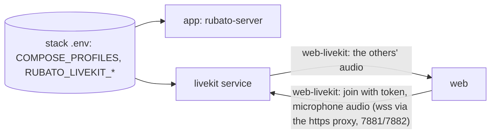

# Ship LiveKit in Rubato's stack behind a voice profile

Issue: #315 · Small track · ADR 0073 (accepted) unchanged. Room voice (#146) needs a LiveKit
server beside Rubato, and nobody runs one. Mattias asked on 2026-11-25 whether it could ship with
Rubato as a feature to switch on. This puts the stack's compose file in the repo and adds LiveKit
as an optional service under a compose profile `voice`, so voice becomes one switch in the stack's
`.env`. Rubato itself still never starts or supervises LiveKit; the stack does.

## What the change does

- **The stack is in the repo.** `deploy/compose.yaml` holds the `app` service as it runs on the
  host today (pinned `local/rubato:sha-…`, `pull_policy: never`, the same health check and log
  rotation).
- **LiveKit ships with it, off by default.** A `livekit` service, image
  `livekit/livekit-server:v1.13.11`, under `profiles: ["voice"]`: it runs only when the stack's
  `.env` sets `COMPOSE_PROFILES=voice`. Host networking, signalling on `127.0.0.1:7880` for the
  https proxy, ICE on 7881/tcp and one UDP port, 7882.
- **One key pair.** LiveKit reads its keys from `RUBATO_LIVEKIT_API_KEY` and
  `RUBATO_LIVEKIT_API_SECRET`, the names Rubato already signs tokens with; `livekit.yaml` holds
  no keys.
- **How to turn it on and off** is in `deploy/README.md`, with what the https setup (#276) must
  give LiveKit.

## How we'll know it works

- [ ] `node --test deploy/compose.test.ts`: `livekit` only in profile `voice`, `app` in none; the
  LiveKit image pinned to an exact `vX.Y.Z`; `LIVEKIT_KEYS` built from the two
  `RUBATO_LIVEKIT_*` names; no `keys:` in `livekit.yaml`. It prints how many services and rules
  it checked. The fixture `deploy/fixtures/bad/` (`latest`, keys in the file, `app` in a profile)
  must fail every rule.
- [ ] `docker compose -f deploy/compose.yaml config --services` lists `app`; with
  `COMPOSE_PROFILES=voice`, `app` and `livekit`.
- [ ] Locally, `docker compose --profile voice up livekit` with a test key pair: the health check
  turns healthy and `GET http://127.0.0.1:7880/` answers `OK`.
- [ ] By hand, once https is up and the profile is on: two logins hear each other in one plan
  room (plan #146, decision 10), and the Voice panel shows no `rubato.voice.join_failed`.

## What it must not break

- ADR 0073: Rubato never starts, supervises or connects to LiveKit. No crate or web code
  changes; the voice slice's source test stays as it is.
- With the profile and `RUBATO_VOICE` unset, the stack runs exactly as today: `app` in
  `deploy/compose.yaml` matches the host's `compose.yaml` but for the image tag (compared by hand
  at the first deploy from the repo).
- `RUBATO_VOICE` off still means every voice route answers 404 `voice_off` and the CSP is as ADR
  0066 says (existing server tests).

## How we'll debug it at 3 am

See the O-rows. Nothing new is emitted. A failed join already reports
`rubato.voice.join_failed{rubato.reason}`: `signal` points at the https proxy or 7880, `ice` at
7881/7882 or `LIVEKIT_NODE_IP`. The container's own state is `docker compose ps livekit` (health
check) and `docker compose logs livekit`.

## Affected parts

| Node | Status | What changes | Seams |
| --- | --- | --- | --- |
| livekit | affected | runs as the `livekit` service in Rubato's stack under the `voice` profile, pinned v1.13.11, keys from Rubato's env | web-livekit |
| web | quiet | joins LiveKit as before; only the URL it is given now points at the stack's LiveKit | web-livekit |

## Data models

| Model | Kind | Part | Change | Crosses | Note |
| --- | --- | --- | --- | --- | --- |
| `deploy/compose.yaml` | file | livekit | new | | the stack: `app` as today, `livekit` under profile `voice` |
| `deploy/livekit.yaml` | file | livekit | new | | ports, bind address, one UDP port; no keys |

## Data flow

## Tasks

1. `deploy/compose.test.ts` with fixtures first: `deploy/fixtures/bad/` must fail every rule;
   then `deploy/compose.yaml` and `deploy/livekit.yaml` until the real files pass. Add
   `pnpm deploy:test` and run it in CI next to `observability:test`.
2. Run `docker compose config` both ways, and the profile locally with a test key pair until the
   health check is healthy.
3. `deploy/README.md`: on, off, what the https setup must give, firewall ports, the 3 am row.
4. AGENTS.md layout gets `deploy/`; `.claude/profiles/dockge.md` says deploys copy `deploy/`
   files and lists the voice env names.
5. After merge and once https is up (#276): Mattias deploys with the dockge skill, exact
   commands approved first; then the voice answer on #279.

## Assumed, not yet approved

| # | Decision | Chosen | Alternatives | Scope |
| --- | --- | --- | --- | --- |
| A1 | LiveKit's network | `network_mode: host`, signalling bound to `127.0.0.1` | bridge with `NODE_IP` and published ports | node (livekit) |
| A2 | UDP | one port, 7882 (mux) | the 50000–60000 range | node (livekit) |
| A3 | TURN | none; LAN only, as design §9 of #146 says suffices on the home server | LiveKit's built-in TURN on 3478/udp | node (livekit) |
| A4 | Memory | `mem_limit: 256m` on a host with about 1.4 GiB free | no limit | node (livekit) |

## Decisions

| # | Decision | Chosen | Why | Decided by |
| --- | --- | --- | --- | --- |
| 1 | What ships with Rubato | LiveKit only, no local speech service | the host has 2 CPUs and ~1.4 GiB free; a speech provider can be added by configuration later | Mattias Jonsson, 2026-11-25 |
| 2 | How it is built in | an optional service in the same compose stack, behind a profile | fits ADR 0073 as written ("beside Rubato", never started by Rubato); one switch, one deploy | Mattias Jonsson, 2026-11-25 |
| 3 | https | solved in another context (#276); this plan only states what it must give LiveKit | keeps this change to the stack | Mattias Jonsson, 2026-11-25 |

## O-rows

| Seam | Breaks like | Signal | Panel | Owner |
| --- | --- | --- | --- | --- |
| web-livekit | the `livekit` service is down or unhealthy, the proxy does not reach 7880, 7881/7882 blocked, the node IP wrong, or the keys differ from Rubato's | counter `rubato.voice.join_failed{rubato.reason}` (`signal`, `ice`, …) against `rubato.voice.tokens{rubato.outcome}`; the log line `voice join failed`; `docker compose ps livekit` health | Rubato overview → Voice | web |

## Flows

None.

## ADRs proposed

None.

## Review map

1. `deploy/compose.yaml`: the `app` service must match the host's stack, and `LIVEKIT_KEYS` must come from Rubato's names.
2. `deploy/livekit.yaml`: bind address and ports, against design §9 of #146.
3. `deploy/compose.test.ts`: the fixture that must fail.
