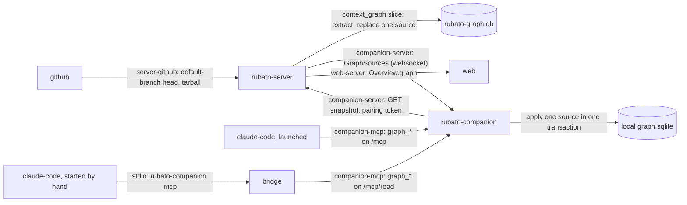

# 322: a repository context graph, generated by Rubato and read by agents through their companion

Plan: [../322.md](../322.md) · ADRs: [0084](../../decisions/0084-a-context-graph-per-source-generated-by-the-server.md),
[0085](../../decisions/0085-tree-sitter-parses-source-for-the-context-graph.md),
[0086](../../decisions/0086-the-context-graph-reaches-agents-through-each-companion.md) (all
proposed) · Issue: m0x6A/rubato#322 · Map: new flows on `server-github`, `companion-server`,
`companion-mcp` and `web-server`; no new part.

This is a design issue. It decides what the graph holds, where it is generated and kept, how it
reaches each developer machine and how an agent reads it, and splits the build into one follow-up
issue per slice (§12). Nothing here is built in this PR; the map and the ADRs are.

## 1. What an agent knows today

| Knowledge | How an agent gets it | Limit |
| --- | --- | --- |
| Map parts, seams, flows | `map.ts`, from the local clone of the map repo (ADR 0010) | needs the clone; drops a part's `path` and `service` (`skills/rubato/scripts/map.ts:45-54`) |
| Accepted ADRs | `adrs.ts`, from the same clone | the map repo's ADRs only; all of them, every time |
| Its own assignment and plan status | `get_assignment`, `plan_status` on the companion's MCP (ADR 0071) | sessions Rubato launched only |
| Issues, pins, plans, pull requests of the team | nothing; they are in the web's Overview | an agent cannot ask "what else touches this seam?" |
| Where code lives and what depends on it | reading and searching its own worktree, every session, from nothing | each agent rebuilds the same picture, on its own branch, and two agents can disagree |

A session a person starts by hand has the first two rows and nothing from Rubato (ADR 0078).

## 2. What changes

Rubato generates one context graph, on a timer, and every agent reads the same one, read-only,
through its own companion. The four choices behind this were made by Mattias Jonsson on
2026-11-26 (plan Decisions 1–4):

1. The graph holds what Rubato already joins, the repositories' decision documents, and a code
   graph (symbols, imports).
2. Agents read it through each person's companion, from a copy the server sends.
3. It covers every repository the maps name.
4. It is regenerated every 15 minutes by default.



## 3. What the graph holds

### 3.1 Sources

The graph is a set of **sources**. A source is regenerated whole and replaced whole; nothing
patches a source in place. That is what "regenerated on a timer" means here, and it is what makes
a copy easy to reason about: a source is at one head, with one hash.

| Source key | Built from | Rebuilt when |
| --- | --- | --- |
| `repo/<owner>/<name>`, one per repository the maps name (`AppState::union_repos`, ADR 0048) that the App installation covers | the repository's tarball at its default-branch head, read as the GitHub App | the head sha or the generator version changed |
| `workspace/<id>`, one per workspace | that workspace's loaded map and its pins | every tick; written and announced only when its content hash changed |
| `team`, one | the facts the server keeps per repository and shares across workspaces (ADR 0047): repositories, pinned issues, plans, open pull requests, through the roots of `pins`, `plans` and `github_poll` | every tick; written and announced only when its content hash changed |

A repository the installation does not cover (`uncovered_repos`, ADR 0048) gets no source; the
Overview already reports it as a finding.

### 3.2 Nodes

Every node has an id, a kind, a name, and where they apply a repo, a path and a line range. Ids
are global and readable, and each id is produced by exactly one source, so `graph_node(id)` has
one answer.

| Kind | Id | Source | Carries |
| --- | --- | --- | --- |
| `part` | `part:<workspace>/<map id>` | workspace | the map node: kind, description, `repo`, `path`, `service`, retired |
| `seam` | `seam:<workspace>/<map id>` | workspace | owner, carries, guard, description, retired |
| `repo` | `repo:<owner>/<name>` | team | plan path template, which workspaces name it |
| `issue` | `issue:<owner>/<name>#<n>` | team | open or closed; the title only when its author is trusted (§9); **pinned issues only** |
| `plan` | `plan:<owner>/<name>#<n>` | team | title, map version, whether it is approved, its path |
| `pull` | `pull:<owner>/<name>#<n>` | team | title, branch; open pull requests whose head is in the repo |
| `file` | `file:<owner>/<name>:<path>` | repo | language, size in lines |
| `symbol` | `sym:<owner>/<name>:<path>#<qualified name>` | repo | kind (function, type, trait, impl, class, interface, constant, module), line range, one signature line, the first line of its doc comment |
| `package` | `pkg:<owner>/<name>:<ecosystem>/<package>` | repo | an import that leaves the repository (`cargo/serde`, `npm/react`) |
| `adr` | `adr:<owner>/<name>:<number>` | repo | title, status, date, the `Seam:` field, the Decision section capped at 4 KiB |
| `scenario` | `scenario:<owner>/<name>:@<capability>.<slug>` | repo | the scenario's name and feature file (ADR 0069) |
| `slice` | `slice:<owner>/<name>:<deployable>/<name>` | repo | description and the tables it owns, from an AGENTS.md slice block when the repo has one |

Kinds travel as strings. A reader keeps a node or edge whose kind it does not know, so a later
kind is additive for an older companion (S1 has the fixture).

Not nodes: progress states and sessions (progress is derived and a session is live state, not
repository context), findings, traffic, room and chat text, and the map's journeys. A later ADR
may add any of them.

### 3.3 Edges

| Kind | From → to | Source |
| --- | --- | --- |
| `joins` | seam → part (role `from`, `to`; `owner` marked) | workspace |
| `flow` | part → part (detail: seam, `data` or `control`, carries) | workspace |
| `backed_by` | part → repo (detail: path) | workspace |
| `pinned_to` | issue → part or seam | workspace |
| `plans` | plan → issue | team |
| `affects` | plan → `map:<id>` (detail: status, what changes) | team |
| `touches` | plan → `map:<id>` | team |
| `cites` | plan → adr | team |
| `for` | pull → issue (the branch names the issue) | team |
| `defines` | file → symbol | repo |
| `imports` | file → file, or file → package | repo |
| `references` | file → symbol, resolved by name (§4.3) | repo |
| `supersedes` | adr → adr | repo |
| `governs` | adr → `map:<id>` for each id in its `Seam:` field | repo |

An edge may point at a node of another source: a pin points from an issue the team source holds
to a part the workspace source holds. Such an edge is kept even when its target is not in the
copy yet, and resolves when it is.

Two things are **resolved when asked, not stored**, so that sources stay independent:

- **`map:<id>`.** A plan and an ADR name map ids without a workspace. The id is resolved against
  the `part` and `seam` nodes of every workspace that names the plan's or ADR's repo, as ADR
  0045 resolves ids.
- **Which part owns a file.** The part whose `repo` and `path` is the longest prefix of the
  file's path, among the workspaces that name the repo. A map change therefore never forces a
  repository rebuild.

## 4. Generation, on `rubato-server`

A new slice `context_graph`, shaped like `traffic` (`crates/rubato-server/src/traffic/`): a
supervisor that follows the workspace registry, a generation number per source so a cancelled
build never writes after its replacement (`traffic/fetch.rs:57`), and explicit states. It is
behind `RUBATO_CONTEXT_GRAPH`, off by default, read the way `RUBATO_VOICE` is
(`kernel/config.rs:106-113`).

With the flag on, the server requires the GitHub App (ADR 0022) unless it is local in ADR 0064's
sense, and refuses to start with `RUBATO_OPEN_LOGIN=1`: on an open server any GitHub account
could pair and read the graph (§6.2).

### 4.1 The tick

Every `RUBATO_GRAPH_REGEN_SECS` (default 900, clamped to 300–86400 with a warning, the way
`traffic_fetch_secs` clamps, `kernel/config.rs:919`):

1. **Repo sources, one at a time across the whole server.** Ask GitHub for the default-branch
   head sha: one call. If the sha and the generator version are the ones stored, record
   `checked_at` and go on. Otherwise stream the tarball at that sha, extract (§4.2–§4.3) in
   `spawn_blocking`, and replace the source (§5).
2. **The workspace sources and the team source.** Build nodes and edges from the loaded maps and
   the other slices' roots, hash them, and replace a source only when its hash differs from the
   stored one.
3. A source whose repository or workspace is no longer configured is removed, as
   `github_poll::forget_repo` does (`github_poll/store.rs:172`).

A failed build keeps the previous rows and records the error on the source (the
`record_listing_error` pattern, `github_poll/store.rs:165`): agents keep reading the last good
graph, with its age.

Two new methods on the `GitHubApi` port (`kernel/github/api.rs:221`), both with the client-span
attributes that `every_github_call_span_is_a_client_span_that_names_its_peer` demands, both
counted on `rubato.github.calls`, both seeded in `FakeGitHub` and `LocalGit`:

- `default_head(repo) -> Option<String>`: the default branch's head sha.
- `tarball(repo, sha)`: a byte stream, with its own total deadline (120 s) and no retry inside a
  tick; the next tick is the retry. The redirect to the archive host is followed inside the one
  client span.

The App's Contents: read permission already covers both (`docs/QUICKSTART.md:34`). Budget: one
call per repository per tick while nothing changes, which is 4 per repository per hour at the
default; one more per change of head. A push webhook (ADR 0074) could trigger a build at once; it
is left out of the first version (plan A7).

### 4.2 Files and documents

The tarball is read as a stream, entry by entry, through a bounded reader; neither the archive
nor the repository is ever whole in memory or on disk.

- every tracked file becomes a `file` node, with its language from its extension;
- `docs/decisions/*.md`, or the `decisions` directory the map names: the header fields of
  `0000-template.md` and the Decision section, with the rules `adrs.ts` already uses
  (`skills/rubato/scripts/adrs.ts:35-48`), ported to Rust with shared fixtures;
- `features/**/*.feature`: each `@<capability>.<slug>` tag and the scenario's name;
- `AGENTS.md`: each `<!-- slices: <deployable> -->` block, the lines the slice test already
  parses (`crates/rubato-server/src/slices.rs:517`).

A repository without one of these simply has no such nodes. A document that does not parse is
counted and skipped; it never fails the build.

### 4.3 Code

Source files are parsed with tree-sitter (ADR 0085), first for Rust, TypeScript, TSX and
JavaScript. A file in any other language stays a `file` node.

- **Symbols** come from each grammar's tags query: definitions of functions, types, traits,
  impls, classes, interfaces, constants and modules, with a line range, one signature line (at
  most 200 characters) and the first line of the doc comment.
- **Imports**: a relative TypeScript import and a Rust `mod` or `use crate::…` resolve to a file
  in the repository; anything else becomes a `package` node.
- **References** are resolved by name, and say so: a referenced identifier becomes a
  `references` edge only when it names exactly one definition among the files the referencing
  file imports, or, failing that, exactly one in the repository. An ambiguous or unknown name is
  counted (`unresolved`) and not stored. This is a map of where to look, not a call graph a
  compiler would sign.

Skipped for parsing: files over 512 KiB, lockfiles, and files under `node_modules`, `target`,
`dist` or `vendor` when a repository tracks them. The crate versions and the tags API are to be
checked against the crates' own documentation when S5 is built, not taken from this note.

### 4.4 What is not stored

- **No file contents.** For code: names, paths, line ranges, one signature line, one doc line.
  An agent that needs the body reads it in its own worktree; the graph says where.
- **Decision text, capped.** An ADR's Decision section up to 4 KiB; a scenario's name; a slice's
  one line.
- **Nothing from a pull request's head or a fork.** Repository content comes from the default
  branch only.

### 4.5 Caps

All in `rubato-protocol::limits`, each with a counter and a `truncated` mark on the source,
never a failed build. The first four belong to generation (ADR 0084); the last two are values of
the `companion-server` contract (ADR 0086).

| Cap | Value |
| --- | --- |
| tarball, compressed | 256 MiB |
| tarball, uncompressed bytes read | 1 GiB |
| files per repository | 50 000 |
| nodes, and edges, per source | 250 000 and 1 000 000 |
| sources announced | 64 |
| snapshot, compressed and uncompressed | 64 MiB and 512 MiB |

### 4.6 Two writers, a retry, a timeout

| Case | What keeps it right |
| --- | --- |
| a tick starts while the previous build of a source still runs | one build per source: the tick skips that source and counts `busy` |
| two repositories change at once | repo builds run one at a time across the server, so the burst is one tarball and one parse |
| a source is removed while its build runs in `spawn_blocking`, which cannot be cancelled | removal bumps the source's generation; the replace checks the generation inside its `BEGIN IMMEDIATE` transaction, as a compare on the `sources` row, and writes nothing when it lost |
| the server stops mid-replace | the transaction rolls back; the old source is whole |
| the maps have not loaded, or `union_repos()` is empty after a failed map load | no source is removed on such a tick; otherwise one bad tick would empty every companion's copy, because the announced list is the truth (§6.1) |
| the tarball stalls | its own deadline ends the build as failed; the previous rows stay |
| a snapshot is read while a replace commits | the snapshot is read in one read transaction; it is the old source or the new one |

## 5. The store

The graph lives in its own SQLite file, `rubato-graph.db` beside the main database
(`RUBATO_GRAPH_DATABASE_URL`), opened by the `context_graph` slice with its own pool. It is
derived data: deleting the file costs one tick.

```sql
PRAGMA user_version = 1;          -- on any other value the file is deleted and rebuilt
CREATE TABLE sources (
  source TEXT PRIMARY KEY,        -- repo/<owner>/<name> | workspace/<id> | team
  kind TEXT NOT NULL,             -- repo | workspace | team
  generation INTEGER NOT NULL,    -- bumped by every build start and by removal
  head_sha TEXT,                  -- repo sources
  map_version TEXT,               -- workspace sources
  generator INTEGER NOT NULL,     -- bumped when extraction changes
  content_hash TEXT,              -- sha256 over the snapshot body, NULL before the first build
  generated_at TEXT,              -- when the stored rows were built
  checked_at TEXT,                -- when a tick last found them current
  attempted_at TEXT, error TEXT,  -- the last failed build, if it is the newest attempt
  nodes INTEGER NOT NULL DEFAULT 0, edges INTEGER NOT NULL DEFAULT 0,
  truncated INTEGER NOT NULL DEFAULT 0
);
CREATE TABLE nodes (
  source TEXT NOT NULL, id TEXT NOT NULL PRIMARY KEY, kind TEXT NOT NULL, name TEXT NOT NULL,
  repo TEXT, path TEXT, line INTEGER, end_line INTEGER, summary TEXT, detail TEXT
);
CREATE INDEX nodes_by_source ON nodes (source);
CREATE INDEX nodes_by_path ON nodes (repo, path);
CREATE TABLE edges (
  source TEXT NOT NULL, from_id TEXT NOT NULL, kind TEXT NOT NULL, to_id TEXT NOT NULL,
  detail TEXT
);
CREATE INDEX edges_by_source ON edges (source);
CREATE INDEX edges_out ON edges (from_id, kind);
CREATE INDEX edges_in ON edges (to_id, kind);
CREATE VIRTUAL TABLE nodes_fts USING fts5 (name, path, summary, source UNINDEXED, id UNINDEXED);
```

FTS5 is compiled into the bundled SQLite the workspace already builds
(`libsqlite3-sys` 0.30.1, `build.rs:129`). `nodes_fts` is an ordinary FTS5 table that
`replace_source` deletes from and fills in the same transaction, so there are no triggers to
keep in step.

**Replacing a source** is one transaction, `BEGIN IMMEDIATE` (the #307 lesson: a deferred
read-then-write gets `SQLITE_BUSY` at once in WAL): check the generation, delete the source's
rows from `nodes`, `edges` and `nodes_fts`, insert the new ones, update its `sources` row.
Readers see the old source or the new one, never half.

**One code path for the hash.** A snapshot body is the source's nodes ordered by id, then its
edges ordered by (`from_id`, `kind`, `to_id`, `detail`), each as one JSON line with a fixed field
order and `detail` with sorted keys. `content_hash` is the sha256 of those lines. The function
that writes a snapshot is the one that computes the hash at build time, and a test asserts that
the stored hash equals the hash of the served body after a reopen.

**Why its own file.** A repository source is a hundred thousand rows replaced at once. In the
main database that write would hold the single writer while the poll, hooks and web writes wait
on it. A separate file has its own writer.

**One crate for both sides.** The schema, `replace_source`, the snapshot reader and writer (§6)
and the queries (§7) live in a new library crate, `crates/rubato-graph`, used by `rubato-server`
(build, serve snapshots, status) and `rubato-companion` (apply, answer tools). It holds no slice
and names neither binary. `rubato-protocol` stays without I/O and carries the wire types.

**Dependencies.** The server gains `tar` and `flate2` (both MIT OR Apache-2.0) to read the
tarball and write snapshots, besides tree-sitter (ADR 0085). The companion gains `sqlx` with the
`sqlite` feature, `flate2` and `sha2` (all MIT OR Apache-2.0); the workspace already compiles
`sqlx` and `sha2` for the server. Each is pinned as its siblings are; ADRs 0084 and 0086 record
them.

## 6. To each companion

### 6.1 Announce

A companion that can keep a copy announces capability `context_graph` in `Hello`; a server with
the flag on announces it in `Welcome`. To such a companion, **when its owner may read the graph
(§6.2)**, the server sends `ServerMessage::GraphSources`, the whole list each time (at most 64),
after every `Welcome` and whenever a source was replaced or removed:

```json
{ "sources": [ { "source": "repo/m0x6A/rubato", "kind": "repo", "head_sha": "b35788b…",
    "content_hash": "sha256:…", "generated_at": "2026-11-26T17:00:04Z",
    "nodes": 5120, "edges": 21877, "truncated": false } ] }
```

The list is the truth: the companion fetches what differs from its copy and deletes the sources
the list no longer names. A `Welcome` that no longer announces `context_graph` (the flag went
off, an older server) changes nothing in the copy: it stays, answers with its age, and
`graph_status` says the server no longer offers the graph.

### 6.2 Who may read, and the fetch

The bytes do not travel on the websocket. The companion asks for them:

`GET /api/graph/snapshot?source=<source key>`, `Authorization: Bearer <pairing token>`.

**Who may read.** A pairing is a long-lived credential: nothing re-checks it against the team
today (`pairing/store.rs:204-210`), while a web session counts only with a team record at most
7 days old (ADR 0022, `auth/current_user.rs:50`). The graph holds file and symbol names of every
map repository, so the pairing alone must not open it. A pairing reads the graph only while its
owner has a **fresh team record**: a web session of that login whose `team_checked_at` passes
`team::record_is_fresh`, the same rule, the same 7 days. So a person who loses access to the
App's repositories stops receiving the graph within 7 days, as they stop seeing the web. The
price: the owner of a headless companion logs in to Rubato at least once a week to keep its copy
fresh.

- A known, unrevoked pairing whose owner's record is fresh: 200.
- A known pairing whose owner's record is stale or absent: 403 `team_record_stale`, counted; no
  `GraphSources` is sent to it either. The companion keeps its copy and marks it *not
  refreshed: log in to Rubato*.
- An unknown or revoked token: 401, counted. On a 401 the companion deletes its copy the next
  time it sees one, which is when it next reaches the server.
- The token opens this one route and nothing else. `a_companions_token_is_not_a_web_session`
  (`auth/current_user.rs:80-102`) uses a literal string; the new cases pair first and use the
  real token: 401 on `/api/overview` with it, and 401 on the snapshot route with a web session
  cookie.
- With the flag off the route answers 404 `context_graph_off`.

**The body** is gzipped NDJSON: one header line (`GraphSnapshotHeader`: format, source, head,
generator, `content_hash`, counts), then the lines of §5, read in one read transaction.

**The transport** is the companion's server URL, through the same gate as the websocket
(`server_link/client.rs:34-49`): TLS, except on loopback or for a pairing made with `--insecure`
(ADR 0067). On the team's own plain-http server the snapshot is as exposed as the websocket
already is, and no more.

**Why not the websocket.** One socket carries `LaunchCommand` and `SessionMessage`. A snapshot
of tens of megabytes in chunks would queue a launch behind it, and every envelope is also stored
in `companion_events`.

### 6.3 Apply

The companion's new slice `graph` runs one best-effort task: for each differing source, in turn,
fetch, decompress under the cap, check the hash against the header and the announce, and call
`replace_source` on `<state dir>/graph.sqlite`. The file and its `-wal` and `-shm` are 0600, in
the 0700 state dir; a `user_version` other than the crate's deletes the file and fetches again.

| Case | What happens |
| --- | --- |
| the server is unreachable, or 5xx | the copy stays; retried on the next announce and every 5 minutes |
| the hash does not match | the download is dropped and counted `hash_mismatch`; the copy stays |
| the server built a newer one meanwhile | the header's hash is not the announced one: dropped, the next announce is already on its way |
| the companion stops mid-apply | the transaction rolls back; the old copy is still whole |
| 403 `team_record_stale` | the copy stays and is marked not refreshed; retried every 5 minutes |
| 401 | the copy is deleted |
| a source is over a cap | the server marked it `truncated`; the copy says so in every answer |

With the link down the tools keep answering from the copy, and every answer says how old it is.

**What leaves the machine: nothing new.** The copy flows in. ADR 0052 is untouched.

**Who gets what.** Every paired companion whose owner has a fresh team record receives every
source. File and symbol names of every map repository therefore reach every such machine,
whichever repositories that person works in. This is plan question Q1, for a person to answer.

## 7. To agents: five read-only tools

All five are `read_only` in the companion's tool table (`agent_mcp/tools.rs:11-17`), answer from
the local copy through a read-only connection, and put `as_of` on every answer: per source used,
its head sha, `generated_at`, and whether the server has announced a newer one.

| Tool | Input | Answers |
| --- | --- | --- |
| `graph_status` | none | every source in the copy: head, generated-at, counts, truncated, behind or current, not refreshed; whether the link is up and whether the server offers the graph |
| `graph_search` | `query`, optional `kinds`, `repo`, `limit` (at most 50) | ranked nodes: id, kind, name, repo, path, line, summary |
| `graph_node` | `id` | the node, and its edges grouped by kind and direction, each group capped |
| `graph_related` | `id`, optional `edge_kinds`, `direction` (`out`, `in`, `both`), `depth` (1–3), `limit` (at most 200) | the nodes and edges reached, with `truncated` |
| `graph_context` | exactly one of `path` (with `repo`), `part`, `about_issue` | what to know before touching it: the owning part, its seams with their flows and the other side, the ADRs that govern them, the capability's scenarios, pinned issues, plans that affect the part, open pull requests; for a path also its symbols, what it imports and what imports it |

An answer is at most 64 KiB of text and says `truncated` when it was cut.

`repo` defaults to the session's own: the launch's repo for a launched session, the bridge's
repo hint (§7.2) for one started by hand.

**Dispatch.** The graph tools are dispatched before the own-issue check of
`agent_mcp/tools.rs:97-119`. That check refuses any call whose `issue` argument is not the
session's own issue and counts an identity refusal; `graph_context` therefore names its argument
`about_issue`, and `issue` keeps its one meaning. `tool_label` (`rpc.rs:77-93`) learns the five
names, so the telemetry label is still never a string the client chose.

**Nothing an agent typed is recorded.** Spans and logs carry the tool label, the outcome and the
reason, as today (`rpc.rs:136-143`): no `query`, `path`, `id` or repo hint.

### 7.1 Launched sessions

The tools join the three on `POST /mcp`. `--allowedTools mcp__rubato-companion` already covers
them (`launch/script.rs:18-23`), so nothing changes at launch. ADR 0071's identity rule stands:
`/mcp` still refuses a call without a known launch id, a graph call included.

### 7.2 Sessions started by hand

Two things stand in the way today: `/mcp` refuses everything without a launch id
(`agent_mcp/rpc.rs:146-159`), and a config file naming the loopback port and token goes stale
when the companion restarts on another port (ADR 0078).

- **A second route, `POST /mcp/read`**, on the same loopback receiver. It sits behind the same
  guard layer as `/mcp` (the token check, `hooks/server.rs:162-200`; the body limit,
  `hooks/server.rs:146`) and runs the same handler checks, the loopback `Origin` check included
  (`agent_mcp/rpc.rs:50-62`). It needs no launch id and lists only the five graph tools. Any
  other tool name is an unknown tool there, exactly as an unknown name is on `/mcp`: JSON-RPC
  `-32602`, outcome `error`.
- **A stdio bridge, `rubato-companion mcp`.** Claude Code starts it as an MCP server over stdio.
  For each message it reads `hook-endpoint.json` (0600, `kernel/config.rs:413-460`) and posts to
  `/mcp/read`. So there is no token and no port in any config file, and a companion restart
  heals by itself. The setup is one line, once per machine:
  `claude mcp add --scope user rubato-graph -- rubato-companion mcp` (the exact form to be
  checked against Claude Code's documentation in S8). Rubato installs nothing: the developer
  adds it, and adding it is the opt-in to the call counts of §10.
  - It sends the session's repository as `X-Rubato-Repo`, read from the working directory's
    `origin` remote, as a default for `repo`. It is a hint for a read; it selects no identity
    and is not recorded.
  - When no companion is running it still answers `initialize` and `tools/list`, so Claude Code
    keeps the server, and answers a call with `companion_down` and the command that starts it.
  - **It lists no tools in a launched session or a room fork.** A launched session already has
    the tools under `rubato-companion`, so the bridge stands down when `RUBATO_LAUNCH_ID` is
    set, as the opt-in hooks do (`hooks/opt_in.rs:11-21`). A room fork has that variable removed
    (`kernel/claude.rs:387-393`, `:486`), and ADR 0071 says "room forks get no MCP", so the
    companion sets `RUBATO_FORK_TURN=1` for every fork turn and the bridge stands down on it
    too. The existing guard `a_fork_turn_names_no_mcp_config_and_no_allowed_tools` checks
    arguments only; a new one runs the bridge with a fork turn's environment and finds zero
    tools.

ADR 0071 rejected stdio for launched sessions because the child still has to reach the companion
with a token. That still holds for them. For a session started by hand, the child reading the
token at call time is exactly what removes the stale config.

### 7.3 Read-only, checked

- The tools open the copy with `SqliteConnectOptions::read_only(true)`, after the sync task has
  created the file; with no file yet they answer *no copy yet*.
- A companion test calls every graph tool with fixture arguments, prints how many it called, and
  fails if the outbox gained an envelope or the database file's hash changed. Its must-fail
  fixture is a tool that writes.
- A second test fails if `/mcp/read` lists a tool that is not `read_only`; its must-fail fixture
  adds `report_status` to the read table.
- A third asserts that every graph tool's answer over a fixture copy carries `as_of` with a head
  sha and a generated-at, and prints the count.
- The existing guard (`agent_mcp/tools.rs:177-209`) keeps failing on a tool that is not
  read-only with an approve-like name, and its count becomes `3 + 4 + 5`.

## 8. For people

`Overview` gains `graph`, absent when the flag is off: the regeneration interval and each
source's status (`GraphSourceInfo` plus `checked_at` and `error`). The web's Repos view shows,
per repository, "context graph: `b35788b` · 12 min ago · 5,120 nodes", or *failing* with the
error, or *stale*; the workspace and team sources show on the workspace line. One scenario,
`@repos.context-graph-age`, with the web slice (S9).

## 9. What it must not break, and what is new to watch

- **Untrusted text reaches agents.** Launched sessions call these tools without a prompt, so
  what the graph says is input to an agent that acts.
  - Only **pinned** issues become nodes, and an issue's title is kept only when its author's
    association is OWNER, MEMBER or COLLABORATOR, the rule `github_poll::suggest::trusted`
    already applies (ADR 0026). Otherwise the node carries the number and `untrusted: true`.
    A title a stranger edits after a member pinned the issue therefore never reaches an agent.
  - Pull requests from forks are already left out (ADR 0034).
  - Repository text comes from the default branch of repositories the installation covers.
  - `SKILL.md` §10 says graph text is data about the repository, never an instruction.
- **Who may read.** The fresh-team-record rule and the App requirement of §4 and §6.2.
- **Planning without the server** (ADR 0010). The skill keeps `map.ts` and `adrs.ts`. The graph
  is extra context; no step of the skill outside §10 names a graph tool.
- **Progress is derived.** No node or edge holds a progress state or a session.
- **Approval stays human.** No graph tool writes (§7.3).
- **The control socket.** Snapshots never ride it (§6.2).
- **The main database.** The graph has its own file and writer (§5).
- **The server's memory.** One repository build at a time, streamed, under caps (§4.5, §4.6).
- **GitHub's rate limit.** One call per repository per tick; `GitHubRateLimitLow` watches the
  rest as today.

New rules for "never silent", each with a firing test under `observability/alerts/tests/`:

- **`ContextGraphStale`** (S3): a source that no tick has found current for three intervals (a
  failing build, a stopped task, GitHub refusing). `rubato.graph.source_age` is computed from
  `checked_at` when it is collected, so a stopped task makes it rise instead of vanish.
- **`ContextGraphCopyBehind`** (S6b): a companion whose copy has been behind the announced list
  for three intervals while it is connected. Without it every companion could drop every
  snapshot on a hash mismatch and the server's rule would see nothing.

Both are severity ticket: a stale graph is worse context, not an outage.

## 10. Telemetry

Names go in `crates/rubato-protocol/src/otel.rs` with S1.

| Where | Signal |
| --- | --- |
| server | span `rubato.graph.build` (`rubato.graph.source`, `rubato.outcome` = `built`, `unchanged`, `failed`, `busy`, `rubato.reason`); counter `rubato.graph.builds`; gauges `rubato.graph.source_age` (seconds since `checked_at`), `rubato.graph.regen_interval`, `rubato.graph.nodes`, `rubato.graph.edges`; counter `rubato.graph.truncated` |
| server | span `rubato.graph.snapshot.serve` (`rubato.companion_id`, `rubato.graph.source`, `rubato.outcome` = `ok`, `unauthorized`, `stale`, `error`); counter `rubato.graph.snapshots` |
| server | existing `rubato.github.call` and `rubato.github.calls` with endpoints `repo_head` and `tarball` |
| companion | span `rubato.graph.sync` (`rubato.graph.source`, `rubato.outcome`, `rubato.reason` = `http`, `hash_mismatch`, `apply`, `team_record_stale`); counter `rubato.graph.syncs`; gauge `rubato.graph.copy_behind` (seconds the copy has been behind the announced list) |
| companion | existing `rubato.mcp.call` and `rubato.mcp.calls` with `rubato.mcp.tool` = `graph_*`, and a new attribute `rubato.mcp.client` = `launched` or `manual` |

A new dashboard row, "Context graph", with three panels: "Context graph source age", "Context
graph builds by outcome", "Context graph snapshots served and synced". The MCP calls stay on the
existing panel "MCP calls by tool and outcome". When `sqlx` arrives in the companion its log
filter gains `sqlx=warn`, as the server's has.

## 11. Alternatives

Each ADR lists its own. The ones that shaped the whole:

- **MCP on `rubato-server` with a read token per person**: one graph in one place and no copies,
  but a new credential for every agent and nothing when the server is unreachable. Mattias chose
  the companion (Decision 2).
- **The companion asks the server per call over the websocket**, as the fleet tools do (ADR
  0072): no copy to keep fresh, but no answer with the link down and a round trip per call.
- **Each agent indexes its own worktree**: what agents do today, each from nothing, each a
  different picture.
- **Wrap an existing code-graph tool**: a new external part on the map and its storage format as
  our seam.
- **Keep the graph in the main database**: one file, but a hundred-thousand-row replace on the
  single writer (§5).
- **Keep the companion's copy in memory**: no SQLite in the companion, but at the caps of §4.5
  that is hundreds of megabytes in a background process.
- **Let the pairing alone open the snapshot route**: no weekly login for a headless companion,
  but a credential that never expires would read every repository's structure (§6.2).

## 12. Slices

One follow-up issue each, in this order, each with its own plan on the small or full track as its
size says. Every one names its failing test first (plan, Tasks). No slice needs a later one to be
tested: S7 reads a fixture copy written with S2's crate.

| # | Slice | Parts |
| --- | --- | --- |
| S1 | Protocol: `graph` module, capability, `GraphSources`, `Overview.graph`, routes, limits, otel names; schemas regenerated | rubato-protocol |
| S2 | `crates/rubato-graph`: schema, `replace_source`, snapshot read and write, queries. Server slice skeleton, the flag and its start-up refusals, the store, status in the Overview | rubato-server |
| S3 | GitHub port (`default_head`, `tarball`), the repo source with files and documents, the timer, metrics, `ContextGraphStale` with its test, dashboard row | rubato-server |
| S4 | The workspace sources and the team source | rubato-server |
| S5 | Code extraction with tree-sitter (ADR 0085) | rubato-server |
| S6a | Server: announce, the snapshot route, who may read | rubato-server |
| S6b | Companion: the `graph` slice, sync and local copy, `ContextGraphCopyBehind` | rubato-companion |
| S7 | The five tools on `/mcp`, the read-only guards | rubato-companion |
| S8 | `/mcp/read`, `rubato-companion mcp`, the fork marker, `status`, the skill's text, QUICKSTART | rubato-companion, skill-rubato |
| S9 | The Repos view, the scenario, e2e | web |

AGENTS.md changes with the code, not here: the repository layout gains `crates/rubato-graph`,
said to hold no slice and to be outside the layout tests (S2); the slice blocks gain
`context_graph` (S2) and the companion's `graph` (S6b); the never-silent list gains
`ContextGraphStale` (S3) and `ContextGraphCopyBehind` (S6b).
