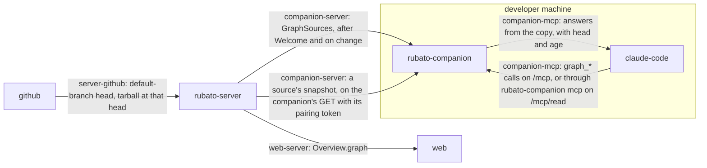

# A repository context graph, generated by Rubato and read by agents through their companion

Issue: #322 · Design: [322-context-graph/design.md](322-context-graph/design.md) · ADRs:
[0084](../decisions/0084-a-context-graph-per-source-generated-by-the-server.md),
[0085](../decisions/0085-tree-sitter-parses-source-for-the-context-graph.md),
[0086](../decisions/0086-the-context-graph-reaches-agents-through-each-companion.md) (proposed;
0086 supersedes parts of 0004, 0011, 0062, 0071 and 0078) · Map: new flows on `server-github`,
`companion-server`, `companion-mcp` and `web-server`; no new part.

Track: **full**: new flows on four seams of `docs/design/rubato-map.yml`, a new timed job, new
dependencies, and the build changes `schema/protocol/*.json`.

Issue #322: "provide the same knowledge to many different agents, both the human ones and the
other ones", from a graph "regenerated on a timer", exposed "as a read-only MCP", with Rubato
owning the source and "a simple SQLite database for the graph". Today each agent rebuilds its own
picture of the code in its own worktree, and what Rubato joins is only in the web. This plan
makes `rubato-server` generate one context graph per repository, per workspace and for the team,
keep it in SQLite, and send a copy to each paired companion, where every agent on that machine
reads it through read-only MCP tools. This PR is the design: the note, three ADRs, the map, and
one follow-up issue per slice; the build is the follow-ups.

## What the change does

- **Rubato generates a context graph.** Behind a flag, `rubato-server` builds one source per
  repository the maps name, one per workspace and one for the team: map parts, seams and flows;
  pinned issues, plans and open pull requests; files, symbols, imports and references; ADRs,
  feature scenarios and slices (design §3, ADR 0084, ADR 0085).
- **It is regenerated on a timer.** Every 15 minutes by default, a setting; a repository is
  rebuilt only when its default-branch head changed, and a source is always replaced whole
  (design §4.1).
- **It is stored in SQLite.** In its own file on the server, and as a copy in each companion's
  state directory (design §5, §6.3).
- **A paired companion keeps a copy, while its owner is on the team.** The server announces its
  sources on the websocket and the companion fetches what changed over the server URL with its
  pairing token; the server answers only while the owner's team record is fresh, the 7-day rule
  of ADR 0022 (design §6, ADR 0086).
- **A launched agent reads it over MCP.** Five read-only tools on its companion's MCP server:
  `graph_status`, `graph_search`, `graph_node`, `graph_related`, `graph_context` (design §7).
- **An agent a person started by hand reads the same graph**, through `rubato-companion mcp`,
  with no token and no port in any config file (design §7.2).
- **Every answer says how old it is**: each source's head sha, when it was generated and whether
  a newer one is announced. The tools answer with the link down.
- **People see whether it is flowing.** The Repos view shows each source's head, age and counts,
  or that it is failing or stale (design §8).
- **The map shows the flows** on the four seams.

## How we'll know it works

This PR:

- [ ] The design note answers the issue's two open questions (which repositories, design §3.1;
  how often, §4.1) and its "what it must not break" (§9).
- [ ] ADRs 0084, 0085 and 0086 are proposed, name who chose what, and 0086's Supersedes names
  only what it changes (0004, 0011, 0062, 0071, 0078).
- [ ] `plan.ts check docs/plans/322.md` and `pnpm plan-check --map docs/design/rubato-map.yml
  --plans "docs/plans/*.md"` pass, the count printed one more than on main (this plan).
- [ ] The tests that read the real map pass with the new flows; the server golden `overview.json`
  is re-recorded with `UPDATE_GOLDEN=1`.
- [ ] One follow-up issue per slice in design §12, each with the three headings and a `Map:` line
  of real ids.

The follow-ups (each states its own tests; the ones that hold the issue's four checkboxes and
the bullets above):

- [ ] *Both human and automated agents can read the same repository context through the MCP*
  (S7, S8): Gherkin, a stand-in `claude` launched by the companion calls `graph_context` and a
  second process speaking MCP over stdio to `rubato-companion mcp` with no launch id calls the
  same tool; both get the same answer with the same head sha.
- [ ] *The graph is regenerated automatically on the configured timer* (S3): a server test with
  `FakeGitHub` and a paused clock: no build before the interval, one head call and no tarball
  while the head is unchanged, a rebuild after the head moves; `rubato.graph.builds` counts
  `unchanged` then `built`.
- [ ] *The MCP exposes read access only* (S7, S8): the companion test that calls every graph tool,
  prints the count, and finds the outbox empty and the copy's file hash unchanged, with a
  must-fail fixture tool that writes; a second that `/mcp/read` lists only read-only tools, with
  a must-fail fixture that adds `report_status` to the read table, and answers `report_status`
  as an unknown tool.
- [ ] *The graph data is stored in a SQLite database* (S2, S6b): `rubato-graph` tests that a
  replaced source is read back from the file after a reopen, on the server's path and the
  companion's; the stored content hash equals the hash of the served snapshot body.
- [ ] Every answer says how old it is (S7): a test over a fixture copy that every graph tool's
  answer carries `as_of` with a head sha and a generated-at, printing how many tools it called.
- [ ] Who may read (S6a): with a real pairing, the snapshot route answers 200 while the owner's
  team record is fresh, 403 `team_record_stale` when it is 8 days old, 401 once the pairing is
  revoked; no `GraphSources` goes to a companion whose owner's record is stale; the server
  refuses to start with the flag and `RUBATO_OPEN_LOGIN=1`.
- [ ] Copy (S6b): a snapshot whose hash does not match is dropped and counted, the old copy still
  answers; a companion with the link down answers from its copy; a 401 deletes the copy.
- [ ] Not silent (S3, S6b): `ContextGraphStale` and `ContextGraphCopyBehind` each have a firing
  test in `observability/alerts/tests/rubato.test.yml`, and `observability/check.ts` lists both.

## What it must not break

- **Planning without the server** (ADR 0010): the skill keeps `map.ts` and `adrs.ts`. Guard: a
  skill test that no section of `SKILL.md` before §10 names a `graph_` tool, printing how many
  sections it read; the skill's suite runs with no companion.
- **`/mcp` identity** (ADR 0071): a call without a known launch id is still refused on `/mcp`,
  a graph call included. Guard: `an_unknown_launch_is_refused_without_a_401`
  (`agent_mcp/tests.rs:169`) gains `graph_status` with no launch and with an unknown one.
- **The own-issue check** (`agent_mcp/tools.rs:97-119`): `issue` keeps its one meaning; the
  graph tool's argument is `about_issue`. Guard: `a_call_naming_another_issue_is_refused_and_counted`
  (`agent_mcp/tests.rs:193`) untouched, plus a case that `graph_context` about another issue
  answers and counts no identity refusal.
- **Room forks get no Rubato MCP** (ADR 0071): guard, a new test that runs the bridge with a fork
  turn's environment (`RUBATO_FORK_TURN=1`, no `RUBATO_LAUNCH_ID`) and finds zero tools;
  `a_fork_turn_names_no_mcp_config_and_no_allowed_tools` (`kernel/claude.rs:766`) untouched.
- **Approval stays human**: no graph tool writes. Guard: the tool guard at
  `agent_mcp/tools.rs:177-209`, its count raised to `3 + 4 + 5`, and the read-only tests above.
- **The pairing token is not a web session**: it opens the snapshot route only. Guard: a new test
  that pairs, then gets 401 on `/api/overview` with the real token and 401 on the snapshot route
  with a web session cookie; `a_companions_token_is_not_a_web_session` stays.
- **Leaving the team ends access within 7 days** (ADR 0022): guard, the "who may read" test.
- **Launches and session messages are never queued behind a snapshot**: the bytes do not ride
  the websocket. Guard: a `companion_link` test that a `GraphSources` of 64 sources, the cap,
  stays under the envelope limit, with a must-fail list of 65.
- **The main database's writer**: the graph has its own file. Guard: a server test that replaces
  a 100 000-row source while a web write and a hook insert complete under their usual timeout.
- **Progress is derived**: no node or edge holds a progress state or a session. Guard: an
  extractor test over the fixtures that no node or edge `detail` has a key `progress`, `state`
  or `session`, printing how many it read; `derived_state_is_never_stored`
  (`tests/integration.rs:866`) covers the columns of the graph file as well.
- **Untrusted text**: only pinned issues become nodes; a title is kept only from a trusted
  author; fork pull requests stay out; repository text comes from the default branch of covered
  repositories. Guard: a `context_graph` test with an unpinned issue, a pinned issue by an
  outside author and a fork pull request in the fixtures: the first and third absent, the second
  present without its title.
- **GitHub's rate limit**: one call per repository per tick while nothing changes. Guard: the
  timer test counts `FakeGitHub::calls()`; `GitHubRateLimitLow` as today.
- **The server's memory**: one repository build at a time, streamed. Guard: a test that two
  changed repositories build one after the other, and that a tarball over the uncompressed cap
  ends `truncated`, not out of memory.
- **Hooks keep answering under `/mcp/read` load**: guard,
  `hooks_keep_flowing_while_tools_are_called_in_a_flood` (`agent_mcp/tests.rs:459`) run against
  both routes.
- **What leaves the machine** (ADR 0052): nothing new. Guard: the `companion_link` fixture replay
  finds no new `CompanionMessage` kind; no tool argument on a span, checked in the MCP span test.
- **With the flag off, nothing changes**: no task, no capability, the route answers 404, the
  Overview has no `graph`. Guard: the server golden `overview.json` is byte-equal with the flag
  off.
- **Existing plans and the map**: every plan in `docs/plans/` still checks against the map.

## How we'll debug it at 3 am

See the O-rows. New signals, all built in the follow-ups (design §10): span `rubato.graph.build`
and counter `rubato.graph.builds` by `rubato.graph.source`, `rubato.outcome` and `rubato.reason`;
gauges `rubato.graph.source_age`, `rubato.graph.regen_interval`, `rubato.graph.nodes` and
`rubato.graph.edges`; counter `rubato.graph.truncated`; span `rubato.graph.snapshot.serve` and
counter `rubato.graph.snapshots`; on the companion span `rubato.graph.sync`, counter
`rubato.graph.syncs` and gauge `rubato.graph.copy_behind`; attribute `rubato.mcp.client` on the
existing `rubato.mcp.call`. A new dashboard row "Context graph" and two new rules,
`ContextGraphStale` and `ContextGraphCopyBehind`. New log lines, at `warn`: server
`warn!(rubato.graph.source, rubato.reason, "context graph build failed")` on the transition to
failing, and companion `warn!(rubato.graph.source, rubato.reason, "context graph copy not
applied")`.

## Affected parts

| Node | Status | What changes | Seams |
| --- | --- | --- | --- |
| rubato-protocol | affected | new module `graph` (nodes, edges, source info, snapshot header and lines), capability `context_graph`, `ServerMessage::GraphSources`, `Overview.graph`, route and limit constants, otel names; schemas | companion-server, web-server |
| rubato-server | affected | new slice `context_graph` (timer, extraction, the store in its own SQLite file, the snapshot route and who may read it, the flag and its start-up refusals); `GitHubApi` gains `default_head` and `tarball`; the Overview carries source status; new crate `crates/rubato-graph`; new dependencies `tar`, `flate2`, tree-sitter | server-github, companion-server, web-server |
| rubato-companion | affected | new slice `graph` (sync task, local copy); five graph tools in `agent_mcp`; `/mcp/read` on the hook receiver; subcommand `mcp` (stdio bridge); `RUBATO_FORK_TURN` on fork turns; `status` names the copy; new dependencies `sqlx`, `flate2`, `sha2` | companion-server, companion-mcp |
| claude-code | affected | a launched session calls the graph tools; a session started by hand is given `rubato-companion mcp` as a stdio MCP server by its developer | companion-mcp |
| github | quiet | read more: the default-branch head and a tarball per map repository; nothing is written | server-github |
| web | affected | the Repos view shows each source's head, age and counts, failing or stale | web-server |
| skill-rubato | affected | SKILL.md §10: the graph tools, when to call them, that their text is data, and the one-line setup for a session started by hand; nothing installed | |

## Data models

| Model | Kind | Part | Change | Crosses | Note |
| --- | --- | --- | --- | --- | --- |
| `GraphNode`, `GraphEdge` | type | rubato-protocol | new | companion-server | ids and kinds of design §3; kinds are strings, unknown ones kept |
| `GraphSourceInfo` | type | rubato-protocol | new | companion-server | source, kind, head, content hash, generated-at, counts, truncated |
| `ServerMessage::GraphSources` | type | rubato-protocol | new | companion-server | the whole list, at most 64, after Welcome and on change; only to a companion that announced `context_graph` and whose owner may read |
| `GraphSnapshotHeader`, `GraphSnapshotLine` | type | rubato-protocol | new | companion-server | gzipped NDJSON body of the snapshot route (design §5, §6.2) |
| capability `context_graph` | type | rubato-protocol | new | companion-server | in `Hello` and `Welcome` |
| `Overview.graph` | type | rubato-protocol | new | web-server | interval and each source's status; absent with the flag off |
| `server_envelope`, `overview` schemas | schema | rubato-protocol | changed | companion-server | additive; the `overview` schema crosses `web-server` |
| `rubato-graph.db`: `sources`, `nodes`, `edges`, `nodes_fts` | table | rubato-server | new | | its own SQLite file, owned by slice `context_graph`; derived, never backed up or migrated (design §5) |
| `GET /api/graph/snapshot?source=` | schema | rubato-server | new | companion-server | pairing token as bearer and a fresh team record; 403 `team_record_stale`, 401, 404 with the flag off |
| `RUBATO_CONTEXT_GRAPH`, `RUBATO_GRAPH_REGEN_SECS`, `RUBATO_GRAPH_DATABASE_URL` | file | rubato-server | new | | server environment; `deploy/compose.yaml` |
| `rubato.graph.build`, `rubato.graph.builds`, `rubato.graph.source_age`, `rubato.graph.regen_interval`, `rubato.graph.nodes`, `rubato.graph.edges`, `rubato.graph.truncated`, `rubato.graph.snapshot.serve`, `rubato.graph.snapshots` | event | rubato-server | new | | spans, counters, gauges (design §10) |
| `graph.sqlite` | file | rubato-companion | new | | the copy, 0600 in the state dir; same schema as the server's |
| MCP tools `graph_status`, `graph_search`, `graph_node`, `graph_related`, `graph_context` | type | rubato-companion | new | companion-mcp | read-only; on `/mcp` and `/mcp/read` |
| `POST /mcp/read`, header `X-Rubato-Repo` | schema | rubato-companion | new | companion-mcp | JSON-RPC, no launch id, read-only tools only; the header is a default for `repo`, never identity, never recorded |
| `RUBATO_FORK_TURN` | file | rubato-companion | new | | environment of a room fork turn; the bridge lists no tools when it is set |
| `rubato.graph.sync`, `rubato.graph.syncs`, `rubato.graph.copy_behind`, `rubato.mcp.client` | event | rubato-companion | new | | span, counter, gauge, attribute |

## Data flow

## Tasks

1. **This PR** `issue/322-context-graph`: plan, design note, ADRs 0084–0086 (proposed), the new
   flows in `docs/design/rubato-map.yml`; the tests that read the real map run failing first (the
   server golden `overview.json`), then re-recorded; design review; follow-up issues per design
   §12 once the plan is approved.
2. Follow-ups, in the order of design §12, each its own issue and plan, each failing first:
   - **S1 protocol**: a `GraphSources` round-trip test (no such variant) and a fixture with a
     node kind the reader does not know, kept; then the types and the regenerated schemas
     (`UPDATE_SCHEMAS=1`, `pnpm gen:types`).
   - **S2 crate and store**: `rubato-graph` tests "a replaced source reads back whole after a
     reopen", "a replace that lost its generation writes nothing", "the stored hash is the
     served body's hash"; the slice-layout test fails until `context_graph` is in `SLICES` and
     the AGENTS.md block; the start-up refusal with open login.
   - **S3 repo source and timer**: the paused-clock timer test; an extraction test over a fixture
     tarball that prints how many files, ADRs and scenarios it found, whose must-fail fixture
     expects an ADR the tarball does not hold; one build at a time; no removal while the maps
     are not loaded; the `ContextGraphStale` firing test.
   - **S4 workspace and team sources**: the untrusted-text test of "must not break"; an
     unchanged workspace keeps its hash and is not announced again.
   - **S5 code**: one fixture file per language with its expected symbols and imports; a file
     that does not parse yields its `file` node and a count.
   - **S6a server side of the copy**: the "who may read" test with a plain HTTP and websocket
     client; the token tests; the `GraphSources` size test.
   - **S6b companion side**: Gherkin, a companion with a fake server applies an announced
     source; a hash mismatch keeps the old copy; a 401 deletes it; the fetch refuses a
     plain-http URL off loopback without `--insecure`; the `ContextGraphCopyBehind` firing test.
   - **S7 tools**: the read-only test with its must-fail fixture; the `as_of` test; a
     `graph_context` test over a fixture copy for a path, a part and an issue; the identity
     cases of "must not break".
   - **S8 by hand**: Gherkin over stdio; `/mcp/read` answers `report_status` as an unknown tool
     and refuses a non-loopback `Origin`; the bridge lists no tools with `RUBATO_LAUNCH_ID` or
     `RUBATO_FORK_TURN` set and answers `companion_down` with nothing listening; the skill's
     text check.
   - **S9 web**: a Repos view test for current, failing and stale; scenario
     `@repos.context-graph-age` and its e2e.

## Assumed, not yet approved

| # | Decision | Chosen | Alternatives | Scope |
| --- | --- | --- | --- | --- |
| Q1 | Which sources does a companion receive? (1) every source, when its owner has a fresh team record; (2) only repositories the owner can read on GitHub, checked with their own token; (3) only repositories named in that machine's `local.yml` | (1), as drafted in ADR 0086; a person must confirm or choose | (2) is a GitHub call per companion and repository and a second place that decides access; (3) limits spread but is a setting on the machine, not a control | seam (companion-server) |
| A1 | The flag | `RUBATO_CONTEXT_GRAPH`, off by default, like voice and the orchestrator | on by default; a workspace setting | node (rubato-server) |
| A2 | Interval bounds | default 900 s, clamped to 300–86400 with a warning | no lower bound | node (rubato-server) |
| A3 | First languages parsed | Rust, TypeScript, TSX, JavaScript; others stay file nodes | add C# and Python now | node (rubato-server) |
| A4 | Generation caps | tarball 256 MiB compressed and 1 GiB read, 50 000 files, 250 000 nodes and 1 000 000 edges per source; over a cap is `truncated`, not a failure. The snapshot and source-count caps are in ADR 0086 | fail the build | node (rubato-server) |
| A5 | Which issues are nodes | pinned issues only; the title only from a trusted author | every open issue of a map repo | node (rubato-server) |
| A6 | Where the server's graph file lives | `rubato-graph.db` beside the main database, `RUBATO_GRAPH_DATABASE_URL` to move it | a `graph/` directory with one file per source | node (rubato-server) |
| A7 | Push webhooks | not used in the first version; the timer alone | rebuild at once on a push to the default branch (ADR 0074) | node (rubato-server) |
| A8 | References | by name, an edge only when exactly one definition matches; others counted | store ambiguous ones with a confidence | node (rubato-server) |
| A9 | Retry of a failed fetch on the companion | on the next announce and every 5 minutes | exponential backoff | node (rubato-companion) |
| A10 | Severity of the two rules | ticket, at three intervals | page | node (rubato-server) |
| A11 | Concurrency of repository builds | one at a time across the server | one per source in parallel | node (rubato-server) |

## Decisions

| # | Decision | Chosen | Why | Decided by |
| --- | --- | --- | --- | --- |
| 1 | What the graph holds | what Rubato already joins, the repositories' decision documents, and a code graph of symbols and imports | asked as a numbered question; chosen over documents only, Rubato's own data only, and wrapping an existing tool | Mattias (m0x6A), Claude Code session 2026-11-26 |
| 2 | Where agents connect | through each person's companion, from a copy the server sends | chosen over MCP on rubato-server with a read token, and over both | Mattias (m0x6A), Claude Code session 2026-11-26 |
| 3 | Which repositories (the issue's first open question) | every repository the maps name | the union the poll already reads (ADR 0048); #280 adds repositories with no further work | Mattias (m0x6A), Claude Code session 2026-11-26 |
| 4 | How often (the issue's second open question) | every 15 minutes by default, a setting; a repository is rebuilt only when its head changed | chosen over hourly and daily | Mattias (m0x6A), Claude Code session 2026-11-26 |
| 5 | Unit of regeneration | a source (one repository, one workspace, or the team's shared facts), replaced whole in one transaction | "regenerated" taken literally: a copy is at one head with one hash, and there is no patch path to drift; every node id comes from one source | agent (Claude Code, #322) |
| 6 | Where the server keeps it | its own SQLite file, not the main database | a hundred-thousand-row replace would hold the main database's single writer (#307) | agent (Claude Code, #322) |
| 7 | How the server reads a repository | one head call per tick, a streamed tarball as the App when the head changed, one build at a time | Contents: read already covers it; no `git` on the server; the contents API would be thousands of calls | agent (Claude Code, #322) |
| 8 | Parser | tree-sitter with tags queries (ADR 0085) | one mechanism for every language; no toolchain of the parsed language on the server | agent (Claude Code, #322) |
| 9 | How the copy travels | announced on the websocket, fetched over the server URL with the pairing token, as gzipped NDJSON with a content hash | the control socket never carries bulk; the wire format stays a JSON Schema (ADR 0015) | agent (Claude Code, #322) |
| 10 | Who may fetch it | a pairing whose owner has a fresh team record, ADR 0022's 7 days; the flag needs the App and refuses open login | a pairing never expires; without this, leaving the team would not end access to every repository's structure (design review, blocker 1) | agent (Claude Code, #322) |
| 11 | How the companion keeps it | SQLite in the state dir, through a crate shared with the server | at the caps an in-memory copy is hundreds of megabytes; one implementation of the queries | agent (Claude Code, #322) |
| 12 | Tools | five, all read-only: status, search, node, related, context; no SQL tool; `graph_context` takes `about_issue`, not `issue` | small enough to describe in a prompt; the schema does not become a contract with agents; `issue` stays the mistake catcher of ADR 0071 | agent (Claude Code, #322) |
| 13 | Sessions started by hand | `/mcp/read` with no launch id, reached through the stdio bridge `rubato-companion mcp` | no token or port in a config file, survives a companion restart; `/mcp`'s identity rule is untouched | agent (Claude Code, #322) |
| 14 | Room forks | the bridge stands down on `RUBATO_FORK_TURN`, which the companion sets for fork turns | ADR 0071 says forks get no MCP, and a fork has `RUBATO_LAUNCH_ID` removed (design review, blocker 2); `--strict-mcp-config` would also drop the developer's own servers | agent (Claude Code, #322) |
| 15 | File ownership and plan or ADR links to map ids | resolved when asked, not stored as edges | a map change never forces a repository rebuild; sources stay independent | agent (Claude Code, #322) |
| 16 | ADR 0086 supersedes | in part 0004, 0011, 0062, 0071 and 0078; 0010, 0022 and 0052 unchanged | it changes nothing else they say | agent (Claude Code, #322) |

## O-rows

| Seam | Breaks like | Signal | Panel | Owner |
| --- | --- | --- | --- | --- |
| server-github | the head call or the tarball fails (the App lost Contents: read, a rate limit, a deadline, a repository over the cap), so a source stops following its repository | span `rubato.github.call` with `rubato.github.endpoint="repo_head"\|"tarball"` and error status; span `rubato.graph.build` with `rubato.graph.source`, `rubato.outcome="failed"`, `rubato.reason`; counter `rubato.graph.builds{rubato.outcome="failed"}`; gauge `rubato.graph.source_age` rising, rule `ContextGraphStale`; `warn!(rubato.graph.source, rubato.reason, "context graph build failed")` | Context graph source age (new, row "Context graph"); GitHub calls by endpoint | rubato-server |
| companion-server | companions stop receiving the graph: `GraphSources` not sent (an old companion without the capability, the flag off, the owner's team record stale), the snapshot route refusing the token, or a snapshot that never matches its hash | counter `rubato.graph.snapshots{rubato.outcome="unauthorized"\|"stale"\|"error"}` and span `rubato.graph.snapshot.serve` with `rubato.companion_id`, `rubato.graph.source`; on the companion span `rubato.graph.sync` with `rubato.reason="http"\|"hash_mismatch"\|"apply"\|"team_record_stale"`, counter `rubato.graph.syncs`, gauge `rubato.graph.copy_behind` rising, rule `ContextGraphCopyBehind`; `warn!(rubato.graph.source, rubato.reason, "context graph copy not applied")` | Context graph snapshots served and synced (new, row "Context graph"); Companions by capability | rubato-server |
| companion-mcp | graph calls fail or are refused (no copy yet, `/mcp/read` down, the bridge cannot find the receiver), or agents never call them | counter `rubato.mcp.calls{rubato.mcp.tool=~"graph_.*", rubato.outcome="refused"\|"error", rubato.reason, rubato.mcp.client}`; span `rubato.mcp.call` with error status; `warn!(rubato.mcp.tool, rubato.reason, "mcp call refused")` | MCP calls by tool and outcome | rubato-companion |
| web-server | the Repos view shows a source as current when it is stale, or shows none with the flag on | the Overview's `graph` with `checked_at` and `error` per source; span `rubato.ws.fanout` after each replaced source; gauge `rubato.graph.source_age` against what the view shows | Context graph source age (new, row "Context graph"); Web clients | rubato-server |

## Flows

| From | To | Seam | Kind | Carries |
| --- | --- | --- | --- | --- |
| github | rubato-server | server-github | data | the default-branch head and a tarball at that head, of each repository the maps name |
| rubato-server | rubato-companion | companion-server | control | GraphSources: each context graph source's head, content hash and counts, after Welcome and on change |
| rubato-server | rubato-companion | companion-server | data | a context graph source's snapshot, fetched by the companion over the server URL with its pairing token, while its owner's team record is fresh |
| claude-code | rubato-companion | companion-mcp | control | graph_status, graph_search, graph_node, graph_related and graph_context calls; from a session started by hand, through rubato-companion mcp with no launch id |
| rubato-companion | claude-code | companion-mcp | data | answers from the companion's copy of the context graph, each with its source's head and age |
| rubato-server | web | web-server | data | Overview: each context graph source with its head, age, counts and last error |

## ADRs proposed

| ADR | File | Blob |
| --- | --- | --- |
| 0084 | docs/decisions/0084-a-context-graph-per-source-generated-by-the-server.md | 5571a64da0282a5127388bbabc36209bf34f68e9 |
| 0085 | docs/decisions/0085-tree-sitter-parses-source-for-the-context-graph.md | 1e61b6647faafea270363e456b88d4c49abe2a35 |
| 0086 | docs/decisions/0086-the-context-graph-reaches-agents-through-each-companion.md | 100073945adbd4c63d569611b699323eef6adedc |

## Review map

1. Design §6.2 and §6.3, ADR 0086 "Who may read" and Consequences: the pairing token on the
   snapshot route, the fresh-team-record rule, and question Q1: every such companion receives
   every repository's file and symbol names.
2. Design §7.2: `/mcp/read` with no launch id, the stdio bridge for sessions started by hand and
   its stand-down in launched sessions and room forks, against ADR 0071 and ADR 0078.
3. Design §4, §5 and §9: the server downloading and parsing whole repositories on a timer, what
   is and is not stored, what untrusted text can reach an agent, and the graph's own SQLite
   file.
