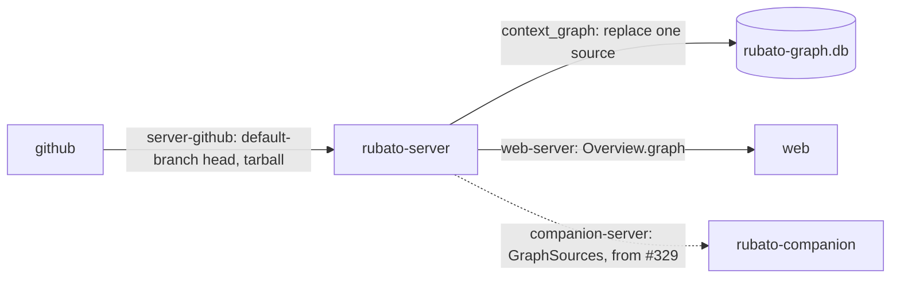

# Context graph: protocol and the server's generation

Issues: #324 #325 #326 #327 #328 · Design: [324-graph-generation/design.md](324-graph-generation/design.md)
· Built under the design of #322 ([plan](322.md), [design](322-context-graph/design.md), ADRs
[0084](../decisions/0084-a-context-graph-per-source-generated-by-the-server.md),
[0085](../decisions/0085-tree-sitter-parses-source-for-the-context-graph.md) and
[0086](../decisions/0086-the-context-graph-reaches-agents-through-each-companion.md), proposed)
· Map: `companion-server`, `web-server`, `server-github`.

Track: **full**. `crates/rubato-protocol` changes `schema/protocol/*.json`, a new crate and a new
server slice arrive, and the server gains dependencies. The flows are already in the map from
#322.

ADR 0084 says `rubato-server` generates a context graph per source on a timer and keeps it in
its own SQLite file. This plan builds the wire types and the server's side of that, one PR per
issue, each stacked on the one before. The copy to companions and the tools are later plans
(#329–#332), and the web's view is #333. Until then a server with this change, and the flag on,
builds the graph and shows its status in the Overview; nothing reads it yet.

## What the change does

- **The protocol carries the graph** (#324): nodes, edges, source info, the snapshot's header
  and lines, `ServerMessage::GraphSources`, the `context_graph` capability, `Overview.graph`, the
  snapshot route, the caps and the telemetry names (design §1).
- **A crate holds the store** (#325): `crates/rubato-graph` has the schema, the whole-source
  replace with its generation check, the snapshot writer that computes the content hash, the
  reader, and the queries (design §2).
- **The server has a `context_graph` slice** (#325): its own SQLite file, the flag off by
  default, the start-up refusals, and each source's status in the Overview (design §3).
- **Repository sources are built on a timer** (#326): one head call per repository per tick, a
  streamed tarball when the head changed, files and decision documents extracted, one build at a
  time (design §4).
- **Workspace and team sources are built from what the server already holds** (#327), with only
  pinned issues and only trusted titles (design §5).
- **Source files are parsed** (#328): symbols, imports and by-name references for Rust,
  TypeScript, TSX and JavaScript (design §6).
- **Operators see it**: span `rubato.graph.build`, counter `rubato.graph.builds`, gauge
  `rubato.graph.source_age`, the dashboard row "Context graph" and rule `ContextGraphStale`
  (#326).

## How we'll know it works

- [ ] **Protocol** (#324). Failing first: `graph::tests` round-trips a `GraphSources` (no such
  variant yet). Then:
  - the fixture `server_graph_sources.json` passes `all_fixtures_round_trip`, which prints a
    count one higher than on main;
  - a node whose kind the reader does not know decodes and keeps its kind;
  - a `GraphSources` of 65 sources fails `GraphSources::check`, and one of 64 passes;
  - a snapshot line is either a node or an edge, and a header decodes from its own line;
  - `UPDATE_SCHEMAS=1 cargo test -p rubato-protocol --test schema_snapshot` shows an additive
    diff, and `pnpm typecheck` passes on the regenerated `protocol.ts`;
  - both binaries compile, and a companion that receives `GraphSources` today ignores it.
- [ ] **Crate and store** (#325). Failing first: a replaced source reads back whole after a
  reopen. Then: a replace that lost its generation writes nothing; the stored hash equals the
  hash of the served body; a `user_version` other than the crate's deletes and recreates the
  file; the slice-layout test passes with `context_graph`; the server refuses to start with the
  flag and `RUBATO_OPEN_LOGIN=1`.
- [ ] **Repo source and timer** (#326). Failing first: with `FakeGitHub` and a paused clock, no
  build before the interval, one head call and no tarball while the head is unchanged, a rebuild
  after the head moves. Then: the extraction test over a fixture tarball prints how many files,
  ADRs and scenarios it found, and its must-fail fixture expects an ADR the tarball does not
  hold; two changed repositories build one after the other; `ContextGraphStale` fires in its
  test.
- [ ] **Workspace and team sources** (#327). Failing first: the fixture's unpinned issue and fork
  pull request are absent, and the pinned issue by an outside author has no title. Then: an
  unchanged workspace keeps its hash; no `detail` has a key `progress`, `state` or `session`.
- [ ] **Code** (#328). Failing first: one fixture file per language with its expected symbols
  and imports. Then: a file that does not parse yields its `file` node and a count.

## What it must not break

- **Older peers**: `GraphSources` is sent only to a companion that announced `context_graph`;
  every existing fixture still round-trips. Guard: `all_fixtures_round_trip`.
- **No I/O in `rubato-protocol`**: guard, its `Cargo.toml` gains no dependency.
- **With the flag off, nothing changes**: guard, the server golden `overview.json` is byte-equal,
  and `Overview.graph` is left out of the JSON when absent.
- **The main database's writer**: guard, the 100 000-row replace test of #325.
- **Progress is derived**: guard, the `detail` test of #327 and
  `derived_state_is_never_stored`.
- **GitHub's rate limit**: guard, the timer test counts `FakeGitHub::calls()`.
- **Every GitHub call is a client span that names its peer**: guard,
  `every_github_call_span_is_a_client_span_that_names_its_peer` with the two new methods.
- **Telemetry names**: guard, `every_declared_name_is_listed` and
  `every_name_is_in_the_rubato_namespace_and_unique`.

## How we'll debug it at 3 am

See the O-rows. The names are added in #324 and emitted from #325 and #326 on: span
`rubato.graph.build`, counters `rubato.graph.builds` and `rubato.graph.truncated`, gauges
`rubato.graph.source_age`, `rubato.graph.regen_interval`, `rubato.graph.nodes` and
`rubato.graph.edges`. New log line at `warn` on the transition to failing:
`warn!(rubato.graph.source, rubato.reason, "context graph build failed")`.

## Affected parts

| Node | Status | What changes | Seams |
| --- | --- | --- | --- |
| rubato-protocol | affected | new module `graph`, capability `context_graph`, `ServerMessage::GraphSources`, `Overview.graph`, route, limits, otel names; schemas | companion-server, web-server |
| rubato-server | affected | new crate `crates/rubato-graph`; new slice `context_graph` with its own SQLite file, the flag, the timer, the three kinds of source, code extraction; `GitHubApi` gains `default_head` and `tarball`; dependencies `tar`, `flate2`, tree-sitter | server-github, companion-server, web-server |
| rubato-companion | affected | compiles against the new `ServerMessage` variant and ignores it until #330 | companion-server |
| web | affected | `protocol.ts` regenerated; nothing shown until #333 | web-server |
| github | quiet | read more: the default-branch head and a tarball per map repository | server-github |

## Data models

| Model | Kind | Part | Change | Crosses | Note |
| --- | --- | --- | --- | --- | --- |
| `GraphNode`, `GraphEdge` | type | rubato-protocol | new | companion-server | kinds are strings with constants in `graph::kind`; unknown ones kept |
| `GraphSourceInfo`, `GraphSources` | type | rubato-protocol | new | companion-server | `ServerMessage::GraphSources`, at most `limits::GRAPH_SOURCES_MAX` |
| `GraphSnapshotHeader`, `GraphSnapshotLine` | type | rubato-protocol | new | companion-server | the NDJSON lines of the snapshot route |
| capability `context_graph` | type | rubato-protocol | new | companion-server | in `Hello` and `Welcome` |
| `GraphOverview`, `GraphSourceStatus` | type | rubato-protocol | new | web-server | `Overview.graph`, left out when absent |
| `server_envelope`, `overview`, `graph_snapshot_header`, `graph_snapshot_line` schemas | schema | rubato-protocol | changed | companion-server | additive; `overview` crosses `web-server` |
| `rubato-graph.db`: `sources`, `nodes`, `edges`, `nodes_fts` | table | rubato-server | new | | its own file, owned by slice `context_graph` |
| `RUBATO_CONTEXT_GRAPH`, `RUBATO_GRAPH_REGEN_SECS`, `RUBATO_GRAPH_DATABASE_URL` | file | rubato-server | new | | server environment |
| `rubato.graph.build`, `rubato.graph.builds`, `rubato.graph.source_age`, `rubato.graph.regen_interval`, `rubato.graph.nodes`, `rubato.graph.edges`, `rubato.graph.truncated` | event | rubato-server | new | | declared in #324, emitted from #325 and #326 |

## Data flow

## Tasks

One PR per issue, each on `issue/<n>-<slug>` stacked on the one before, each failing first with
the test its "How we'll know" line names.

1. **#324 protocol**: `graph.rs` with its tests and the fixture; `message.rs`, `limits.rs`,
   `otel.rs`, `progress.rs`, `schema.rs`, `lib.rs`; regenerate schemas and `protocol.ts`; the
   server and companion compile against the new variant and field.
2. **#325 crate and store**: `crates/rubato-graph`; server `context_graph` slice skeleton, config,
   the start-up refusals, status in the Overview; AGENTS.md layout and slice block.
3. **#326 repo source and timer**: the port methods and their fakes; the extraction of files and
   documents; the task; metrics; the rule, its test and the dashboard row; AGENTS.md's
   never-silent line.
4. **#327 workspace and team sources**.
5. **#328 code**: check the crates' documentation first; the extractor and its fixtures; bump
   the generator version.

## Assumed, not yet approved

| # | Decision | Chosen | Alternatives | Scope |
| --- | --- | --- | --- | --- |
| A1 | Node and edge kinds on the wire | strings, with the known ones as constants in `graph::kind` | a closed enum with an `other` variant | node (rubato-protocol) |
| A2 | Where `Overview.graph` is absent | `Option`, skipped when `None`, so a flag-off overview is byte-equal to today's | an empty object | node (rubato-protocol) |
| A3 | Snapshot line shape | externally tagged, `{"node":{…}}` or `{"edge":{…}}` | a `type` field inside each line | node (rubato-protocol) |

## Decisions

| # | Decision | Chosen | Why | Decided by |
| --- | --- | --- | --- | --- |
| 1 | Build before the approval in Rubato | yes, as plan #322 Decision 17 records | Mattias in the session: "continue without rubato" | Mattias (m0x6A), Claude Code session 2026-11-26 |
| 2 | One plan for the five server-side issues | yes, one PR per issue | the pattern of plan #220 under #197; they share one design | agent (Claude Code, #324) |

## O-rows

| Seam | Breaks like | Signal | Panel | Owner |
| --- | --- | --- | --- | --- |
| companion-server | a companion or server of the other version cannot decode an envelope after the new variant | `rubato.events.dropped{rubato.reason="schema"}`; span `rubato.inbound_event` with error status; the schema snapshot test in CI | Events dropped | rubato-server |
| web-server | the web cannot read an Overview that carries `graph`, or reads a flag-off Overview differently | the CI diff of the generated `web/src/protocol.ts`; span `rubato.ws.fanout`; the golden `overview.json` | Web clients | rubato-server |
| server-github | the head call or the tarball fails, so a source stops following its repository | span `rubato.github.call` with `rubato.github.endpoint="repo_head"\|"tarball"`; span `rubato.graph.build` with `rubato.outcome="failed"`, `rubato.reason`; gauge `rubato.graph.source_age`, rule `ContextGraphStale` | Context graph source age (new with #326, row "Context graph"); GitHub calls by endpoint | rubato-server |

## Flows

| From | To | Seam | Kind | Carries |
| --- | --- | --- | --- | --- |
| github | rubato-server | server-github | data | the default-branch head and a tarball at that head, of each repository the maps name |
| rubato-server | web | web-server | data | Overview: each context graph source with its head, age, counts and last error |
| rubato-server | rubato-companion | companion-server | control | GraphSources: declared here, sent from #329 on |

## ADRs proposed

None. This plan builds under ADRs 0084, 0085 and 0086, which plan #322 proposes.

## Review map

1. `crates/rubato-protocol/src/graph.rs`: the wire shape of a node, an edge, a source and a
   snapshot line, which every later slice and every companion depends on.
2. `crates/rubato-graph` (#325): `replace_source` with its generation check, and the one code
   path that writes a snapshot and computes its hash.
3. `context_graph` (#326, #327): what reaches the graph from GitHub and from the server's
   tables, and what is left out.
