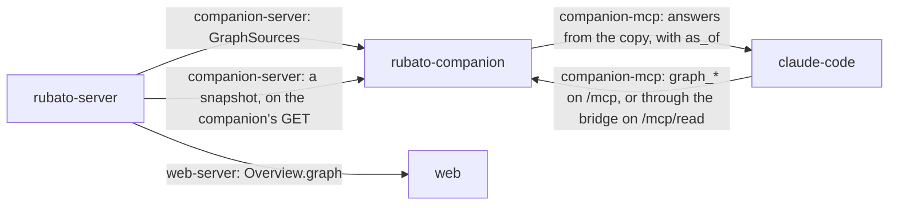

# Context graph: the copy on each companion, the tools, and the Repos view

Issues: #329 #330 #331 #332 #333 · Design: [329-graph-copy-and-tools/design.md](329-graph-copy-and-tools/design.md)
· Built under the design of #322 ([plan](322.md), [design](322-context-graph/design.md), ADRs
[0084](../decisions/0084-a-context-graph-per-source-generated-by-the-server.md) and
[0086](../decisions/0086-the-context-graph-reaches-agents-through-each-companion.md), proposed),
after plan [#324](324.md) · Map: `companion-server`, `companion-mcp`, `web-server`.

Track: **full**. A new companion slice, a new route on the `companion-server` seam, a second
route on the loopback receiver, and `rubato-companion` gains dependencies. The flows are already
in the map from #322, and the wire types in the protocol from #324.

Plan #324 made the server generate the graph. This plan gets it to agents and to people: the
server announces its sources and serves snapshots (#329), each companion keeps a copy (#330),
five read-only tools answer from the copy (#331), a session started by hand reaches them through
a stdio bridge (#332), and the Repos view shows how fresh each source is (#333). One PR per
issue.

**#329 was built last.** It waited for plan #322's question Q1 (which sources a companion
receives), which Mattias answered on 2026-11-27: every source. The other four were built against
the protocol and a fake server, and did not depend on the answer.

## What the change does

- **The server announces and serves** (#329): `GraphSources` after every `Welcome` and when a
  source changed, and `GET /api/graph/snapshot?source=` for a pairing whose owner has a fresh
  team record (design §1).
- **A companion keeps a copy** (#330): a new slice `graph` fetches each source that differs,
  checks its hash and applies it to `graph.sqlite` in its state directory; it announces
  `context_graph`; `status` names the copy (design §2).
- **A launched agent reads the graph** (#331): `graph_status`, `graph_search`, `graph_node`,
  `graph_related` and `graph_context` on `/mcp`, read-only, each answer with `as_of` (design §3).
- **An agent started by hand reads the same graph** (#332): `/mcp/read` and the stdio bridge
  `rubato-companion mcp`, which stands down in launched sessions and room forks; the skill and
  the quickstart say how (design §4).
- **People see whether it flows** (#333): the Repos view shows each source's head, age and
  counts, failing or stale (design §5).
- **A copy that falls behind is not silent** (#330): gauge `rubato.graph.copy_behind` and rule
  `ContextGraphCopyBehind`.

## How we'll know it works

- [ ] **Server side of the copy** (#329). Failing first: with a real pairing, the snapshot route
  answers 200 while the owner's team record is fresh, 403 `team_record_stale` when it is 8 days
  old, 401 once the pairing is revoked. Then: no `GraphSources` to a companion whose owner's
  record is stale; the real token gets 401 on `/api/overview` and a web cookie 401 on the route;
  a list of 64 sources fits an envelope, with a must-fail list of 65.
- [ ] **Companion side** (#330). Failing first: a companion given an announce and a fake server
  applies the source and answers its head from the copy. Then: a hash mismatch keeps the old
  copy and is counted; a 401 deletes the copy; a 403 keeps it and marks it not refreshed; a
  source the list no longer names is deleted; the fetch refuses a plain-http URL off loopback
  without `--insecure`; `ContextGraphCopyBehind` fires in its test.
- [ ] **Tools** (#331). Failing first: every graph tool called with fixture arguments, the count
  printed, the outbox empty and the copy's file unchanged, with a must-fail fixture tool that
  writes. Then: every answer carries `as_of`; `graph_context` for a path, a part and an issue;
  `graph_status` without a known launch is refused on `/mcp`; `graph_context` about another
  issue answers and counts no identity refusal.
- [ ] **By hand** (#332). Failing first: a process speaking MCP over stdio to
  `rubato-companion mcp` with no launch id gets the answer a launched session gets. Then:
  `/mcp/read` lists only read-only tools (must-fail fixture: `report_status` in the read table),
  answers `report_status` as an unknown tool and refuses a non-loopback `Origin`; the bridge
  lists no tools with `RUBATO_LAUNCH_ID` or `RUBATO_FORK_TURN` set and answers `companion_down`
  with nothing listening; the skill's text check.
- [ ] **Web** (#333). Failing first: a Repos view test for current, failing and stale. Then:
  scenario `@repos.context-graph-age` covered by its e2e test.

## What it must not break

- **`/mcp` identity** (ADR 0071): guard, `an_unknown_launch_is_refused_without_a_401` gains
  `graph_status`.
- **The own-issue check**: guard, `a_call_naming_another_issue_is_refused_and_counted`
  untouched; the graph tool's argument is `about_issue`.
- **Room forks get no Rubato MCP**: guard, the bridge with a fork turn's environment lists zero
  tools.
- **Approval stays human**: guard, the tool guard's count becomes `3 + 4 + 5`; the read-only
  tests.
- **The pairing token is not a web session**: guard, the token tests of #329.
- **Hooks keep answering**: guard, the flood test run against `/mcp` and `/mcp/read`.
- **What leaves the machine** (ADR 0052): nothing new. Guard: the fixture replay finds no new
  `CompanionMessage` kind; no tool argument on a span.
- **A companion without the capability, or a server with the flag off**: nothing changes.
  Guard: Gherkin `agent-mcp.feature` passes untouched; the tools answer *no copy yet*.
- **With the flag off the Repos view is as today**: guard, the existing Repos tests.

## How we'll debug it at 3 am

See the O-rows. Emitted from these slices: server span `rubato.graph.snapshot.serve` and counter
`rubato.graph.snapshots` (#329); companion span `rubato.graph.sync`, counter `rubato.graph.syncs`
and gauge `rubato.graph.copy_behind` (#330); `rubato.mcp.client` on `rubato.mcp.call` (#331,
#332). New panel "Context graph snapshots served and synced" and rule
`ContextGraphCopyBehind`. New log line at `warn`:
`warn!(rubato.graph.source, rubato.reason, "context graph copy not applied")`.

## Affected parts

| Node | Status | What changes | Seams |
| --- | --- | --- | --- |
| rubato-server | affected | `context_graph` announces `GraphSources` and serves the snapshot route to a pairing whose owner has a fresh team record; the `context_graph` capability in `Welcome` | companion-server |
| rubato-companion | affected | new slice `graph` (sync, local copy); graph tools in `agent_mcp`; `/mcp/read`; subcommand `mcp`; `RUBATO_FORK_TURN` on fork turns; `status`; depends on `rubato-graph` | companion-server, companion-mcp |
| claude-code | affected | calls the graph tools; a session started by hand is given the stdio server by its developer | companion-mcp |
| skill-rubato | affected | SKILL.md §10: the graph tools, that their text is data, the one-line setup | |
| web | affected | the Repos view shows each source's status | web-server |
| rubato-protocol | quiet | the types are there from #324; at most a limit or a reason constant is added | companion-server |

## Data models

| Model | Kind | Part | Change | Crosses | Note |
| --- | --- | --- | --- | --- | --- |
| `GET /api/graph/snapshot?source=` | schema | rubato-server | new | companion-server | pairing token as bearer and a fresh team record; 403, 401, 404 |
| `graph.sqlite` | file | rubato-companion | new | | the copy, 0600 in the state dir, through `rubato-graph` |
| MCP tools `graph_status`, `graph_search`, `graph_node`, `graph_related`, `graph_context` | type | rubato-companion | new | companion-mcp | read-only |
| `POST /mcp/read`, header `X-Rubato-Repo` | schema | rubato-companion | new | companion-mcp | no launch id; read-only tools only |
| `RUBATO_FORK_TURN` | file | rubato-companion | new | | environment of a fork turn |
| `rubato.graph.sync`, `rubato.graph.syncs`, `rubato.graph.copy_behind` | event | rubato-companion | new | | declared in #324, emitted here |
| `rubato.graph.snapshot.serve`, `rubato.graph.snapshots` | event | rubato-server | new | | declared in #324, emitted here |

## Data flow

## Tasks

One PR per issue, each failing first with the test its "How we'll know" line names. Built in
this order, since #329 waits for Q1: #330, #331, #332, #333, then #329.

1. **#330**: `rubato-companion` depends on `rubato-graph`; slice `graph` (the copy's location,
   the sync task, apply, removal, marks); `GraphSources` arm in the runtime; the capability;
   `status`; metrics; the rule and its test; AGENTS.md's block and never-silent line.
2. **#331**: the five tools and `graph_context`'s query in `rubato-graph`; dispatch before the
   own-issue check; `tool_label`; the guards.
3. **#332**: `/mcp/read`; the bridge; the fork marker; SKILL.md, the quickstart; check
   `claude mcp add` against Claude Code's documentation first.
4. **#333**: the Repos view, the scenario, its e2e.
5. **#329**: announce and route, once Q1 is answered.

## Assumed, not yet approved

| # | Decision | Chosen | Alternatives | Scope |
| --- | --- | --- | --- | --- |
| A1 | Retry of a failed fetch | on the next announce and every 5 minutes | exponential backoff | node (rubato-companion) |
| A2 | Opting a machine out | `companion: context_graph: false` in `local.yml`; default on | no opt-out | node (rubato-companion) |
| A3 | A copy with no announce since start | answers, with *behind* unknown | refuse until the first announce | node (rubato-companion) |

## Decisions

| # | Decision | Chosen | Why | Decided by |
| --- | --- | --- | --- | --- |
| 1 | Build before the approval in Rubato | yes, as plan #322 Decision 17 records | Mattias in the session: "continue without rubato" | Mattias (m0x6A), Claude Code session 2026-11-26 |
| 2 | Order | the four slices that do not depend on Q1 first; #329 last | a seam-scope question blocks only what it decides | agent (Claude Code, #329) |
| 3 | Q1 of plan #322 | every source, for a companion whose owner has a fresh team record | plan #322 Decision 18 | Mattias (m0x6A), Claude Code session 2026-11-27 |

## O-rows

| Seam | Breaks like | Signal | Panel | Owner |
| --- | --- | --- | --- | --- |
| companion-server | companions stop receiving the graph: no announce, the route refusing, a snapshot that never matches its hash | counter `rubato.graph.snapshots{rubato.outcome="unauthorized"\|"stale"\|"error"}`, span `rubato.graph.snapshot.serve`; on the companion span `rubato.graph.sync` with `rubato.reason`, counter `rubato.graph.syncs`, gauge `rubato.graph.copy_behind`, rule `ContextGraphCopyBehind` | Context graph snapshots served and synced (new, row "Context graph"); Companions by capability | rubato-server |
| companion-mcp | graph calls fail or are refused (no copy yet, `/mcp/read` down, the bridge cannot find the receiver) | counter `rubato.mcp.calls{rubato.mcp.tool=~"graph_.*", rubato.outcome, rubato.reason, rubato.mcp.client}`; span `rubato.mcp.call`; `warn!(rubato.mcp.tool, rubato.reason, "mcp call refused")` | MCP calls by tool and outcome | rubato-companion |
| web-server | the Repos view shows a source as current when it is stale | the Overview's `graph` with `checked_at` and `error`; gauge `rubato.graph.source_age` | Context graph source age; Web clients | rubato-server |

## Flows

| From | To | Seam | Kind | Carries |
| --- | --- | --- | --- | --- |
| rubato-server | rubato-companion | companion-server | control | GraphSources, after Welcome and on change |
| rubato-server | rubato-companion | companion-server | data | a source's snapshot, on the companion's GET with its pairing token |
| claude-code | rubato-companion | companion-mcp | control | graph tool calls on /mcp, or through rubato-companion mcp on /mcp/read |
| rubato-companion | claude-code | companion-mcp | data | answers from the copy, each with its source's head and age |
| rubato-server | web | web-server | data | Overview: each context graph source's status, shown in the Repos view |

## ADRs proposed

None. This plan builds under ADRs 0084 and 0086, which plan #322 proposes.

## Review map

1. The companion's `graph` slice (#330): what a companion does with a snapshot before it
   believes it, and when it deletes its copy.
2. `/mcp/read` and the bridge (#332): a route with no launch id on the loopback receiver.
3. `graph_context` (#331): what an agent is told about a path, a part or an issue, and that
   text from a repository is returned as data.
