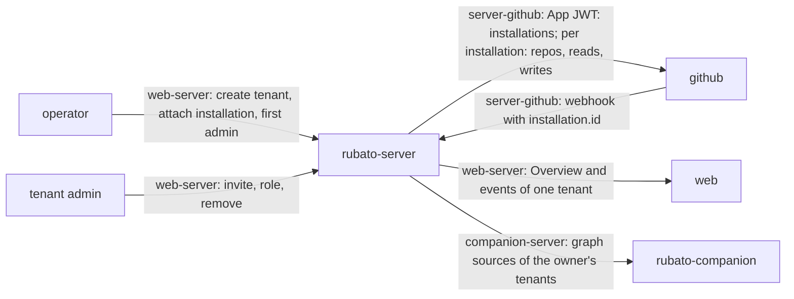
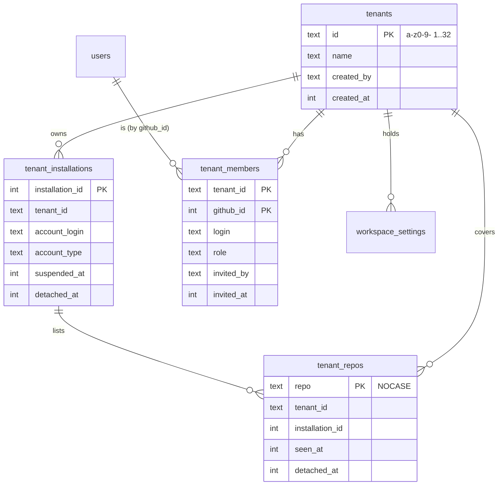

# 345: tenants on one server, and a server that may face the internet

Plan: [../345.md](../345.md) · ADRs: [0087](../../decisions/0087-a-tenant-owns-installations-workspaces-and-members.md),
[0088](../../decisions/0088-operators-tenant-admins-and-invited-members.md),
[0089](../../decisions/0089-tenant-scoped-api-paths.md),
[0090](../../decisions/0090-rubato-may-face-the-internet.md) (all proposed) ·
Issue: m0x6A/rubato#345 · Map: changed flows on `server-github`, `web-server` and
`companion-server`; no new part.

This note decides what a tenant is, who gets into one, how every row, every request and every
background step stays inside its tenant, and what the server needs before it goes on the
internet for a demo. It splits the build into one pull request per slice (§13). The design pull
request holds only the plan, this note, the ADRs and the map's reworded flows.

## 1. What is true today

| Concern | Today | Where |
| --- | --- | --- |
| Who is on the team | anyone whose own GitHub account can access the one configured installation, checked at login, at most 7 days old | ADR 0022; `auth/handlers.rs:149-191`, `auth/team.rs:25-33`, `auth/current_user.rs:50-53` |
| A person | keyed by login; `users.github_id` nullable; `CurrentUser(String)`; `pairings.user`, `launches.user` are logins | `migrations/0001_init.sql:3-8`, `auth/current_user.rs` |
| GitHub identity of the server | one `Octo::for_installation`, `App.github`, used in 17 files | `kernel/state.rs:93`, `kernel/github/api.rs:652-668`, `main.rs:41-90` |
| Workspaces | every member sees, creates and deletes every one; a `default` is required and cannot be deleted | ADR 0044, 0075; `kernel/workspaces.rs:162`, `workspace_settings/api.rs:608-723` |
| In-memory state | maps, traffic and the registry keyed by bare workspace id | `kernel/state.rs:104,107,113` |
| The poll | anchored on `default_map()`, skips the pass without it; one map for every issue's plan path | `tasks.rs:340-343,499,552,802` |
| Rows | 12 tables carry `workspace_id`; GitHub facts, sessions, plans, rooms, spend are server-wide | migrations 0013, 0014, 0024, 0027 |
| Housekeeping | seam notices group every plan on the server by seam id; cross-workspace findings and seam gauges span the server | `rooms/notices.rs:44-71`, `overview/gauges.rs:57`, `overview/handler.rs:73` |
| Browser events | one broadcast to every socket; the browser drops other workspaces' events | `web_link/ws.rs:26`, `web/src/shared/workspace.ts:80-85` |
| Overview | lists every user's pairings | `overview/handler.rs:32` |
| Companion intake | a draft, hook, room reply, agent report or fleet request is checked only against the launch's companion | `companion_link/ws.rs:429-435,544-577`, `fleet/handle.rs:304-321` |
| Context graph | one `team` source; every source to every companion with a fresh team record; the snapshot route serves any source key; the list is cut at 64 before anything else | ADR 0086; `context_graph/serve.rs:27-35,57,145-148` |
| Import | takes the repo from the request body and reads its plan, unchecked against any map | `import/handler.rs:60,94-105` |
| Webhooks | the shared secret is the only binding; `installation.id` is not read | `webhooks/handler.rs:83-215`, `webhooks/event.rs:67-140` |
| Exposure | plain HTTP on the LAN, no general rate limit, random session secret if unset | `deploy/compose.yaml:12`, `kernel/config.rs:589-594`, #276 |

Two existing gaps close on the way, each with a test: the backlog returns every `open_issues` row
regardless of workspace (`github_poll/store.rs:210-215`, `overview/build.rs:313-323`), and
`map_layout_grouped` is missing from `SCOPED_TABLES` (`kernel/workspaces.rs:171-182`).

## 2. What changes

Decided by Mattias on 2026-11-27 (plan Decisions 1–6 and 12–15):

1. Membership is by **explicit invite**; GitHub org membership grants nothing by itself.
2. Tenants are **created by an operator**; visitors cannot sign up.
3. A person may belong to **several tenants**, with a switcher.
4. **One database**, a `tenant_id` on every tenant-owned row, scoped through a type only a
   membership check produces.
5. The **invite alone** is the gate: no check that the invitee's GitHub account can read the
   installation's repositories.
6. **Tenant admins** manage members; the operator names the first. The operator works on a **web
   admin page**. The demo runs on the **public internet**.
7. **No required `default` workspace**: nothing falls back to one (§5.3).
8. A detached or deleted installation's rows are **tombstoned**, and purged only by the operator
   (§3.3).
9. Graph sources are **filtered to the owner's tenants before the cap**, and the cap rises to 256
   (§6.4).
10. A login that arrives with a different GitHub id than the one stored is **a new person**; the
    old one's pairings, tokens, sessions and memberships are revoked first (§4.4).



## 3. The model



- **Tenant**: an id in the same alphabet as workspace ids, a display name.
- **Installation**: one GitHub context, a personal account or an organisation. GitHub gives an
  App at most one installation per account, and a repository belongs to one account, so a
  repository is covered by at most one installation at a time. An installation belongs to at
  most one tenant (`installation_id` is the key). So **a repository belongs to at most one
  tenant**, and `tenant_repos.repo` is the key. This holds only while §3.3's lifecycle rules
  hold.
- **Member**: a GitHub user id in a tenant, with role `admin` or `member`. The login is kept for
  display and refreshed at each login.
- **Operator**: a GitHub user id listed in `RUBATO_OPERATORS`, not a row. An operator reaches
  every tenant's administration, not its data (§5.4).

### 3.1 Table classes

Every table falls in exactly one class. The class decides the rule the check of §11.1 enforces.

| Class | Tables | Rule |
| --- | --- | --- |
| **Tenancy** (slice `tenants`) | `tenants`, `tenant_installations`, `tenant_members`, `tenant_repos` | owned by the slice; read elsewhere only through its root module |
| **Person** (global) | `users`, `web_sessions`, `user_tokens`, `pairing_codes`, `pairings` | keyed by person; never returned to another person |
| **Companion** (global, filtered on read) | `session_snapshots` (one row per companion, a JSON array of sessions), `companion_events` (Hello and Heartbeat have no repo), `stale_events` | no `tenant_id`; a read for a tenant keeps only the sessions whose repo is a live repo of that tenant, through `tenancy::sessions_of` |
| **Workspace** | `map_layout`, `map_layout_grouped`, `map_cache`, `map_proposal`, `pins`, `map_line_pins`, `map_draft_ops`, `issue_creations`, `issue_suggestions`, `traffic_dismissals`, `workspace_settings` | `tenant_id` joins every key: `(tenant_id, workspace_id, …)` |
| **Repo fact** | `open_issues`, `backlog_repos`, `uncovered_repos`, `pull_requests`, `decisions`, `issue_meta`, `plan_signals`, `repo_pulls`, `repo_pulls_status`, `plans`, `plan_approvals`, `rubato_approvals`, `plan_links`, `plan_drafts`, `plan_draft_revisions`, `pr_merges`, `room_messages`, `room_agents`, `room_requests`, `spend_sessions`, `spend_points`, `session_log_entries` | `tenant_id` joins every key and every `ON CONFLICT` target (23 sites); written at insert from `tenant_repos` |
| **Launch** | `launches`, `companion_queue`, `session_messages`, `agent_reports`, `fleet_requests`, `cap_hits` | `tenant_id` from the launch's repo; joins the key where the key names a repo |
| **Server** | `webhook_deliveries`, sqlx's own | no tenant; never returned through the API |

Every tenant-owned table is **rebuilt** with `tenant_id TEXT NOT NULL` and **no default**, the
backfill done in the copy (§8). An insert that forgets the column fails instead of landing in the
original team's tenant.

Reads of repo facts and launch rows also require the repo to be **live** in the tenant
(`tenant_repos.detached_at IS NULL`): `tenancy::live_repos(&TenantId)` is loaded once per request
and per poll pass, and every repo-fact store function takes it. That is what hides tombstoned
rows (§3.3) without deleting them.

A row whose repository has no live tenant is not written. That is how "an installation nobody
attached is never read" holds for facts too.

### 3.2 In memory

`AppState.maps`, the traffic cache and the workspace registry (`kernel/state.rs:104,107,113`)
are keyed by `WsKey(TenantId, ws)`, because workspace ids are unique only inside a tenant.
`default_map()` is removed. Every `notify*` (`kernel/state.rs:344-474`) takes a `TenantId`.

### 3.3 Lifecycle: detach, delete, reinstall (Decision 13)

- **Detach** (operator) and **`installation.deleted`** (webhook) set
  `tenant_installations.detached_at` and `tenant_repos.detached_at` for its repos, in one
  transaction. The rows of those repos stay, hidden and no longer polled; maps that still name
  the repos show them as uncovered. In the same transaction the tenant's `room_agents` and
  pending `room_requests` on those repos are dismissed and its `companion_queue` rows for them
  dropped.
- **Purge** (operator, on a detached installation) deletes every row of those repos in that
  tenant, then the tombstones. It names the row counts before it runs.
- **Attach** is refused while any repo of the installation has rows of another tenant, live or
  tombstoned (`attach_refused reason=rows_of_other_tenant`), and names the tenant to purge.
- A **reinstall** gets a new installation id and its repos' old rows belong to the old,
  detached id: attaching it to the same tenant moves the tombstoned `tenant_repos` rows back to
  live under the new id; to another tenant it is refused until purge, as above.
- **Tenant delete** is refused while the tenant has workspaces or attached installations; with
  none, it deletes the tenancy rows. Re-creating a tenant id is refused while rows of it remain
  (`ID_HAS_ROWS`, as `kernel/workspaces.rs:218` does for workspaces).

## 4. Requests

### 4.1 Paths (ADR 0089)

| Today | Now |
| --- | --- |
| `/api/w/{ws}/…`, unprefixed means `default` | `/api/t/{tenant}/w/{ws}/…` |
| team routes unprefixed (`/api/overview`, `/api/queue`, `/api/launch`, rooms, pulls, drafts, plans, import…) | `/api/t/{tenant}/…` |
| `/api/me`, `/auth/*`, `/api/pair/*`, `/api/pairings`, `/ws/companion`, `/api/graph/snapshot`, `/api/health` | unchanged (person or server) |
| `/ws/web` | `/ws/web?t={tenant}` |
| — | `/api/admin/…` (operator), `/api/t/{tenant}/members…` (admin) |

The unprefixed and `/api/w/{ws}` tenant forms answer 404 after the cut. The web ships in the
same binary and changes in the same pull request; `e2e/run.ts` (`:229-257`) moves to the new
paths in it. The companion uses only person and server routes.

### 4.2 Scope types (`kernel/tenancy.rs`)

```rust
pub struct TenantScope { tenant: TenantId, github_id: u64, login: String, role: Role }
pub struct AdminScope(TenantScope);   // role admin
pub struct Operator { github_id: u64, login: String }
pub struct TenantId(String);          // from a tenants or tenant_repos read only
pub struct WsKey(TenantId, String);
```

- `TenantScope` is built in two places only, both reading `tenant_members` for
  `(tenant, github_id)`:
  - its **axum extractor**: `{tenant}` from the path plus `CurrentUser`, on every request;
  - **`TenantScope::for_member(db, &TenantId, github_id)`**, for every path that acts for a
    person outside an HTTP request: companion intake (§6.3), fleet requests, room turns, plan
    status pushes.
- An unknown tenant, or one the person is not in, answers **404 `unknown_tenant`**; never 403.
- `TenantId` alone is for work that acts for no person (the poll, webhooks, graph builds,
  housekeeping). A store function that writes on a person's behalf takes `&TenantScope`.
- A resource named by id or by repo inside a tenant path (a launch, a draft, a room, a pull
  request, an import's repo) that is not the tenant's answers 404 the same way and counts
  `rubato.web.rejected{reason=other_tenant}`.

### 4.3 Login (supersedes ADR 0022's gate)

```mermaid
sequenceDiagram
  participant B as browser
  participant S as rubato-server
  participant G as github
  B->>S: GET /auth/github/login
  S-->>B: 302 to GitHub (state cookie)
  B->>G: authorize the App's OAuth
  G-->>B: 302 /auth/github/callback?code
  B->>S: callback
  S->>G: exchange code; GET /user
  S->>S: identity guard (§4.4)
  S->>S: operator? or ≥1 tenant_members row for github_id?
  alt neither
    S-->>B: 403 not_invited (no session row, no token kept)
  else invited or operator
    S->>S: upsert user, refresh member logins, keep token, new session id
    S-->>B: 302 / (last tenant, or the switcher)
  end
```

`/user/installations` is no longer called; `team_checked_at` and its 7-day gate go. Sessions still
end at 30 days (ADR 0064).

### 4.4 Identity guard (Decision 15)

Person tables stay keyed by login. At every login the server compares `GET /user`'s id with
`users.github_id` for that login. When they differ (a renamed and reused login), in one
transaction before anything else: the old person's web sessions, user tokens and pairings are
revoked, their queue rows dropped, and `users.github_id` set to the new id. Memberships are keyed
by id, so the new person inherits none. Logged as `identity changed login=<l>` and counted
`rubato.web.rejected{reason=identity_changed}`. A `users` row with no `github_id` (from before
ADR 0022) gets one at its next login.

### 4.5 Invite

An admin enters a login; the server resolves it to a GitHub user id (`GET /users/{login}` through
one of the tenant's installation clients), shows the account to confirm, and stores
`(tenant, github_id, login, role, invited_by)`. The last admin cannot be removed or demoted; the
operator can always name a new one.

What an invitee can do, whatever their own GitHub access: **read**, as the installation, every
open issue, pull request, plan, room and context-graph source of the tenant's repositories,
private ones included; and **write as the App** where Rubato writes as the App: create issues
(`new_issue/handlers.rs:141`) and push a branch, a file and a pull request for a map draft
(`map_draft/propose.rs:354,374`). Acting as themselves (approval and link comments, a merge) uses
their own token, so GitHub decides. The members page says both next to the invite button, and
ADR 0087 states them.

### 4.6 Removal (from one tenant or the last)

In one transaction: the `tenant_members` row; that person's `room_agents` and pending
`room_requests` in the tenant; their `companion_queue` rows for its repos; and, when it was their
last membership, their web sessions, user tokens and pairings. After the commit, their sockets
for that tenant close (§6.1), and plan status for their launches in that tenant stops (§6.3).
Logged `rubato.tenant.member_changed action=removed`.

## 5. GitHub

### 5.1 One client per installation (`kernel/github`)

`App.github: Arc<dyn GitHubApi>` becomes `App.github: GitHubApps`:

```rust
impl GitHubApps {
  fn for_repo(&self, t: &TenantId, repo: &RepoName) -> Option<Arc<dyn GitHubApi>>; // None unless live in t
  fn for_tenant(&self, t: &TenantId) -> TenantGitHub;   // its live installations
  fn app(&self) -> &AppClient;                           // JWT: /app, /app/installations
}
```

There is no lookup by repo alone: every caller says which tenant it acts for, and a repo outside
it yields `None`, so no call is made. `Octo::for_installation` (`kernel/github/api.rs:652`) is
built once per attached installation and cached. `FakeGitHub` and `LocalGit` take an
installation id, so tests seed two. `check_app` (`kernel/github/app.rs:26-69`) checks the App and
the client id; a suspended or missing installation is a finding on its tenant, not a refusal to
start.

### 5.2 Maps name only their tenant's repositories

The check runs at workspace create and edit, **and on every map load** (`map/load.rs`, reload at
`tasks.rs:842`): a repo the map names that is not live in the tenant is **uncovered** for that
workspace. The poll, the graph and every route skip it, and the map shows it as a finding. So an
admin who edits the map's YAML to name another tenant's repository gets a finding, not a read.
`Map: … in <ws>` lines (`tasks.rs:420-432`) resolve only among the workspaces of the issue's
repo's tenant. Import checks its repo against the tenant's maps like the pull view
(`pulls/view.rs:79`).

### 5.3 The poll

- No anchor map: each pass loops over tenants, and inside a tenant over the union of its maps'
  live `repos_named()` (ADR 0048 narrowed to a tenant). Each issue's plan path and PR listing
  come from the workspaces of its repo's tenant (`tasks.rs:499,552,802`), not from a `default`.
- Each full tick first refreshes `tenant_repos` per installation (`GET
  /installation/repositories`, paged).
- One installation's error or exhausted budget ends that installation's work for the pass and is
  logged with `rubato.github.installation`; other tenants go on.
- Rate-limit reads are per installation; `rubato.github.rate_limit.remaining` gains the
  `rubato.github.installation` attribute.
- The poll stays the only writer of **repo facts** (ADR 0074). `tenant_repos` and
  `tenant_installations` are tenancy rows, also written by admin attach and detach and by
  `installation*` webhooks, always as upserts keyed by repo or installation; the next refresh is
  authoritative.
- Passes over tenants are sequential, as passes over repos are today. At lab scale that is a
  choice, not an accident: a new `rubato.poll.tenant_pass` span per tenant carries `rubato.tenant`
  and its duration, so one tenant slowing another shows.

### 5.4 Webhooks and the operator page

- A delivery must name an attached, live installation; otherwise it is answered 200, counted
  `rubato.github.webhook.deliveries{outcome=unattached}` and nothing else happens. With the App
  public, strangers' installations produce these; that is a count, not a page (§10).
- `installation` (`suspend`, `unsuspend`, `deleted`) and `installation_repositories` (`added`,
  `removed`) update the tenancy rows; `deleted` and `removed` tombstone as §3.3 says.
- `/api/admin/installations` lists the App's installations as the App (`GET /app/installations`),
  each marked attached (to which tenant), detached, or never attached. The operator creates a
  tenant, attaches installations, names the first admin, detaches, purges and deletes as §3.3
  says. The operator sees names, installations and member counts, not data.

### 5.5 Housekeeping per tenant

Seam notices (`rooms/notices.rs:44-71`) group plans by `(tenant, seam)`; cross-workspace
findings (`overview/handler.rs:73`, `overview/gauges.rs:57`) compare workspaces of one tenant;
`rubato.seam.open_plans` gains `rubato.tenant`, so `SeamCollision` fires per tenant. A test seeds
two tenants that both have workspace `main` and the same seam ids.

## 6. Live paths

### 6.1 Browser socket (`web_link`)

`/ws/web?t={tenant}` checks membership at upgrade. Every `WebEvent` carries `tenant` (protocol
change). Each socket's task drops events of other tenants before it sends. Membership is checked
again every 60 s and on a `members` event of its tenant; a socket whose person is gone is closed
with code 4403.

### 6.2 Overview

Built from a `TenantScope` and `WsKey`: pairings and companion sessions only of the tenant's
members and live repos (`tenancy::sessions_of`); graph status only of the tenant's sources.

### 6.3 Companion intake and pushes

One companion serves all its owner's tenants (Assumption A3). For every intake that acts in a
tenant (a draft bundle, a hook with a prompt or reply, a room reply, an agent report, a fleet
request; `companion_link/ws.rs:429-435,544-577`, `fleet/handle.rs:304-321`) the server takes the
launch's tenant, builds `TenantScope::for_member(tenant, owner)`, and on failure refuses the
write, acks the envelope (so the outbox does not retry it) and counts
`rubato.companion.refused{reason=not_member}`. Plan status pushes and room turns go only for
launches whose owner is still a member of the launch's tenant. Session snapshots are stored as
today and filtered on read (§3.1).

### 6.4 Context graph (ADR 0084, 0086 superseded in part)

- Sources: `repo/<owner>/<name>` (tenant from `tenant_repos`), `workspace/<tenant>/<ws>` and
  `team/<tenant>`. `source_key::kind_of` (`rubato-protocol/src/graph.rs:105-111`) learns both
  new forms. Repo tarballs are read through the repo's installation.
- `GraphSources` for a companion: the sources of its owner's tenants, filtered **before** the cap,
  which rises from 64 to 256 (`GRAPH_SOURCES_MAX`, protocol and schema change). A cut list logs
  `graph sources truncated kept=<n> dropped=<m>` and counts `rubato.graph.sources_truncated`;
  `ContextGraphCopyBehind` compares against the full filtered list, not the cut one.
- The snapshot route (`context_graph/serve.rs:145-148`) checks the source's tenant against the
  owner's memberships and answers 404 `unknown_source` otherwise; counted on
  `rubato.graph.snapshot.serve{outcome=refused}`.
- Upgrade: the renamed keys make each copy drop `team` and `workspace/<ws>` and fetch the new ones
  once, within one interval. `ContextGraphCopyBehind` needs three, so it should not fire; if it
  does, the copy is genuinely stuck.

## 7. Hardening for the internet (ADR 0090)

| Threat | Today | Now |
| --- | --- | --- |
| Traffic read or altered on the way | plain HTTP | Caddy in `deploy/compose.yaml` ends TLS with ACME; the server refuses to start off loopback with an http `RUBATO_PUBLIC_URL` unless `RUBATO_ALLOW_HTTP=1`; `Strict-Transport-Security` on https |
| Cookie theft or fixation | `Secure` only on https | `__Host-rubato_session`, `Secure`, `HttpOnly`, `SameSite=Lax`; a new session id at each login |
| Forged sessions after a restart | random secret if unset | `RUBATO_SESSION_SECRET` (≥32 bytes), `RUBATO_TOKEN_KEY`, the App and `RUBATO_OPERATORS` required off loopback, refused at start like `exposure()` (`config.rs:283-329`) |
| Floods of the anonymous paths | 50 pending pairings server-wide; nothing on `/auth` | per-IP token buckets on `/auth/*`, `/api/pair/start`, `/api/pair/poll`; pending pairing codes capped per IP and globally; client IP from `X-Forwarded-For` only from `RUBATO_TRUSTED_PROXY` |
| Abuse by a logged-in person | none | per-person buckets on writes and on `pair/approve` |
| Large or slow requests | per-route caps only | a 1 MiB default body limit (existing larger caps kept); a 30 s timeout outside websockets, **except** handlers that chain GitHub writes (map draft propose, approve with its handoff and link comment, merge), which get 120 s, above their worst case of chained 15 s calls (`map_draft/propose.rs:219-400`); a concurrency limit |
| Labels as an attack surface | `rubato.route` takes the concrete path (`auth/current_user.rs:51`) | the matched route template (`MatchedPath`), so tenant ids and probe paths never become label values |
| Webhooks need a public path | off | on, with the installation check of §5.4 |
| Data loss | one copy (#275); no backups by Mattias's choice, 2026-11-25 | unchanged by this design; the demo holds other teams' data, so plan Q1 asks again |

The token bucket of `telemetry_relay/handler.rs:88` moves to `kernel/limits.rs` and serves every
bucket above; refusals are 429 with `Retry-After` and count
`rubato.web.rejected{reason=rate_limited}`. Voice and the lead agent stay off on the demo.

Before go-live: a Claude Security scan of the branch and an attack-surface analysis of the
unauthenticated surface (`/auth/*`, `/api/pair/*`, `/webhooks/github`, `/api/health`, static
files), findings fixed or recorded; and a `deploy/check.ts` probe of the live host (HTTPS, HSTS,
http refused, a foreign tenant path 404, a burst answered 429).

## 8. Migration and backfill

Migration `0032_tenants.sql` creates the tenancy tables and rebuilds every Workspace, Repo-fact
and Launch table with `tenant_id TEXT NOT NULL` (no default) in its keys and conflict targets,
copying existing rows with `tenant_id = 'default'` (as 0013 did; no table has a foreign key). The
seed, only while `tenants` is empty, runs at the first start:

- creates tenant `default`, named after the installation's account, and attaches the
  `RUBATO_GITHUB_APP_INSTALLATION_ID` installation; fills `tenant_repos`;
- makes every user with a `team_checked_at` in the last 30 days (a session's lifetime) a member,
  and each operator who is a user an admin;
- logs `seed left out login=<l>` for every other user, and the operator page lists them under
  *previous users* with an invite button, so nobody is lost silently.

After the seed the variable is ignored, with one warning per start. A row whose repo is not in
`default`'s `tenant_repos` stays tombstoned: it is in tenant `default` but not live.

## 9. Concurrency and idempotency

- Membership changes, identity changes and lifecycle changes (§3.3, §4.4, §4.6) each run in one
  transaction; socket closes and push stops follow the commit.
- Attach and `installation` webhooks race on `tenant_installations`: both upsert by
  `installation_id`; a webhook never attaches, only updates a row that exists.
- `tenant_repos` refreshes replace one installation's rows in one transaction; webhook changes in
  between are upserts, and the next refresh is authoritative.
- Companion intake reads membership per envelope, so a removal is honoured from the next one.

## 10. Telemetry

Names from `crates/rubato-protocol/src/otel.rs`, with additions marked *new*:

| Signal | Kind | Where |
| --- | --- | --- |
| `rubato.tenant` | attribute, *new* | every server span in a tenant; `rubato.web.rejected`; `rubato.seam.open_plans`; `rubato.poll.tenant_pass` |
| `rubato.github.installation` | attribute, *new* | `rubato.github.rate_limit.remaining`, GitHub client spans |
| `rubato.web.rejected{reason}` | counter | reasons *new*: `not_invited`, `unknown_tenant`, `other_tenant`, `rate_limited`, `identity_changed` |
| `rubato.github.webhook.deliveries{outcome=unattached}` | counter | outcome *new* |
| `rubato.companion.refused{reason}` | counter, *new* | `not_member` |
| `rubato.graph.snapshot.serve{outcome=refused}` | span | reason `unknown_source` |
| `rubato.graph.sources_truncated` | counter, *new* | §6.4 |
| `rubato.poll.tenant_pass` | span, *new* | §5.3 |
| `rubato.tenant.member_changed` | log line, *new* | invite, role, remove, identity |

Alerts, each with a must-fire test: `TenantCrossAccess` (any `other_tenant` refusal: a bug or a
probe), `CompanionRefusedNotMember` (sustained refusals: a removed member's companion still
sending), `InstallationSuspended`, `RateLimited` (a spike per route), and
`WebhookUnattachedHigh` (unattached deliveries over a threshold per hour, not per delivery).

Panels in `observability/dashboards/rubato-overview.json`: *Requests and refusals by tenant*,
*GitHub budget by installation*, *Companion refusals*, *Graph sources per companion*.

## 11. How we know it holds

### 11.1 Scoping check

A test in `rubato-server`, beside the slice-layout test, reads every `sqlx::query*` call under
`src/` (about 308, 33 with a runtime string) and parses its SQL with `sqlparser` (SQLite dialect,
a dev-dependency). For every reference to a Workspace, Repo-fact or Launch table it requires a
`tenant_id` predicate (in `WHERE`, or in the `ON` of that table's join), or, for an insert, the
column **and** a conflict target that includes it. A non-literal argument must be a call to
`tenancy::scoped_sql`, which the check also parses. An allowlist names the few global queries
(the poll's own bookkeeping, migration helpers), each with a reason. It prints queries, tables
and allowlisted entries checked. `must fail:` fixtures: a query with no predicate, a join that
scopes one of two tables, and an upsert whose conflict target leaves out `tenant_id`.

### 11.2 Cross-tenant sweep

The router is built from a `ROUTES` table (method, path, handler, flag, a fixture that fills its
ids and body), and the sweep reads the same table, so a route cannot be added without joining it.
The sweep runs with **every flag on** (voice, orchestrator, graph, webhooks), seeds two tenants
A and B with FakeGitHub holding two installations and one of every resource each, logs in as a
member of A only, and calls every tenant route with B's tenant, workspace and resource ids, and
with B's repos in request bodies. Every call answers 404. It also calls the pairing-token routes
(`/api/graph/snapshot` with B's source keys) and drives `/ws/companion` with envelopes naming B's
launches. It prints the route count. `must fail:` fixture: one route that reads without scope.

### 11.3 Tests for the paths no sweep reaches

- Two tenants with workspace `main` and the same seam ids: seam notices, findings, gauges and the
  in-memory maps stay apart.
- A person removed from A but still in B: their companion's draft, room reply and agent report
  for A are refused and counted; plan status for A stops; B is unaffected.
- Detach, purge, re-attach elsewhere; reinstall; tenant id reuse refused.
- A map edited to name another tenant's repo: uncovered, no read made.
- A login with a changed GitHub id: old pairings and tokens revoked, no membership inherited.
- The backlog gap and `map_layout_grouped` in `SCOPED_TABLES`.
- The migration from a database at 0031: every row in `default`, no column default left.

### 11.4 End to end

`e2e/run.ts` with two tenants and three people (one in both): the switcher, events, the
companion's graph copy, the operator page and the members page, citing `@tenants.*` and
`@admin.*` scenarios.

## 12. What it must not break

- Owner-only rules: launch, message, stop, queue, call-in (`launch/handler.rs:95-110`,
  `session_messages/handlers.rs:188-196`, `rooms/callin.rs:187-194`).
- No inbound access to machines; `LaunchCommand` and the companion's routes are unchanged.
- Existing data: it all lands in tenant `default`; users without a recent login are listed for
  re-invite (§8).
- Companion graph copies across the key change (§6.4).
- `Map: … in <ws>` lines, now inside the repo's tenant (§5.2).
- Comment trust by `author_association` (ADR 0065).
- Local development: loopback keeps `RUBATO_DEV_USER`, operator and admin of `default`.

## 13. Pull requests

| # | Branch | Content |
| --- | --- | --- |
| 1 | `issue/345-tenants` | this note, the plan, ADRs 0087–0090, the map's reworded flows |
| 2 | `issue/345-tenancy-store` | protocol types and schema, migration 0032 (rebuilds), the `tenants` slice store, the seed, the identity guard, the scoping check |
| 3 | `issue/345-github-apps` | `GitHubApps`, the poll per tenant with no anchor map, map-load coverage, webhooks' installation check and lifecycle |
| 4 | `issue/345-tenant-scope` | `TenantScope`, `ROUTES`, `/api/t/{tenant}` routes, login gate, every slice scoped, in-memory keys, housekeeping per tenant, the sweep (may split in three) |
| 5 | `issue/345-live-paths` | browser socket, overview, companion intake and pushes, the graph per tenant |
| 6 | `issue/345-admin-ui` | operator and members slices and pages, the switcher, scenarios |
| 7 | `issue/345-internet` | ADR 0090: refusals, HSTS, cookies, limits, timeouts, `MatchedPath`, Caddy, `deploy/check.ts` |
| 8 | `issue/345-isolation-alerts` | alerts with must-fire tests, the four panels, security scan fixes |
| 9 | `issue/345-demo-deploy` | QUICKSTART "Run a multi-tenant demo", the live-host probe, the deploy record |

Each is stacked on the one before and opened as a pull request once its base merges.
