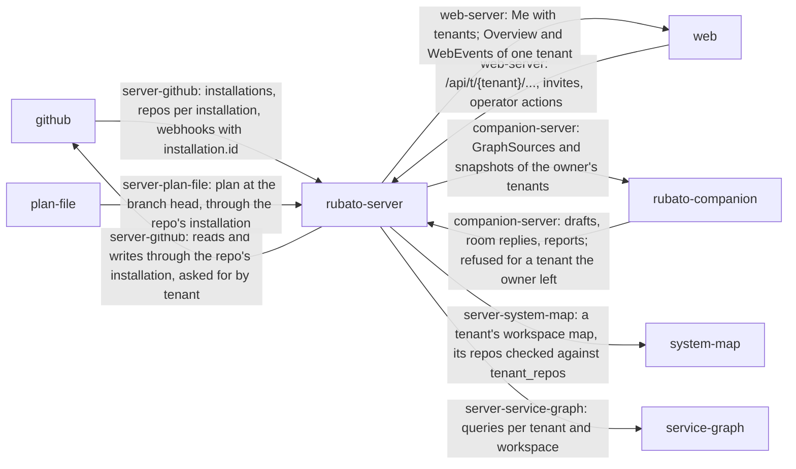

# Tenants and a public demo

Rubato is to run as a demo on the public internet, where several teams share one server without
seeing each other. A tenant owns one or more GitHub App installations (each a personal account or
an organisation), its workspaces and its invited members; every tenant-owned row, request and
background step is scoped to it; and the server gets what it needs to face the internet. Design:
[345-tenants/design.md](345-tenants/design.md).

## What the change does

- An operator creates a tenant on the admin page, attaches one or more of the App's installations
  to it and names its first admin. An installation nobody attached is never read.
- Every repository an attached installation covers can be named by the tenant's maps; a repo
  outside them is refused at workspace create and shown uncovered, and never read, at every map
  load.
- A tenant admin invites a GitHub login, changes roles and removes members. The invite alone lets
  the person in, to read the tenant's repositories and to write as the App where Rubato does
  (issues, map pull requests). Only admins create, edit and delete workspaces.
- A GitHub login that is neither invited nor an operator gets no session. A reused login with a
  new GitHub id starts as a new person, with the old one's pairings and tokens revoked.
- A person in several tenants switches between them; the URL names the tenant and the workspace.
  No tenant needs a `default` workspace.
- Nothing of another tenant is visible or writable: routes answer 404, the browser socket carries
  only the tenant's events, housekeeping (seam notices, findings, gauges) stays inside a tenant,
  companion intake is refused for a tenant its owner left, and a companion receives and may fetch
  only its owner's tenants' graph sources.
- Removing a person from a tenant takes effect at once, there and on their companion; from their
  last tenant it also ends their sessions and pairings.
- Detaching an installation hides and stops reading its rows; the operator purges them before it
  can be attached elsewhere.
- The server refuses to start off loopback without https, a session secret, a token key, the App
  and operators (unless explicitly on a LAN); it sends HSTS, uses `__Host-` cookies, limits body
  size, time, concurrency and request rates; webhooks are on.
- The existing deployment becomes tenant `default` on first start, with its data; users it leaves
  out are listed for re-invite.

## How we'll know it works

- [ ] Scoping check: parses every `sqlx::query*` SQL with `sqlparser`; every reference to a
      Workspace, Repo-fact or Launch table has a `tenant_id` predicate, or column and conflict
      target; prints queries, tables and allowlist entries; three `must fail:` fixtures (design
      §11.1).
- [ ] Cross-tenant sweep over the `ROUTES` table with every flag on: B's path ids, B's repos in
      bodies, B's graph source keys and `/ws/companion` envelopes naming B's launches all answer
      404 or are refused; prints the route count; `must fail:` fixture (design §11.2).
- [ ] Two tenants with workspace `main` and the same seam ids: notices, findings, gauges, traffic
      and in-memory maps stay apart.
- [ ] A person removed from A, still in B: their companion's draft, room reply and agent report
      for A are refused and counted; plan status for A stops; B unaffected.
- [ ] A map edited to name another tenant's repo: uncovered, no GitHub call; import of a foreign
      repo answers 404.
- [ ] Detach, purge, re-attach elsewhere, reinstall, tenant id reuse: each as design §3.3.
- [ ] Login: uninvited → 403 `not_invited`; changed GitHub id → old pairings and tokens revoked.
- [ ] Graph: filtered before the cap of 256; truncation counted; a foreign source key → 404.
- [ ] The backlog only shows the workspace's repos; `map_layout_grouped` is in `SCOPED_TABLES`.
- [ ] Migration from a 0031 database: every row in `default`, no column default left, left-out
      users listed.
- [ ] e2e (`e2e/run.ts`): two tenants, three people (one in both): switcher, socket isolation,
      companion graph copy, operator and members pages; `@tenants.*`, `@admin.*` cited;
      `pnpm scenarios check` passes.
- [ ] Start-up refusals, HSTS, cookie name, 413, 429 per bucket, the 120 s exemption,
      `X-Forwarded-For` from an untrusted peer ignored, `rubato.route` is the template: tests.
- [ ] `deploy/check.ts` live probe on the demo host: HTTPS, HSTS, http refused, foreign tenant
      path 404, a burst answered 429.
- [ ] Claude Security scan and attack-surface analysis of the unauthenticated surface: no open
      high findings before go-live.

## What it must not break

- Owner-only rules for launch, messages, stop, queue and call-in: existing tests in `launch`,
  `session_messages`, `queue`, `rooms`.
- The companion protocol apart from `GraphSources`' cap: `LaunchCommand` and the companion's
  routes unchanged; `crates/rubato-companion` features suite.
- Companion graph copies across the source-key change: each refetches once; a test applies a
  `GraphSources` with the new keys to an old copy.
- `Map: … in <ws>` lines resolve inside the repo's tenant: `github_poll` tests.
- Comment trust by `author_association` (ADR 0065): `github_poll` tests.
- `e2e/run.ts` moves to the tenant paths in the same pull request as the routes.
- Local development on loopback with `RUBATO_DEV_USER` (operator and admin of `default`): e2e.
- The slice layout test and the AGENTS.md blocks: new slices `tenants` and `admin`, web features
  `tenants`, `members`, `admin`.

## How we'll debug it at 3 am

See the O-rows and design §10. New: `rubato.tenant` and `rubato.github.installation` attributes;
`rubato.web.rejected` reasons `not_invited`, `unknown_tenant`, `other_tenant`, `rate_limited`,
`identity_changed`; `rubato.companion.refused{reason=not_member}`;
`rubato.github.webhook.deliveries{outcome=unattached}`; `rubato.graph.sources_truncated`;
`rubato.poll.tenant_pass` span; `rubato.tenant.member_changed` and `identity changed` log lines;
alerts `TenantCrossAccess`, `CompanionRefusedNotMember`, `InstallationSuspended`, `RateLimited`,
`WebhookUnattachedHigh`.

## Affected parts

| Node | Status | What changes | Seams |
| --- | --- | --- | --- |
| rubato-server | affected | tenancy tables and slice, scope types, `ROUTES`, `/api/t/{tenant}` routes, a client per installation, the poll per tenant with no anchor map, webhooks and lifecycle, in-memory keys, housekeeping, socket, overview, companion intake and graph per tenant, operator and members slices, internet hardening | web-server, server-github, companion-server, server-system-map, server-plan-file, server-service-graph |
| web | affected | tenant in the URL and `scoped()`, switcher, members and operator pages, admin-only workspace controls | web-server |
| rubato-protocol | affected | `TenantInfo`, `Role`, member and admin types, `Me.tenants`, `WebEvent.tenant`, graph source keys and `GRAPH_SOURCES_MAX` 256, routes, limits, new otel names; schema regenerated | web-server, companion-server |
| github | affected | the App lists its installations; each attached installation's repositories and webhooks; the App is installable by other accounts | server-github |
| system-map | quiet | a workspace's map may name only its tenant's repositories; the format is unchanged | server-system-map |
| plan-file | quiet | read through the repo's installation; the format is unchanged | server-plan-file |
| service-graph | quiet | queried per `(tenant, workspace)`; the queries are unchanged | server-service-graph |
| rubato-companion | quiet | applies the renamed graph source keys; otherwise unchanged | companion-server |

## Data models

| Model | Kind | Part | Change | Crosses | Note |
| --- | --- | --- | --- | --- | --- |
| tenants | table | rubato-server | new | | id, name, created_by, created_at |
| tenant_installations | table | rubato-server | new | server-github | installation_id key, tenant_id, account, suspended_at, detached_at |
| tenant_members | table | rubato-server | new | web-server | (tenant_id, github_id), login, role, invited_by |
| tenant_repos | table | rubato-server | new | server-github | repo key (NOCASE), tenant_id, installation_id, detached_at |
| workspace, repo-fact and launch tables | table | rubato-server | changed | | rebuilt with tenant_id NOT NULL, no default, in keys and conflict targets (design §3.1, §8) |
| web_sessions.team_checked_at | table | rubato-server | removed | | replaced by the membership read per request |
| TenantInfo, Role, MemberRequest, InviteRequest, AdminInstallation, NewTenant | type | rubato-protocol | new | web-server | schema/protocol |
| Me | type | rubato-protocol | changed | web-server | gains tenants with roles and operator |
| WebEvent | type | rubato-protocol | changed | web-server | gains tenant |
| GraphSources | type | rubato-protocol | changed | companion-server | owner's tenants only; keys `workspace/<tenant>/<ws>`, `team/<tenant>`; at most 256 |

## Data flow

## Tasks

1. Design pull request: this plan, the design note, ADRs 0087–0090, the map's reworded flows.
2. Store (`issue/345-tenancy-store`): failing first — protocol round-trips for the new types; the
   migration test from a 0031 database; `tenants` store tests (invite binds id, last admin kept,
   removal transaction, identity guard); the scoping check with its three `must fail:` fixtures
   (it fails on today's code, so it lands with an allowlist that later PRs shrink to zero). Then
   types, `schema/protocol`, migration 0032, the `tenants` slice, the seed, the identity guard.
3. GitHub (`issue/345-github-apps`): failing first — FakeGitHub with two installations: a pass
   reads each repo through its own installation and writes its tenant; `for_repo` refuses a repo
   of another tenant; a map naming a foreign repo makes no call; an unattached webhook is
   `unattached`; detach, purge, attach-refused and reinstall. Then `GitHubApps`, the 17 call
   sites, the poll per tenant with no anchor map, map-load coverage, `Map: … in` resolution,
   webhooks and lifecycle.
4. Scope (`issue/345-tenant-scope`, may split in three): failing first — the sweep over `ROUTES`
   with every flag on and its `must fail:` route; uninvited login refused; the two-tenant
   housekeeping test. Then scope types, `ROUTES`, `/api/t/{tenant}` routes, the login gate,
   every slice's store functions, `WsKey` in memory, seam notices, findings and gauges per tenant,
   the backlog gap, `map_layout_grouped`, import's repo check, `e2e/run.ts` paths. The scoping
   check's allowlist reaches zero here.
5. Live paths (`issue/345-live-paths`): failing first — a socket of A gets no event of B and is
   closed after removal; a removed member's companion intake is refused and counted; a foreign
   graph source key answers 404; filtering before the cap; an old copy applies the new keys. Then
   `web_link`, `overview`, `companion_link` intake via `TenantScope::for_member`, pushes, the graph
   per tenant and its cap.
6. Admin and members (`issue/345-admin-ui`): failing first — scenarios in
   `features/tenants.feature` and `features/admin.feature` and their Playwright tests. Then the
   `admin` slice (installations, tenants, detach, purge, previous users), members routes, web
   features `tenants`, `members`, `admin`, the switcher, admin-only workspace controls, the
   invite notice, AGENTS.md blocks.
7. Internet (`issue/345-internet`): failing first — start-up refusals, HSTS and cookie name on
   https, 413, 429 per bucket, the 120 s exemption, untrusted `X-Forwarded-For` ignored,
   `rubato.route` from `MatchedPath`. Then the layers, `kernel/limits.rs`, Caddy in
   `deploy/compose.yaml`, `deploy/check.ts` rules.
8. Isolation alerts (`issue/345-isolation-alerts`): failing first — each new alert's must-fire
   test. Then the rules, the four panels of design §10, the security scan and its fixes.
9. Demo deploy (`issue/345-demo-deploy`): QUICKSTART "Run a multi-tenant demo" (App public,
   callback and webhook URL, operators, first tenant), the `deploy/check.ts` live probe, backups
   if Q1 says so, the deploy record.

## Assumed, not yet approved

| # | Decision | Chosen | Alternatives | Scope |
| --- | --- | --- | --- | --- |
| A1 | Who edits workspaces | admins create, edit and delete; members use | any member edits, only create/delete is admin | node |
| A2 | The existing deployment | becomes tenant `default`, renamable by the operator; users with a team record in the last 30 days become members, the rest are listed for re-invite | operator creates it by hand after the upgrade | node |
| A3 | A companion and tenants | one companion serves all its owner's tenants; intake is checked per envelope against the launch's tenant | a pairing per tenant | node |
| A4 | Invites | never expire; shown as *invited* until first login | expire after N days | node |
| A5 | Operator and data | an operator sees tenants' names, installations and member counts, not their data | operator sees everything | node |
| A6 | Who may attach an installation | only an operator; the App is public so others can install it, and an unattached installation is inert and only counted | App private, installed by the operator only | node |
| A7 | Fairness across tenants | the poll and graph builds stay sequential over tenants; `rubato.poll.tenant_pass` shows one slowing another | a budget or rotation per tenant | node |
| Q1 | Backups for the demo host (#275 chose none for the LAN host, 2026-11-25); it will hold other teams' data | none until Mattias answers | 1) none, as today; 2) a nightly SQLite copy on another disk of the host; 3) an off-host copy | node |

## Decisions

| # | Decision | Chosen | Why | Decided by |
| --- | --- | --- | --- | --- |
| 1 | Who becomes a member of a tenant | explicit invites | asked as a numbered question; chosen over GitHub org membership and over both | Mattias (m0x6A), Claude Code session 2026-11-27 |
| 2 | How a tenant comes into being | created by an operator | chosen over self-serve install and allowlisted self-serve | Mattias (m0x6A), Claude Code session 2026-11-27 |
| 3 | Several tenants per person | yes, with a switcher | chosen over one tenant per login | Mattias (m0x6A), Claude Code session 2026-11-27 |
| 4 | How tenants' data is separated | one database, `tenant_id` on every tenant-owned row, a scope type and checks | chosen over a database file per tenant | Mattias (m0x6A), Claude Code session 2026-11-27 |
| 5 | Invite and GitHub access | the invite alone is the gate | chosen over invite plus access to the installation | Mattias (m0x6A), Claude Code session 2026-11-27 |
| 6 | Who manages members; where the operator works; exposure | tenant admins, the first named by the operator; a web admin page; the public internet | chosen over operator only, a host CLI, and a tunnel or LAN | Mattias (m0x6A), Claude Code session 2026-11-27 |
| 7 | Operator identity | GitHub user ids in `RUBATO_OPERATORS`, not a row | cannot be granted from inside the app; ids survive renames | agent (Claude Code, #345) |
| 8 | Not-yours answers | 404, never 403 | a probe cannot tell another tenant's resource exists | agent (Claude Code, #345) |
| 9 | Paths | `/api/t/{tenant}/…`, `/api/t/{tenant}/w/{ws}/…`, no default fallback (ADR 0089) | a fallback is where a scoping bug hides | agent (Claude Code, #345) |
| 10 | Repository to tenant | through `tenant_repos`, keyed by repo; clients asked for by tenant and repo, never by repo alone | GitHub gives an App one installation per account; a lookup by repo alone let a member of A reach B's installation (design review, blocker 1) | agent (Claude Code, #345) |
| 11 | Membership freshness | read on every tenant request and every companion envelope that acts in a tenant | removal takes effect at once, on the web and on the companion (design review, blocker 3) | agent (Claude Code, #345) |
| 12 | Must every tenant have a `default` workspace | no; no anchor map in the poll, no fallback anywhere | asked as a numbered question (design review, open 1); chosen over a `default` per tenant | Mattias (m0x6A), Claude Code session 2026-11-27 |
| 13 | Rows of a detached or deleted installation | tombstoned, hidden and not read; the operator purges; attach elsewhere refused until then | asked (design review, open 2); chosen over purge at once and re-tag on attach | Mattias (m0x6A), Claude Code session 2026-11-27 |
| 14 | More than 64 graph sources | filter to the owner's tenants first, raise the cap to 256, count truncation | asked (design review, open 3); chosen over keeping 64 and a list per tenant | Mattias (m0x6A), Claude Code session 2026-11-27 |
| 15 | A reused GitHub login | a guard at login: a different id is a new person, the old one's pairings, tokens, sessions revoked | asked (design review, open 4); chosen over re-keying person tables by id and accepting the risk | Mattias (m0x6A), Claude Code session 2026-11-27 |
| 16 | The tenant column | `NOT NULL`, no default, in every key and conflict target; tables rebuilt | a default would land a forgotten insert in the original team (design review, blocker 4) | agent (Claude Code, #345) |
| 17 | Companion snapshots and events | person rows, filtered on read by the session's repo | one companion serves several tenants; one row holds all its sessions (design review, blocker 3) | agent (Claude Code, #345) |
| 18 | How the checks enforce scope | SQL parsed with `sqlparser`; a `ROUTES` table that builds the router and drives the sweep, with every flag on | a string match and a hand-kept route list would pass the bugs the review found (design review, finding 6) | agent (Claude Code, #345) |
| 19 | Timeouts for handlers that chain GitHub writes | 120 s instead of 30 s | a cut mid-chain leaves a branch with a file and no pull request (design review, risk 5) | agent (Claude Code, #345) |
| 20 | Approval | plan approved in chat ("approve") after the design review and the fixes it led to; recorded here, not through `plan.ts handoff`, so no approval record in the front matter; ADRs 0087–0090 pinned at their blobs and still proposed until accepted; Q1 stays open | Mattias in the session, 2026-11-27 | Mattias (m0x6A), Claude Code session 2026-11-27 |

## O-rows

| Seam | Breaks like | Signal | Panel | Owner |
| --- | --- | --- | --- | --- |
| web-server | a route returns another tenant's data, or refuses its own members; a socket carries another tenant's events; a flood of logins or pair starts | `rubato.web.rejected{reason=other_tenant\|unknown_tenant\|not_invited\|rate_limited\|identity_changed}` with `rubato.tenant`, `rubato.route` as the template; alerts `TenantCrossAccess`, `RateLimited`; the sweep in CI | Rubato overview → Requests and refusals by tenant | rubato-server |
| server-github | an installation suspended or removed; a read through the wrong installation; strangers' installations; one installation's budget exhausted | `rubato.github.rate_limit.remaining{rubato.github.installation}`, `rubato.github.webhook.deliveries{outcome=unattached}`, `rubato.github.repos_uncovered{rubato.tenant}`, `rubato.poll.tenant_pass`; alerts `InstallationSuspended`, `WebhookUnattachedHigh`, `GitHubRateLimitLow` | Rubato overview → GitHub budget by installation | rubato-server |
| companion-server | a removed member's companion keeps writing into a tenant; a companion receives or fetches another tenant's source; sources cut by the cap | `rubato.companion.refused{reason=not_member}`, `rubato.graph.snapshot.serve{outcome=refused}`, `rubato.graph.sources_truncated`; alerts `CompanionRefusedNotMember`, `ContextGraphCopyBehind` | Rubato overview → Companion refusals; Graph sources per companion | rubato-server |
| server-system-map | a workspace map names a repo outside its tenant, or the tenant lost it | `rubato.github.repos_uncovered{rubato.tenant}` and the uncovered finding on the map; `workspace settings refused reason=repo_not_in_tenant` log line | Rubato overview → Requests and refusals by tenant | rubato-server |
| server-plan-file | a plan read through the wrong installation, or not at all after a detach | GitHub client spans with `rubato.github.installation` and `rubato.tenant`; plans missing show as `rubato.github.repos_uncovered` | Rubato overview → GitHub budget by installation | rubato-server |
| server-service-graph | traffic of one tenant's workspace shown in another's with the same workspace id | `rubato.traffic.fetches` with `rubato.tenant` and `rubato.workspace`; the two-tenant test in CI | Rubato overview → Requests and refusals by tenant | rubato-server |

## Flows

| From | To | Seam | Kind | Carries |
| --- | --- | --- | --- | --- |
| github | rubato-server | server-github | data | as the App, its installations; per attached installation, the repositories it covers |
| github | rubato-server | server-github | data | webhook deliveries naming an installation: installation and installation_repositories events |
| web | rubato-server | web-server | control | as a tenant admin, invite a login, change a role, remove a member; as an operator, create a tenant, attach, detach or purge an installation, name its first admin |
| rubato-server | web | web-server | data | Me with the person's tenants and roles; the Overview and WebEvents of one tenant |
| rubato-server | rubato-companion | companion-server | data | graph sources of the tenants the owner belongs to, at most 256 |

## ADRs proposed

| ADR | File | Blob |
| --- | --- | --- |
| 0087 | docs/decisions/0087-a-tenant-owns-installations-workspaces-and-members.md | 4f422a4b65e43079ac72fcf37bc0714eb68bfc06 |
| 0088 | docs/decisions/0088-operators-tenant-admins-and-invited-members.md | 9e21db1d28ae36922a93185e51578ea4bdbf9a20 |
| 0089 | docs/decisions/0089-tenant-scoped-api-paths.md | 45985d6316d894d6cb33235ba9988d82a7ef4188 |
| 0090 | docs/decisions/0090-rubato-may-face-the-internet.md | c140695cd5aef3bf4a3d7cb7250b88069c25673b |

## Review map

1. `docs/plans/345-tenants/design.md` §3.1–§3.3 and §11: the table classes, the lifecycle, and
   the checks that hold isolation together.
2. Design §5.1–§5.2 and §6.3: GitHub clients asked for by tenant, and companion intake checked
   per envelope; the two places the review found leaks.
3. ADR 0087's Decision: the invite alone lets someone read private repositories and write there
   as the App.
