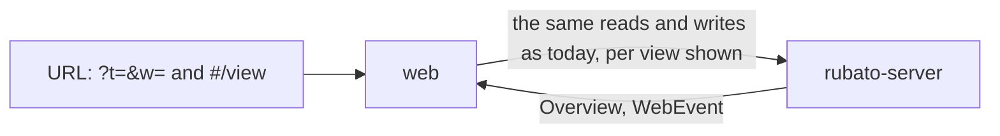

# Redesign the web UI: routed views, one job per screen

Issue: #357 · Design: [357-ux-redesign/design.md](357-ux-redesign/design.md) · no ADR.
Stacked PRs on `issue/357-*` branches; PR 0 is this plan.

The web UI grew one feature at a time into a single page with no navigation model: the map on the
left and one 400px panel that carries four tabs, settings, members, the operator page, the map
draft, findings, the inspector and a 15-section issue detail. Nothing but the tenant and the
workspace is in the URL. Issue #357 asks for a redesign with the `rubato-ux` skill so that a person
always knows where they are, what they can do and what to do next. Mattias settled the direction
on 2026-11-28: the map stays as the stage with a routed panel beside it, the issue view is a
header and sections, and the whole app is redesigned in one stack of small PRs.

## What the change does

- **Every view has a URL.** The fragment names the view (`#/issues/m0x6A/rubato/357/plan`); the
  tenant and workspace stay in the query. Reload keeps the view, Back returns to the previous one,
  a link opens an issue or one of its sections, also after logging in. An unknown link says so.
- **The panel shows one view at a time**: the issue list, an issue, the plans board, companions,
  pairing, repos, a repo, a pull request, a part or seam, the map draft, map versus territory,
  findings, a new issue. Nothing is stacked above the view.
- **The issue view is a header and five sections**: Overview, Plan, Room, Sessions, Pull request.
  The header shows the state and the one next action for that state. The Plans board opens the
  same Plan section. Decisions, O-rows, seam questions and spend are shown once.
- **The top bar holds four things**: the brand, a workspace menu, the live dot and an account
  menu. Configure workspace, Workspaces, Members and Operator are full pages behind the menus,
  with the map hidden.
- **The map band is one row**: lenses, a View menu (By repo, Auto-arrange), Edit map. The legend
  is behind a key; the traffic numbers are one line; map versus territory is a panel view.
- **Lists are lean**: the issue list has Open, Not pinned and Done; the plans board loses its big
  counts and the Accept button on every row; pairing is its own view; a repo's pull requests and
  issues are in the repo's view; the map draft shows its changes and one primary action.

## How we'll know it works

- [ ] `shared/route.ts`: `parseRoute(formatRoute(r))` equals `r` for every route kind; an unknown
  fragment parses to not-found; `parentOf` gives each view's way up (Vitest, with a `must fail:`
  case that drops one kind from the round trip).
- [ ] `@navigation.reload-keeps-view`, `@navigation.back-returns`, `@navigation.link-opens-issue`,
  `@navigation.link-opens-issue-section`, `@navigation.unknown-link`, `@navigation.login-returns`
  each have a Playwright test in `web/e2e/navigation.spec.ts`.
- [ ] `@issues.next-action`: for each progress state the header offers exactly one primary button
  (Vitest over a table of states; Playwright on the seeded issues).
- [ ] Voice is held by the issue view, not the Room section: joined, switching sections keeps
  the connection, the header shows "In voice · speech via <host> · Leave" and spoken replies
  still play; closing the issue view disconnects (Vitest on the holder with a fake room;
  `must fail:` with the holder's cleanup removed).
- [ ] Text typed in the room, a session's message box or the new-issue form survives a switch to
  another section and back (Vitest).
- [ ] `web/e2e/structure.spec.ts` walks one address of every route kind and asserts, printing how
  many it checked: the panel holds exactly one view root (`[data-view]`) with no findings list or
  draft panel above it; the view has at most one `.primary` button; on a full page `data-page`
  is set and the map is hidden but still in the document; the map band is one row high in every
  lens; the top bar holds four items. A `must fail:` test injects a second view root and a
  second primary. It starts in PR 3 with the shell's assertions and gains each screen's with its PR.
- [ ] Decisions, O-rows, seam questions and spend each appear once in an issue with a plan
  (Vitest on the issue view, counting headings; `must fail:` with the old stack).
- [ ] The session log's "see the reply" link scrolls and leaves the fragment alone (Vitest).
- [ ] Every e2e spec and `pnpm scenarios check` pass on every PR of the stack; `pnpm scenarios
  check --base origin/main` fails when an id present at the base is missing (new in PR 1, with a
  fixture that removes one id on purpose).
- [ ] `features/features.test.ts`, `styles.test.ts` and `motion.test.ts` pass unchanged.
- [ ] Screenshots from `web/e2e/shots.spec.ts` before PR 1 and after PR 12, at both widths and both
  colour schemes, read against the `rubato-ux` checklist; the result is in the PR 12 description.

## What it must not break

- Scenario ids (ADR 0069): a moved screen is reworded under the same id (`pnpm scenarios check`).
- The three panel sizes and the 400px normal size (#265; `@look.panel-expands`, `look.spec.ts`).
- Open by default, Done on request (`@issues.open-only`, `@issues.done-view`, `@plans.done-view`).
- Motion and tokens from #81: one switch, every animation under `:root[data-motion="full"]`
  (`motion.test.ts`, `motion.spec.ts`); contrast of every token pair (`styles.test.ts`).
- Raw plan text one click away (ADR 0079; `plans/markdown.test.tsx`); the room shows which
  agents are in (ADR 0057; `room.spec.ts`); the voice consent text before the first utterance
  and "speech via <host>" while joined (ADR 0073; `room/voice.test.tsx`).
- No retired id is drawn or offered (ADR 0077; `map.spec.ts` and `shared/map.test.ts`).
- Drag an issue to a part or seam to pin it and to a lane to queue it (`map.spec.ts`,
  `sessions.spec.ts`).
- The slice rules of `web/src/features` and the web block of `AGENTS.md`
  (`features/features.test.ts`).
- The server, the protocol and every seam: no route, type or schema changes
  (`web/src/protocol.ts` drift check in CI).
- `?t=` and `?w=` links from before keep working; with no fragment the page opens the issue list.

## How we'll debug it at 3 am

See the O-rows. The redesign adds no server signal. A view that refetches more than before shows
as more requests for the tenant and more web spans relayed; reads are not rate limited
(`kernel/limits.rs` limits anonymous paths and writes), so the request count is the signal, and
past the server's bound the `timeout` and `busy` refusals. Data that is stale but shown as live
has no server signal: it is what the live dot and its "refreshed" text are for (Q7 keeps them
visible whenever the page is stale or disconnected). A broken route shows to the person as the
not-found notice, which names the fragment it could not read.

## Affected parts

| Node | Status | What changes | Seams |
| --- | --- | --- | --- |
| web | affected | routed views from the URL fragment, the shell, every screen's layout; shared `route`, `Menu`, `Confirm`; the voice connection held by the issue view; no change to what it sends or reads | web-server, web-livekit |
| livekit | quiet | the same rooms and tokens; a browser stays joined while the person reads another section of the issue | web-livekit |
| rubato-server | quiet | serves the same routes and the same `index.html` | web-server |

## Data models

None.

## Data flow

## Tasks

Each PR runs `pnpm typecheck`, Vitest, `web/e2e/run.sh` and `pnpm scenarios check`. The design
note's section per PR holds the job, path and element audit of each screen it changes.

- [ ] **PR 0** `issue/357-ux-redesign`: this plan, the design note, `AGENTS.md` and
  `.claude/skills/rubato-ux/` committed; `plan.ts check` clean; design review.
- [ ] **PR 1** `issue/357-routing`: Vitest first on `shared/route.ts` (round trip, unknown,
  `parentOf`, `sel`, the login round trip with its query); then the route replaces `tab`,
  `selectedIssue`, `selection`, `newIssueAt`, `planFromBoard`, `configuring` and `side` in
  `App.tsx`; Escape goes up; tenant and workspace switches reset the route; the login page keeps
  the address; a not-found notice; the session log's in-page links stop writing the fragment.
  Same look, same test ids. `features/navigation.feature` and `web/e2e/navigation.spec.ts`;
  `@plans.board-from-another-tab` reworded (Q2), since one view at a time changes it here;
  `pnpm scenarios check --base`.
- [ ] **PR 2** `issue/357-menu-confirm`: Vitest first (keyboard path of `Menu`; `Confirm` arms,
  confirms, cancels on Escape); then `shared/Menu.tsx` from `PinMenu` and `QueueMenu`,
  `shared/Confirm.tsx` in the five places. No visual change.
- [ ] **PR 3** `issue/357-shell`: the top bar's two menus; full pages for Configure workspace,
  Workspaces, Members, Operator; the Findings view and its link; `TeamTrack` at the head of the
  issue list. Rewords `@settings.single-workspace`, `@settings.move-map-ref`, `@tenants.switch`,
  `@admin.*`, `@workspaces.*`, `@findings.*`.
- [ ] **PR 4** `issue/357-issue-list`: Open, Not pinned, Done as routes; lean rows; the row menu;
  the new-issue view. Rewords `@issues.*`, `@pins.*`, `@queue.*`, `@new-issue.*` where they place
  things.
- [ ] **PR 5** `issue/357-issue-view`: Vitest first (next action per state; voice cleanup; kept
  text); then the header, the five section routes, the content moved without removing any, voice
  joined across the issue. `@issues.next-action`, `@navigation.link-opens-issue-section`;
  rewords `@map.escape-closes`.
- [ ] **PR 6** `issue/357-plan-section`: `plans/PlanSection.tsx` with the plan inspector's content
  merged in and the duplicates dropped; the board without big counts and inline Accept;
  `PlanDetail` removed and its interim route redirected. Rewords `@plans.board`,
  `@plans.accept-says-so`, `@plans.unfit-cannot-be-accepted`.
- [ ] **PR 7** `issue/357-repos-pulls`: the repo view and the pull request view, shared with the
  issue's Pull request section. Rewords `@repos.*`, `@pulls.listed-per-repo`.
- [ ] **PR 8** `issue/357-companions`: the pairing view; inline only when no companion is paired.
  Rewords `@companions.pairing-steps`. Until this PR, "Pair a companion" opens Companions.
- [ ] **PR 9** `issue/357-map-band`: the band as one row, the View menu, the key, one line of
  traffic numbers, the map versus territory view. Rewords `@map.ghosts-and-discrepancies`,
  `@map.dismiss-discrepancy`.
- [ ] **PR 10** `issue/357-map-draft`: `#/map/draft`; editing and its prefill move to the route;
  the draft view split into changes, one primary action, a More menu and forms on demand.
  Rewords `@map.edit-hint`, `@drafts.*`.
- [ ] **PR 11** `issue/357-cards`: part cards and seam chips reduced, after Q1 is answered; left
  out if the answer is to keep them.
- [ ] **PR 12** `issue/357-cleanup`: interim redirects and compatibility ids removed, the
  `AGENTS.md` web block, screenshots, `docs/design/ux-walkthrough-2026-11-26.md` brought up to date.

## Assumed, not yet approved

All inside node `web`. Q1–Q8 are the design note's numbered questions for Mattias; the stack
proceeds on the chosen option and each is cheap to change until its PR.

| # | Decision | Chosen | Alternatives | Scope |
| --- | --- | --- | --- | --- |
| Q1 | What stays on a part card and a seam chip | sessions working, and one warning mark with a count | issue-state counts and a warning; leave the cards and drop PR 11 | node (web) |
| Q2 | `@plans.board-from-another-tab` | reword: Back returns to the open issue (built in PR 1; the other answer adds a remembered view per nav entry) | the nav remembers each entry's last view | node (web) |
| Q3 | Map name and sha | in the workspace menu; reword `@settings.move-map-ref` | keep the sha in the bar | node (web) |
| Q4 | Counts in the nav | proposed plans and live companions only | all four | node (web) |
| Q5 | Voice across sections | stays joined across the issue view, "In voice · Leave" in the header, leaves when the issue closes | leaves on a section switch with a notice | node (web) |
| Q6 | Plan lens on the map | on every section of an issue with a plan, as today | Overview and Plan only | node (web) |
| Q7 | "refreshed N ago" | shown when stale or disconnected, otherwise the dot's title | always shown | node (web) |
| Q8 | Not pinned | its own segment of the issue list | under the Open list, collapsed | node (web) |
| A1 | Where the view lives in the URL | the fragment, with `?sel=` inside it for the map selection | paths (the server answers unknown paths 404 with `index.html`, `crates/rubato-server/src/app.rs:392`); a query parameter | node (web) |
| A2 | Router | own module `shared/route.ts`, no dependency | a routing library (needs an ADR) | node (web) |
| A3 | History | push on a view change, replace when only the selection changes; Escape and back links go up, to the parent or to the board, lane or repo the view was opened from | Escape as Back | node (web) |
| A4 | Full pages | the map is hidden, not unmounted, under `data-page` | unmount the map | node (web) |

## Decisions

| # | Decision | Chosen | Why | Decided by |
| --- | --- | --- | --- | --- |
| D1 | Navigation model | the map as the stage with a routed panel; settings, members and operator as full pages | the map is the shared picture and stays in view; every view gets a URL | Mattias Jonsson, 2026-11-28 |
| D2 | The issue view | a header with the next action and sections Overview, Plan, Room, Sessions, Pull request | one job per section instead of one scroll of fifteen | Mattias Jonsson, 2026-11-28 |
| D3 | Scope | the whole app, as stacked small PRs under one issue | one consistent result; each PR small and green | Mattias Jonsson, 2026-11-28 |

## O-rows

| Seam | Breaks like | Signal | Panel | Owner |
| --- | --- | --- | --- | --- |
| web-server | a view refetches on every switch or in a loop, so one browser floods the server with reads | `rubato.web.tenant_requests` rising for one tenant, with its `timeout` and `busy` refusals; `rubato.telemetry.relay` (the web's own spans, by route template, ADR 0082); a refused write counts on `rubato.web.rejected` with `rubato.route` | Requests and refusals by tenant; Web spans relayed; Web writes rejected | web |
| web-livekit | a browser stays in a room's voice channel after the person left the issue, or cannot rejoin | `rubato.voice.join_failed` by `rubato.reason`; `rubato.voice.tokens` minted with nobody speaking (`rubato.voice.speech` flat) | Voice | web |

## Flows

None.

## ADRs proposed

None.

## Review map

1. `docs/plans/357-ux-redesign/design.md` §2 (routes and rules) and §4 (the issue view): the two
   structures everything else hangs on.
2. The questions Q1–Q8 at the end of the design note.
3. This plan's "What it must not break": what the stack promises to leave alone.
