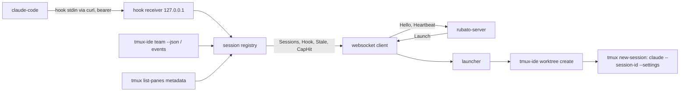

# Task 4: rubato-companion

Task 4 of `docs/plans/v0.md` §5. Six feature files first, then the binary that makes them pass
against a private tmux server, temporary git repositories, the real tmux-ide, a stand-in
`claude` and a test double of the server end of the websocket.

## Affected parts

| Node | Status | What changes | Seams |
| --- | --- | --- | --- |
| rubato-companion | new | pairing, websocket client with resume, loopback hook receiver, tmux pane metadata + tmux-ide reconciliation, launch (worktree, session, `--session-id`, `--settings`, OTel env), stale detection, spend cap, heartbeat, OTLP export | companion-server, companion-tmux-ide, companion-claude-code |
| rubato-protocol | affected | pairing requests and responses, route constants | companion-server |

## Data flow

## O-rows

| Seam | Breaks like | Signal | Panel | Owner |
| --- | --- | --- | --- | --- |
| companion-server | disconnected, token rejected, envelope undecodable | gauge `rubato.companion.heartbeat` (`rubato.companion_id`, `rubato.user`) flat; counter `rubato.events.dropped` (`rubato.reason`); log "server connection lost" with retry | Companions · Events dropped | rubato-server |
| companion-tmux-ide | `team --json` fails or changes shape; `worktree create` fails | span `rubato.team_poll`; gauge `rubato.sessions.discovered` (`rubato.session.source`); `LaunchResult::Failed` with the tmux-ide error; `rubato.tmux_ide.version` on every heartbeat | Sessions discovered | rubato-companion |
| companion-claude-code | hooks stop posting; payload shape changes; `--settings` no longer merges | counter `rubato.hook.forwarded` (`rubato.hook_event`, `rubato.session_id`) at zero while a session is *working*; event `rubato.session.stale`; fixtures replayed per event name | Hooks/min vs working sessions | rubato-companion |

## Assumed, not yet approved

| # | Decision | Chosen | Scope |
| --- | --- | --- | --- |
| T4.1 | Private tmux server for tests | `TMUX_TMPDIR` under `/tmp` (socket path length), not `tmux -L`: tmux-ide honours the env, not the flag | node (companion) |
| T4.2 | Session creation | `tmux-ide worktree create --no-session` for the worktree, then `tmux new-session -d` running the launcher script so the pane id is known; `tmux-ide adopt` best effort | node (companion) |
| T4.3 | tmux-ide events | `events --follow --json` lines are a trigger to reconcile with `team --json` now; their fields are not trusted directly | node (companion) |
| T4.4 | Precedence of sources | Hook > TmuxIde (`since` set) > Launch > Scraped; a trusted source is never downgraded by a scraped one | node (companion) |
| T4.5 | Spend | summed from the transcript with prices from `workspace.yml` (`companion.pricing`); empty pricing counts tokens only; a cap hit kills the tmux session and sends `CapHit` | node (companion) |
| T4.6 | Pane detection | pane metadata only (`list-panes -F`), command in {claude, node}; content is never read | node (companion) |
| T4.7 | Limits | the server's `Welcome` limits replace the local defaults, so one team shares one definition of stale | node (companion) |
| T4.8 | A17 | the launch feature asserts the settings file is passed; whether hooks merge under `--settings` needs a live Claude Code run (task 7) | node (companion) |

## Check

`cargo test -p rubato-companion`: unit tests plus the cucumber suite (`features/*.feature`) on a private tmux server; `fail_on_skipped`. On-purpose failures: the refused launch, the 401 without token, the scraped pane rendering *unknown*. Each scenario reports its steps; the summary reports scenarios run.
