# Make the system map interactive and link it to open issues

Issue: #48 · Plan: [../48.md](../48.md) (written after this design is approved)

## 1. Problem

The issue, condensed: the system map "is just a plain map, it doesn't show data flow, control flows
or anything similar, you're not able to drag and drop the different parts". The author works as a
team lead whose agents run on their own machine and who coordinates with other team leads. They
want to move parts, connect them to open issues, see **all** open issues ("we don't know whether
they are to be pinned or not if we don't see them"), see what each companion is doing and match
issues to companions, and bring session plans into the picture. "The main part we need to address
is the interactivity."

**What this is for.** Understanding the system is the point of this application; the interactivity serves it. Mattias, in the session: "the understanding of our system part is very important". A team lead who looks at the map should be able to say what each part is, what it owns, what goes in and out of it and over which seam, who depends on it, and what work and which decisions currently touch it, without opening a repository. Every statement below is judged against that: moving, pinning, queueing and editing are ways of working *on* a picture one already understands.

Settled in the planning session on 2026-11-10 (the four answers and "assume everything should be
super interactive and being able to move, modify, drag drop"):

| Question | Answer |
|---|---|
| How do UI edits reach the versioned map file? | A shared draft on the server; "Propose map change" opens a PR on the map repo |
| Where do part positions live? | One shared team layout on the server, live to every browser |
| What does dropping an issue on a companion do? | It queues the issue on your own companion; you start it from the queue; other people's lanes are read-only |
| How far do session plans come in? | A plan lens on the map, with a new parsed `Flows` table in the plan file |
| How does the server get write access, and who is on the team? | Through the GitHub registration: it becomes a GitHub App installed on the team's repos. Whoever can access that installation is on the team |

**Acceptance criteria** (from the issue)

- [ ] The map displays data flow and control flow between parts.
- [ ] A part can be dragged and dropped to a new position.
- [ ] A part can be connected to an open issue.
- [ ] All open issues are listed, including ones not yet pinned.
- [ ] An issue can be matched to a companion, and the companion's current work is visible.
- [ ] A session plan can be imported into the solution.

Below they are AC1 to AC6 in this order. AC7 is added from the session: the map itself can be
modified from the UI.

**Prior art.** Issue #47 asks for the unpinned-issues list with a pin button; this design covers it
and its first PR closes it. Design #20 gives the slice layout every new capability follows. The
direction is taken from Maggie Appleton's "Planning with Agents" and GitHub Next's Chopin: a plan
surface should be visual, directly manipulable and shared, decisions carry who made them and when,
and the agent's work is translated for the human. What is *not* taken: Chopin's shared plan editor,
its chat room and its MCP hand-off, because Rubato does not chat and each developer keeps their own
agents (ADR 0001, 0005).

## 2. Spec

### 2.1 What the change does

**Open issues and pinning (PR 1)**

- **S1** — When the server polls, it lists the open issues (pull requests excluded) of every repo the map names, in `repos[]` or on a node's `repo`, one listing per repo, at most 500 issues per repo. `GET /api/overview` carries the ones that are not already tracked as `backlog.issues`, and for each repo `backlog.repos[]` says when it was last listed, whether the list was cut at 500, and the error of the last failed listing. (AC4)
- **S2** — When a user opens the Issues tab, a "Not pinned" section lists every backlog issue with its key, title and labels, a text filter, and "listed N min ago" per repo. When the last listing of a repo failed, the section says so with the time of the last good listing; before a repo's first listing it says "not listed yet"; when the map names no repo it says so. It never shows an empty list as if there were no issues. (AC4)
- **S3** — When a user drags an issue row (tracked or not pinned) onto a part or a seam, the target highlights while the row is over it, and on drop the issue is pinned there (`POST /api/pins`); a not-pinned issue then appears among the tracked issues as *Planned*. The row menu "Pin to…" does the same without a pointer and replaces the typed pin dialog. An issue may have several pins: dropping a pinned issue on another target adds a pin, it does not move one. A pin is removed with the unpin button on the issue, as today. On a seam the drop target is the seam's label chip. (AC3)
- **S4** — When a user clicks a seam, it is selected like a part: the issue list filters to the issues pinned to exactly that seam, and the inspector (S9) opens. A filter on a part no longer matches a seam pin with the same id.
- **S5** — When a client sends `POST /api/pins` whose `kind` does not match the id (a node id as `seam` or a seam id as `node`), the server answers 422 and stores nothing.

**Movable parts (PR 2)**

- **S6** — When a user drags a part and drops it, the position is saved (`PUT /api/layout`) and every connected browser shows the part there after its next overview refresh; it is still there after a reload. (AC2)
- **S7** — When a part has no saved position, the automatic layout places it as today. "Auto-arrange" removes every saved position for the whole team and shows a notice with **Undo**, which restores the positions that were removed.

**Data flow and control flow (PR 3)**

- **S8** — When the map file gives a seam `flows` (each with `kind: data | control`, `from`, `to`, `carries`), the server accepts it if both ends of every flow are that seam's two nodes; otherwise the map load fails with the seam id in the error and the previous map stays loaded. A map without `flows` loads as before.
- **S9** — When a user looks at the map, every seam has an arrowhead, and a lens switch offers *Structure*, *Data flow* and *Control flow*. In the flow lenses each declared flow is its own arrow in its own direction, data solid and control dashed, labelled with what it carries, with a legend. (AC1)
- **S26** — When a user selects a part, the map explains it. The inspector says what the part is (description, kind, repo and path, linked to GitHub), what it receives and what it sends (its flows grouped as *in* and *out*, each naming the other part and the seam), which parts depend on it and which it depends on, and what touches it now (pinned issues with their state, open plans with what each changes there, sessions, decisions with author and time). On the map the part's neighbours and the seams between them stay lit and everything else dims. A seam explains itself the same way: its two ends, owner, guard, what it carries, its flows, and the O-rows open plans have written for it. A part or seam with no description or no flows says so ("not described yet"), so a gap in the team's understanding is visible, not blank.

**Plan lens (PR 4)**

- **S10** — When a plan file has a `## Flows` table (`From | To | Seam | Kind | Carries`), the server parser and the plan-check parser produce the same JSON from it. The plan check fails a plan whose flow names an unknown id or whose seam does not join `From` and `To`, and its log line reports how many flows it checked. A plan without the table parses and passes as before. (AC6)
- **S11** — When a user selects an issue that has a plan, the map shows that plan: parts the plan does not name are dimmed, affected and new parts are painted, the plan's flows are drawn as moving dashed arrows on their seams, and the inspector shows the plan's O-rows, its seam-scoped assumptions and the issue's `Decision:` comments with author and time. Clearing the selection returns to the team view. (AC6)
- **S12** — When a stored plan has a flow whose seam does not join its two parts, the overview carries a finding for it, shown on that seam.

**Companions and the queue (PR 5)**

- **S13** — When a user opens the Companions tab, each companion is a lane, the user's own first, showing hostname, user, connected or last seen, and every session it reports: issue, status, last seen and spend. A session whose signal is older than the stale limit shows *unknown*, never *working*. Sessions with no issue are listed in their lane. (AC5)
- **S14** — When a user drops an issue on one of their own lanes (or uses "Queue on…" in the row menu), the issue is queued there and every browser shows it in that lane with who queued it. The user can reorder a lane's queue by dragging and remove an entry. (AC5)
- **S15** — When a user drags an issue over another person's lane, the lane shows it does not accept the drop and nothing happens. `POST`, `PUT` or `DELETE /api/queue` for a companion that is not the caller's own, or is revoked, answers 403.
- **S16** — When a user presses **Start** on a queued issue, the session is launched on that lane's companion with the plan's spend cap and attempt limit (resolved by the server, as today). The entry leaves the queue when the companion reports the launch as started; when the launch is refused or fails it stays, with the reason shown. Start is disabled with the reason for an issue that is not pinned ("pin first") and for a lane whose companion is not connected.
- **S17** — When an issue is queued, moved or removed, its progress state and reason are unchanged.

**Editing the map (PR 6)**

- **S18** — When a user turns on edit mode, they can add a part (double-click the canvas or "Add part"), draw a seam (drag from one part's handle to another, or "Add seam"), edit a part's or seam's fields and flows in the inspector, and remove a part or seam. Each change is stored as an operation in one shared draft; every browser shows draft elements dashed with a "draft" badge and the author. (AC7)
- **S19** — When an operation would make the map invalid (duplicate id, a seam end that does not exist, an owner that is neither end, a flow off its seam), the server answers 422 with the reason and stores nothing. The id of a part or seam cannot be changed once added. Removing a part or seam that issues are pinned to answers 409 and names the issues.
- **S20** — When a user tries to pin an issue to a draft id, the server answers 422, and a plan naming a draft id still has unknown ids, until the proposal is merged and the map reloaded.
- **S21** — When a user presses "Propose map change", they see the YAML difference; on confirm the draft becomes read-only for everyone (further operations answer 409) and the server, acting as the GitHub App, opens a pull request on the map repo from a branch `map/draft-<time>` that starts at the map branch's head. The PR body lists every operation with its author. The draft shows the PR link. When that PR is merged and the map has been loaded again after the merge, the draft empties; when it is closed without merging, or a user presses "Withdraw proposal" (which closes the PR and deletes the branch), the draft is editable again with every operation kept.
- **S23** — When a user presses "Discard draft" on an editable draft, it empties for everyone and a notice offers **Undo** to every user until the next operation is written. A draft that is being proposed cannot be discarded, only withdrawn.
- **S22** — When the server cannot propose, it answers with the reason and the draft is kept, in the state it was in (editable on a first Propose; still frozen in *opening* on a Propose again, where Withdraw is the way out): the server's GitHub connection cannot write (it runs on a personal token or none: only an App installation writes; the local git stand-in used in tests also can), or the map is read from a local file (409; "Copy YAML" gives the full proposed file); the map file on the map branch is not the one that is loaded (409, "reload the map first"; other commits on that branch do not matter); the map file has keys the server does not model, which a rewrite would drop (409, naming them); an operation no longer applies to the loaded map (409, naming it, so it can be removed first). When GitHub refuses or times out during the writes, the answer is 502 naming the step, and the draft stays frozen in *opening*: Propose again resumes, Withdraw gives up.
- **S24** — When the server is configured as a GitHub App (`RUBATO_GITHUB_APP_ID`, its private key and installation id), it reads and writes GitHub as that installation, and a person gets a session only if their GitHub account can access that installation: checked at login (403 otherwise) and recorded on the session with its time. Every request and websocket upgrade then requires that record, no older than 7 days; a session without one, including every session from before the upgrade, answers 401 and the web sends the person through login again. When the server is not configured as an App (a personal token, or none), login and reads stay as today and the server warns at start; whether it can propose is S22's question about the connection, not this one. All the team's repos are under one GitHub account, because one installation covers one account. When a request or the websocket is refused for a missing or old record, the web takes the person to the login page: a 401 from any call does, and a closed websocket probes `GET /api/me` to find out.
- **S25** — When a user removes one operation from an editable draft (their own or anyone's), it leaves the draft for everyone; later operations that depended on it are shown as no longer applying.

**Routes** (all take the session cookie; every refusal is counted, O3)

| Route | Answers |
|---|---|
| `PUT /api/layout` · moved positions | 204 · 422 unknown id or non-finite number |
| `DELETE /api/layout` | 200 with the positions removed (Undo is a `PUT` of them) |
| `POST /api/queue` · issue, companion | 201 · 403 not your companion or revoked · 409 lane full |
| `PUT /api/queue` · companion, full order | 204 · 403 · 409 the set differs from what is stored |
| `DELETE /api/queue` · issue, companion | 204 · 403 · 404 |
| `POST /api/map/draft/ops` · operation with `op_id` | 201 · 409 draft is frozen · 409 pins name what is removed · 409 draft full · 422 invalid, with reason |
| `DELETE /api/map/draft/ops/{seq}` | 204 · 404 · 409 draft is frozen |
| `POST /api/map/draft/discard` | 200 · 409 draft is frozen |
| `POST /api/map/draft/restore` | 200 · 409 nothing to restore |
| `GET /api/map/draft/yaml` | 200 the proposed file as text |
| `POST /api/map/draft/propose` | 200 with the PR link · 409 refusals of S22 · 502 naming the step |
| `POST /api/map/draft/withdraw` | 200 · 409 no proposal, or already merged · 502 the PR could not be closed |

The draft, layout, queue and backlog are read through `GET /api/overview`; there is no separate read route.

### 2.2 How we'll know it works

Rust tests are `crate::module::tests::name` or `tests/integration.rs::name`; web tests are the file and the test title; e2e is `web/e2e/map.spec.ts`.

| Proves | Evidence | Kind |
|---|---|---|
| S1, AC4 | `github_poll::backlog::tests::lists_each_map_repo_once_and_replaces_rows`: with `FakeGitHub` holding 3 open issues, 1 closed and 1 pull request in a map repo, one poll stores exactly the 3; a second poll after one closes stores 2; a repo named only on a node is listed too | integration |
| S1 | `overview::build::tests::backlog_excludes_tracked_issues`: a pinned issue is in `issues`, not in `backlog.issues` | unit |
| S1 | `github_poll::backlog::tests::failed_listing_keeps_rows_and_records_error`; `…::cut_at_500_sets_truncated` | integration |
| S1 | `kernel::github::api::tests::open_issues_skips_pull_requests_and_pages` against a recorded response | unit |
| S2, AC4 | `features/issues/backlog.test.tsx`: "lists every not-pinned issue", "filters by text", "shows the listing error with the last good time, not an empty list", "says not listed yet before the first listing" | component |
| S3, AC3 | `features/issues/backlog.test.tsx` "Pin to… pins by keyboard"; `features/map/drop-target.test.tsx` "drop on a part card posts a node pin", "drop on a seam chip posts a seam pin", "dropping a pinned issue adds a second pin" (the card and the chip rendered on their own, without React Flow) | component |
| S3, AC3, AC4 | e2e "drag a not-pinned issue onto a part and onto a seam": the row moves to the tracked list as Planned | e2e |
| S4 | `features/issues/issue-panel.test.tsx` "a seam filter matches only seam pins" | component |
| S5 | `tests/integration.rs::pin_kind_must_match_id`: 422 for both mismatches, 201 for both matches | integration |
| S6, AC2 | `tests/integration.rs::layout_put_is_in_overview_and_notifies`; `features/map/layout.test.ts` "the drag-stop handler sends only the moved part", "a stored position wins over ELK", "an incoming position does not move the part being dragged" (pure functions; the real drag is the e2e row below) | integration, unit |
| S6, AC2 | e2e "a dragged part is in the same place in a second browser and after reload" | e2e |
| S7 | `tests/integration.rs::layout_delete_returns_removed_positions`; `map-view.test.tsx` "Auto-arrange then Undo restores" | integration, component |
| S8 | `rubato_protocol::map::tests::flow_ends_must_be_the_seams_nodes`; `…::map_without_flows_still_validates`; `map::load::tests::invalid_flows_keep_the_previous_map` | unit, integration |
| S8 | `schema/fixtures/maps/flows.{yml,json}` and `flows-off-seam.yml`, read by both `rubato_protocol::map::tests::map_fixtures` and plan-check "map fixtures": same result on both sides | unit |
| S9, AC1 | `features/map/flows.test.ts`: "one arrow per flow, data solid, control dashed", "two flows on one seam get different offsets", "structure lens gives one arrow per seam" (the pure function that turns a seam and a lens into arrows); `features/map/inspector.test.tsx` "a seam shows carries, guard, flows, pins and plans" | unit, component |
| S26 | `features/map/explain.test.ts`: "flows are grouped as in and out with the other part and the seam", "dependants and dependencies come from seam direction", "neighbours stay lit, the rest dims"; `features/map/inspector.test.tsx` "a part shows what it is, what goes in and out, and what touches it now", "a missing description or flow says not described yet" | unit, component |
| S9, AC1 | e2e "the data flow lens shows `rubato-map.yml`'s flows with arrowheads" (counts markers against the file) | e2e |
| S10, AC6 | `plans::parse::tests::flows_fixture_matches_typescript` and `actions/plan-check` "flows fixture matches Rust" over `schema/fixtures/plans/flows.{md,json}`; plan-check "a flow off its seam fails", "an unknown flow id fails", "a plan without Flows passes"; the log line has `flows_checked` | unit |
| S11, AC6 | `features/map/lens.test.ts`: "parts outside the plan are dimmed", "plan flows land on their seams"; `inspector.test.tsx` "shows the selected plan's O-rows, seam assumptions and decisions with author and time" | unit, component |
| S11, AC6 | e2e "selecting an issue with a plan paints its parts and flows": the seeded repo has a branch `issue/901-lens` whose plan has a Flows table (harness note below) | e2e |
| S12 | `overview::build::tests::flow_off_seam_is_a_finding` | unit |
| S13, AC5 | `features/companions/lanes.test.tsx`: "own lanes first", "a stale session shows unknown", "sessions without an issue are listed" | component |
| S14, AC5 | `tests/integration.rs::queue_add_reorder_remove`; `lanes.test.tsx` "drop on own lane queues", "Queue on… queues by keyboard" | integration, component |
| S15 | `tests/integration.rs::queue_refuses_another_users_and_revoked_companions` (403 on all three methods); `lanes.test.tsx` "another user's lane rejects the drop" | integration, component |
| S16, AC5 | `tests/integration.rs::queue_entry_leaves_on_started_and_stays_on_refused`; `lanes.test.tsx` "Start is disabled with 'pin first' for an unpinned issue", "Start is disabled for a disconnected lane", "a refused launch keeps the entry and shows the reason" | integration, component |
| S16, AC5 | e2e "queue an issue on a paired companion and start it" (extends the existing start-session e2e) | e2e |
| S17 | `overview::build::tests::queue_layout_and_draft_do_not_change_progress` | unit |
| S18, AC7 | `tests/integration.rs::draft_ops_build_a_preview` (add, update fields, set flows, remove, for parts and seams); `features/drafts/edit.test.tsx` "Add part form posts AddNode", "Add seam form posts AddSeam", "the connect handler posts AddSeam and adds no local edge", "editing a field posts an update", "remove posts a removal", "draft elements are dashed and badged" | integration, component |
| S19 | `map_draft::apply::tests::invalid_op_is_rejected_with_reason` (one case per rule); `tests/integration.rs::draft_remove_with_pins_is_409` | unit, integration |
| S20 | `tests/integration.rs::draft_ids_cannot_be_pinned` | integration |
| S21, AC7 | `tests/integration.rs::propose_opens_one_pr_and_freezes_the_draft` (the ref starts at the map branch's head, whose map file is the loaded one; the body lists each operation with its author; an operation sent while opening or proposed gets 409), `…::propose_twice_resumes_and_opens_one_pr` (a failed step, then success; "already exists" answers are reused), `…::merged_proposal_clears_only_after_a_load_that_follows_the_merge` (with an unrelated commit and a reload while proposed: the draft stays), `…::closed_proposal_reopens_the_draft`, `…::a_pr_created_during_a_timed_out_call_is_found_from_opening`, `…::withdraw_closes_the_pr_and_reopens_the_draft`, with `FakeGitHub` recording the calls | integration |
| S21 | `map_draft::yaml::tests::round_trip_keeps_the_committed_maps`: parse then serialise then parse gives the same map for `docs/design/rubato-map.yml` and `e2e/fixtures/team-map.yml` | unit |
| S21 | e2e "draft a part and a seam, propose" against the local git stand-in: a branch `map/draft-*` holds the new YAML | e2e |
| S22 | `tests/integration.rs::propose_refusals_keep_the_draft`: a GitHub port that cannot write, a local map file, a changed map file on the map branch, a map file with an unknown key and a stale operation each answer 409 with their reason and leave the draft as it was (a changed map file on Propose again leaves it frozen, Withdraw reopens it); an unrelated commit on the map branch does not refuse; a failing GitHub step answers 502 naming the step; `edit.test.tsx` "Copy YAML offers the proposed file" | integration, component |
| S23 | `tests/integration.rs::discard_then_undo_restores_every_operation_and_author`, `…::discard_is_409_while_proposing`; `edit.test.tsx` "Discard shows Undo" | integration, component |
| S24 | `auth::team::tests::member_only_when_the_installation_is_listed` (the predicate the callback uses, over recorded `/user/installations` answers); `tests/integration.rs::session_needs_a_fresh_team_record_when_the_app_is_configured`: sessions inserted without a record, with a record 8 days old and with a fresh one get 401, 401 and 200 on `GET /api/overview`, `/ws/web` and `POST /api/pins`; `…::without_the_app_login_stays_open`; `kernel::github::tests::only_installation_local_and_test_ports_can_write` (a personal-token client and the tokenless fake answer `can_write() == false`); `shared/api.test.ts` "a 401 raises needs-login once", `features/live/subscribe.test.ts` "a closed socket probes /api/me and routes a 401 to login"; `kernel::github::app::tests::startup_check_names_what_is_wrong` (bad key, client id that is not the App's, installation id that mints no token) | unit, integration, component |
| S25 | `tests/integration.rs::removing_an_operation_marks_dependants_stale` | integration |

**Harness changes these rows need** (each is a task in the plan, done before the rows that use it):

- `web/e2e/run.sh` stops using `RUBATO_MAP_FILE`. It seeds a temporary bare repository holding `docs/design/rubato-map.yml` on `main` and a branch `issue/901-lens` with a plan that has a Flows table, and starts the server with `RUBATO_LOCAL_REPOS`, `RUBATO_MAP_REPO/PATH/REF` and a 5 s poll interval, so plans, the lens and proposals run against real git. Whether a proposal is possible is asked of the GitHub port (`GitHubApi::can_write`): an App installation, `LocalGit`, and `FakeGitHub` when a test turns writes on can; a personal-token client and the tokenless fake cannot. The team record is required only when the App is configured, so the dev user needs none. The lens test pins #901 through the API and waits for the tick that fetches its plan, because plans are fetched only for tracked issues (`tasks.rs:28-40`). The two existing e2e tests must pass unchanged on it (N11).
- `RUBATO_DEV_ISSUES=<file.json>` gives `LocalGit` (and `FakeGitHub` when no token is set) its open issues. Development and tests only; the server logs a `warn!` at start when it is set, as it does for `RUBATO_LOCAL_REPOS`.
- `LocalGit` gains the write calls with real git and returns an error when git fails (today `LocalGit::git` turns every failure into `Ok(None)`, `kernel/github/local.rs:48-50`, which is right for reads only). Its pull requests live in memory.
- The OAuth callback calls `github.com` directly (`auth/handlers.rs:48-50, 127`), so the team check is tested as a predicate over recorded answers plus sessions inserted into the table, not through the callback.
- React Flow renders no edges in jsdom, because `web/test/setup.ts` stubs `ResizeObserver` without measuring. So component tests cover the part card, the seam chip, the inspector and the pure functions (arrows from flows, the lens, layout merging, the drag-stop and connect handlers); everything that needs a rendered edge or a real drag is an e2e row.

### 2.3 What it must not break

| # | Must keep working | Guarded by |
|---|---|---|
| N1 | A launch reaches only the caller's own connected companion (ADR 0004); the start-session gate; caps resolved by the server | existing `issue-panel.test.tsx` gate tests and the launch integration tests; new `queue_refuses_another_users_and_revoked_companions`. The web sends only the issue and the companion id |
| N2 | Progress is derived from the same inputs as today; layout, queue and draft are not inputs, and no new column stores a progress state | existing `progress.rs` tests; the existing every-column test over `kernel::db::all_columns`; new `queue_layout_and_draft_do_not_change_progress` |
| N3 | A map without `flows` and the committed `rubato-map.yml` load and validate | `map_without_flows_still_validates`; existing `graph.test.ts` over `realMap()` |
| N4 | Every existing plan in `docs/plans/*.md` parses and passes the plan check | existing `plans::parse` test over `docs/plans/*.md` (`parse.rs:364`); CI plan check |
| N5 | The per-issue poll order `upsert_meta → find_branch → plan, PR → decisions`, and `rate_limit` as the last call of a tick (`until_tick_done`, `tests/integration.rs:1073`) | existing GitHub-calls order test (`tests/integration.rs:1127`), extended: `open_issues` per map repo before the issue loop, the proposal's PR lookup after it and before `rate_limit`, nothing else moved |
| N6 | GitHub budget: listing costs at most 5 calls per map repo per tick | `lists_each_map_repo_once_and_replaces_rows` asserts the call count; the existing `GitHubRateLimitLow` rule |
| N7 | Every registered route answers; unknown `/api` paths answer 404 JSON | `app::tests::every_known_route_answers` with the new routes in `known_routes` |
| N8 | Slice rules and the AGENTS.md slice blocks | `slices.rs` tests with `layout`, `queue`, `map_draft` added; `features.test.ts` with `queue`, `drafts` added |
| N9 | Wire schemas change only by adding optional fields and new types; envelope fixtures still round-trip | `schema_snapshot.rs` (regenerated, diff reviewed); `fixtures.rs`; CI `protocol.ts` diff |
| N10 | Pins and plans name only merged map ids (ADR 0007) | `draft_ids_cannot_be_pinned`; existing `UnknownIds` finding tests |
| N11 | Existing end-to-end runs | `web/e2e/map.spec.ts` (both tests) and root `pnpm e2e` |
| N12 | With no saved layout the map looks as it does today | existing `graph.test.ts` "ELK lays out all 11 nodes"; `map-view.test.tsx` "no stored layout uses ELK for every part" |
| N13 | A failed map reload keeps the cached map | existing `loaded_at_follows_loads_and_survives_failures`; new `invalid_flows_keep_the_previous_map` |
| N14 | Pins stored before S5 keep showing, even if their kind was wrong | `tests/integration.rs::old_mismatched_pin_still_listed` (inserted directly into the table) |
| N15 | The skill's copies of the schemas in connected repos keep validating old maps and plans | both new fields are optional and neither schema sets `additionalProperties: false`; plan-check test "an old map and an old plan validate against the new schemas" |
| N16 | No browser dialogs; every drag has a keyboard path | `web-ux:ux-critic` pass per UI PR; component tests named "…by keyboard" above |
| N17 | Pairing a companion with a code and revoking your own, on the tab that becomes lanes (`CompanionsPanel.tsx:16-57`, untested today) | new `features/companions/pairing.test.tsx` "approving a code posts it", "revoke is offered only on your own", written and passing **before** the lanes rewrite, then kept green |
| N18 | Unpinning from the issue detail; selecting a part filters the issue list | new `features/issues/issue-panel.test.tsx` "unpin posts a delete", "a part filter lists its issues", written before PR 1's changes |
| N19 | A server that is not configured as a GitHub App (personal token or none, and `RUBATO_DEV_USER`) logs in, reads and launches as today | `without_the_app_login_stays_open`; the existing integration suite, which runs with a dev user and `FakeGitHub` |
| N21 | Under the App, every repo the map names and every repo of a tracked issue is still readable. Today a 404 reads as "absent" (`kernel/github/api.rs:114,134,168`), so a repo the installation does not cover would silently lose its branch, plan, PR and checks | new `github_poll::coverage::tests::a_repo_outside_the_installation_is_a_finding_not_an_absence`; O13 |
| N20 | A browser that missed websocket events still catches up | new `web_link::ws::tests::a_lagged_client_gets_one_changed_event` (today a lagged client is skipped silently, `web_link/ws.rs:37`) |

### 2.4 How we'll debug it at 3 am

All names below are added to `crates/rubato-protocol/src/otel.rs`. Panels are in a new dashboard row "Interactive map" in `observability/dashboards/rubato-overview.json`, asserted by `observability/check.ts`.

| # | When this fails | How we find out | What localises it | What it tells us · first action |
|---|---|---|---|---|
| O1 | Listing open issues fails or stops (token scope, rate limit, GitHub down) | panel "Backlog age" (`time() - max by (rubato_repo) (rubato_backlog_listed_at)`) yellow past 900 s, red past 1800 s; the Issues tab says "could not list" | `warn!("open issues listing failed")` with `rubato.repo` and the error; span `rubato.github.call` with `rubato.github.endpoint = "issues"` in error | which repo and why · check "GitHub calls · Rate limit", then O13 (is the repo in the installation?) |
| O2 | A repo has more than 500 open issues | the Issues tab says "first 500 shown" | `warn!("backlog truncated")` with `rubato.repo` and the count; gauge `rubato.backlog.issues` flat at 500 on panel "Backlog issues" (recorded every tick per map repo; a repo no longer in the map is recorded once as 0 and its `listed_at` as 0) | the cap is hit · raise the cap or add a label filter (new decision) |
| O3 | A drag, drop, queue or draft write is refused or errors | the user sees the reason in a notice; panel "Web writes rejected" (`rubato_web_rejected_total` by `rubato_route`, `rubato_reason`) | `info!("web write rejected")` with `rubato.route`, `rubato.reason`, `rubato.user` and the id concerned | which rule refused whom · a burst of `not_own_companion` or `unknown_id` after a deploy points at the web build |
| O4 | A saved position does not reach other browsers | users report different maps | counter `rubato.layout.writes` moves on panel "Layout writes"; `rubato.ws.clients` on "Web clients"; `rubato.events.dropped` with `rubato.reason = "web_lagged"` on "Events dropped" and its `warn!("web client lagged")`; a new `info!("web fan-out")` line in `AppState::notify` with the change reason and `rubato.subscribers` (today's per-client span is `debug`, `web_link/ws.rs:32`) | the write landed; either nobody was subscribed or a client fell behind · a lagged client is sent one catch-up event, so a persistent difference points at the browser |
| O5 | The map file gets invalid flows | "Map age" turns yellow, `rubato_map_load_failures_total` rises (existing panels) | `error!("map reload failed")` with the validation message naming the seam id | the merged map is wrong · fix the YAML; the old map stays in use meanwhile |
| O6 | A plan's Flows table is wrong, or the two parsers disagree | CI plan check fails; "Plan checks" panel; a finding on the seam | `rubato.plan.check` line with `flows_checked` and `flows_off_seam`; `PlanParseError` or flow-off-seam finding with the issue | which plan and which row · fix the plan on its branch |
| O7 | A proposal cannot be opened (the App lacks a permission, GitHub down or slow) | the user sees the step and reason within 50 s at worst (five calls, 10 s each, no retry) and the draft is kept; panel "Map proposals" (`rubato_map_proposals_total` by `rubato_outcome`) | `error!("map proposal failed")` with the step (`head`, `file`, `ref`, `contents`, `pull`), repo, branch, base sha and `rubato.user`; span `rubato.github.call` with endpoint `create_ref`, `put_contents` or `create_pull` | which GitHub call refused · check the App's Contents and Pull requests permissions and that it is installed on the map repo; Propose again resumes, Withdraw gives up |
| O8 | A proposal is merged but the draft does not clear, or a proposal stays in opening | users cannot edit; panel "Map proposal age": `time() - rubato_map_proposal_state_since > 0` by `rubato_outcome` (the state), yellow past 900 s for `opening` and for `merged` (`proposed` may be old: a review takes time). The gauge is recorded every poll tick from the table, with 0 for every state that is not current, so a past state does not linger and a restart does not go silent | `info!("map proposal state")` with from, to, the PR number and the base sha at every transition | merged but no map load since: check "Map age" and "Poll ticks" (the poll reloads the map when it sees the merge) · stuck opening: read O7's line, then Withdraw |
| O11 | A start from the queue is refused or fails on the companion | the entry stays in the lane with the reason | `info!("queue entry kept, launch not started")` with `rubato.companion_id`, `rubato.issue` and the reason, next to the existing `LaunchResult` handling | which launch and why · the existing launch path; nothing is lost |
| O13 | The App is not installed on a repo the map or a tracked issue names | a finding on the map ("not covered by the installation"); the issue's plan and PR stop updating | each tick the server lists the installation's repositories; `warn!("repo not covered by the installation")` with `rubato.repo`; gauge `rubato.github.repos_uncovered` on "GitHub calls · Rate limit" | which repo · add it to the App's installation |
| O14 | The App is misconfigured at deploy (bad key, the client id of another registration, wrong installation id) | the server refuses to start with the reason | `error!("github app check failed")` naming which of key, client id or installation failed; at login a failing `/user/installations` call answers 502 with reason `installation_lookup_failed`, distinct from 403 `not_on_team` | which setting · fix the environment; nobody is told "no access" for a configuration fault |
| O12 | A colleague cannot log in, or is sent to login again and again | they see 403 at login, or a login loop | `warn!("login refused: no access to the installation")` with the login and the installation id; `info!("session needs a team record")` with the login and the record's age; `rubato.web.rejected` with `rubato.reason = "not_on_team"` or `"team_record_stale"` | the App is not installed on a repo they can access, or the installation id is wrong · check the App's installation and the person's repo access |
| O9 | Queues grow and nothing starts | lanes fill up | gauge `rubato.queue.depth` by `rubato.companion_id` on "Queue depth", recorded every poll tick for every pairing, 0 for an empty or revoked one, next to "Sessions by state" | intent without sessions · a human question, not a fault; O11 covers a start that fails |
| O10 | A new migration fails at start | the server exits at start (existing fail-fast) | the `sqlx` migration error in the log | additive tables only · restore the database file and start the previous build |

## 3. Where it fits

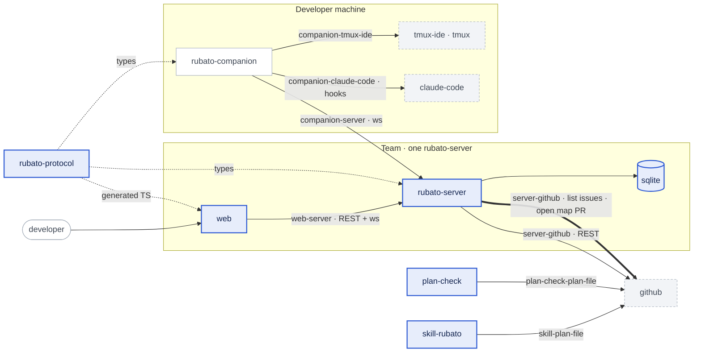

The companion does not change: lanes are drawn from the sessions it already reports, and a start
from the queue is the existing `LaunchCommand`.

## 4. Main flow

### 4a. Pin an open issue by dropping it on a part

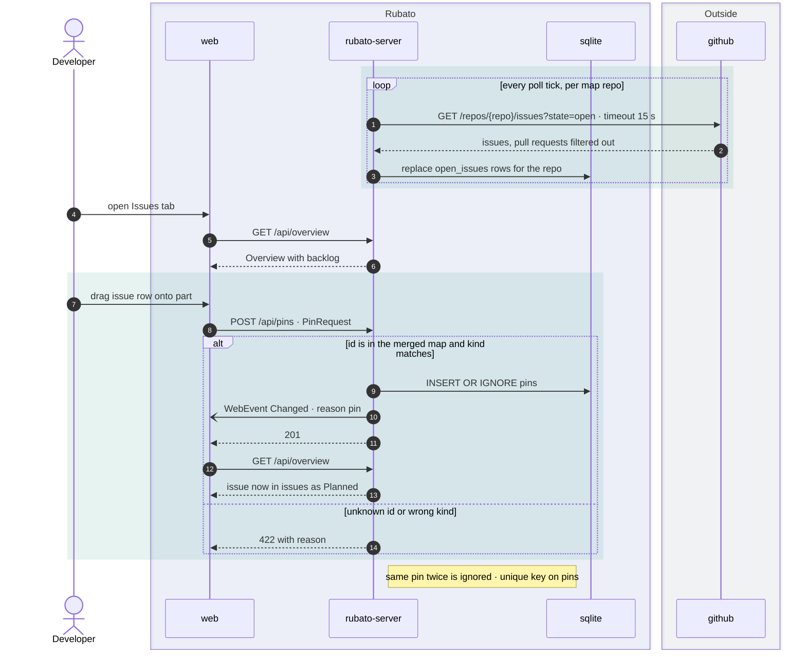

### 4b. Move a part

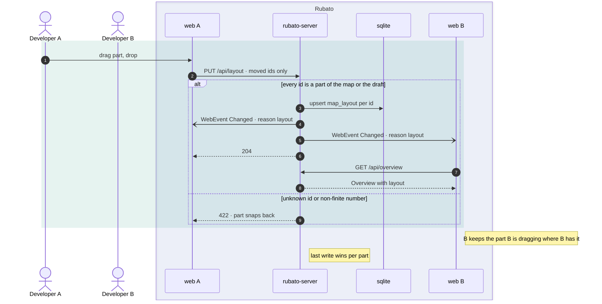

### 4c. Queue an issue on your companion, then start it

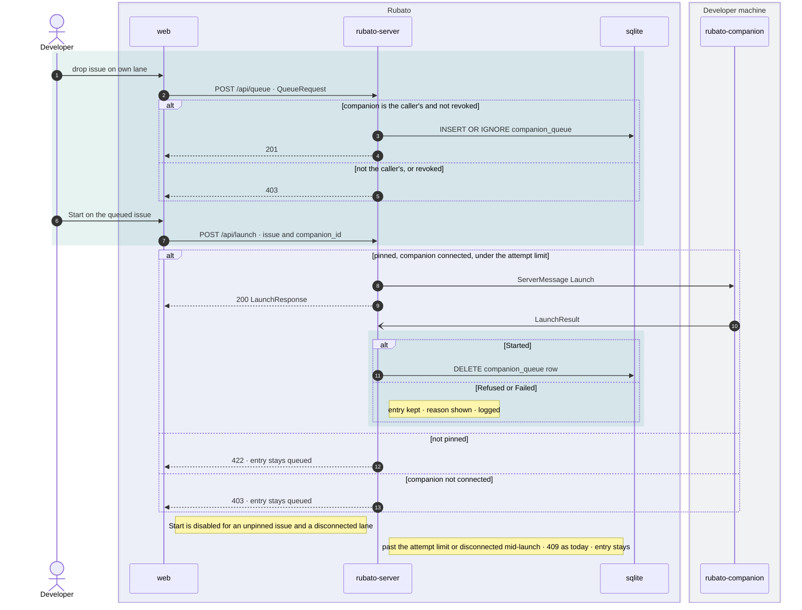

### 4d. Edit the map as a draft and propose it

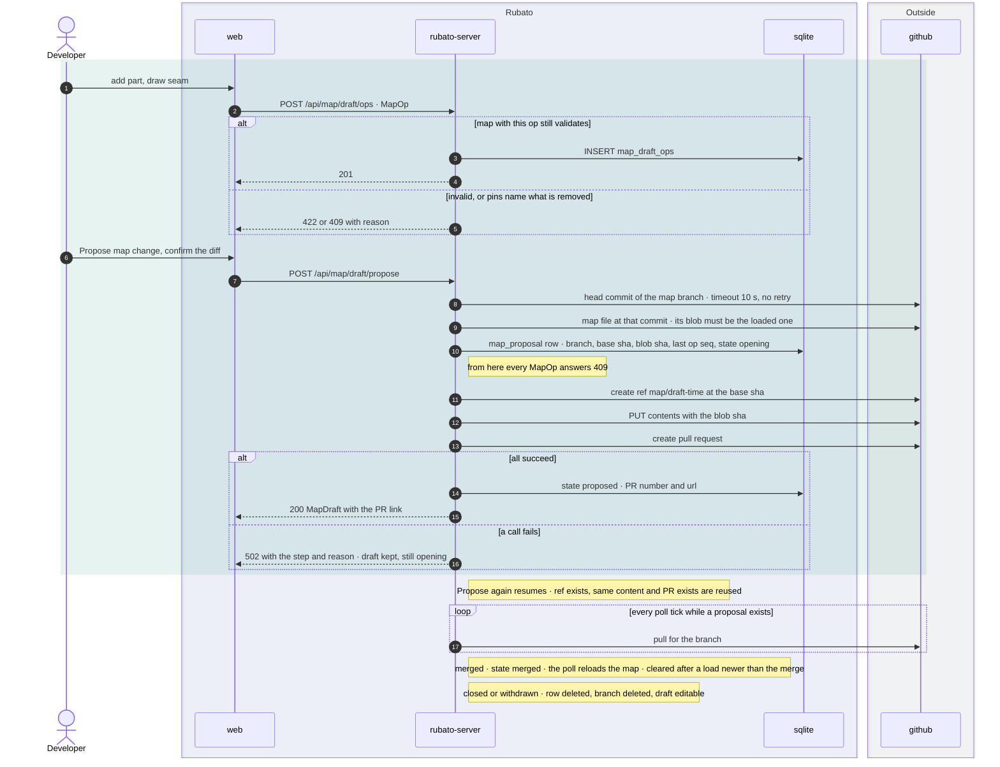

## 5. Control flow

### 5a. Every new write route

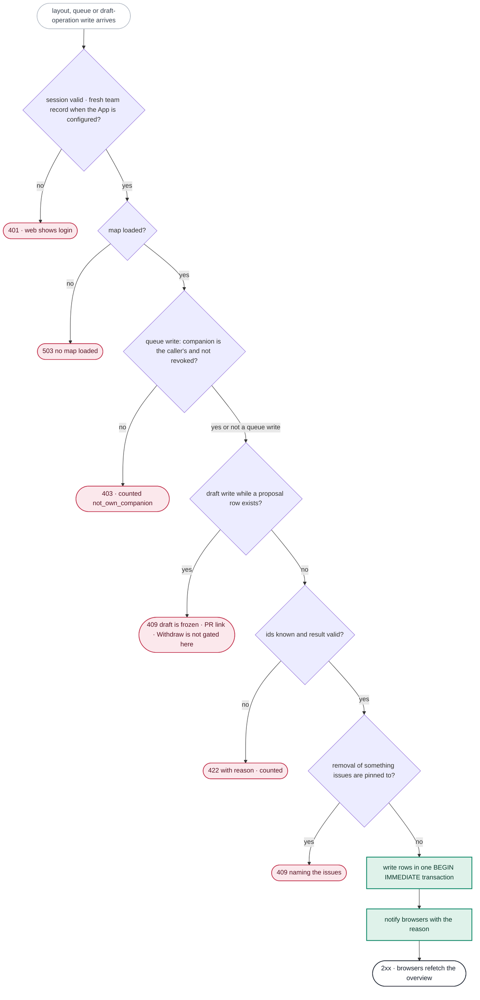

### 5b. Proposing the draft

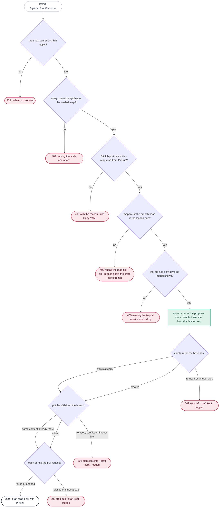

## 6. Data flow

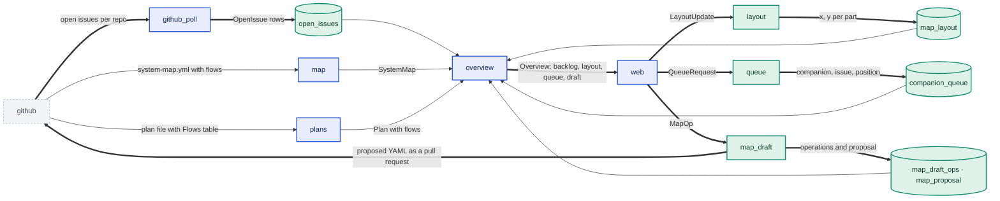

Nothing new crosses to the companion. The only new outbound data is the map YAML written to the map
repo as a pull request (seam `server-github`), by the App installation.

## 7. Data model and states

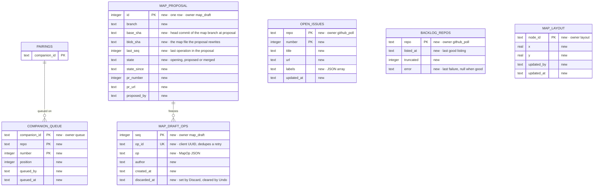

One additive migration per PR (`0002_backlog_team.sql`, `0003_layout.sql`, `0004_queue.sql`,
`0005_map_draft.sql`). One existing table changes: `web_sessions` (owner `auth`) gains a nullable
`team_checked_at`.

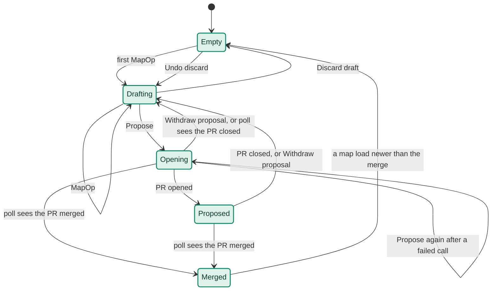

The draft's state is derived from its tables (no live operations: Empty; operations and no proposal
row: Drafting; a proposal row: its `state`). Operations are accepted only in Empty and Drafting. In
Opening, Proposed and Merged the draft is frozen, and Propose refuses a draft with an operation that
no longer applies, so the proposal is exactly the operations up to `last_seq`: the same set is in the
file, in the PR body, and deleted on the way from Merged to Empty. Withdraw closes the pull
request if one is open and deletes the branch (best effort, logged), then deletes the proposal row.
The poll task (`tasks.rs`, the composition root) checks the proposal's pull request each tick in every
proposal state, Opening included, so a pull request GitHub created while our call timed out is found.
It runs after the issue loop and before the rate-limit read. When it sees the merge it sets Merged and
reloads the map; the draft empties once the map's `loaded_at` is later than the merge was seen. So the
`map` slice never names `map_draft`. The loaded map's version is the branch's head commit
(`map/load.rs:18-21`), which moves with every commit to a code repo, so freshness is judged by the map
file's git blob hash, computed from the loaded text, not by the commit. Unknown keys are found in the
file fetched for that check, so `map_draft` needs nothing from `map`'s cache. The issue
progress states do not change.

## 8. Affected parts

| Project | Kind of change | Version bump | Migration | Generated clients |
|---|---|---|---|---|
| rubato-protocol | additive: `Seam.flows`, `Plan.flows`, `Overview.backlog/layout/queue/draft`, an optional `Seam.description`, `Finding` variants; new modules `layout`, `queue`, `map_draft`; a `Finding` for an uncovered repo; new `otel` names | no | no | yes (`schema/protocol/*`, `web/src/protocol.ts`) |
| rubato-server | behaviour and schema: `open_issues` on the GitHub port and in `github_poll`; pin kind check; new slices `layout`, `queue`, `map_draft`; `overview` reads them; `companion_link` dequeues on a started launch; flows in `plans::parse`; GitHub App installation auth (dependency change: `octocrab` gains a `jwt` feature, compiled out today at `Cargo.toml:26`; `sha1` becomes a direct dependency for the blob hash), a start-up check of the App settings, the installation's repo coverage each tick, and the team record on sessions; GitHub write calls without retry; lagged web clients counted and caught up | no | `0002` to `0005`, additive (new tables, one nullable column) | no |
| web | behaviour: a 401 anywhere leads to login; draggable map, flow edges and lenses, inspector, drop targets, backlog list, lanes and queue, edit mode; new features `queue`, `drafts` | no | no | consumes |
| system-map (contract) | additive: optional `flows` and `description` per seam in `schema/system-map.schema.json`; `docs/design/rubato-map.yml` declares flows for its 10 seams | no | no | no |
| plan-file (contract) | additive: optional `## Flows` table in `schema/plan.schema.json` | no | no | no |
| plan-check | behaviour: parses and checks Flows; `flows_checked` in the log line; map type gains `flows` | no | no | no |
| skill-rubato | additive: `map.ts` prints flows; `plan.ts init` writes an empty Flows table; `SKILL.md` names the section | no | no | no |
| rubato-companion | none | no | no | no |
| observability | additive: dashboard row "Interactive map" with seven panels; `check.ts` asserts them | no | no | no |

## 9. Caveats to consider

| Caveat | Answer |
|---|---|
| Boundaries | Each new table has one owning slice (§7). `overview` reads `layout`, `queue`, `map_draft` and `github_poll` through their roots, as it reads `pins` today (`overview/inputs.rs:5`). New edges, checked against today's graph in `slices.rs` (`pins`, `pairing`, `map` name only `auth`; `github_poll` and `plans` name nothing): `companion_link → queue` (dequeue on `LaunchResult::Started`), `queue → pairing` (ownership), `map_draft → pins` (pinned-to check), `layout → map_draft` (a position may be saved for a draft part), `overview → layout, queue, map_draft`. The proposal check and the clearing after a merge are called from `tasks.rs`, the composition root, so `map` names no new slice. No cycle. Revoked companions' queue rows are hidden by `overview`, not counted in `rubato.queue.depth`, and deleted by `queue` on its next write, so `pairing` need not call `queue`. Layout rows for ids in neither the map nor the draft are left out of the overview and deleted on the next layout write; a read never writes. |
| Idempotency | §9.1. |
| Concurrency | §9.1. |
| Schema change and rollback | Four additive migrations: new tables and one nullable column on `web_sessions`, no backfill (a missing team record means "log in again"). Rollback: `kernel/db.rs:20` runs `sqlx::migrate!` without `ignore_missing`, so an older build refuses a database that has newer migrations. Rolling back therefore means the previous build plus the database file copied before the upgrade; the copy is a step in each PR's deploy note. What is lost is only layout, queue and draft rows written since. |
| Contract compatibility | All wire changes add optional fields or new types (N9). `Finding` gains a variant: the web is embedded in the server and ships with it, so no older reader exists. `system-map.yml` and the plan file gain optional parts; old readers ignore them (no `deny_unknown_fields`, no `additionalProperties: false`, checked in `rubato-protocol/src/map.rs` and `schema/*.json`). The hand-written copies in `actions/plan-check/src/map.ts` and `parse-plan.ts` change in the same PRs. |
| Authorisation and tenancy | Today any GitHub account that reaches the server gets a session (`auth/handlers.rs:94-170`), sessions never expire on the server (`auth/store.rs:31-37`) and the server reads GitHub with a personal token. This design adds team-wide writes, shows every open issue title of the map's repos, and lets the server open pull requests. Decided with Mattias on 2026-11-10 (D12, ADR 0022): the registration becomes a GitHub App installed on the team's repos; the server acts as that installation; a person is on the team when their account can access the installation. The record of that check is required by `CurrentUser` (`auth/current_user.rs:27-46`), which every route and the websocket upgrade already use, so a session from before the gate is refused, not only a new login. Queue writes also check the companion against the caller's own pairings, the query the launch handler uses (`launch/handler.rs:61-80`). One team per server; no tenancy. |
| Observability | §2.4, O1 to O14. |
| Cost | GitHub: one to five listing calls per map repo per tick (at a 60 s tick, 60 to 300 calls per hour per repo of the 5000 budget), plus one PR lookup per tick while a proposal exists, plus five calls per proposal. An installation has its own budget of at least 5000 calls per hour, separate from any person's. The existing per-issue poll costs about six calls per tracked issue per tick (`tests/integration.rs:1209-1224`), about 360 per hour each at a 60 s tick, so roughly a dozen tracked issues already use the whole budget; pinning by drag makes that ceiling easier to reach. It is not changed here: `GitHubRateLimitLow` fires on it, and reducing the per-issue cost (the listing already carries title and state; conditional requests) is follow-up issue #49. SQLite rows are bounded: 500 per repo, one per part, 50 per companion, 200 operations. No model calls. |
| Testability | `FakeGitHub` gains `open_issues` and the three write calls and records them; the harness changes are listed under §2.2. Drag and drop onto HTML targets (part card, seam chip, lane): `fireEvent` with a `dataTransfer` stub in Vitest, `dragTo` in Playwright. Rendered edges and part dragging: Playwright only. Time: `build` already takes `now`. |
| i18n | n/a — English only (profile: do not flag). |
| CSP and hosting | No new host: no fonts, images or scripts are loaded; ELK and React Flow are already bundled. |
| States | Backlog: loading (overview not yet loaded), not listed yet, no repos in the map, empty ("No open issues in <repos>"), error (last listing failed, with the time of the last good one), truncated. Lanes: no companions (the existing pair hint), disconnected, revoked, stale sessions as *unknown*. Inspector: nothing selected. Draft: empty, opening (read-only, step shown, Withdraw), proposed (read-only with link, Withdraw), merged (waiting for the map), failed proposal (reason, Propose again or Withdraw), discarded (Undo). A refused drop shows why. |
| Generated types | All new wire types come from `web/src/protocol.ts`; the drag payload type lives in `web/src/shared/`. |
| Hot tables | n/a — new, small tables; SQLite on one server. |
| Unbounded reads | Backlog capped at 500 per repo (`truncated` shown); queue 50 per companion (409 past it); draft 200 live operations (409 past it); layout bounded by the number of parts. The overview stays unpaginated (profile: do not flag). |
| Retention | Backlog rows are replaced on every listing. Queue rows leave on launch, on removal, and when the companion is revoked. The draft empties on merge; discarded operations are deleted when the next operation is written. Branches `map/draft-*` are deleted when a proposal is withdrawn or its pull request is seen closed; after a merge the branch is deleted too (best effort, logged). Layout rows for unknown ids are deleted on the next layout write. No personal data beyond GitHub logins already stored with pins. |
| Seam O-row | `web-server`, `server-github`, `server-system-map`, `skill-system-map`, `server-plan-file`, `skill-plan-file`, `plan-check-plan-file` each get an O-row in `docs/plans/48.md`, from O1 to O14. |
| Telemetry names | New in `otel.rs`: metrics `rubato.backlog.listed_at`, `rubato.backlog.issues`, `rubato.web.rejected`, `rubato.layout.writes`, `rubato.queue.depth`, `rubato.map.draft.ops`, `rubato.map.proposals`, `rubato.map.proposal.state_since`, `rubato.github.repos_uncovered`; attributes `rubato.route`, `rubato.outcome`; `rubato.events.dropped` gains the reason value `web_lagged`. The gauges that describe current state (`backlog.listed_at`, `backlog.issues`, `queue.depth`, `map.draft.ops`, `map.proposal.state_since`) are recorded on every poll tick from the tables, zeros included, because a gauge recorded only on change keeps its last value per attribute set (the trap noted at `companion_link/ws.rs:285-287`). The two timestamp gauges have no unit, like `rubato.map.loaded_at` (#31 N4). Each is asserted by a test with the in-memory metric reader from #31 and listed in `e2e/run.ts`. |
| Derived, not stored | Queue, layout and draft are stored intent and presentation, not progress (S17, N2). `derive_progress` is not touched. |
| Own tmux only | Start from the queue is the existing launch handler with `companion_id` set; the queue adds its own ownership check so that an entry cannot even be placed on someone else's lane (S15). |
| Check reports its count | Plan check adds `flows_checked`; must-fail fixtures: a flow off its seam and an unknown flow id. `observability/check.ts` reports the panel count with the seven new panels; its must-fail copy lacks "Backlog age". Slice tests report their new slice and edge counts. |
| Log level | Every line in §2.4 is `info`, `warn` or `error`. |

### 9.1 Concurrency and idempotency

**Idempotency: the same work arriving twice**

| Kind of duplicate | Covered by | Outcome |
|---|---|---|
| Same message or job redelivered (retry, crash before ack, restart) | The listing replaces a repo's `open_issues` rows in one transaction; running it twice gives the same rows | no duplicates |
| Same message on two replicas at once | n/a — one server per team (ADR 0008) | |
| Failure partway through (after some writes, before publish or commit) | Listing: the transaction rolls back and `backlog_repos.error` is set. Proposal: the `map_proposal` row holds the branch name, base sha and `last_seq` before the first write to GitHub; each step tolerates "already done": GitHub's 422 "Reference already exists" and "A pull request already exists" are mapped to *exists*, equal content is not rewritten, and the PR is found with the existing `pull_for_branch`. The write calls use a client built without retry, so nothing replays a call behind our back (octocrab's retry feature is on for reads, `Cargo.toml:26`) | Propose again resumes; never two PRs for one draft |
| Duplicate event from the producer | n/a — no new events from the companion | |
| Side effects outside the database (e-mail, blob, search, external API) | The pull request, guarded as above | one PR |
| New request with the same intent (double-click, client or gateway retry) | Pins and queue: `INSERT OR IGNORE` on the primary key. Layout: an upsert of the same position. Draft: the client sends an `op_id` (UUID) per operation, unique in `map_draft_ops`; a repeat answers 201 without a second row | no double entries |
| Redelivery after the deduplication window | n/a — no window; keys are permanent | |

**Concurrency: different actors touching the same state**

| Situation | Covered by | Outcome |
|---|---|---|
| Two writers on the same row | Layout: last write wins per part, by design; the browser that is dragging a part ignores incoming positions for it until its own write is answered. Queue order: `PUT` carries the full order of one lane and is refused with 409 when its set of issues differs from the stored set (an entry added in another tab is not deleted by a reorder); only the lane's owner can write it. Draft: operations append in `seq` order; each is validated against the map with all earlier operations applied, inside a `BEGIN IMMEDIATE` transaction (`begin_with` in sqlx 0.8; a plain `begin` is deferred and the loser of two read-then-insert transactions would fail with `SQLITE_BUSY`, a 500), so two operations that conflict cannot both land | the later conflicting operation gets 422 |
| Several saves inside one request or consume | Each write route uses one transaction | all or nothing |
| Work running on more than one replica (static state, schedulers, sweeps, claims) | n/a — one server | |
| Several events for one saga instance or aggregate at once | Propose pressed by two users: the `map_proposal` table has one row (`id = 1`); the second insert fails and that caller gets the existing proposal. An operation written while another user proposes: the proposal row and its `last_seq` are written in the same `BEGIN IMMEDIATE` transaction that reads the operations, and operations are refused from then on, so the PR content, the PR body and what is cleared on merge are the same set | one proposal; no operation is listed but missing, or cleared but never proposed |
| Locks or transactions held across a network call | None: the proposal row is committed before the writes to GitHub and updated after. The freshness check (two reads) happens before the row is written. It is a check-then-act on a remote branch, accepted: the PR starts from that head and the file is written with its blob sha, so a map change that lands in between is a conflict on the PR, not a silent revert | |
| Work longer than the broker's ack or visibility timeout | n/a — no broker | |
| Ordering assumed between two messages | The merged map changing under a draft: operations are re-applied to the current map on every read; one that no longer applies is marked `stale` with its reason and skipped in the preview. Propose refuses while any operation is stale; a user removes it (S25) or fixes what it depends on | shown, never proposed in part, never cleared unseen |

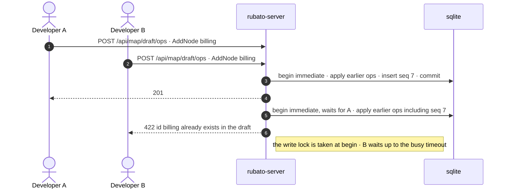

Left to another feature: live cursors and presence, and undo beyond the two cases named in S7 and S23. Auto-arrange's Undo is offered only to the person who pressed it.

## 10. Decisions

### 1. Open issues come from one listing per map repo → ADR 0019

**Decision:** The server lists open issues for the repos in the map's `repos[]` and keeps them in `open_issues`, replaced per listing. They reach the browser as `Overview.backlog`, separate from `issues`.

**Rationale:** A list per repo costs one to five calls however many issues there are; the tracked `issues` keep their derived progress, and an unpinned issue has none to derive. (Rejected: putting unpinned issues in `issues` with state *Unknown*, which would make every open issue cost five calls per tick in `poll_issue`.)

### 2. One shared layout, last write wins per part → ADR 0016

**Decision:** Positions live in `map_layout`, travel in the overview and are written by `PUT /api/layout`.

**Rationale:** The thesis is a shared picture; a map each person arranges differently is not one. (Rejected: browser storage, private and lost per device; positions in the map file, where every drag is a pull request.)

### 3. Flows are declared on the seam → ADR 0017

**Decision:** `flows: [{kind, from, to, carries}]` on a seam, optional. A seam's own `from → to` stays the dependency direction.

**Rationale:** The existing arrows mean "depends on" and data often runs both ways over one seam; flows per seam say so without new ids. (Rejected: a single `kind` on the seam, which cannot show two directions; flows as separate top-level edges with their own ids, which would be new ids for pins and plans to name.)

### 4. A plan carries its flows as a table → ADR 0021

**Decision:** An optional `## Flows` table in the plan file, parsed by both parsers, checked by the plan check.

**Rationale:** ADR 0005 keeps the plan a file; a table is what both parsers already read, and it puts the plan's data flow on the shared map instead of in a Mermaid block nobody parses. (Rejected: parsing Mermaid; a submit endpoint.)

### 5. The queue is stored intent on your own companion → ADR 0020

**Decision:** `companion_queue` holds what a developer intends to run on their own companion. It is visible to everyone, writable only by the owner, and never an input to progress.

**Rationale:** It is the "match" the issue asks for without steering anyone else's agent (ADR 0001) and without replacing branch identity (ADR 0006): once a session exists, the session is the truth. (Rejected: drop equals launch, which makes matching and starting one irreversible gesture; assigning to another user's companion.)

### 6. Map edits are a shared operation log proposed as a pull request → ADR 0018

**Decision:** Operations are stored, replayed over the current map for a preview, and proposed as a PR that rewrites the map file. One proposal can be open at a time.

**Rationale:** The map stays a versioned file whose merged ids are the only ones pins and plans may name (ADR 0007, 0010), and review stays on GitHub where merging is a human act. (Rejected: the server as the map's source of truth; a stored whole-map draft, which loses who changed what.)

### 7. Ids are permanent

**Decision:** No operation renames an id. Description, kind, repo, path, carries, owner, guard and flows can be edited.

**Rationale:** Pins, plans and O-rows name ids (ADR 0007); a rename would orphan them.

### 8. The proposed file is serialised from the map model, and only over the file that is loaded

**Decision:** The PR writes the YAML produced from `SystemMap`, with a fixed header comment, on a branch that starts at the map branch's head. The server refuses to propose when the map file at that head is not the loaded one (compared by git blob hash; other commits do not matter), or when the file has keys the model does not know. Hand-written comments in the file are lost on the first proposal, which also reflows the file once.

**Rationale:** There is no comment-preserving YAML writer in the Rust toolchain we use; `rubato-map.yml` has two comment lines. Rewriting only a file known to be the loaded one means a map change merged meanwhile is refused or shows as a conflict instead of being undone; refusing unknown keys means a rewrite cannot drop a field a newer schema added. A round-trip test over the committed maps proves the model loses nothing it knows. (Rejected: text patching of the YAML, fragile for removals and edits.)

### 9. Native drag and drop, each drag with a menu twin

**Decision:** HTML drag and drop with a typed payload from `web/src/shared/`; React Flow's own dragging for parts and for drawing seams. Every drag action also exists as a menu item or a small form.

**Rationale:** No new dependency, and keyboard users are not locked out (N16). (Rejected: a drag-and-drop library for three drop targets.)

### 10. No new alert rules

**Decision:** Seven dashboard panels with thresholds; nothing added to the "never silent" list.

**Rationale:** That list is the team's to extend (as in #31). Every failure here is also visible to the user at the moment it happens.

### 11. Delivered as six code PRs after the records PR

**Decision:** PR 1 GitHub App access and the team record, backlog and pinning (closes #47), PR 2 layout, PR 3 flows, PR 4 plan lens, PR 5 lanes and queue, PR 6 drafts. Each branches from `main` after the previous one merges.

**Rationale:** Each is usable alone and reviewable; stacked branches caused conflicts in #26 to #31.

### 12. The registration becomes a GitHub App; access to its installation is the team → ADR 0022

**Decision:** The server is registered as a GitHub App installed on the team's repositories. It reads and writes GitHub as that installation (Contents and Pull requests read and write, Issues, Checks and Metadata read). A person gets a session only if their account can access the installation, recorded on the session and required on every request, at most 7 days old. Without the App configuration the server behaves as today and cannot propose.

**Rationale:** Decided with Mattias on 2026-11-10 ("give the app access through the app registration"; team = whoever can access the App's repos). One registration then answers both questions the review raised: what the server may write, and who may make it write. Nobody keeps a list of logins, and the personal token goes away in production. The pull request is opened by the App's own identity and names the people in its body. (Rejected: a login list in the environment, one more thing to edit per colleague; a second write-only token; checking the gate only at login, which leaves earlier sessions with full access.)

### 13. Understanding comes first

**Decision:** The map's first job is to explain the system: a selected part or seam says what it is, what flows through it, what depends on it and what is happening to it (S26), and gaps in that description are shown. `docs/design/rubato-map.yml` gets a description and flows for every part and seam in PR 3, and the plan lens (S11) answers "what would this plan change in the system" in the same vocabulary.

**Rationale:** Stated by Mattias as the purpose of the application. It is also Appleton's point about boundary objects: the surface should be built for the human's way of seeing, and the labour of translation belongs to the tool. An interactive map that can be rearranged but does not explain anything would be a toy. (Rejected: keeping explanation in the YAML and the repos, where only the person who wrote it reads it.)

### 14. The seam's drop target is its label chip

**Decision:** Each seam has an HTML chip at its label (React Flow's `EdgeLabelRenderer`) that is the drop target, the click target and the keyboard focus for the seam. Parallel flows on one seam are drawn by a custom edge that offsets each arrow.

**Rationale:** React Flow has no drop API for edges and an SVG path is a poor drag target (a curve's bounding-box centre is usually off the line). One HTML element serves pointer, keyboard and tests.

### 15. A queue entry leaves when the companion says the launch started

**Decision:** `companion_link` removes the entry on `LaunchResult::Started` (it already maps the result to its issue through `launch::record_result`, `launch/store.rs:18-37`). On Refused or Failed the entry stays and shows the reason. A failed delete is logged at `error!`, like the store calls next to it; a redelivered Started deletes nothing.

**Rationale:** The launch handler's success only means the command was sent (`launch/handler.rs:186-196`); removing the entry there would lose the intent when the companion refuses.

## 11. Out of scope / Open questions

- Plans merged to `main` and folder-form designs are still not read by the server; the lens shows plans on issue branches.
- Anchoring a `Decision:` comment to one part: decisions show on the parts their issue pins or its plan touches.
- Live cursors, presence, comments on the map, undo history.
- Touch devices.
- Suggesting a companion for an issue.
- Traffic observed against the declared flows (map versus territory).
- Reducing the per-issue poll cost (see the Cost caveat): issue #49.
- Removing someone's access takes effect when their team record is 7 days old, or at once by deleting their rows in `web_sessions`; there is no screen for it.
- Deployment, for a human: register a GitHub App (an OAuth app cannot be converted, so this is a new registration with a new client id and secret), install it on the team's repos, and set its id, private key and installation id on the server. `docs/QUICKSTART.md` is updated in PR 1. Until then S24's last sentence applies.
- The map is still read at the branch name while its version is the head commit (`map/load.rs:18-26`); not changed here, because freshness no longer depends on it.

## 12. Review outcome

design-reviewer, 2026-11-10, three passes. First: 5 blockers, 2 should-fix. Second: 1 blocker, 5 should-fix, 1 note. Third: 1 blocker (a contradiction in the text), 4 should-fix. Every finding was taken; none is kept as an accepted risk. The fixes to the third pass were checked by reading, not by a fourth pass.

- **Spec check (third pass):** Does: gap (when the server may propose was answered three ways). We'll know it works: gap (the propose rows contradicted N19's test; the web's re-login had no test). Must not break: gap (every read changes identity to the installation, unguarded). Debug at 3 am: gap (a misconfigured App looked like "no access"; an uncovered repo looked like "no branch").
- **Fixed after the third pass:** proposing is asked of the GitHub port (`can_write`), the team record of the App configuration (S22, S24, §5b); a 401 anywhere leads to login, with tests (S24); N21 and O13 for repos outside the installation; O14, a start-up check of the App settings, and the dependency change named in §8; five leftovers of earlier wording.

### Risk map (look here first)

1. **Switching every read to the installation identity** (S24, D12; `kernel/github/api.rs:114,134,168`). A 404 becomes "absent" today, so a repo the installation does not cover would look like "no branch, no plan, no issue". Guarded by N21 and O13. Verify by hand: install the App on a subset of repos and watch a tracked issue in an excluded one.
2. **Draft to pull request** (`map_draft`, ADR 0018, §4d, §5b, §7). The server's first write to GitHub, rewriting the file whose ids pins and plans name. Verify by hand: the branch's base, what is frozen in which state, that the operations cleared on merge are exactly the ones in the PR.
3. **Re-login in the browser** (`web/src/features/live/subscribe.ts:28-35`, `web/src/App.tsx:59-70`). Verify by hand: let a team record age past 7 days with the tab open and the websocket dropped.
4. **The blob-hash freshness check** (§7). `LoadedMap` holds no text or hash today, and the database-copy path must produce one too. Verify by hand: the computed hash equals the contents API's `sha` for `rubato-map.yml`.
5. **GitHub budget** (§9 Cost). About six calls per tracked issue per tick; pinning by drag makes the ceiling of about a dozen tracked issues easy to reach. Accepted here; follow-up issue #49; `GitHubRateLimitLow` covers it. Watch after PR 1.

### Problematic patterns

- **Capability decided in two places** (config "is an App" against port "can write"): fixed, one port method.
- **"Not found" read as "absent"** under a narrower identity: fixed by the coverage check (N21, O13).
- **Authorisation at session creation instead of at every use**: fixed, the team record is required by `CurrentUser`.
- **Gauge recorded only on transitions**: fixed, state gauges are recorded every tick with zeros.
- **Retry without idempotency** on GitHub writes: fixed, the write calls do not retry and "already exists" is reused.
- **Read-modify-write without a token** on queue order: fixed, a differing set is refused.
- **Check-then-act on the remote branch** before a proposal: kept deliberately. A change that lands in between is a conflict on the pull request, not a silent revert.
- **Last write wins** on a part's position: kept deliberately (ADR 0016).
- **Undo for one person only** on Auto-arrange: kept; positions are cheap to redo.

### Findings

None open. The full reports are summarised above; their fixes are in §2 (S16, S21 to S26, N17 to N21, O4, O7 to O14, the Routes table, the harness list), §5, §7, §9, §9.1 and D8, D12 to D15.
