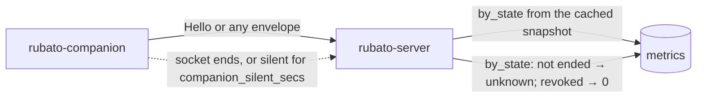

# Sessions by state shows a disconnected companion's sessions as unknown

Since #43 the server is the only source of `rubato.sessions.by_state`, recorded from each
companion snapshot (`crates/rubato-server/src/companion_link/ws.rs`, `record_sessions_by_state`).
When a companion disconnects the gauge keeps its last values, so the "Sessions by state" panel
can show *working* for a companion with no heartbeat. AGENTS.md says such a session renders as
*unknown*, never as *working*. Zeroing on disconnect is not enough: the companion sends a
`Sessions` snapshot only when it changed, so after a reconnect with no change the gauge would stay
at zero. This change takes the server-only fix the issue lists first: when a companion goes away,
record its sessions as `unknown`; when it says `Hello` (or is heard from again), record them from
the stored snapshot. The companion does not change.

## What the change does

- When a companion's socket ends and no newer socket has taken its place, the gauge for that
  companion counts every session of its last snapshot that had not ended as `unknown`, and
  `working`, `idle` and `blocked` as 0. Ended sessions stay `ended`.
- When a companion's pairing is revoked, its gauge is all zeros: it is gone, as the queue-depth
  gauge already treats a revoked pairing.
- A companion whose socket is still open but that has sent nothing for `companion_silent_secs`
  (a laptop asleep with the socket half-open; the same threshold `CompanionSilent` pages on) is
  counted the same way, as `unknown`, by the server's poll tick.
- When the companion says `Hello` again, or a quiet one sends any envelope again, the gauge is
  recorded from its stored snapshot, so the states it last reported show again without waiting
  for a changed snapshot.
- A socket replaced by a newer one for the same companion changes nothing when it closes: the
  newer socket is live.
- `companion disconnected` now says what was recorded: `sessions="unknown"`, `"zeros"` or
  `"left_to_newer"`.

## How we'll know it works

Each test polls the metric reader until the expected point appears, with a timeout, as the
existing socket tests do: a close is asynchronous, so an assertion right after it proves nothing.

- [ ] `app::tests::a_disconnected_companion_counts_its_sessions_as_unknown`: `Hello`, then a
      snapshot with one working and one ended session: working 1. The socket closes: working 0,
      unknown 1, ended 1, and the kernel's session cache and the `session_snapshots` row are as
      before. It reconnects and says `Hello` without a new snapshot: working 1, unknown 0 again.
      It prints the points it checked. It fails against today's code (working stays 1 after the
      close; run before the fix, recorded in the PR).
- [ ] `app::tests::a_replaced_socket_leaves_the_counts_to_the_newer_one`: a second socket says
      `Hello`; the server ends the first one; the reader is polled until the first socket's end
      is logged (`sessions="left_to_newer"`) and the gauge still shows working 1.
- [ ] `app::tests::a_revoked_companion_counts_zero`: `Hello`, a working snapshot, `DELETE` the
      pairing: every point for that companion is 0.
- [ ] `companion_link::ws::tests::a_quiet_companion_counts_unknown_until_heard_from`: the quiet
      pass with a `last_seen` older than `companion_silent_secs` records unknown; a later
      `touch_companion` records from the cache again; a fresh `last_seen` records nothing.

## What it must not break

- Each snapshot still records one point per status for its companion, zeros included
  (`companion_link::ws::tests::a_snapshot_without_a_working_session_records_working_zero`).
- The 256-session cap: a refused snapshot records nothing. `app::tests::a_snapshot_over_the_cap_is_not_stored`
  gets an assertion that the gauge is unchanged after the refused snapshot.
- The stored snapshot and the kernel's session cache are not changed on disconnect: asserted in
  the first test above. `each_snapshot_replaces_the_companions_cached_sessions` keeps guarding
  the cache on snapshots.
- `SessionWorkingNoHooks` and its rule tests (`observability/alerts/tests/rubato.test.yml`): the
  rule reads `working`. After a disconnect it is lower than today; after a `Hello` it is recorded
  from the stored snapshot, which may be old, exactly as today's gauge would show it, and the
  hook series still decides the alert.

## How we'll debug it at 3 am

See the O-rows. The disconnect log line `companion disconnected` gains `sessions` (what was
recorded), so a replaced socket, a revoke and a plain close can be told apart. The quiet pass
logs `companion quiet, sessions counted unknown` at info once per companion when it marks it,
with `rubato.companion_id` and `last_seen`. The panel's description says what `unknown` means
here.

## Affected parts

| Node | Status | What changes | Seams |
| --- | --- | --- | --- |
| rubato-server | affected | records a gone or quiet companion's sessions as `unknown` (zeros once revoked) and records them again from the cached snapshot on `Hello` or the next envelope | companion-server |
| rubato-companion | quiet | unchanged: still sends `Sessions` only when they changed | companion-server |

## Data models

None.

## Data flow

## Tasks

1. Failing tests first, in `crates/rubato-server/src/app.rs` `tests` (they need the router and
   the in-memory metric reader): the three socket tests above, and the cap test's new
   assertion. Run them against today's code; the first and the revoke test fail.
2. `companion_link/ws.rs`, after the read loop in `handle`, under the `companions` lock: our own
   `conn` in the slot → remove it and record `unknown`; an empty slot (revoked: `pairing::revoke`
   removed it) → record zeros; a different `conn` → record nothing. The recording is synchronous
   and happens while the lock is held, so a newer socket's `Hello` cannot be overwritten by an
   older socket's late close.
3. The `Hello` arm, after the identity and protocol checks and before the `Welcome`: record from
   the kernel's session cache. A companion with nothing cached records nothing.
4. The quiet pass: `companion_link::mark_quiet`, called from the poll tick in `tasks.rs` next to
   `overview::refresh_gauges` (the composition root names both slices, so the slice graph gains
   no edge), marking each connected companion whose `last_seen` is older than
   `companion_silent_secs` as quiet (a flag on `CompanionConn`) and recording `unknown` once;
   `touch_companion` clears the flag and records from the cache. Unit test with a fixed clock.
5. The "Sessions by state" panel gets a description; the disconnect log line gets `sessions`.
6. Server suite, clippy, fmt, `pnpm observability:check` and `observability:test`.

## Assumed, not yet approved

| # | Decision | Chosen | Alternatives | Scope |
| --- | --- | --- | --- | --- |
| A1 | What a disconnected companion's ended sessions count as | `ended`, as last reported | `unknown` too | node |
| A2 | Where `Hello` reads the snapshot from | the kernel's session cache (`AppState::sessions`), filled from the stored snapshots at start (`tasks::warm_sessions`) and on every snapshot | a query of `session_snapshots` per `Hello` | node |
| A3 | A revoked companion | zeros: it is gone, and a permanent `unknown` series per revoked id would stay until restart (the SDK keeps every attribute set) | `unknown` | node |

## Decisions

| # | Decision | Chosen | Why | Decided by |
| --- | --- | --- | --- | --- |
| 1 | Fix | server only: unknown on disconnect, re-record on `Hello` | the issue's first two candidates; no companion change, as the team lead set | agent (delegated by Mattias, 2026-11-15) |
| 2 | A half-open socket (a sleeping laptop) | in scope: the poll tick counts a companion silent for `companion_silent_secs` as unknown, and the next envelope records from the cache | it is the main "no heartbeat" case in AGENTS.md, and the threshold is the one `CompanionSilent` pages on, so panel and alert agree; reversible, inside the server | agent (delegated by Mattias, 2026-11-15) |
| 3 | Approve plan for build | yes | approved by Mattias in the Claude Code session ("approve all"), 2026-11-16 | Mattias (m0x6A) |

## O-rows

| Seam | Breaks like | Signal | Panel | Owner |
| --- | --- | --- | --- | --- |
| companion-server | a companion that went away or went quiet still shows *working*, or one that came back shows nothing | `rubato.sessions.by_state{rubato.session.state, rubato.companion_id}` next to `rubato.companion.heartbeat`; log lines `companion disconnected` with `companion_id`, `reason` and `sessions`, and `companion quiet, sessions counted unknown` | Sessions by state; Companions | rubato-server |

## Flows

| From | To | Seam | Kind | Carries |
| --- | --- | --- | --- | --- |
| rubato-companion | rubato-server | companion-server | control | Hello, after which the server records the stored snapshot's states again |

## ADRs proposed

None.

## Review map

1. `crates/rubato-server/src/companion_link/ws.rs` `handle`: the three outcomes under the `companions` lock.
2. `crates/rubato-server/src/companion_link/ws.rs` the `Hello` arm and the quiet pass.
3. `crates/rubato-server/src/app.rs` `tests`: the socket tests and their polling.
