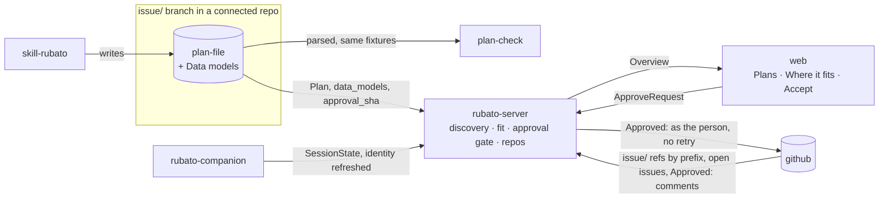
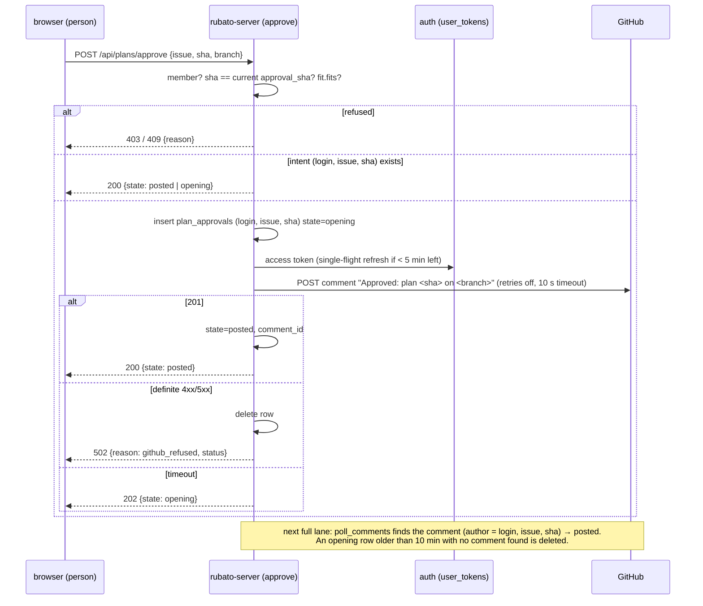

# Design: plans in view with their architecture fit, accepted in Rubato (#80)

Plan: [../80.md](../80.md) · ADRs 0029 (fit gate), 0030 (act as the person), 0031 (data models),
0032 (discover plans by branch prefix in every map repo). All accepted by Mattias Jonsson 2026-11-12.

Revised after the design review (stage 2, five blockers): idempotency of Accept keyed on intent,
App user-token rotation, no change to stored repo spelling, a discovery pass with a real budget,
signals that exist, a companion refresh that does not block, and which branch holds the plan.

## Where it sits on the map

## 1. Seeing every plan (ADR 0032)

Today a plan is read only for tracked issues (`crates/rubato-server/src/tasks.rs:99-112`), and
branches are listed with `list_branches`, every page, filtered on the client
(`kernel/github/api.rs:407-426`), per repo that has a tracked issue (ADR 0023).

**Discovery pass.** On every tick, per map repo, the server lists
`GET /repos/{o}/{r}/git/matching-refs/heads/issue/`: the server filters by prefix, so pages count
`issue/` refs only. The same listing replaces `list_branches` for tracked issues, so a repo is
listed once per tick either way. For each **open** listed issue (ADR 0019's listing, already made)
that is not tracked and has a matching ref, the server reads the plan file at that head only when
(path, head) changed since the last look, kept in memory; a 404 is remembered for that head. The
issue becomes tracked only when a plan row exists (`plans::all`, `tasks.rs:112`). Until then it
costs no `open_pulls`, `pull_for_branch`, `issue_comments` or `checks` call.

**Budget, in numbers.** Per tick: +1 call per map repo with no tracked issue (today: 0, the one map
repo is already polled), and `ceil(issue refs / 100)` instead of `ceil(all branches / 100)` per
repo (today: 1 either way). Per head change on an untracked open issue's branch: 1 contents read.
The fake GitHub counts pages (`kernel/github/fake.rs`), so the call-count test can fail: 250
`issue/` refs must cost 3 pages, and an unchanged head must cost 0 reads.

**Which branch holds the plan.** Several `issue/<n>-*` branches are normal (this plan's own stack
makes six). Today the first by name wins (`github_poll/poll.rs:126-129`), so pushing
`issue/80-accept` would move the plan. Rule, in order: the branch the newest counted-or-not
`Approved:` comment names with `on <branch>`; else the branch of the issue's open pull request into
the repo's default branch (the bottom of a stack); else the oldest-created matching ref that
carries the plan file; else the first by name. A test with two `issue/71-*` branches exists
(`build.rs:839`); it gains a stack case.

**Backlog.** An issue that is tracked only because it has a plan stays in "Not pinned"
(`overview/build.rs:303-308` keyed on *not pinned*, not *not tracked*), and appears on the map on
the parts its plan names, marked "planned here".

## 2. Fit (ADR 0029)

`plan_fit(plan, parse_error, map) -> PlanFit` in `rubato-protocol`, pure. Reasons (`FitReason`):

| Reason | Rule | Today |
| --- | --- | --- |
| `ParseError{message}` | the plan file did not parse | finding `PlanParseError` |
| `UnknownIds{ids}` | a node or seam id is not in the map | finding `UnknownIds` |
| `FlowOffSeam{from,to,seam}` | a flow's seam does not join its parts | finding `FlowOffSeam` |
| `MissingORow{seam}` | a seam in Affected parts has no O-row | `Plan::seams_without_o_row`, CI only |
| `ModelOffPart{model,part}` | a data model's part is not in Affected parts | `Plan::models_off_part` (PR 1) |
| `ModelOffSeam{model,seam}` | a data model crosses an untouched seam | `Plan::models_off_seam` (PR 1) |

`MapVersionMismatch` is shown, not a reason. `IssueSummary.fit` carries the answer.

**Signals.** Fit is computed in the pure `build()`, which runs per overview request, so it is not
counted there. It is a gauge, `rubato.plans.not_fitting`, recorded in `overview/gauges.rs` next to
`plans_approval_stale` (`gauges.rs:43-49`). The log `plan does not fit` (issue, reasons) is
written where the fit can change: after a plan fetch and after a map reload, and only when the
answer for that issue changed (kept in memory per issue).

## 3. The approval gate (ADR 0029)

`approval_state` (`overview/build.rs:72-100`) takes the fit. Newest approval names the current plan
and `fit.fits` is false → version `DoesNotFit`, finding `ApprovedWithoutFit{issue}`. Other versions
unchanged. A badge; `derive_progress` does not read it.

## 4. Accept in Rubato (ADR 0030)

Login runs through the App's client (ADR 0022), so the callback's token (`auth/handlers.rs:136`) is
a user-to-server token. It is kept only when the server runs as an App (`github_app` configured)
**and** the response carries `refresh_token` and `expires_in` (expiring user tokens on). Otherwise
nothing is stored and `Me.can_act_on_github` is false, with the reason (`oauth_only`,
`tokens_do_not_expire`, `no_token_key`).

- **Idempotency is the intent, not the click.** `plan_approvals(login, issue_repo, issue_number,
  sha, branch, state, comment_id, created_at)`, primary key `(login, issue_repo, issue_number,
  sha)`, owned by the new slice `approve`. A double click, a retry or a second tab finds the row.
  Two people approving the same plan make two comments, both valid.
- **No retries.** The POST goes through a client built like ADR 0025's `no_retry` installation
  client (`api.rs:275,310,742`), with the person's token, retries off and a 10 s timeout.
- **Stuck rows are visible.** Gauge `rubato.plans.approvals_opening` (rows `opening` older than
  2 min), on the Approvals panel.
- **Tokens.** `user_tokens(login PK, access_ct, refresh_ct, nonces, expires_at,
  refresh_expires_at, updated_at)`, owned by `auth`, AES-256-GCM under `RUBATO_TOKEN_KEY`.
  - App refresh tokens rotate. Refresh is single-flight per login (a per-login async mutex in
    `auth`); after taking the lock the row is re-read, and a refresh is skipped if another task
    already did it.
  - On `bad_refresh_token` the row is deleted only if its stored refresh token is the one that was
    sent (compare-and-delete), so a winner's row survives.
  - The token endpoint call has a 10 s timeout (today's callback client has none,
    `auth/handlers.rs:113-115`).
  - Tokens are deleted on logout, and when a person's last web session expires or the ADR 0022
    team re-check fails for them.
- **Never leaves the server.** No protocol type carries a token; a schema test fails if any
  `schema/protocol/*.json` property is named like `*token*` outside the pairing allow-list
  (ADR 0011).

## 5. Work in connected repos shows up

| Gap | Fix |
| --- | --- |
| identity set once (`discovery.rs:44-46`, `hooks/apply.rs:22-24`) | re-identify only when the cwd changed or the worktree's `HEAD` file changed (mtime), in `spawn_blocking`, **outside** the registry lock, then apply under the lock; log `identity changed` with old and new branch |
| a launched session would be retargeted by `git checkout` | an entry with source Launch keeps its launch issue (spend cap, `CapHit`, OTel `rubato.issue` stay coherent); a branch change is reported as `branch` drift and logged, not as a new issue |
| agent match by exact command (`discovery.rs:31-33`) | on reconcile only, for panes whose command did not match, walk the pane's descendants (`/proc` on Linux, `ps -o comm= -g` on macOS) through `kernel/proc` with a 2 s deadline (A8) |
| repo case differs between remote and map | no change to `IssueRef` or to stored rows. The server canonicalises an incoming session's repo to the map's spelling, case-insensitively, in `companion_link` on receipt; the companion falls back to `upstream` when there is no `origin` |
| no finding for sessions with no issue (`overview/build.rs:287-292`) | `UnattributedSession{companion, branch, repo}` |
| nothing shows which repos are connected | `Overview.repos: Vec<ConnectedRepo{repo, in_map, covered, open_issues, plans, sessions, unattributed}>` |

Out of scope (A2): sessions outside tmux without hooks.

## 6. The web

- `features/plans/`: **Plans** tab, Proposed and Open, each row with fit chip, parts and seams,
  models count, review and approval badges, *Accept plan*. Selecting a row selects the issue and
  the map takes the plan lens (`MapView.tsx:107`).
- **Where it fits** in the issue detail (`features/issues/IssuePanel.tsx:123-160`), above Review and
  approval: a small read-only map in the plan lens, the parts table with what changes, data models
  grouped by part (marked new, changed, removed; a crossing model shown on its seam), fit reasons,
  *Accept plan*. Each part has a Vitest test.
- Map: an issue with a plan and no pin is drawn on its plan's parts as "planned here"
  (`graph.ts:89-93`); in the plan lens a part card shows "+N models".
- **Connected repos** panel; unattributed sessions listed with the branch and a hint.

## 7. Neighbours

| Neighbour | What changes | Expected |
| --- | --- | --- |
| alert `SeamCollision` (`observability/alerts/rubato.rules.yml:32-44`) | more plans are visible, so more seam overlaps | collisions are counted only between plans that are not merged; the alert's threshold stays. Every new collision is a true finding: two open plans touch the same seam. Reviewed after a week of data |
| alert `PlanUnknownNodes` | fed by more plans | fires for a plan with an unknown id, as intended |
| "Not pinned" backlog | tracked-by-plan issues stay in it | §1 |
| "Cost per issue" series | unchanged: stored repo spelling is not changed | §5 |
| ADR 0026 "a person's unpin sticks" | unchanged: `map_line_pins` keys are not rewritten | §5 |
| `RepoRef` lookup for `plan_path` (`protocol/src/map.rs:371`) | sessions now carry the map's spelling, so the lookup finds it | §5 |

## 8. Failure

- The plan changes between view and click: 409 `plan_changed`; the web refreshes.
- GitHub times out after posting: state `opening`; the comments pass finds it and moves it to
  `posted`; the web shows "approval posted, waiting for GitHub".
- GitHub refuses (403, 422, 5xx): row deleted, 502 with the status; the person can press again.
- Refresh rejected: compare-and-delete; 409 `needs_github_authorization`; log `token refresh
  failed` with the login.
