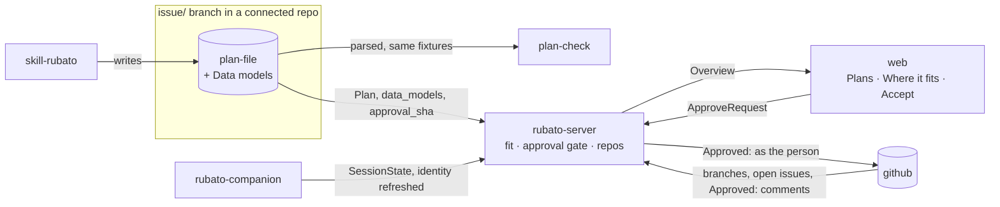
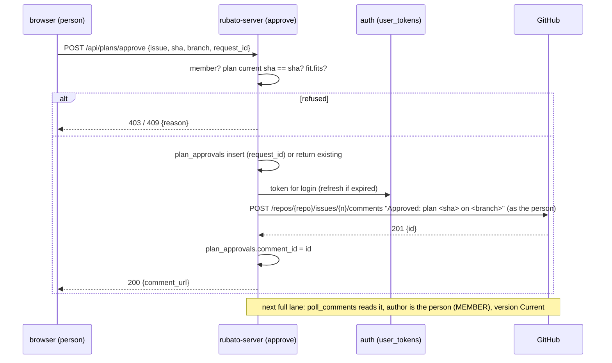

# Design: plans in view with their architecture fit, accepted in Rubato (#80)

Plan: [../80.md](../80.md) · ADRs 0029 (fit gate), 0030 (act as the person), 0031 (data models).

## Where it sits on the map

## 1. Seeing every plan

Today the poll reads plans only for tracked issues (`crates/rubato-server/src/tasks.rs:99-112`):
pinned, launched, with a session, or already with a plan row. The poll already lists, once per repo
per tick, the open issues of the map's repos (`tasks.rs:116`) and the `issue/` branches of each
repo it reads (`github_poll/poll.rs:116-132`).

Change: after the listing, add to the tracked set every **open** listed issue whose number matches
an `issue/` branch of its repo. The branch listing is extended to every map repo (one list call per
repo per tick, already made for repos with tracked issues; for map repos without any, this adds at
most one call per repo per tick, counted against ADR 0023 in a call-count test). A plan is then
fetched only when (path, head sha) changes, as now. A closed issue's branch is not read (A9).

Result: an issue placed by a voice tool's `Map:` line is tracked from the pin, and an issue whose
agent pushed a plan is tracked from its branch, whether or not anyone pinned it or a companion saw
the session.

## 2. Fit

`plan_fit(plan: Option<&Plan>, parse_error: Option<&str>, map: &SystemMap) -> PlanFit` in
`rubato-protocol` (pure; the server and the web read the same answer). Reasons, each a variant of
`FitReason`:

| Reason | Rule | Today |
| --- | --- | --- |
| `ParseError{message}` | the plan file did not parse | finding `PlanParseError` |
| `UnknownIds{ids}` | a node or seam id is not in the map | finding `UnknownIds` |
| `FlowOffSeam{from,to,seam}` | a flow's seam does not join its parts | finding `FlowOffSeam` |
| `MissingORow{seam}` | a seam in Affected parts has no O-row | `Plan::seams_without_o_row` (`plan.rs:103-109`), CI only |
| `ModelOffPart{model,part}` | a data model's part is not in Affected parts | new (ADR 0031) |
| `ModelOffSeam{model,seam}` | a data model crosses a seam not in Affected parts | new (ADR 0031) |

`MapVersionMismatch` is shown but is not a reason: a plan written against an older map that still
names only existing ids fits. The global findings stay as they are; `IssueSummary.fit` carries the
per-plan answer, so the web never recomputes it.

## 3. The approval gate (ADR 0029)

`approval_state` (`overview/build.rs:72-100`) gains the fit. When the newest approval names the
current plan (`Current` today) and `fit.fits` is false, the version is `DoesNotFit` and the finding
`ApprovedWithoutFit{issue}` is raised. `Earlier`, `NotNamed`, `NoPlan` are unchanged: an older
approval was already not counted. A badge, not a state: `derive_progress` does not read it.

## 4. Accept in Rubato (ADR 0030)

Login already runs through the App's client (ADR 0022, `docs/QUICKSTART.md:24-62`), so the token
the callback receives (`auth/handlers.rs:136`) is a user-to-server token; today it is dropped after
reading the login. Change: keep it.

- `user_tokens(login PK, access_ct, access_nonce, refresh_ct, refresh_nonce, expires_at,
  refresh_expires_at, updated_at)`, owned by `auth`. AES-256-GCM under `RUBATO_TOKEN_KEY`
  (A5). Refresh with `grant_type=refresh_token` at the token endpoint when `expires_at` is within
  5 minutes; a refresh failure deletes the row and the person is asked to log in again.
- `plan_approvals(request_id PK, login, issue, sha, branch, comment_id NULL, created_at)`, owned by
  `approve`. A second request with the same id returns the first result. A row with no
  `comment_id` older than 2 minutes is reconciled on the next comments pass by matching author,
  issue and sha; until then a retry with the same id is refused with `pending`.
- The approval is posted only through `kernel/github` with the person's token; no other slice asks
  `auth` for a token. Tokens are never serialised to the web, the companion or an agent.
- The web learns `Me.can_act_on_github` (a token row exists and is not past refresh expiry).

## 5. Work in connected repos shows up

From the exploration (`crates/rubato-companion/src/sessions`):

| Gap | Fix |
| --- | --- |
| identity set once (`discovery.rs:44-46`, `hooks/apply.rs:22-24`) | on each update, re-read the branch for the cwd's worktree (already resolved); when it differs, re-resolve repo and issue and log `identity changed` |
| agent match by exact command (`discovery.rs:31-33`) | also accept a pane whose descendant processes include `claude` (A8), through `kernel/proc` with a deadline |
| repo from `origin` only, case kept (`registry.rs:51-54`) | lowercase; fall back to `upstream` |
| `IssueRef` compared case-sensitively (`protocol/src/ids.rs`) | normalise the repo to lowercase in `IssueRef::new` and on deserialise; the map's spelling is used for display |
| no finding for sessions with no issue (`overview/build.rs:287-292`) | `UnattributedSession{companion, branch, repo}` |
| nothing shows which repos are connected | `Overview.repos: Vec<ConnectedRepo{repo, in_map, covered, open_issues, plans, sessions, unattributed}>` |

Out of scope by ADR 0003/0013 (A2): sessions outside tmux without hooks.

## 6. The web

- `features/plans/`: the **Plans** tab (Proposed, Open), each row with the fit chip, parts and
  seams, a models count, review and approval badges, and *Accept plan*. Selecting a row selects the
  issue; the map takes the plan lens (`MapView.tsx:107`).
- **Where it fits** in the issue detail (`features/issues/IssuePanel.tsx:123-160`), above Review
  and approval: a small read-only map with the plan lens, the parts table with what changes, the
  data models grouped by part, the fit reasons, and *Accept plan*.
- The map places an issue with a plan and no pin on the parts its plan names, marked "planned
  here" (`graph.ts:89-93`). In the plan lens a part card shows "+N models".
- **Connected repos** panel from `Overview.repos`, listing unattributed sessions with a hint.

## 7. Concurrency and failure

- Two people press Accept on the same plan: two comments by two people; both are valid approvals;
  the newest counts. Same person twice: one request id per click, so a double click posts once.
- The plan changes between the view and the click: `sha` mismatch, 409 `plan_changed`, nothing
  posted; the web refreshes.
- GitHub times out after posting: the row has no `comment_id`; the comments pass finds the comment
  and fills it; the web shows "approval posted, waiting for GitHub" until the next overview.
- Token expired and refresh rejected: 409 `needs_github_authorization`, row deleted, log
  `token refresh failed` with the login.
