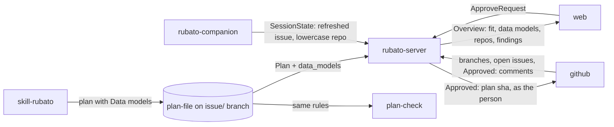

# Plans in view with their architecture fit, accepted in Rubato

Issue: #80 · Design: [80-plans-in-view/design.md](80-plans-in-view/design.md) · ADRs 0029–0031
(proposed). Stacked PRs on `issue/80-*` branches; PR 0 is this plan.

Issue #80 ("Nerebato" is Rubato) says every proposed plan, whether it starts from an issue or from
the voice issue model, should show where it fits in the system architecture before it can be
accepted, and that proposed and open plans should be visible in Rubato. Mattias added, in the
session that wrote this plan: work on any issue in a connected repo must show up; a plan, this one
included, must be acceptable in Rubato; and a plan shows the parts it affects and the data models it
introduces. A bold restyle (#81) and listing and merging pull requests (#82) are their own issues.

## What the change does

- **Plans tab.** Rubato lists every plan it can read, in two groups: *Proposed* (a plan, no counted
  approval) and *Open* (a counted approval, not merged). Plans from voice-note issues placed by a
  `Map:` line (ADR 0026) appear like any other.
- **Where it fits.** A plan's view shows the map with its affected parts and seams lit, the parts
  table with what changes in each, and the **data models** it introduces, changes or removes, on
  the part that owns each one.
- **Fit gate (ADR 0029).** A plan fits when it parses, names only map ids, keeps its flows on
  declared seams, has an O-row per seam, and puts its data models on parts and seams it names. An
  `Approved:` comment on a plan that does not fit is shown as "approved, doesn't fit, not counted"
  and raises a finding.
- **Accept in Rubato (ADR 0030).** A person presses *Accept plan*; Rubato posts
  `Approved: plan <sha> on <branch>` as that person, through the GitHub App's user-to-server token.
  Refused when the plan does not fit, has changed since it was shown, or the person has not
  authorised the App.
- **Data models in the plan (ADR 0031).** The plan file gains a parsed `## Data models` table; the
  skill writes it, plan-check checks it, the server reads it.
- **Work in connected repos shows up.** The server reads plans from every open issue in the map's
  repos that has an `issue/<n>-*` branch, not only issues it already tracks. The companion
  re-resolves a session's issue when its branch changes, finds agents started through a wrapper,
  and compares repos case-insensitively. A session Rubato cannot tie to an issue is a finding, and a
  *Connected repos* panel shows, per repo, whether it is in the map, covered by the App, and its
  open issues, plans and sessions.

## How we'll know it works

- [ ] An open issue with a plan on its `issue/` branch and no pin, launch or session appears under Plans → Proposed (server integration test; e2e).
- [ ] The voice fixture issues #912 and #913 with a plan on their branch appear under Proposed with a fit verdict (e2e).
- [ ] `plan_fit` returns each reason on its own fixture: parse error, unknown id, flow off seam, missing O-row, model on an unnamed part, model crossing an untouched seam (protocol unit tests).
- [ ] An `Approved:` comment on a plan that does not fit derives `DoesNotFit` and `ApprovedWithoutFit`; on a plan that fits it still derives `Current` (server tests).
- [ ] `POST /api/plans/approve` refuses non-members, a missing user token, a changed sha and a plan that does not fit, posting nothing; a double submit posts once; the posted comment derives `Current` on the next poll (integration tests with the fake GitHub).
- [ ] Rust and TS parse the same `schema/fixtures/plans/` fixtures for `## Data models` to the same JSON, including "None." and a legacy plan without the section (both suites).
- [ ] plan-check fails on purpose on a model with an unknown part and on one crossing an untouched seam, and reports `data_models` on its `rubato.plan.check` line.
- [ ] A session that starts on `main` and runs `git checkout -b issue/42-x` reports issue 42; a wrapper script that runs claude is found (Gherkin, `tmux -L rubato-test`).
- [ ] `M0x6A/Rubato#5` from a remote and `m0x6A/rubato#5` from a pin are one issue (protocol and server tests).
- [ ] A session with no issue raises `UnattributedSession`, shown in the Connected repos panel with its branch (server test; web test).
- [ ] This plan appears in Rubato under Proposed with its parts and data models, fits, and is accepted with *Accept plan*; the comment on #80 is authored by the person (manual run).

## What it must not break

- ADR 0023's GitHub call budget: no new list calls per tick; a plan is fetched only when its branch head changes (a call-count test).
- Plans already approved that fit stay `Current`; `ApprovalStale` keeps working (existing tests).
- The progress model: fit and approval are badges, not states (`derive_progress` tests unchanged).
- Plans without a `## Data models` section still parse and pass CI (`docs/plans/*.md` in plan-check).
- Existing login keeps working; a person who has not re-authorised can still read everything (auth tests).
- The slice tests and the AGENTS.md slice blocks per deployable; the contrast tests in `styles.test.ts`.
- ADR 0004: the token stays on the server; the companion and agents never see it.

## How we'll debug it at 3 am

See the O-rows. New: findings `ApprovedWithoutFit` and `UnattributedSession`; counter
`rubato.plan.fit{rubato.plan.fit.outcome}`; span `rubato.plan.approve` with `rubato.issue` and
outcome; counter `rubato.plan.approve.refused{rubato.reason}`; `data_models` on the
`rubato.plan.check` line; log `plan does not fit` naming the issue and reasons.

## Affected parts

| Node | Status | What changes | Seams |
| --- | --- | --- | --- |
| rubato-protocol | affected | `PlanFit`, `plan_fit`, `DataModel`, `ApproveRequest`, `ConnectedRepo`, new findings, `ApprovalVersion::DoesNotFit`, `Me.can_act_on_github`, case-insensitive `IssueRef`, otel names | web-server, companion-server, server-plan-file |
| rubato-server | affected | track issue branches in map repos; fit per plan; approval gate; `UnattributedSession`; repos summary; user-to-server tokens; new slice `approve` | web-server, server-github, server-plan-file, companion-server |
| rubato-companion | affected | identity refresh on branch change; agent detection by process tree; lowercase repo, `upstream` fallback | companion-server |
| web | affected | Plans tab, Where it fits, data models, Accept plan, Connected repos, plan-placed issues on the map | web-server |
| plan-file | affected | optional `## Data models` table | skill-plan-file, server-plan-file, plan-check-plan-file |
| skill-rubato | affected | `plan.ts init` writes Data models; SKILL.md and review checklist name it | skill-plan-file |
| plan-check | affected | parse and check Data models; `data_models` count | plan-check-plan-file |
| github | affected | the App's user authorization (callback, refresh tokens); comments authored by the person via the App | server-github |
| system-map | quiet | read for fit; unchanged | |

## Data models

| Model | Kind | Part | Change | Crosses | Note |
| --- | --- | --- | --- | --- | --- |
| `DataModel` | type | rubato-protocol | new | server-plan-file | a row of the plan's Data models table |
| `Plan.data_models` | type | rubato-protocol | changed | server-plan-file | parsed table; empty when absent |
| `Plan.approval_sha` | type | rubato-protocol | changed | web-server | the sha a person approves |
| `PlanFit`, `FitReason` | type | rubato-protocol | new | web-server | per issue in the overview |
| `ApprovalVersion::DoesNotFit` | type | rubato-protocol | changed | web-server | approval present, not counted |
| `Finding::ApprovedWithoutFit`, `Finding::UnattributedSession` | type | rubato-protocol | new | web-server | |
| `ConnectedRepo`, `Overview.repos` | type | rubato-protocol | new | web-server | per map repo |
| `ApproveRequest`, `ApproveResponse` | type | rubato-protocol | new | web-server | `POST /api/plans/approve` |
| `Me.can_act_on_github` | type | rubato-protocol | changed | web-server | |
| `user_tokens` | table | rubato-server | new | | owned by `auth`; encrypted access and refresh tokens |
| `plan_approvals` | table | rubato-server | new | | owned by `approve`; idempotency by request id |
| `plan.schema.json` `data_models` | schema | plan-file | changed | plan-check-plan-file | |
| `Approved:` comment as the person | event | github | new | server-github | posted through the user-to-server token |

## Data flow

## Tasks

- [ ] **PR 0** `issue/80-plans-in-view`: ADRs 0029–0031 proposed, design note, this plan; `Map: node web` on #80; follow-up issues #81 (restyle) and #82 (PRs and issues, merge as the person) filed; `Review:` posted on #80
- [ ] **PR 1** `issue/80-data-models`: shared plan fixtures first (both suites fail on the bad ones); `DataModel` in protocol and `plan.schema.json`; Rust and TS parsers; plan-check rules and `data_models` count; `plan.ts init`, SKILL.md, review checklist
- [ ] **PR 2** `issue/80-fit`: `plan_fit` fixtures first; `PlanFit`, `ApprovalVersion::DoesNotFit`, findings, `ConnectedRepo`, case-insensitive `IssueRef`, otel names; server tracks issue branches in map repos (call-count test first), fit per issue, approval gate, `UnattributedSession`, repos summary; regenerated schema and `protocol.ts`
- [ ] **PR 3** `issue/80-accept`: refusal tests first; user-to-server login, `user_tokens` (migration 0009), refresh, logout; slice `approve` with `plan_approvals` (migration 0010); `Me.can_act_on_github`; AGENTS.md server block
- [ ] **PR 4** `issue/80-companion-identity`: Gherkin first; identity refresh, process-tree detection, repo normalisation
- [ ] **PR 5** `issue/80-plans-tab`: Vitest first, then e2e; features `plans` (tab, Where it fits, data models, Accept plan) and Connected repos; plan-placed issues on the map; AGENTS.md web block

## Assumed, not yet approved

| # | Decision | Chosen | Alternatives | Scope |
| --- | --- | --- | --- | --- |
| A1 | What "cannot be accepted until fit is shown" means | an approval of a plan that does not fit is not counted (ADR 0029); decided by Mattias Jonsson 2026-11-12 | warning only; also fail CI | seam (server-plan-file): settled |
| A2 | How far "work in connected repos shows up" goes | close the gaps within ADR 0003 and 0013, no user-level hooks; decided by Mattias Jonsson 2026-11-12 | user-level hooks; plans only | seam (companion-server): settled |
| A3 | Who posts the approval from Rubato | the person, through the App's user-to-server token (ADR 0030); asked for by Mattias Jonsson 2026-11-12 | the App on the person's behalf (would be a Bot comment, ignored by ADR 0027) | seam (server-github): ADR 0030 proposed, blocks PR 3 until accepted |
| A4 | Data models in the plan | a parsed `## Data models` table, optional (ADR 0031); asked for by Mattias Jonsson 2026-11-12 | free text under the parts table | seam (server-plan-file): ADR 0031 proposed, blocks PR 1 until accepted |
| A5 | Token encryption key | `RUBATO_TOKEN_KEY` from config, 32 bytes, AES-256-GCM; the server refuses to store tokens without it and login stays read-only | reuse the signer secret | node (rubato-server) |
| A6 | Accept without a confirmation dialog | one click; a later `Approved:` or a plan change supersedes it | confirm dialog | node (web) |
| A7 | Which plans are Open | counted approval and PR not merged; merged plans drop off | keep merged for a day | node (web) |
| A8 | Agent detection by process tree | read `/proc/<pane_pid>` descendants on Linux, `ps -o comm= -g` on macOS, through `kernel/proc` with a deadline | tmux-ide only | node (rubato-companion) |
| A9 | Issues in map repos tracked by branch | only open issues; a closed issue's branch is not read | every branch | node (rubato-server) |

## O-rows

| Seam | Breaks like | Signal | Panel | Owner |
| --- | --- | --- | --- | --- |
| web-server | the Plans tab is empty or the fit is wrong; Accept is refused for a plan that fits | `rubato.web.rejected{rubato.route=/api/plans/approve, rubato.reason}`; `rubato.plan.approve.refused{rubato.reason}`; generated `protocol.ts` diffed in CI | Web writes rejected; new panel "Approvals" row "refused by reason" | rubato-server |
| server-github | the approve post fails (token expired, refresh rejected, 403), posts twice, or the branch scan adds calls | span `rubato.plan.approve` (error status, `rubato.github.endpoint=create_comment`); `rubato.github.calls{endpoint}` per tick against the budget; log `token refresh failed` naming the login; rate-limit gauge | GitHub calls · Rate limit; Approvals | rubato-server |
| server-plan-file | a plan that fits is marked as not fitting, or an approval counts on a plan that does not fit | `rubato.plan.fit{rubato.plan.fit.outcome}`; findings `ApprovedWithoutFit{issue}` and `UnknownIds`; log `plan does not fit` with issue and reasons | Plan checks; finding on the map | plan-file |
| companion-server | sessions keep their old issue after a checkout, or the same issue appears twice by case | finding `UnattributedSession{companion, branch, repo}`; `rubato.sessions{rubato.state}` by issue; log `identity changed` on the companion with old and new branch | Sessions by state; Connected repos panel | rubato-server |
| skill-plan-file | the skill stops writing Data models, or writes a shape the parsers reject | skill tests on the `init` template; `data_models` on the `rubato.plan.check` line; `PlanParseError` finding | Plan check log lines | plan-file |
| plan-check-plan-file | plan-check and the server disagree on Data models | shared fixtures under `schema/fixtures/plans/` in both suites; must-fail fixtures; `data_models` count on the check line | Plan check log lines | plan-check |

## Flows

| From | To | Seam | Kind | Carries |
| --- | --- | --- | --- | --- |
| skill-rubato | plan-file | skill-plan-file | data | plan Markdown with a Data models table |
| plan-file | rubato-server | server-plan-file | data | Plan with data_models and approval_sha |
| plan-file | plan-check | plan-check-plan-file | data | Plan with data_models, same rules as the server |
| rubato-server | web | web-server | data | Overview with fit, data models, connected repos, new findings |
| web | rubato-server | web-server | control | ApproveRequest: accept a plan as yourself |
| rubato-server | github | server-github | control | Approved: plan sha comment, as the person; token refresh |
| github | rubato-server | server-github | data | issue branches of open issues in map repos; user authorization |
| rubato-companion | rubato-server | companion-server | data | SessionState with a refreshed issue and lowercase repo |

## Review map

1. ADR 0029's fit rule and `approval_state` in `crates/rubato-server/src/overview/build.rs`: an approval that should count but doesn't blocks every plan.
2. ADR 0030 and the `approve` slice: a token that acts as a person; storage, refresh, refusals, and that nothing but this slice reads it.
3. The tracked-issue set in `crates/rubato-server/src/tasks.rs`: the branch scan must stay inside ADR 0023's budget.
