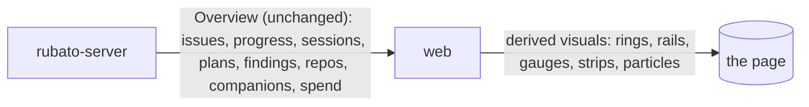

# Bold restyle of the web app

Issue: #81 · Design: [81-bold-restyle/design.md](81-bold-restyle/design.md) · Map: node `web` only.

Track: **full**, because the self-hosted type pairing adds a dependency (two `@fontsource-variable`
packages); everything else would be small, since it stays inside `web` and crosses no seam.

Issue #81 says the web app looks dull and asks for a bold restyle "so the map and the work on it
feel alive": a distinct type pairing and a richer palette as tokens on `:root`, dark first with
light kept; depth on panels and the map (gradients, glow on lit parts, a pulse on working
sessions); animated state badges and transitions that honour `prefers-reduced-motion`. It was
raised while planning #80 ("the application should also sparkle more, it looks dull"). The
direction chosen in the design note is **control room**: a dark canvas with a dot field, parts as
lit hardware, conduits that carry particles, and every surface opening with a picture of its state.

## What the change does

- **Dark first, light designed.** `:root` holds a dark palette (near-black with a cool tint,
  layered `--bg`, `--canvas`, `--panel`, `--raised`, part faces) with six accent roles: cyan
  (selection, affected), violet (new, proposed), magenta (heat: plans per seam, collision), green
  (working, done, live), amber (review, stale, findings), red (blocked, errors). Each role has a
  base, an `-ink` for small text and a solid `-wash` under filled badges. Light mode follows the
  OS preference (or `data-theme="light"`) with its own values, not an inversion. Full table in
  design §3.
- **Type.** Space Grotesk for the UI and JetBrains Mono for ids, node names, numbers and badges,
  self-hosted from npm and bundled into `dist`; nothing is fetched from a CDN (design §2).
- **The map is the hero.** A dark canvas with a faint dot field; parts as slabs with a gradient
  face, a crisp rim and a bottom activity strip; seams as conduits; a glow when a part is
  affected, new or selected; a slow breathing halo on parts with a working session.
- **Flows move.** Declared flows carry particles in their direction: filled dots in the data lens,
  rings in the control lens (whose dashed arrows stay still). A flow a plan *proposes* keeps its own encoding: a violet dashed conduit
  whose dashes march, never particles, plus a "proposed" tag on its label. The scenario's current
  step runs a pulse with a comet trail of the same shape (design §5).
- **Visuals lead, text supports**, on every surface: a progress ring on issue rows; a stage rail
  and a spend gauge on the selected issue; a mini map per plan on the Plans tab; rack units with
  LEDs and bars on Connected repos; lanes with connection LEDs and freshness bars for companions;
  a team-wide segmented track in the topbar (design §6).
- **State changes animate** (badges, lighting up, panels opening, rings and gauges filling), and
  **with reduced motion nothing animates**: one switch (`data-motion` on `<html>`, set from
  `prefers-reduced-motion`) gates every CSS animation and transition, and the JS pulse becomes a
  CSS animation under the same switch (design §5).

## How we'll know it works

- [ ] **Contrast** (issue criterion 1): `web/src/styles.test.ts` reads dark from `:root` and light from the `prefers-color-scheme: light` block (which must define every dark colour token, and which `:root[data-theme="light"]` must repeat), checks 55 small-text pairs per scheme (110 in all) at 4.5:1, the role bases at 3:1 on `--panel`, the part-face gradient's ends and channel monotony, the rules that carry small text (each selector found once, `color:` not matched inside `background-color:`), and scans every rule for small text on a role base or on a `color-mix` background; it prints the counts. Must fail: light `--accent` on `--bg`, light `--warn` on `--panel`, dark `--quiet` on `--panel` stay below 4.5:1; a fixture with one `-ink` lowered is reported by the pair loop; a CSS without the light block throws; a drifted forced-light block throws; a non-monotone gradient fails.
- [ ] **Reduced motion** (issue criterion 2), design §7a: a Vitest checks every `animation`/`transition` rule in `styles.css` sits under `:root[data-motion="full"]` (prints its count; a fixture rule outside fails). An e2e runs twice, once with `reducedMotion: "no-preference"` and `data-motion="reduced"` forced (so the media-query belt is not what stops it) and once with `reducedMotion: "reduce"`: in one `evaluate` it selects a part, opens issue #901 (proposed flows) and shows a scenario step, then reads `document.getAnimations()` (empty) and finds no `animateMotion`/`animate` element; with Play paused, two screenshots of the canvas 500 ms apart (refreshed text masked) are identical. Must fail: under `no-preference` unforced, the pulse's `getAnimations()` is non-empty and the screenshots differ.
- [ ] **Screenshots** (issue criterion 3): `RUBATO_E2E_SHOTS=<dir>` runs `web/e2e/shots.spec.ts`, which writes `<surface>-<theme>-<width>.png` for 11 surfaces × dark, light × 1600 × 1000 and 900 × 900, 44 files, and prints the count: `login`, `map-data` (data lens with particles), `map-at-work` (working sessions breathing), `map-plan` (plan lens, issue selected, proposed flow), `scenario-step`, `inspector-part`, `issue-panel` (stage rail, spend gauge), `plans-tab`, `where-it-fits`, `connected-repos`, `companions-lanes`. The existing shots in `web/e2e/map.spec.ts` (`lens-data`, `inspector-part`, `scenario-step`, `plan-lens`, `draft`) move there, and `draft` is added as a 12th surface (48 files). Reviewed by a person, before and after, in the PR.
- [ ] **Proposed stays distinct**: a Vitest renders `arrowsFor(seam, "control")` and `arrowsFor(seam, "plan")` for the same seam: the declared control flow has ring particles, a static `7 5` dash and no `moving` class; the proposed flow has `moving`, a marching violet dash, no particles, and a label that reads "proposed".
- [ ] **Kind by shape**: a Vitest asserts particles are filled dots in the data lens and rings in the control lens, and the scenario pulse is a dot on a data step and a ring on a control step, its trail of the same shape carrying `pulse-trail`, not `pulse`; the e2e legend and scenario tests keep passing. Under reduced motion the still marker sits at 30 % of the path, and the e2e checks `elementFromPoint` at its centre returns it (not hidden under the label).
- [ ] **Fonts are local**: an e2e records every request while loading the app and fails on any host but the app's, and asserts a face of each family has `status === "loaded"` (`document.fonts.check` alone is true when no face matches).
- [ ] **900 px**: an e2e at 900 × 900 and 600 × 900, dark and light, with a part selected and the inspector open, asserts `scrollWidth <= innerWidth` and the panel's box inside the viewport. Must fail: a panel forced to 1200 px is caught.
- [ ] **Performance**: an e2e stubs `/api/overview` with a typed 40-part, 60-seam fixture (`web/e2e/fixtures/big-map.ts`, data lens, 10 working parts), asserts `long-animation-frame` is a supported entry type, and records no long animation frame over 50 ms in 5 s of steady state; it prints parts, seams, particles and the median frame time. Must fail: an injected 80 ms busy rAF callback is reported.
- [ ] **Visual components** (Vitest, one each): the progress ring maps all nine `ProgressState`s (blocked a red gap, unknown dashed); the stage rail lights the current station of seven and puts blocked as a notch; the spend gauge is amber from 80 % and red at the cap, and absent without a cap; the rack unit scales bars to the team's max; the freshness bar is empty at 10 min; the topbar track's segments add up to the issue count; the Plans mini map lights exactly the plan's parts; the breathing class is set only for `working`, never for `unknown`.

## What it must not break

- **Data versus control without colour** (issue): a filled dot and a ring, in particles, the scenario pulse, the legend, the static markers under reduced motion and `.flow-kind` in the steps list. Guarded by the existing legend and scenario e2e (`web/e2e/map.spec.ts:287`) and the new kind-by-shape Vitest.
- **Layout at 900 px and below** (issue): `.body` collapses to rows; no glow, grid or badge pushes the panel off screen. Guarded by the 900 px e2e.
- **`moving` means proposed**: `.react-flow__edge.moving` stays the only marching-dash edge and never carries particles; declared flows never march. Guarded by the proposed-stays-distinct Vitest and `web/e2e/map.spec.ts:351` (plan lens).
- **Unknown never renders as working** (AGENTS.md progress model): breathing and green LEDs only for `working`. Guarded by the visual-components Vitest.
- **Every existing test id and role**: `node-<id>`, `flow-<id>`, `pulse-<id>`, `legend`, `scenario-caption`, `plans-proposed`, `start-session` and the rest stay, so the current Vitest and e2e suites pass unchanged except the `animateMotion` assertion at `web/e2e/map.spec.ts:307`, which becomes "a CSS animation runs on the pulse".
- **Targets of at least 24 px** (WCAG 2.5.8): the existing target-size test keeps its three selectors and adds the lens buttons and tab buttons.
- **The slice layout** (`web/src/features/features.test.ts`) and the AGENTS.md web block: no new feature folder; shared pieces go in `shared/`.
- **The server**: `web/dist` is still served from disk as today; the only new files are hashed `.woff2` assets beside the JS and CSS.

## How we'll debug it at 3 am

Nothing here crosses a seam, so there are no O-rows: the change is presentation inside `web`. A
regression is seen by whoever opens the page, and the suites above are the signal before that:
`styles.test.ts` prints the pairs, rules and targets it checked; the reduced-motion e2e prints
the animations it found; the performance e2e prints parts, seams, particles and frames; the
shots spec prints the files it wrote. No new log line, metric or finding.

## Affected parts

| Node | Status | What changes | Seams |
| --- | --- | --- | --- |
| web | affected | tokens dark first, type pairing, motion switch, map and panel visuals, contrast test, e2e for motion, layout, fonts, performance and screenshots | |
| rubato-server | quiet | serves `web/dist` from disk as today, now with `.woff2` assets; no code change | |

## Data models

None.

## Data flow

No data crosses a seam differently. The web reads what it already reads:

## Tasks

- [ ] **PR 0** `issue/81-bold-restyle`: this plan and the design note; ADR 0036 (proposed). Design review.
- [ ] **PR 1** `issue/81-tokens-type`: failing first: `styles.test.ts` restructured (dark from `:root`, light from the `prefers-color-scheme: light` block, missing block throws, 55 pairs, `GRADIENTS`, `NON_TEXT`, new `uses`), which fails on today's `styles.css` because it has no light block; the no-CDN and font-loaded e2e; `shots.spec.ts` with all 48 shots, run once on `main` for the "before" set. Then the token table from design §3 dark first, `:root[data-theme="light"]` mirroring the light block, `@fontsource-variable/space-grotesk` and `@fontsource-variable/jetbrains-mono` imported in `main.tsx`, `--font-ui`/`--font-mono` replacing the five monospace stacks, badges onto `-ink`/`-wash`, buttons onto `--accent-strong`/`--on-accent`. The 900 px e2e lands here too.
- [ ] **PR 2** `issue/81-motion`: failing first: the motion Vitest over `styles.css` (fails on today's `flow-move` rule, which sits outside the switch), the reduced-motion e2e with `data-motion` forced (fails on `dataset.motion` and on the `.moving` dash animation, which today stops only under the media query), its must-fail twin (the pulse's own `getAnimations()`, empty today on the SMIL pulse), and the proposed-stays-distinct and kind-by-shape Vitest. Then `web/src/shared/motion.ts` (`data-motion`, `useMotion`, `usePrefersReducedMotion` moved from `MapView.tsx:127`), every animation and transition under `:root[data-motion="full"]`, the scenario pulse on `offset-path` (M3, comet trail), the proposed-flow tag and legend samples (M2), motion tokens.
- [ ] **PR 3** `issue/81-map-hero`: failing first: the performance e2e on the stubbed 40/60 overview and its 80 ms must-fail, the breathing-only-for-working Vitest. Then the canvas dot field, part slabs with the activity strip and kind glyph, glows (M5), breathing (M4), particles (M1, cap 2 per flow and 120 total, paused while dragging and while hidden), conduits, seam chips with plan counts and the collision throb (M12), the map band's segmented lens control (M11).
- [ ] **PR 4** `issue/81-panels`: failing first: the visual-components Vitest (progress ring, stage rail, spend gauge, rack unit, freshness bar, topbar track, mini map). Then the topbar track and live ping (M9), issue rows and the issue panel (M6, M7, M8, M10), the Plans tab mini map and Where it fits, Connected repos rack units, companions lanes, findings, the draft panel and the login page. The "after" screenshots go in this PR's description; AGENTS.md's web block is checked against the folders (no change expected).
- [ ] **Follow-ups** filed once PR 4 merges (design §9): spend history for sparklines; observed traffic on seams; the stale threshold N in the overview; the stage a blocked issue left from.

## Assumed, not yet approved

| # | Decision | Chosen | Alternatives | Scope |
| --- | --- | --- | --- | --- |
| Q1 | The font packages are a new dependency, and AGENTS.md says a dependency decision is an ADR | (a) ADR 0036 "Self-host the web's type pairing from npm font packages", *proposed*, pinned below, accepted by the approval; the recommended option, taken when Mattias Jonsson said "implement the plan" (2026-11-13) without picking | (b) no ADR; (c) vendor the `.woff2` files under `web/src/fonts/`, no ADR | node (web) |
| A2 | Type pairing | Space Grotesk + JetBrains Mono, variable, `latin` and `latin-ext` | Geist + Geist Mono; Inter Tight + IBM Plex Mono | node (web) |
| A3 | Theme switching | follow `prefers-color-scheme`; `data-theme` on `<html>` forces one, with no toggle in the UI | add a toggle in the topbar | node (web) |
| A4 | Which flows carry particles | declared flows in the data lens (dots) and the control lens (rings), 2 per flow, 120 in all; past the cap only flows next to the selection or a lit part; none in the plan lens (all its flows are proposed and march); in the scenario lens only the step | particles only on lit parts' flows; none until traffic is observed | node (web) |
| A5 | Particle speed | fixed 64 px/s: it shows direction, not volume (design §5) | speed by number of open plans on the seam | node (web) |
| A6 | Replace the SMIL pulse | CSS `offset-path` + `offset-distance`, so `getAnimations()` sees it and the switch stops it | keep `animateMotion` and assert its absence separately | node (web) |
| A7 | Stale threshold for the freshness bar | 10 min, the AGENTS.md default, until the overview carries N (follow-up) | hide the bar | node (web) |
| A8 | Where blocked sits on the stage rail | a red notch at Started, since `Progress` does not say the stage it left from (follow-up) | a separate "blocked" lane off the rail | node (web) |
| A9 | Screenshot data | the seeded e2e server where it has the state; for working sessions and lanes, the real overview with sessions and companions added on its way to the page (`page.route`), typed through the generated `Overview` | a fake companion process | node (web) |
| A10 | Performance budget | fail on any long animation frame over 50 ms on 40 parts and 60 seams in headless Chromium; the median frame is printed, not asserted | a median threshold (flaky on CI runners) | node (web) |

## O-rows

None: the change touches no seam (Affected parts names none).

| Seam | Breaks like | Signal | Panel | Owner |
| --- | --- | --- | --- | --- |

## Flows

None: nothing new crosses a seam.

| From | To | Seam | Kind | Carries |
| --- | --- | --- | --- | --- |

## ADRs proposed

| ADR | File | Blob |
| --- | --- | --- |
| 0036 | docs/decisions/0036-self-hosted-type-pairing-in-web.md | 7062400ed19dbaf2a34bfc62bd1679b59492ee14 |

## Review map

1. `web/src/styles.test.ts` against design §3–4: the parser now reads dark from `:root` and light from the media block; check it cannot pass by reading one scheme twice (the must-fail fixture), and that the 55 pairs cover every surface small text sits on.
2. Design §5, the `moving` encoding and the motion switch: particles on solid conduits for declared flows, marching dashes only for proposed ones, and every animation under `:root[data-motion="full"]`.
3. The particle cap and the performance e2e (PR 3): the only part of this change that can make a large team's map worse rather than prettier.
