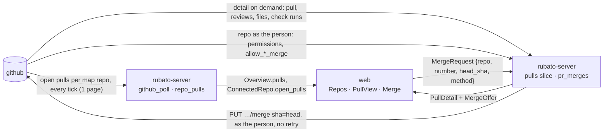

# Design: open pull requests and issues in Rubato; merge as the person (#82)

Plan: [../82.md](../82.md) · ADRs 0033 (merge as the person) and 0034 (list every open pull request,
detail on demand), both *proposed*. Choices Q1–Q4 answered by Mattias Jonsson 2026-11-12.

## Where it sits on the map



Nothing here reaches a companion or an agent (ADR 0001, 0004). The token stays on the server
(ADR 0030).

## 1. Listing (ADR 0034)

Today `RepoView.open_pull` lists `open_pulls(repo)` lazily, only when a tracked issue's branch needs
it, and keeps one pull request per issue (`github_poll/poll.rs:189-210`). New:

- On every tick, `github_poll` lists `open_pulls` for **every map repo**, before the per-issue pass,
  and hands the listing to `RepoView` so the per-issue pass does not list again. Same fork filter
  (`kernel/github/api.rs:538-545`).
- `PullInfo` gains `title` and `author` (both are in the same REST page).
- The listing replaces the repo's rows in `repo_pulls` (migration 0011): `(repo, number)` primary
  key, `branch`, `base`, `title`, `author`, `draft`, `head_sha`, `checks`, `checks_sha`,
  `updated_at`, `url`; plus one status row per repo in the same table's companion
  `repo_pulls_status (repo, listed_at, truncated, error)`. A failed listing keeps the last rows and
  records the error, as `backlog_repos` does.
- **Checks.** A pull request tied to a tracked issue already gets checks each tick (ADR 0023) and the
  stored value is copied over. Any other pull request is read on the full lane only when
  `head_sha != checks_sha`. An unchanged head costs 0 calls.
- `issue` on each row is derived, not stored: branch `issue/<n>-…` → `IssueRef{repo, n}` (ADR 0006).

**Budget.** Per tick: +1 `pulls` call per map repo with no tracked issue (today: 0, since the one
map repo has tracked issues). Full lane: ≤ 1 `check-runs` call per untracked open pull request
whose head moved. The call-count test pins it: three map repos, no tracked issue, cost 3 `pulls`
calls per tick and 0 in the per-issue pass; a second full tick with unchanged heads costs 0
`check-runs`. It fails on purpose by listing per issue instead of per repo.

## 2. A pull request's view (ADR 0034)

`GET /api/pulls/{owner}/{repo}/{number}` in a new slice `pulls`. It reads, in parallel:

| Call | As | Gives |
| --- | --- | --- |
| `GET /repos/{o}/{r}/pulls/{n}` | installation | body, head sha, base, draft, mergeable, mergeable_state, state, merged_at, head repo (fork?) |
| `GET …/pulls/{n}/reviews` (1 page) | installation | latest review per author: APPROVED, CHANGES_REQUESTED, COMMENTED, DISMISSED |
| `GET …/pulls/{n}/files` (1 page, 100) | installation | count, additions, deletions; top 20 by changes; `truncated` past 100 |
| `GET …/commits/{sha}/check-runs` (1 page) | installation | name, status, conclusion, url per run; folded with `summarize_check_runs` |
| `GET /repos/{o}/{r}` | the person | `permissions.push`, `allow_merge_commit`, `allow_squash_merge`, `allow_rebase_merge` |

- Cache: in memory, 30 s per (repo, number), keyed with the login for the person's part. One fetch
  in flight per (repo, number): a second viewer waits on the first (`tokio::sync::OnceCell` per
  entry, or a `Mutex<HashMap<_, Shared<…>>>`). Counter `rubato.pulls.view_fetches{rubato.outcome}`
  with `cached`, `fetched`, `failed`.
- No token (OAuth-only, no key, not authorised): the installation part still renders;
  `merge.why_not = needs_github_authorization` and `methods` is empty.
- A pull request not in `repo_pulls` for a map repo answers 404 `unknown_pull`, so the route cannot
  be used to read arbitrary repos through the installation.
- Body is plain text (A4). Reviews show the latest state per author (GitHub's own reduction rule).

## 3. The merge gate

One pure function in `rubato-protocol` (no I/O), used by both the view and the POST:

```rust
pub fn merge_refusal(pull: &PullFacts, person: Option<&PersonFacts>, gate: PlanGate, req: Option<&MergeRequest>) -> Option<&'static str>
```

Order, first match wins, each a `rubato_protocol::pulls::reason` constant:

1. `not_open` — state is not open (closed or merged).
2. `fork` — head repo is not the base repo.
3. `draft`.
4. `head_changed` — request's `head_sha` differs from the fresh head (POST only).
5. `checks_not_green` — folded check runs are not `Green` (pending, red; `none` counts as green:
   a repo with no checks configured is not blocked by Rubato, GitHub's protection decides).
6. `not_mergeable` — `mergeable` is false or still null (A5; the view says "GitHub is still
   checking").
7. `plan_not_approved` — `PlanGate::Required{counted: false}`: the issue from the branch has a plan
   and its approval is not `Current`-and-fits (the overview's existing `ApprovalVersion` and
   `PlanFit`, ADR 0029). `PlanGate::NoPlan` passes.
8. `needs_github_authorization` — no person facts (no token).
9. `no_push_permission` — `permissions.push` is false.
10. `method_not_allowed` — the requested method is not among the allowed ones (POST only).

The view returns `MergeOffer{methods, default_method, can_merge, why_not, plan_gate}`; the button is
disabled with the reason text. The POST answers 409 with `{reason}` (502 for `github_refused`) and
counts `rubato.web.rejected{rubato.route=/api/pulls/merge, rubato.reason}`.

## 4. Merge, at most once (ADR 0033)

`POST /api/pulls/merge {repo, number, head_sha, method}`, in the shape of
`approve/handlers.rs`:

1. Membership (`CurrentUser`), map loaded, the pull request in `repo_pulls` of a map repo.
2. **Fresh** detail (bypasses the cache), then `merge_refusal`. Any refusal: nothing sent.
3. `pr_merges` (migration 0012), key `(repo, number, head_sha)`, columns `login`, `method`,
   `state` (`opening` | `merged`), `merge_sha`, `opened_at`, `updated_at`. An existing row answers
   with its state (`merged` 200, `opening` 202), whoever opened it. Two people or two tabs on the
   same head make one call.
4. Token: `auth::access_token`; `NotStored`/`Rejected` → 409 `needs_github_authorization`;
   `Failed` → 502 with `retry: true`.
5. `INSERT OR IGNORE` the `opening` row; losing the race answers with the winner's row.
6. `merge_as(token, repo, number, head_sha, method)` inside span `rubato.pr.merge`
   (`rubato.repo`, `rubato.pr`, `rubato.outcome` recorded on the span, not only on the log).
   - `Ok{sha}` → row `merged`, `app.notify("merge")`, log `pull merged from Rubato` (repo, pr,
     login, method), 200.
   - `Refused{status, message}` → delete the row, 502 `github_refused` with GitHub's message (branch
     protection, 405 not mergeable, 409 head moved, 403 no permission).
   - `Unknown` → row stays `opening`, 202.
7. **Reconcile** on every tick after the listing: an `opening` row whose pull request is no longer
   in the listing is checked with `pull` (1 call); `merged_at` set → `merged`; closed unmerged or
   600 s old → deleted with log `merge not confirmed`. Gauge `rubato.pulls.merges_opening` counts
   rows opening longer than 120 s.

Rubato never deletes the head branch (stacked pull requests above it would close). Retrying a merge
after `Unknown` is safe twice over: the row stops a second call, and GitHub's `sha` parameter makes
a merge at an old head fail with 405/409 rather than merge twice.

## 5. Web

- Feature `pulls` (`web/src/features/pulls/`): `PullList`, `PullView`, `MergeButton`, `api.ts`
  (`GET`, `POST`, refusal texts in the style of `plans/api.ts`).
- Repos tab: each repo row expands to its open pull requests (from `Overview.pulls`) and its open
  issues (from `Overview.backlog` plus tracked issues of that repo). An open backlog issue opens a
  read-only view from the stored listing (title, labels, author, body as text, link, Pin to…).
- Issue detail: the existing pull request line (`features/issues/IssuePanel.tsx:135-145`) opens
  `PullView`.
- `PullView` fetches on open and on `WebEvent::Changed` with reason `merge`; shows body, check runs
  with links, latest review per author, files summary with "View diff on GitHub"
  (`{url}/files`), the linked issue with its fit and approval badges, and `MergeButton`.
- `MergeButton`: a select of the allowed methods only (default squash when allowed), a primary
  button, disabled with `why_not` text in a `.muted` line; one click, no confirm (A2); result in a
  `role="status"` element. New badge pairs (`checks-red`, `conflict`) use `-ink` tokens and join
  `PAIRS` in `styles.test.ts`.

## 6. Test fixtures

- `kernel/github/fake.rs`: `pull_detail`, `reviews`, `files`, `check_runs`, `repo_perms` per login,
  `merge_as` that records `(login, repo, number, sha, method)` and supports `merge_refused`,
  `merge_times_out`. Every method pushes onto `calls`.
- `local.rs` (dev e2e): `RUBATO_DEV_PULLS` JSON seeds open pull requests; `merge_as` merges the
  branch locally into the base (`git merge --no-ff`) so the dev e2e can see `merged`.
- `web/e2e/github-standin.ts` (app e2e): `/repos/m0x6A/rubato/pulls`, `/pulls/{n}`, `/reviews`,
  `/files`, `/commits/{sha}/check-runs`, `/repos/m0x6A/rubato` (as the user), `PUT /merge` that
  records the token's login as `merged_by`; the spec asserts it through `/_standin/calls`.

## 7. Caveats

| Caveat | Answer |
| --- | --- |
| Concurrency | `pr_merges` key on the head; `INSERT OR IGNORE`; GitHub's `sha` guard. Detail cache single-flight. |
| Timeout | `Unknown` stays `opening`; reconcile resolves it within a tick or 600 s. No retry. |
| Untrusted input | PR titles and bodies come from team members (same-repo branches only), still rendered as text. A route parameter must name a pull request in `repo_pulls`. |
| Budget | ADR 0034 numbers; call-count test; `GitHub calls by endpoint` panel. |
| Token | Only `pulls` (repo_as, merge_as) and `approve` call `auth::access_token`; schema token-leak test unchanged. |
| Derived, not stored | `repo_pulls` stores GitHub's facts, not progress; `issue` and the gate are derived. `pr_merges` is an intent record, like `plan_approvals`. |
| Slices | `pulls` owns `pr_merges`; `github_poll` owns `repo_pulls`; `pulls` reads `github_poll`, `auth`, `plans`, `overview` (fit and approval) through their roots. AGENTS.md blocks updated. |
