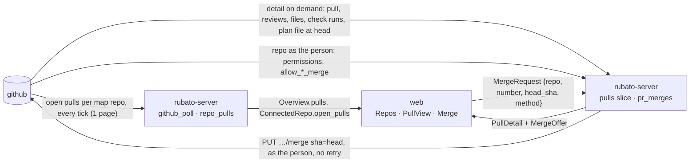

# Design: open pull requests and issues in Rubato; merge as the person (#82)

Plan: [../82.md](../82.md) · ADRs 0033 (merge as the person) and 0034 (list every open pull request,
detail on demand), both *proposed*. Choices Q1–Q4 answered by Mattias Jonsson 2026-11-12.

Revised after the design review (two blockers: the plan gate failed open when the branch lacked the
plan file; the open-issue view needed issue bodies that ADR 0026 keeps out of the browser; and eight
should-fix findings, all taken).

## Where it sits on the map

Nothing here reaches a companion or an agent (ADR 0001, 0004). The token stays on the server
(ADR 0030).

## 1. Listing (ADR 0034)

Today `RepoView.open_pull` lists `open_pulls(repo)` lazily, only when a tracked issue's branch needs
it, and keeps one pull request per issue (`github_poll/poll.rs:189-210`). New:

- On every tick, `github_poll` lists `open_pulls` for **every map repo** before the per-issue pass
  and hands the listing to `RepoView`, so the per-issue pass does not list again. Same fork filter
  (`kernel/github/api.rs:538-545`). A truncated or failed listing keeps today's per-issue fallback
  to `pull_for_branch` (`poll.rs:192-194`) and the stack-bottom rule (`poll.rs:160-169`) reads the
  same shared listing; both get tests with a fake that truncates (today `fake.rs:137` never does).
- `PullInfo` gains `title` and `author` (both are in the same REST page).
- The listing replaces the repo's rows in `repo_pulls` (migration 0011): `(repo, number)` primary
  key, `branch`, `base`, `title`, `author`, `draft`, `head_sha`, `checks`, `checks_sha`,
  `updated_at`, `url`; and `repo_pulls_status (repo, listed_at, truncated, error)`. A failed listing
  keeps the last rows and records the error, as `backlog_repos` does.
- **Checks, one source per pull request.** A pull request tied to a tracked issue keeps its checks
  in `pull_requests` (ADR 0023, every tick); the overview takes them from there when it builds
  `Overview.pulls`, so nothing is copied. Any other pull request is read on the full lane when its
  head moved (`head_sha != checks_sha`) **or** its stored status is `Pending` or `None` (CI may not
  have started or finished). Only a terminal status (`Green`, `Red`) at an unchanged head is skipped.
- `issue` on each row is derived, not stored: branch `issue/<n>-…` → `IssueRef{repo, n}` (ADR 0006).

**Budget.** Per tick: +1 `pulls` call per map repo with no tracked issue (today: 0, since the one
map repo has tracked issues). Full lane: ≤ 1 `check-runs` call per untracked open pull request whose
head moved or whose checks are not terminal. Call-count tests: three map repos with no tracked issue
cost 3 `pulls` calls per tick and 0 in the per-issue pass (fails on purpose when listing per issue);
an unchanged head with `Green` costs 0 `check-runs` on the next full tick, with `Pending` it costs 1.

## 2. A pull request's view (ADR 0034)

`GET /api/pulls/{owner}/{repo}/{number}` in a new slice `pulls`. The repo must be one the map names
and the installation covers; any pull request of such a repo can be viewed (open, merged or closed),
so the issue detail's link works for a Done issue and after a merge. Other repos answer 404
`unknown_repo`, so the route cannot read arbitrary repos through the installation. It reads, in
parallel:

| Call | As | Gives |
| --- | --- | --- |
| `GET /repos/{o}/{r}/pulls/{n}` | installation | body, head sha, base, draft, mergeable, mergeable_state, state, merged_at, head repo (fork?) |
| `GET …/pulls/{n}/reviews` (1 page) | installation | per review: author, `author_association`, `user.type`, state, time |
| `GET …/pulls/{n}/files` (1 page, 100) | installation | count, additions, deletions; top 20 by changes; `truncated` past 100 |
| `GET …/commits/{head}/check-runs` (1 page) | installation | name, status, conclusion, url per run; folded with `summarize_check_runs` |
| `GET …/commits/{base head}/check-runs` (1 page), only when the head has none | installation | whether the repo runs any checks at all (§3 rule 5) |
| `GET …/contents/{plan path}?ref={head}`, only when the branch names an issue | installation | the plan file at the head being merged (§3 rule 7) |
| `GET /repos/{o}/{r}` | the person | `permissions.push`, `allow_merge_commit`, `allow_squash_merge`, `allow_rebase_merge` |

- **Reviews from the team only.** Reviews are shown as the latest state per author among those that
  pass `trusted_author` (ADR 0027; `github.rs:112`, as the comments pass does at `poll.rs:310`).
  The rest are counted as "n reviews from outside the team", without their state.
- **Cache.** In memory, 30 s per (repo, number); the person's part is keyed with the login. One fetch
  in flight per (repo, number): a second viewer waits on the first. The merge POST's fresh read
  replaces the entry, and every merge outcome evicts it before `notify("merge")`, so a refetch after
  a merge never shows the pre-merge state. Counter `rubato.pulls.view_fetches{rubato.outcome}` with
  `cached`, `fetched`, `failed`; log `pull view failed` (repo, number, error).
- **No token** (OAuth-only, no key, not authorised): the installation part still renders;
  `merge.why_not = needs_github_authorization` and `methods` is empty.
- Body is plain text (A4).

## 3. The merge gate

`merge_refusal(...)` is one pure function in `rubato-protocol`, used by both the view and the POST.
The approval derivation it needs (`approval_state`, today private in `overview/build.rs:80-114`)
moves next to `plan_fit` in `rubato-protocol` as a pure function, so `pulls` does not depend on the
`overview` slice and `overview` stays a sink. Inputs: `PullFacts` (fresh pull, check runs, base
check runs), `PersonFacts` (push, allowed methods) or none, `PlanAtHead`, and the request.

Order, first match wins, each a `rubato_protocol::pulls::reason` constant:

1. `not_open` — the pull request is closed or merged.
2. `fork` — the head repo is not the base repo.
3. `draft`.
4. `head_changed` — the request's `head_sha` differs from the fresh head (POST only).
5. `checks_not_green` — folded check runs are `Pending` or `Red`; or there are none at the head
   while the base branch's head has some ("checks have not started"). No runs at either means the
   repo runs no checks, and that passes. (The team's `main` has no branch protection, so Rubato's
   gate is the only one before CI has registered.)
6. `not_mergeable` — `mergeable` is false, or still null (A5; the view says "GitHub is still
   checking").
7. `plan_not_approved` — the issue named by the branch has a plan, and no counted approval names
   the plan **at the head being merged**: the plan file is read at `head_sha`, its approval sha
   computed (`plan-sha`, checkboxes normalised, ADR 0027), and an `Approved:` from a trusted author
   must name that sha, with the plan fitting the map (ADR 0029). The issue "has a plan" when the file is at the head, **or** Rubato holds a plan row for it, **or**
   it has a `Review:` or `Approved:` comment in `plan_signals` (kept even when `plans/fetch.rs:72` deletes
   the plan row); only when none of these holds is the gate `NoPlan` and passes. A plan deleted from the
   branch, or edited after approval, is refused.
8. `needs_github_authorization` — no person facts (no token).
9. `no_push_permission` — `permissions.push` is false.
10. `method_not_allowed` — the requested method is not among the allowed ones (POST only).

The view returns `MergeOffer{methods, default_method, can_merge, why_not, plan_gate}`; the button is
disabled with the reason text. The POST answers 409 with `{reason}` (502 for `github_refused`) and
counts `rubato.web.rejected{rubato.route=/api/pulls/merge, rubato.reason}`.

## 4. Merge, at most once (ADR 0033)

`POST /api/pulls/merge {repo, number, head_sha, method}`, in the shape of `approve/handlers.rs`:

1. Membership (`CurrentUser`), map loaded, the repo named by the map and covered.
2. **Existing intent first**: a `pr_merges` row for `(repo, number, head_sha)` answers with its
   state (`merged` 200, `opening` 202), whoever opened it. A retry after a merge gets "merged", not
   `not_open`.
3. Token: `auth::access_token`; `NotStored`/`Rejected` → 409 `needs_github_authorization`;
   `Failed` → 502 with `retry: true`.
4. **Fresh** facts (bypass the cache; the result replaces the cache entry), including the person's
   repo read with the token, then `merge_refusal`. Any refusal: nothing sent.
5. `INSERT OR IGNORE` the `opening` row (migration 0012: key `(repo, number, head_sha)`, `login`,
   `method`, `state` `opening` | `merged`, `merge_sha`, `opened_at`, `updated_at`); losing the race
   answers with the winner's row. Two people or two tabs on the same head make one call.
6. `merge_as(token, repo, number, head_sha, method)` inside span `rubato.pr.merge` (`rubato.repo`,
   `rubato.pr` — a new attribute in `otel.rs` — and `rubato.outcome` recorded on the span).
   - `Ok{sha}` → row `merged`, evict the cache entry, `app.notify("merge")`, log
     `pull merged from Rubato` (repo, pr, login, method), 200.
   - `Refused{status, message}` → delete the row, evict, 502 `github_refused` with GitHub's message
     (405 not mergeable or a merge queue, 409 head moved, 403 no permission, 422 validation; also a
     merge that changes `.github/workflows/` when the App lacks the Workflows permission).
   - `Unknown` → row stays `opening`, 202.
7. **Reconcile**, on every tick, only after a fresh and untruncated listing of that repo: an
   `opening` row whose pull request is no longer listed is checked with `pull` (1 call); `merged_at`
   set → `merged`, log `merge confirmed by poll` (repo, pr, login). A row whose pull request is still
   listed open at the same head after two such listings is deleted (GitHub did not merge; a second
   PUT is harmless anyway, since `sha` guards it). **Every** `opening` row is deleted at 600 s
   whatever the listing says, log `merge not confirmed` (repo, pr, login). A failed `pull` call logs
   `merge reconcile failed` (repo, pr, error) and leaves the row for the next tick. Gauge
   `rubato.pulls.merges_opening` counts rows opening longer than 120 s. `merged` rows are deleted
   after 7 days.

Rubato never deletes the head branch (stacked pull requests above it would close).

**Budget of one merge** (in ADR 0034): the view's reads (4–6 as the installation, 1 as the person),
the POST's fresh reads (the same), 1 PUT as the person, and at most 1 reconcile `pull`.

## 5. Web

- Feature `pulls` (`web/src/features/pulls/`): `PullList`, `PullView`, `MergeButton`, `api.ts`
  (`GET`, `POST`, refusal texts in the style of `plans/api.ts`).
- Repos tab: each repo row expands to its open pull requests (from `Overview.pulls`) and its open
  issues: the backlog issues of that repo (`Overview.backlog`) and its tracked issues. An open issue
  row shows what Rubato stores — title, labels, last updated, a link to GitHub — and offers *Pin
  to…* (backlog) or opens the existing issue detail (tracked). No issue body is shown: ADR 0026 keeps
  the body excerpt on the server, and the issue's own page is one click away.
- Issue detail: the existing pull request line (`features/issues/IssuePanel.tsx:135-145`) opens
  `PullView` for any state; merged and closed pull requests show their state and no Merge.
- `PullView` fetches on open and on `WebEvent::Changed` with reason `merge` or `poll`; shows body
  (text), check runs with links, team reviews (latest per reviewer) and the outside-team count, the
  files summary with "View diff on GitHub" (`{url}/files`), the linked issue with its fit and
  approval badges, and `MergeButton`.
- `MergeButton`: a select of the allowed methods only (default squash when allowed), a primary
  button, disabled with `why_not` text in a `.muted` line; one click, no confirm (A2); result in a
  `role="status"` element. New badge pairs (`checks-red`, `conflict`) use `-ink` tokens and join
  `PAIRS` in `styles.test.ts`.

## 6. Test fixtures

- `kernel/github/fake.rs`: pull detail, reviews with associations, files, check runs per sha, plan
  files per ref (existing `file`), repo permissions per login, a listing that can truncate,
  `merge_as` that records `(login, repo, number, sha, method)` and supports `merge_refused`,
  `merge_times_out` (posted or not). Every method pushes onto `calls`.
- `local.rs` (dev e2e, bare repos, `web/e2e/run.sh:44`): `RUBATO_DEV_PULLS` JSON seeds open pull
  requests; `merge_as` merges with `git merge-tree --write-tree`, `git commit-tree -p <base> -p
  <head>` and `git update-ref refs/heads/<base> <new> <old>` (the old value mimics GitHub's head
  guard); a conflicting tree is refused as 405.
- `web/e2e/github-standin.ts` (app e2e): `/repos/m0x6A/rubato/pulls`, `/pulls/{n}`, `/reviews`,
  `/files`, `/commits/{sha}/check-runs`, `/contents/…?ref=`, `/repos/m0x6A/rubato` (as the user),
  `PUT /merge` that records the token's login as `merged_by`; the spec asserts it through
  `/_standin/calls`.

## 7. Caveats

| Caveat | Answer |
| --- | --- |
| Concurrency | `pr_merges` key on the head; existing row answered first; `INSERT OR IGNORE`; GitHub's `sha` guard. Detail cache single-flight, replaced by the POST, evicted on every merge outcome. Token refresh is already single-flight (`auth/tokens.rs`). |
| Timeout | `Unknown` stays `opening`; reconcile confirms it, deletes it after two listings still open, or at 600 s. No retry. Test: timeout without a merge, row expires, a second Merge sends once. |
| Plan gate | Read at the head being merged; fails closed when the issue ever had a plan signal. Tests: plan deleted on the branch; plan edited after approval; approval of a plan that does not fit; no plan ever. |
| Untrusted input | Same-repo branches only; titles and bodies rendered as text. Reviews shown only from trusted authors (ADR 0027). Issue bodies never sent (ADR 0026). The view is limited to map repos the installation covers. |
| Budget | ADR 0034 numbers; call-count tests; "GitHub calls by endpoint" panel. |
| Token | Only `pulls` (`repo_as`, `merge_as`) and `approve` call `auth::access_token`; the token-leak schema test is unchanged. |
| Derived, not stored | `repo_pulls` stores GitHub's facts, not progress; `issue`, checks of tracked pull requests and the gate are derived. `pr_merges` is an intent record, like `plan_approvals`. |
| Slices | `pulls` owns `pr_merges` and names `github_poll`, `auth`, `plans` through their roots; `approval_state` moves to `rubato-protocol`, so `pulls` does not name `overview`. `github_poll` owns `repo_pulls`. AGENTS.md blocks updated. |
