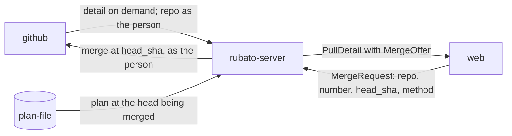

# Open pull requests and issues in Rubato; merge as the person

Issue: #82 · Design: [82-pulls-in-rubato/design.md](82-pulls-in-rubato/design.md) · ADRs 0033,
0034 (*accepted* 2026-11-12). PR 0 (#92) and PR 1 (#93) merged. Refreshed 2026-11-15 against main
at `20912cf` before PRs 2–4: approval now happens in Rubato (ADR 0054), migrations are at 0023, the
server has gained workspaces and same-origin writes (ADR 0049, 0066). What changed is in
`## Decisions` (rows 1–8). One PR per part, each from the newest main.

Issue #82, raised by Mattias Jonsson while planning #80: "we should also be able to see open pull
requests, issues, view them and merge them from rubato". Per connected repo, Rubato shows open pull
requests (checks, review state, mergeable, linked issue and its plan) and open issues; a pull
request has a view (description, checks, reviews, changed files, link to the diff); and *Merge*
runs as the person through their GitHub App user-to-server token (ADR 0030), so GitHub enforces
branch protection and records who merged. Mattias answered Q1–Q4 on 2026-11-12: the person picks
the merge method among those the repo allows; a pull request whose issue has a plan needs a counted
approval; the list is cheap and the detail is read on demand; same-repo branches only.

## What the change does

- **Open pull requests per repo.** The Repos tab lists, per map repo, its open pull requests from
  same-repo branches: title, author, branch, draft, checks, and the linked issue (from the branch
  name) with its plan's fit and approval badges. Listed every tick; checks of untracked pull
  requests within 300 s (ADR 0034). *(Server side merged in PR 1.)*
- **Open issues per repo.** The same row lists the repo's open issues with what Rubato stores
  (title, labels, last updated, a link to GitHub); a backlog issue offers *Pin to…*, a tracked one
  opens its issue detail. No issue body is shown (ADR 0026); no extra GitHub call.
- **A pull request's view.** Body, check runs with links, the latest review per team reviewer (and a
  count of reviews from outside the team), a changed files summary, "View diff on GitHub",
  mergeability, the linked issue, and what *Merge* would do or why it cannot. Any pull request of a
  repo the workspace's map names and the installation covers, open or not. Read when opened,
  cached 30 s, one fetch at a time per pull request, refreshed after a merge.
- **Merge as yourself (ADR 0033).** A method select (only what the repo allows, squash by default)
  and *Merge*. Rubato refuses, sending nothing, when the pull request is closed, a draft or from a
  fork, the head moved, checks are pending or red or have not started, it is not mergeable, the
  linked issue has a plan and the newest counted approval (as the overview derives it) does not
  name the plan at the head being merged, that plan does not fit the map, or, for an approval given
  in Rubato, the head's approval record is not Rubato's (ADR 0054); a plan that cannot be read
  refuses too, the person has no push permission or no stored token, or the
  method is not allowed. GitHub records the person as the merger; its own refusal is shown as is.
  Rubato never deletes the head branch. When another open pull request is based on the head
  branch, the view says a squash will make it conflict.

## How we'll know it works

- [x] Three map repos with no tracked issue cost 3 `pulls` calls per tick and none in the per-issue pass (call-count test with the fake; fails on purpose when listing per issue). *(PR 1)*
- [x] On the full lane, an untracked pull request at an unchanged head costs 0 `check-runs` when its checks are `Green` or `Red`, and 1 when they are `Pending` or none; a run first seen pending shows green within one full tick after it finishes (call-count test). *(PR 1)*
- [x] Every open same-repo pull request of every map repo is in `Overview.pulls` with its linked issue; a fork pull request is not; a truncated listing says so; a failed listing keeps the last rows with the error; a tracked issue's pull request shows the checks from `pull_requests`, not a copy (server tests). *(PR 1)*
- [ ] The Repos tab lists each repo's open issues (backlog and tracked) with title, labels, updated and link, offers Pin to… on a backlog issue and opens the detail of a tracked one, and the payload carries no issue body (Vitest; a schema test that `OpenIssue` has no body field).
- [ ] The view returns body, check runs, team reviews (latest per author) and an outside-team count, files summary (top 20, truncated past 100) and a `MergeOffer`; two concurrent views make one fetch; a second view within 30 s makes none; with no token it renders with `why_not = needs_github_authorization`; a merged pull request of a map repo renders; a repo outside the workspace's map or the installation is 404; under `/api/w/{ws}` it reads that workspace's map (server tests).
- [ ] `merge_refusal` returns each reason on its own case, in order: `not_open`, `fork`, `draft`, `head_changed`, `checks_not_green` (pending, red, none at the head while the base has runs), `not_mergeable` (false and null), `plan_not_approved`, `needs_github_authorization`, `no_push_permission`, `method_not_allowed`; no runs at head and base passes (protocol unit tests).
- [ ] `plan_gate`: passes with no plan signal at all; passes when the newest counted approval names the plan hash at the head and that plan fits, for a comment approval and for one given in Rubato whose record at the head matches; refuses with no approval, an approval naming no sha, a plan edited after approval, a head plan that does not fit, a plan that could not be read, a Rubato approval whose record is missing or differs at the head, and a plan file gone at the head while the issue has a plan row, draft, review or approval (protocol unit tests). Server tests through the view: an `Approved:` comment after the cutover leaves the gate closed; a failed contents read closes it (fails on purpose if the error became "no file"); a stacked head whose plan matches an approval named on a deleted branch passes; the plan is read at the plan row's path.
- [ ] `POST /api/pulls/merge` refuses each reason with nothing sent (the fake logs no `merge_as`); a cross-origin POST is 403 `cross_origin` before the handler (ADR 0066); two concurrent requests on one head merge once; a retry after a merge answers `merged` 200; a timeout that merged is confirmed by reconcile; a timeout that did not merge expires (two listings still open, or 600 s) and a second Merge sends once; a 405 from GitHub deletes the row and answers `github_refused` with GitHub's message; reconcile ignores a truncated or failed listing (integration tests with the fake, retries off).
- [ ] A merge through the app-mode e2e stand-in is made with the logged-in person's token and the stand-in records them as `merged_by`; the dev e2e lists seeded pull requests, opens a view and merges into the bare repo (Playwright, both projects).
- [ ] PullList, PullView and MergeButton render; MergeButton is disabled with the reason text for each `why_not`, its select offers only allowed methods, and the stacked-branch note shows when pull requests are based on the head (Vitest).
- [ ] Manual run against the real App, once Mattias has set the App permissions (see the PR 3 description): this repo's open pull requests show in Rubato; Mattias merges one whose plan is approved; GitHub shows him as the merger, via the App; a pull request that changes `.github/workflows/` is tried once and its outcome noted.

## What it must not break

- ADR 0001 and 0004: nothing merges without a person's click; no agent or companion is sent a token (the existing token-leak schema test over `schema/protocol`).
- The approval derivation (ADR 0029, 0054): `ApprovalVersion`, `PlanFit` and `approval_state` in `overview/build.rs` unchanged (existing `overview` tests); the gate reads the summary the overview builds, never writes or stores a state.
- ADR 0023's per-issue budget: tracked issues make no more calls than today (existing call-count tests).
- The per-issue fallback when the shared listing is truncated or failed (PR 1 tests).
- ADR 0032's plan-branch rule: the bottom of a stack is still chosen from the shared listing's `base` (PR 1 tests).
- ADR 0026: no issue body reaches a browser (schema test above).
- ADR 0066: every new write passes `same_origin`; the route-probe test in `app.rs` lists the new routes, map-scoped ones under `/api/w/{ws}` too (ADR 0049).
- The issue detail's pull request line keeps showing merged and closed pull requests (`IssuePanel` test, extended for the PullView link).
- Approve as the person (ADR 0030, 0054): `approve` tests unchanged; the token store is shared, not changed.
- The progress model: listing and merging are not states; `derive_progress` tests unchanged (Done still comes from `merged_at`).
- Slice tests and AGENTS.md slice blocks per deployable (`slices.rs`, `features.test.ts`); `styles.test.ts` contrast and target-size rules; the overview golden test.

## How we'll debug it at 3 am

See the O-rows. New: span `rubato.pr.merge` (`rubato.repo`, `rubato.pr` — a new attribute in
`otel.rs` — and `rubato.outcome`); gauge `rubato.pulls.merges_opening`; counter
`rubato.pulls.view_fetches{rubato.outcome}`; endpoints `pull`, `pull_reviews`, `pull_files`,
`check-runs`, `contents`, `repo`, `merge` on `rubato.github.calls`; route `/api/pulls/merge` on
`rubato.web.rejected`; logs `merge refused` (repo, pr, login, reason, gate why, approved sha, head hash), `pull merged from Rubato`, `merge confirmed by poll`,
`merge not confirmed`, `merge reconcile failed`, `pull view failed`, `pulls listing failed`
(repo, error).

## Affected parts

| Node | Status | What changes | Seams |
| --- | --- | --- | --- |
| rubato-protocol | affected | module `pulls` gains `PullDetail`, `CheckRun`, `PullReview`, `FilesSummary`, `MergeOffer`, `PlanGate`, `plan_gate`, `merge_refusal`, `MergeRequest`, `MergeResponse`, reasons, routes; otel names | web-server |
| rubato-server | affected | slice `pulls` (view, cache, plan gate from the overview's summary, merge, reconcile, `pr_merges`); port methods `pull`, `pull_reviews`, `pull_files`, `check_runs`, `repo_as`, `merge_as`; fake, local and stand-in; `overview::issue_summary`; dashboard query | web-server, server-github, server-plan-file |
| web | affected | feature `pulls` (PullList, PullView, MergeButton); Repos rows expand to pull requests and issues; read-only open issue view; issue detail opens PullView | web-server |
| github | affected | pull request merged by the person via the App; detail reads | server-github |
| plan-file | quiet | read at the head being merged for the gate; unchanged | server-plan-file |

## Data models

| Model | Kind | Part | Change | Crosses | Note |
| --- | --- | --- | --- | --- | --- |
| `PullDetail`, `CheckRun`, `PullReview`, `FilesSummary` | type | rubato-protocol | new | web-server | `GET /api/pulls/{owner}/{repo}/{number}`, map-scoped; team reviews only, plus an outside-team count |
| `MergeOffer`, `PlanGate` | type | rubato-protocol | new | web-server | from `merge_refusal` and `plan_gate`, the same rule as the POST |
| `MergeRequest`, `MergeResponse` | type | rubato-protocol | new | web-server | `POST /api/pulls/merge`, map-scoped |
| `pr_merges` | table | rubato-server | new | | owned by `pulls`; key (repo, number, head_sha); opening, merged; merged rows kept 7 days; migration 0025 |
| merge as the person | event | github | new | server-github | `PUT …/pulls/{n}/merge` with `sha` and `merge_method` |

## Data flow

## Tasks

- [x] **PR 0** `issue/82-pulls-plan` (#92): ADRs 0033 and 0034, map flows, design note, this plan; approved by Mattias 2026-11-12
- [x] **PR 1** `issue/82-pulls-list` (#93): listing for every map repo, `repo_pulls` (migration 0011), full-lane checks, `Overview.pulls`, `ConnectedRepo.open_pulls`
- [ ] **PR 2** `issue/82-pull-view`: this refresh and its delegated approval first; then `plan_gate` and `merge_refusal` unit tests (one per reason and case, order, no-plan-signal case, a Rubato approval); view tests against the fake (shape, team reviews only, cache within 30 s, single flight, no token, merged pull request renders, 404 outside the workspace's map or the installation); then protocol types, port methods `pull`, `pull_reviews` (with association), `pull_files`, `check_runs`, `repo_as` with `count_call` and `GITHUB_CALL` spans, fake and `local.rs` (`RUBATO_DEV_PULLS`), `overview::issue_summary`, slice `pulls` with the map-scoped GET and `rubato.pulls.view_fetches`; regenerated schema and `protocol.ts`; AGENTS.md server and protocol blocks
- [ ] **PR 3** `issue/82-merge`: refusal integration tests asserting no `merge_as`; a cross-origin POST refused; concurrency, retry-after-merge, timeout-merged, timeout-not-merged and truncated-listing reconcile tests; then `merge_as` (no retry, `sha`, `merge_method`), migration 0025 `pr_merges`, the map-scoped handler with the existing row answered first, cache replace and evict, reconcile with its logs, gauge `rubato.pulls.merges_opening`, span `rubato.pr.merge` with `rubato.pr` (new in `otel.rs`) and the outcome recorded; `local.rs` merge with `merge-tree`, `commit-tree`, `update-ref`; dashboard query on the Approvals panel; the App permissions Mattias must set, in the PR description
- [ ] **PR 4** `issue/82-pulls-web`: Vitest first (PullList, PullView, MergeButton per reason and methods, stacked note); feature `pulls`, Repos rows expanding, open issue view, issue detail link; `styles.test.ts` pairs; stand-in routes and e2e on both projects (dev lists, views and merges; app merges and asserts `merged_by`); AGENTS.md web block

## Assumed, not yet approved

| # | Decision | Chosen | Alternatives | Scope |
| --- | --- | --- | --- | --- |
| Q1 | Merge method | the person picks among the repo's allowed methods, default squash when allowed; chosen by Mattias Jonsson 2026-11-12; ADR 0033 accepted | squash only; merge commit only | seam (server-github): settled, ADR 0033 |
| Q2 | Plan gate before Merge | counted approval required only when the issue has a plan; chosen by Mattias Jonsson 2026-11-12; ADR 0033 accepted, approval source extended by ADR 0054 | always required; never | seam (server-github): settled, ADR 0033 |
| Q3 | Cost of pull request data | list per repo each tick, checks on the full lane, detail on demand cached 30 s; chosen by Mattias Jonsson 2026-11-12; ADR 0034 accepted | REST per pull request per tick; GraphQL per repo | seam (server-github): settled, ADR 0034 |
| Q4 | Fork pull requests | same-repo branches only; chosen by Mattias Jonsson 2026-11-12 | list without Merge; list with Merge | seam (server-github): settled |
| A1 | Linked issue | from the branch name only (ADR 0006) | also `Closes #n` in the body | node (rubato-server) |
| A2 | Merge confirmation | one click, no dialog; `head_sha` is the guard | a confirm dialog | node (web) |
| A3 | Files summary | top 20 by changes from one page of 100, marked truncated past it | page through all files | node (rubato-server) |
| A4 | Body rendering | plain text | Markdown with a sanitiser dependency | node (web) |
| A5 | `mergeable: null` | "GitHub is still checking", refused as `not_mergeable` until a later view | treat as mergeable and let GitHub decide | node (rubato-server) |
| A6 | No check runs at the head | passes only when the base branch head has none either (the repo runs no checks); otherwise `checks_not_green`, "checks have not started" | always pass; always refuse | node (rubato-server) |
| A7 | Reviews in a public repo | shown only from trusted authors (ADR 0027 rule); others counted | show all | node (rubato-server) |
| A9 | `pr_merges` retention | `merged` rows deleted after 7 days | keep forever | node (rubato-server) |

## Decisions

| # | Decision | Chosen | Why | Decided by |
| --- | --- | --- | --- | --- |
| 1 | What "a counted approval" means at the merge gate, now that approval is in Rubato (ADR 0054) | the newest counted approval record the overview derives for the linked issue (`IssueSummary.approval.record`: comments before the cutover, approvals given in Rubato) must name `approval_hash` of the plan read at the head being merged; that head plan must fit this workspace's map; for a Rubato approval the head's `approved_by`, `approved_at` and `approved_sha` must equal Rubato's record (ADR 0054 "the merge gate"). The summary's `ApprovalVersion` is not used: it compares with the branch the overview reads the plan from, not the head. `pulls` reads the summary through `overview::issue_summary`; nothing new is stored | one source of counted approvals for the badge and the gate; the head checks keep ADR 0033's "plan at the head being merged" and ADR 0054's record rule (review blockers 1, should-fix 3) | agent (delegated by Mattias, 2026-11-15) |
| 2 | Where `approval_state` lives (was A8: move it to `rubato-protocol`) | it stays in `overview/build.rs`; the pure `plan_gate` in `rubato-protocol` takes the summary's counted record and the plan at the head instead; `pulls` → `overview` is a new slice edge (overview names no `pulls`, so the graph stays acyclic) | moving it would duplicate a derivation that now spans drafts, Rubato approvals and workspaces | agent (delegated by Mattias, 2026-11-15) |
| 3 | What counts as "the issue has a plan" for the gate | the plan file at the head, or the issue's summary has a plan row (`plan_sha`), a draft (ADR 0053), a review or an approval; otherwise `NoPlan` and the gate passes | the same fail-closed rule as before, with the draft added as a plan signal | agent (delegated by Mattias, 2026-11-15) |
| 4 | `pr_merges` migration number | 0025 (main is at 0023, #144 takes 0024) | the next free number on main and the open pull requests | agent (delegated by Mattias, 2026-11-15) |
| 5 | Routes | `GET /api/pulls/{owner}/{repo}/{number}` and `POST /api/pulls/merge` are map-scoped (also under `/api/w/{ws}`, ADR 0049), both behind `same_origin` (ADR 0066) | the repo must be one the workspace's map names, and the gate reads that workspace's overview | agent (delegated by Mattias, 2026-11-15) |
| 6 | Where `merge_refusal` and `plan_gate` land | PR 2, with the view (the view shows `why_not`); PR 3 adds the POST, `pr_merges` and reconcile | PR 2's view is complete on its own and PR 3 stays about the write | agent (delegated by Mattias, 2026-11-15) |
| 7 | Merge method default for a branch other pull requests are based on (review left open 1) | keep squash as the default (ADR 0033, Mattias's Q1); the view counts the open pull requests based on the head and warns that a squash makes them conflict; the person picks | keeps the accepted ADR's text; a default of merge commit there needs a superseding ADR, which Mattias can ask for | agent (delegated by Mattias, 2026-11-15) |
| 8 | A merge that changes `.github/workflows/` (review left open 2) | no Workflows permission asked for; GitHub's refusal shows as `github_refused` with its message | the narrowest permission set; adding Workflows is Mattias's call | agent (delegated by Mattias, 2026-11-15) |
| 9 | A read the gate needs fails (the plan file at the head, or the overview summary) | the gate closes: `PlanGate::NotApproved{why: unreadable}` in the view, 502 `github_failed` on the POST, nothing sent; a read error is never "no file" | fail closed (review blocker 2) | agent (delegated by Mattias, 2026-11-15) |
| 10 | Which path the plan is read from at the head | the plan row's `path` when Rubato holds one, else the map's path for the head branch's slug | a stacked head with another slug reads the plan that was approved (review should-fix 4) | agent (delegated by Mattias, 2026-11-15) |
| 11 | Fit at the head across workspaces | the head plan must fit this workspace's map (the repo is one it names); fitting only another workspace refuses | fail closed and one map to read; widen later if a shared repo needs it | agent (delegated by Mattias, 2026-11-15) |
| 12 | Reconcile of an `opening` merge | `pr_merges.listings_open` counts complete listings that still show the pull request open at that head; `tasks.rs` calls `pulls::reconcile` after `list_repo_pulls` with the repos listed completely this tick (`pulls` names `github_poll`, so not the other way); a pull request seen closed without a merge deletes the row, log `merge not confirmed` | review should-fix 5 | agent (delegated by Mattias, 2026-11-15) |
| 13 | Tracing a wrong refusal | log `merge refused` (info) with repo, pr, login, reason, gate why, approved sha and head hash, beside `rubato.web.rejected` | review should-fix 6 | agent (delegated by Mattias, 2026-11-15) |
| 14 | What a Rubato approval covers at the gate | the plan only, not the rest of its bundle (design note, ADRs) | ADR 0033 and 0054 ask for the plan; the bundle is checked at handoff | agent (delegated by Mattias, 2026-11-15) |
| 15 | Approve plan for build | yes | review passed, delegated approval | agent (delegated by Mattias, 2026-11-15) |

## O-rows

| Seam | Breaks like | Signal | Panel | Owner |
| --- | --- | --- | --- | --- |
| server-github | a merge fails, hangs or is attempted twice; the views cost more than ADR 0034 says | span `rubato.pr.merge` (`rubato.repo`, `rubato.pr`, `rubato.outcome`, error status) wrapping `rubato.github.call{rubato.github.endpoint=merge}`; gauge `rubato.pulls.merges_opening`; `rubato.github.calls{rubato.github.endpoint=pull,pull_reviews,pull_files,check-runs,contents,repo,merge}`; `rubato.pulls.view_fetches{rubato.outcome}`; logs `pull merged from Rubato`, `merge confirmed by poll`, `merge not confirmed`, `merge reconcile failed`; rate-limit gauge | GitHub calls by endpoint; GitHub calls · Rate limit; Approvals (gains merges opening) | rubato-server |
| web-server | Merge is refused for a pull request that should merge, or the view does not load | `rubato.web.rejected{rubato.route=/api/pulls/merge, rubato.reason}` (also `cross_origin`); log `pull view failed` (repo, number, error); generated `protocol.ts` diffed in CI | Web writes rejected | rubato-server |
| server-plan-file | Merge offered on a plan nobody approved, or refused on one that is approved and fits | `rubato.web.rejected{rubato.reason=plan_not_approved}`; findings `ApprovedWithoutFit`, `ApprovalStale` and gauge `rubato.plans.not_fitting` (unchanged, the gate reads the same derived state) | Approvals; Web writes rejected | plan-file |

## Flows

| From | To | Seam | Kind | Carries |
| --- | --- | --- | --- | --- |
| github | rubato-server | server-github | data | a pull request's detail; the person's repo permission and merge methods |
| rubato-server | github | server-github | control | merge a pull request at the head the person saw, as the person |
| rubato-server | web | web-server | data | PullDetail with MergeOffer |
| web | rubato-server | web-server | control | MergeRequest: merge as yourself |
| plan-file | rubato-server | server-plan-file | data | the plan at the head being merged, for the gate |

## Review map

1. `plan_gate` and `merge_refusal` in `crates/rubato-protocol/src/pulls.rs`, and where `pulls` feeds them: the counted record from `overview::issue_summary`, the plan read at the head (its hash, fit and approval record; a read error closes the gate), the has-a-plan rule (fail closed), the checks-not-started rule.
2. The merge handler in `crates/rubato-server/src/pulls/`: `head_sha` sent to GitHub as `sha`, nothing sent on any refusal, one `pr_merges` row per head, the existing row answered first, reconcile only after a complete listing.
3. Token use: `repo_as` and `merge_as` are the only new callers of `auth::access_token`; nothing new carries the token across `web-server`.
