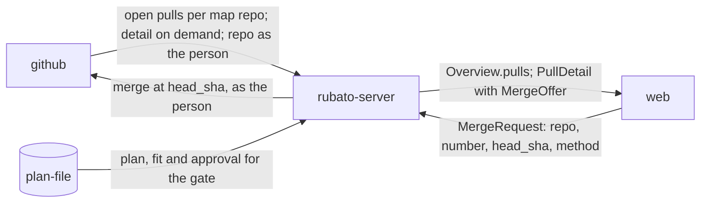

# Open pull requests and issues in Rubato; merge as the person

Issue: #82 · Design: [82-pulls-in-rubato/design.md](82-pulls-in-rubato/design.md) · ADRs 0033,
0034 (*proposed*). Revised after the design review (two blockers, eight should-fix, all taken). Stacked PRs on `issue/82-*` branches; PR 0 is this plan.

Issue #82, raised by Mattias Jonsson while planning #80: "we should also be able to see open pull
requests, issues, view them and merge them from rubato". Per connected repo, Rubato shows open pull
requests (checks, review state, mergeable, linked issue and its plan) and open issues; a pull
request has a view (description, checks, reviews, changed files, link to the diff); and *Merge*
runs as the person through their GitHub App user-to-server token (ADR 0030), so GitHub enforces
branch protection and records who merged. Mattias answered Q1–Q4 on 2026-11-12: the person picks
the merge method among those the repo allows; a pull request whose issue has a plan needs a counted
approval; the list is cheap and the detail is read on demand; same-repo branches only.

## What the change does

- **Open pull requests per repo.** The Repos tab lists, per map repo, its open pull requests from
  same-repo branches: title, author, branch, draft, checks, and the linked issue (from the branch
  name) with its plan's fit and approval badges. Listed every tick; checks of untracked pull
  requests within 300 s (ADR 0034).
- **Open issues per repo.** The same row lists the repo's open issues with what Rubato stores
  (title, labels, last updated, a link to GitHub); a backlog issue offers *Pin to…*, a tracked one
  opens its issue detail. No issue body is shown (ADR 0026); no extra GitHub call.
- **A pull request's view.** Body, check runs with links, the latest review per team reviewer (and a
  count of reviews from outside the team), a changed files summary, "View diff on GitHub",
  mergeability, and the linked issue. Any pull request of a covered map repo, open or not. Read when
  opened, cached 30 s, one fetch at a time per pull request, refreshed after a merge.
- **Merge as yourself (ADR 0033).** A method select (only what the repo allows, squash by default)
  and *Merge*. Rubato refuses, sending nothing, when the pull request is closed, a draft or from a
  fork, the head moved, checks are pending or red or have not started, it is not mergeable, the plan
  at the head being merged has no counted approval, the person has no push permission or no stored
  token, or the method is not allowed. GitHub records the person as the merger; its own refusal is
  shown as is. Rubato never deletes the head branch.

## How we'll know it works

- [ ] Three map repos with no tracked issue cost 3 `pulls` calls per tick and none in the per-issue pass (call-count test with the fake; fails on purpose when listing per issue).
- [ ] On the full lane, an untracked pull request at an unchanged head costs 0 `check-runs` when its checks are `Green` or `Red`, and 1 when they are `Pending` or none; a run first seen pending shows green within one full tick after it finishes (call-count test).
- [ ] Every open same-repo pull request of every map repo is in `Overview.pulls` with its linked issue; a fork pull request is not; a truncated listing says so; a failed listing keeps the last rows with the error; a tracked issue's pull request shows the checks from `pull_requests`, not a copy (server tests).
- [ ] The Repos tab lists each repo's open issues (backlog and tracked) with title, labels, updated and link, offers Pin to… on a backlog issue and opens the detail of a tracked one, and the payload carries no issue body (Vitest; a schema test that `OpenIssue` has no body field).
- [ ] The view returns body, check runs, team reviews (latest per author) and an outside-team count, files summary (top 20, truncated past 100) and a `MergeOffer`; two concurrent views make one fetch; a second view within 30 s makes none; view, merge, refetch shows `not_open`; with no token it renders with `why_not = needs_github_authorization`; a merged pull request of a map repo renders; a repo outside the map or the installation is 404 (server tests).
- [ ] `merge_refusal` returns each reason on its own case, in order: `not_open`, `fork`, `draft`, `head_changed`, `checks_not_green` (pending, red, none at the head while the base has runs), `not_mergeable` (false and null), `plan_not_approved` (unapproved; approval of an earlier sha; approved but doesn't fit; plan file deleted on the branch while the issue has a `Review:`; plan edited after approval), `needs_github_authorization`, `no_push_permission`, `method_not_allowed`; no runs at head and base passes; an issue with no plan signal at all passes the plan gate (protocol unit tests).
- [ ] `POST /api/pulls/merge` refuses each reason with nothing sent (the fake logs no `merge_as`); two concurrent requests on one head merge once; a retry after a merge answers `merged` 200; a timeout that merged is confirmed by reconcile; a timeout that did not merge expires (two listings still open, or 600 s) and a second Merge sends once; a 405 from GitHub deletes the row and answers `github_refused` with GitHub's message; reconcile ignores a truncated or failed listing (integration tests with the fake, retries off).
- [ ] A merge through the app-mode e2e stand-in is made with the logged-in person's token and the stand-in records them as `merged_by`; the dev e2e lists seeded pull requests, opens a view and merges into the bare repo (Playwright, both projects).
- [ ] PullList, PullView and MergeButton render; MergeButton is disabled with the reason text for each `why_not`, and its select offers only allowed methods (Vitest).
- [ ] Manual run against the real App: this repo's open pull requests show in Rubato; Mattias merges one whose plan is approved; GitHub shows him as the merger, via the App; a pull request that changes `.github/workflows/` is tried once and its outcome noted in the PR.

## What it must not break

- ADR 0001 and 0004: nothing merges without a person's click; no agent or companion is sent a token (the existing token-leak schema test over `schema/protocol`).
- The approval gate (ADR 0029): `ApprovalVersion` and `PlanFit` derivation unchanged (existing `overview/build.rs` tests); the merge gate reads them, never writes them.
- ADR 0023's per-issue budget: tracked issues make no more calls than today (existing call-count tests).
- The per-issue fallback when the shared listing is truncated or failed: tracked issues still reach their pull request through `pull_for_branch` (new test with a fake listing that truncates; `fake.rs` gains it).
- ADR 0032's plan-branch rule: the bottom of a stack is still chosen from the shared listing's `base` (the existing stack test in `overview/build.rs`, plus one through the shared listing).
- ADR 0026: no issue body reaches a browser (schema test above).
- The issue detail's pull request line keeps showing merged and closed pull requests (`issue-panel.test.tsx`, extended for the PullView link).
- Approve as the person (ADR 0030): `approve` tests unchanged; the token store is shared, not changed.
- The progress model: listing and merging are not states; `derive_progress` tests unchanged (Done still comes from `merged_at`).
- Slice tests and AGENTS.md slice blocks per deployable; `styles.test.ts` contrast and target-size rules; map scenarios still load (the flows were extended, not added as a second control flow, so no step becomes ambiguous; map load test).

## How we'll debug it at 3 am

See the O-rows. New: span `rubato.pr.merge` (`rubato.repo`, `rubato.pr` — a new attribute in
`otel.rs` — and `rubato.outcome`); gauge `rubato.pulls.merges_opening`; counter
`rubato.pulls.view_fetches{rubato.outcome}`; endpoints `pull`, `pull_reviews`, `pull_files`,
`check-runs`, `contents`, `repo`, `merge` on `rubato.github.calls`; route `/api/pulls/merge` on
`rubato.web.rejected`; logs `pull merged from Rubato`, `merge confirmed by poll`,
`merge not confirmed`, `merge reconcile failed`, `pull view failed`, `pulls listing failed`
(repo, error).

## Affected parts

| Node | Status | What changes | Seams |
| --- | --- | --- | --- |
| rubato-protocol | affected | module `pulls`: `OpenPull`, `RepoPulls`, `PullDetail`, `MergeOffer`, `PlanGate`, `MergeRequest`, `MergeResponse`, `merge_refusal`, reasons, routes; `approval_state` moved here from `overview/build.rs` as a pure function; `ConnectedRepo.open_pulls`; `Overview.pulls`; otel names | web-server |
| rubato-server | affected | listing for every map repo into `repo_pulls`; full-lane checks; slice `pulls` (view, cache, plan read at the head, merge, reconcile, `pr_merges`); port methods `pull`, `pull_reviews`, `pull_files`, `check_runs`, `repo_as`, `merge_as`; fake, local and stand-in; dashboard query | web-server, server-github, server-plan-file |
| web | affected | feature `pulls` (PullList, PullView, MergeButton); Repos rows expand to pull requests and issues; read-only open issue view; issue detail opens PullView | web-server |
| github | affected | pull request merged by the person via the App; detail reads | server-github |
| system-map | affected | flows on `server-github` and `web-server` extended (ADR 0017); no new ids | |
| plan-file | quiet | read for the merge gate; unchanged | server-plan-file |

## Data models

| Model | Kind | Part | Change | Crosses | Note |
| --- | --- | --- | --- | --- | --- |
| `OpenPull`, `RepoPulls`, `Overview.pulls` | type | rubato-protocol | new | web-server | per map repo, every tick |
| `ConnectedRepo.open_pulls` | type | rubato-protocol | changed | web-server | count |
| `PullDetail`, `CheckRun`, `PullReview`, `FilesSummary` | type | rubato-protocol | new | web-server | `GET /api/pulls/{owner}/{repo}/{number}`; team reviews only, plus an outside-team count |
| `MergeOffer`, `PlanGate` | type | rubato-protocol | new | web-server | from `merge_refusal`, the same rule as the POST |
| `MergeRequest`, `MergeResponse` | type | rubato-protocol | new | web-server | `POST /api/pulls/merge` |
| `repo_pulls`, `repo_pulls_status` | table | rubato-server | new | | owned by `github_poll`; migration 0011 |
| `pr_merges` | table | rubato-server | new | | owned by `pulls`; key (repo, number, head_sha); opening, merged; merged rows kept 7 days; migration 0012 |
| `PullInfo.title`, `PullInfo.author` | type | rubato-server | changed | | port type, from the same listing |
| merge as the person | event | github | new | server-github | `PUT …/pulls/{n}/merge` with `sha` and `merge_method` |
| `server-github`, `web-server` flows | file | system-map | changed | | `docs/design/rubato-map.yml` |

## Data flow

## Tasks

- [ ] **PR 0** `issue/82-pulls-plan`: ADRs 0033 and 0034 (*proposed*), map flows, design note, this plan; `plan.ts check` clean; design review; `Review:` posted on #82; Mattias's `Approved:` and the ADRs' acceptance before PR 1 merges
- [ ] **PR 1** `issue/82-pulls-list`: call-count tests first (three repos, no tracked issue, fails on purpose when listing per issue; terminal vs pending checks at an unchanged head); truncated-listing fallback and stack-bottom tests with a fake that truncates; then protocol `pulls` listing types, `PullInfo.title/author`, migration 0011, listing for every map repo shared with `RepoView`, full-lane checks on a moved head or unfinished status, tracked checks taken from `pull_requests`, Repos open issues (no body), `Overview.pulls`, `ConnectedRepo.open_pulls`, log `pulls listing failed`; regenerated schema and `protocol.ts`
- [ ] **PR 2** `issue/82-pull-view`: view tests first against the fake (shape, team reviews only, cache within 30 s, single flight, no token, merged pull request renders, 404 outside the map or installation); then port methods `pull`, `pull_reviews` (with association), `pull_files`, `check_runs`, `repo_as` with `count_call` and `GITHUB_CALL` spans, fake and `local.rs` (`RUBATO_DEV_PULLS`), stand-in routes, slice `pulls` with the GET and `rubato.pulls.view_fetches`; AGENTS.md server and protocol blocks
- [ ] **PR 3** `issue/82-merge`: `merge_refusal` unit tests first (one per reason and case, order, no-plan-signal case); refusal integration tests asserting no `merge_as`; concurrency, retry-after-merge, timeout-merged, timeout-not-merged and truncated-listing reconcile tests; then `approval_state` moved to `rubato-protocol` (existing approval tests move with it), plan read at the head, `merge_refusal`, `merge_as` (no retry, `sha`, `merge_method`), migration 0012, handler with the existing row answered first, cache replace and evict, reconcile with its logs, gauge `rubato.pulls.merges_opening`, span `rubato.pr.merge` with `rubato.pr` (new in `otel.rs`) and the outcome recorded; `local.rs` merge with `merge-tree`, `commit-tree`, `update-ref`; dashboard query on the Approvals panel
- [ ] **PR 4** `issue/82-pulls-web`: Vitest first (PullList, PullView, MergeButton per reason and methods); feature `pulls`, Repos rows expanding, open issue view, issue detail link; `styles.test.ts` pairs; e2e on both projects (dev lists and views; app merges and asserts `merged_by`); AGENTS.md web block

## Assumed, not yet approved

| # | Decision | Chosen | Alternatives | Scope |
| --- | --- | --- | --- | --- |
| Q1 | Merge method | the person picks among the repo's allowed methods, default squash when allowed; chosen by Mattias Jonsson 2026-11-12; ADR 0033 proposed | squash only; merge commit only | seam (server-github): settled, ADR to accept |
| Q2 | Plan gate before Merge | counted approval required only when the issue has a plan; chosen by Mattias Jonsson 2026-11-12; ADR 0033 proposed | always required; never | seam (server-github): settled, ADR to accept |
| Q3 | Cost of pull request data | list per repo each tick, checks on the full lane, detail on demand cached 30 s; chosen by Mattias Jonsson 2026-11-12; ADR 0034 proposed | REST per pull request per tick; GraphQL per repo | seam (server-github): settled, ADR to accept |
| Q4 | Fork pull requests | same-repo branches only; chosen by Mattias Jonsson 2026-11-12 | list without Merge; list with Merge | seam (server-github): settled |
| A1 | Linked issue | from the branch name only (ADR 0006) | also `Closes #n` in the body | node (rubato-server) |
| A2 | Merge confirmation | one click, no dialog; `head_sha` is the guard | a confirm dialog | node (web) |
| A3 | Files summary | top 20 by changes from one page of 100, marked truncated past it | page through all files | node (rubato-server) |
| A4 | Body rendering | plain text | Markdown with a sanitiser dependency | node (web) |
| A5 | `mergeable: null` | "GitHub is still checking", refused as `not_mergeable` until a later view | treat as mergeable and let GitHub decide | node (rubato-server) |
| A6 | No check runs at the head | passes only when the base branch head has none either (the repo runs no checks); otherwise `checks_not_green`, "checks have not started" | always pass; always refuse | node (rubato-server) |
| A7 | Reviews in a public repo | shown only from trusted authors (ADR 0027 rule); others counted | show all | node (rubato-server) |
| A8 | Where `approval_state` lives | a pure function in `rubato-protocol` next to `plan_fit`, so `pulls` does not name `overview` | export it from `overview` | node (rubato-protocol) |
| A9 | `pr_merges` retention | `merged` rows deleted after 7 days | keep forever | node (rubato-server) |

## O-rows

| Seam | Breaks like | Signal | Panel | Owner |
| --- | --- | --- | --- | --- |
| server-github | a merge fails, hangs or is attempted twice; the listing or views cost more than ADR 0034 says; a listing fails and the Repos tab goes stale | span `rubato.pr.merge` (`rubato.repo`, `rubato.pr`, `rubato.outcome`, error status) wrapping `rubato.github.call{rubato.github.endpoint=merge}`; gauge `rubato.pulls.merges_opening`; `rubato.github.calls{rubato.github.endpoint=pulls,pull,pull_reviews,pull_files,check-runs,contents,repo,merge}`; `rubato.pulls.view_fetches{rubato.outcome}`; logs `pull merged from Rubato`, `merge confirmed by poll`, `merge not confirmed`, `merge reconcile failed`, `pulls listing failed`; rate-limit gauge | GitHub calls by endpoint; GitHub calls · Rate limit; Approvals (gains merges opening) | rubato-server |
| web-server | Merge is refused for a pull request that should merge, or the view does not load | `rubato.web.rejected{rubato.route=/api/pulls/merge, rubato.reason}`; log `pull view failed` (repo, number, error); generated `protocol.ts` diffed in CI | Web writes rejected | rubato-server |
| server-plan-file | Merge offered on a plan nobody approved, or refused on one that is approved and fits | `rubato.web.rejected{rubato.reason=plan_not_approved}`; findings `ApprovedWithoutFit`, `ApprovalStale` and gauge `rubato.plans.not_fitting` (unchanged, the gate reads them) | Approvals; Web writes rejected | plan-file |

## Flows

| From | To | Seam | Kind | Carries |
| --- | --- | --- | --- | --- |
| github | rubato-server | server-github | data | open pull requests of every map repo; a pull request's detail; the person's repo permission and merge methods |
| rubato-server | github | server-github | control | merge a pull request at the head the person saw, as the person |
| rubato-server | web | web-server | data | Overview.pulls; PullDetail with MergeOffer |
| web | rubato-server | web-server | control | MergeRequest: merge as yourself |
| plan-file | rubato-server | server-plan-file | data | plan, fit and approval read for the merge gate |

## Review map

1. `merge_refusal` in `crates/rubato-protocol/src/pulls.rs` and the `pulls` merge handler: the plan read at the head being merged and the has-a-plan rule (fail closed), the checks-not-started rule, `head_sha` sent to GitHub as `sha`, nothing sent on any refusal, one row per head.
2. ADR 0034's budget in `crates/rubato-server/src/tasks.rs` and `github_poll/poll.rs`: one listing per repo per tick shared with the per-issue pass; checks only on a moved head.
3. Token use: `repo_as` and `merge_as` are the only new callers of `auth::access_token`; nothing new carries the token across `web-server`.
