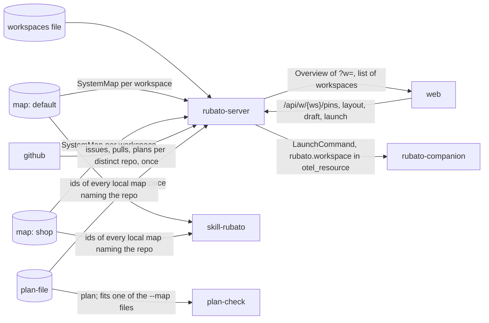

# Workspaces: several maps on one server

Issue: #89 · Design: [89-workspaces/design.md](89-workspaces/design.md) · ADRs 0044–0049
(*proposed*). Revised after the design review (four blockers, three should-fix, nits; all taken).
Stacked PRs on `issue/89-*` branches; PR 0 is this plan.

Issue #89 asks, from a voice note by Mattias Jonsson, for "one view that combines multiple
repositories" showing "what features and functionality each repository provides to the whole
application", with *workspaces* as the umbrella. Mattias settled the concept on 2026-11-14:
one Rubato server holds **several workspaces**, each one map (one application) and its view state.
A repo may belong to several workspaces; ids resolve by derivation. What a repo provides is
**derived from the map**. Workspaces are declared in a **server config file**, and the
developer-local `workspace.yml` is renamed `local.yml`.

## What the change does

- **Workspaces on one server.** An operator lists workspaces in `RUBATO_WORKSPACES_FILE` (id,
  name, map repo, path, ref); one must be `default`, which keeps today's rows. A server without
  the file behaves exactly as today, as workspace `default` (ADR 0044).
- **Switch between them.** With more than one workspace, the web shows a switcher; the choice
  stays in the URL (`?w=shop`) and survives a reload. With one, nothing in the web changes.
- **What each repo provides.** On the Repos tab each repo lists its parts and their descriptions,
  the seams it owns, the seams it uses, and the scenarios it takes part in, derived from the
  workspace's map. The map gains a **By repo** lens that boxes each repo's parts together.
- **A shared repo shows in every workspace that names it.** Its issues, pull requests and plans
  are read once (ADR 0048) and shown in each such workspace; a plan shows where its ids resolve
  (ADR 0045); its approval counts if the plan fits any of the issue's workspaces, and elsewhere it
  reads "counts in <name>". A `Map: node <id> in <workspace>` line narrows a placement to one
  (ADR 0046).
- **Each workspace keeps its own view.** Layout, map draft and proposal, pins and placements are
  per workspace (ADR 0047); a pin made while viewing *shop* is a pin in *shop*.
- **Planning across maps.** The skill reads every map in `local.yml` that names the session's
  repo and offers their ids; plan-check passes a plan that fits at least one map naming the repo.

## How we'll know it works

- [ ] The Repos tab lists, for each repo of today's map, its parts, owned and used seams and scenarios; the By repo lens boxes parts per repo (Vitest on `repoFeatures` with a two-repo fixture, on `graph.ts` for `parentId` and group nodes; e2e on the dev project).
- [ ] With today's env (`RUBATO_MAP_FILE`) and a database seeded at migration 0012, `/api/overview`, pins and the draft equal a snapshot recorded on PR 2's branch (golden test, masking times; fails on purpose when the snapshot is edited by one field). The seed holds a pinned issue in a repo no map names with a non-fitting, approved plan (stays `DoesNotFit`), a launch at another map version (`MapVersionMismatch`), and a draft with a merged proposal.
- [ ] Migration 0013 keeps every row of the rebuilt tables, all at `workspace_id = 'default'` (migration test with a `Migrator` cut at version 12, counting rows per table); a store insert without a workspace fails on a rebuilt table (store test).
- [ ] The server refuses to start, with the reason, on: file and legacy env both set; duplicate id; bad id; no `default` entry; two entries for the same map, repo compared without case; and, until PR 4, more than one entry (config unit tests, one per case).
- [ ] Two workspaces sharing `acme/auth`: an unqualified `Map: node auth-api` places the issue in both; `… in shop` in shop only; `… in nope` in none with `unknown_workspace` (server integration tests).
- [ ] A plan naming only shop's ids shows in shop, fits there, and raises no unknown-id finding in admin, where it reads "counts in Shop"; Accept plan under `/api/w/admin` accepts it; a plan naming ids in neither raises it in both, is refused by Accept plan, and counts on `rubato.plans.fit_none` (server tests).
- [ ] A merged proposal in shop leaves admin's draft ops; `launch_map_versions` and `MapVersionMismatch` are per workspace; a queued issue pinned only in shop launches with `rubato.workspace=shop`; gauges from `refresh_gauges` and traffic carry `rubato.workspace` (server tests).
- [ ] `PUT /api/w/admin/layout` does not move shop's node of the same id; a draft op in shop is not in admin's draft; a pin in shop is not a pin in admin (server tests).
- [ ] `/api/w/nope/overview` answers 404 `unknown_workspace` and counts `rubato.web.rejected{rubato.reason=unknown_workspace}`; unprefixed routes answer as `default`; team routes exist only unprefixed; the route list test lists both forms.
- [ ] GitHub listing calls per tick equal the number of distinct repos across workspaces (call-count test with the fake; fails on purpose when polling per workspace).
- [ ] `parse_map_line` returns the workspace for `Map: node x in shop`, rejects `Map: node x on shop` and `Map: node x in`, and parses every existing fixture as before (protocol tests over `schema/fixtures/issues/`).
- [ ] An overview JSON from today's server deserialises with `workspace = "default"` and no workspaces (protocol test); `schema/protocol/*.json` and `web/src/protocol.ts` regenerate clean (drift test).
- [ ] One workspace renders no switcher; two render it and `?w=` picks the scoped base for map-scoped calls only, while queue, companions, auth and `/ws/web` stay unprefixed; a stale stored id answered `unknown_workspace` is cleared and the web falls back to `default`; `Changed` with another workspace does not refetch, without one it does (Vitest).
- [ ] An e2e run with two workspaces switches, pins in one, and the other shows "pinned in <name>" (Playwright, dev project).
- [ ] plan-check with two `--map` and `--repo acme/auth` passes a plan that uses only map B's ids and reports `fits`; with one `--map` the output is byte-identical to a recorded fixture (plan-check tests).
- [ ] A legacy `workspace.yml` with `map:` reads as one map with one deprecation warning, in the skill and the companion; the companion starts with no `map:` at all (unit tests); `map.ts` prints `rubato.map.select outcome=one|several|none` for each case; `plan.ts check` and `wait` pass a plan that fits only the second matched map and report `fits`; `init` and `path` refuse when matched maps disagree on the plan path (skill tests).

## What it must not break

- A single-map deployment: same routes, same overview, same rows (the golden test above; the existing server suite run unchanged against the default workspace).
- ADR 0022: who may log in is unchanged; every workspace is visible to the same people (existing auth tests).
- ADR 0004 and 0001: the companion gains no command and reads no map; `LaunchCommand` keeps its shape, `rubato.workspace` rides in the existing `otel_resource` map (existing companion Gherkin suite).
- ADR 0027: plan front matter unchanged; existing plans check as before (plan-check fixtures, skill tests).
- ADR 0026 lines: every existing `Map:` line places the issue as before (shared fixtures).
- ADR 0023 per-issue budget: tracked issues cost the same calls (existing call-count tests).
- Approval counting (ADR 0029/0035): an approval of a plan that fits its only workspace counts as today (existing `approve` and `plan.ts wait` tests).
- The scenario player and map load: the extended flows keep every scenario step unambiguous (map load test).
- `MapVersionMismatch`, the proposal merge clearing its own draft (`map_draft/store.rs:305`) and the traffic lens on a single map (existing tests, run in the golden setup).
- An older companion binary: QUICKSTART says to upgrade before renaming `workspace.yml`; the new companion reads both.
- The plan-check composite Action's `map` input keeps working beside the new `maps` (Action fixture test).
- `plan.ts check|wait|sha|path` with one map: output byte-identical (skill fixture tests).
- Rollback of migration 0013: a database copy taken before the PR 3 deploy, restored with the previous sha (deploy record; D5).
- Slice tests and AGENTS.md slice blocks per deployable; `observability/check.ts` and each alert rule's firing test.

## How we'll debug it at 3 am

See the O-rows. New: attribute `rubato.workspace` (in `otel.rs`) on route spans, map load spans,
`rubato.map.loaded_at`, `rubato.map.load_failures`, `rubato.map.proposals`,
`rubato.backlog.map_lines` and launches' `otel_resource`; gauges `rubato.workspaces.configured`,
`rubato.workspace.shared_repos`, `rubato.workspace.orphan_rows`, `rubato.workspace.id_collisions`,
`rubato.plans.fit_none`; findings `PlanPathConflict`, `IdCollision`; logs `workspace config`
(ids, `source=file|legacy_env`), `workspace map load failed` (workspace, error), `plan fit` (repo#n,
workspaces), `orphan workspace rows`; skill lines `rubato.map.select`, `rubato.plan.init`;
plan-check fields `maps_checked`, `fits`.

## Affected parts

| Node | Status | What changes | Seams |
| --- | --- | --- | --- |
| rubato-protocol | affected | `WorkspaceInfo`, `Overview.workspace`/`workspaces`, optional `WebEvent::Changed.workspace`, `MapPlacement` with the `in <ws>` qualifier, findings `PlanPathConflict` and `IdCollision`, `PlanSummary.fits`, attribute `rubato.workspace`, route `WORKSPACES` and the scoped-route helper | web-server, server-system-map |
| rubato-server | affected | workspaces config, maps per workspace in `AppState`, migration 0013, `/api/w/{ws}` routes, overview per workspace, plan fit and placement per workspace, polling the union of repos, coverage of every map repo | server-system-map, server-github, server-plan-file, web-server, companion-server |
| web | affected | feature `workspaces` (switcher, base from `?w=`), event filter, `repoFeatures` on the Repos tab, By repo lens | web-server |
| skill-rubato | affected | `local.yml` with `maps:` and legacy fallback, `map.ts` picking maps by repo, `adrs.ts` over several maps, `plan.ts init` map_version rule | skill-system-map |
| plan-check | affected | repeated `--map`, `--repo`; passes when a plan fits one map naming the repo | plan-check-plan-file |
| rubato-companion | affected | reads `local.yml` (legacy `workspace.yml` with a warning); passes `rubato.workspace` through untouched | companion-server |
| system-map | affected | three flows extended (skill-system-map, server-system-map, web-server); no new ids, no schema change | server-system-map, skill-system-map |
| plan-file | quiet | front matter and tables unchanged | server-plan-file |
| github | quiet | the App installation must also cover each workspace's map repo | server-github |

## Data models

| Model | Kind | Part | Change | Crosses | Note |
| --- | --- | --- | --- | --- | --- |
| `WorkspaceInfo`, `Overview.workspace`, `Overview.workspaces` | type | rubato-protocol | new | web-server | serde default `default` and empty |
| `WebEvent::Changed.workspace` | type | rubato-protocol | changed | web-server | optional; absent means all |
| `MapPlacement` | type | rubato-protocol | new | web-server | `parse_map_line` result: target and optional workspace |
| `Finding::PlanPathConflict`, `Finding::IdCollision` | type | rubato-protocol | new | web-server | per workspace |
| `IssueSummary.fits_in`, `IssueSummary.pinned_in` | type | rubato-protocol | new | web-server | additive; "counts in" and "pinned in" |
| `OpenIssue.map_line` | type | rubato-protocol | changed | web-server | `MapRef` becomes `MapPlacement`; an old value still deserialises |
| `rubato.workspace` | event | rubato-protocol | new | companion-server | OTel attribute; in launch `otel_resource` |
| `rubato.workspaces.configured`, `rubato.workspace.shared_repos`, `rubato.workspace.orphan_rows`, `rubato.workspace.id_collisions`, `rubato.plans.fit_none` | event | rubato-protocol | new | | metric names in `otel.rs` |
| workspaces file (`RUBATO_WORKSPACES_FILE`) | file | rubato-server | new | | server config, ADR 0044 |
| `map_layout`, `map_cache`, `map_proposal`, `pins`, `map_line_pins` | table | rubato-server | changed | | rebuilt with `workspace_id` in the key, no default; migration 0013 |
| `map_draft_ops`, `issue_creations`, `launches` | table | rubato-server | changed | | `workspace_id` column, default `'default'` |
| `issue_suggestions` | table | rubato-server | new | | owned by `github_poll`; replaces `open_issues.suggestion` |
| `SystemMap` per workspace | type | system-map | changed | server-system-map | one per configured workspace; type unchanged |
| `local.yml` | file | skill-rubato | new | skill-system-map | replaces `workspace.yml`; `maps:` list |

## Data flow

## Tasks

- [ ] **PR 0** `issue/89-workspaces`: ADRs 0044–0049 (*proposed*), map flows, design note, this plan; `plan.ts check` clean; design review; `Review:` on #89; Mattias's `Approved:` and the ADRs' acceptance before PR 1 merges
- [ ] **PR 1** `issue/89-repo-view`: Vitest first (`repoFeatures` on a two-repo fixture: parts, owned and used seams, scenarios; `graph.ts` By repo lens: one group node per repo, children with `parentId` and ELK's relative positions, externals outside, dragging off); then `features/repos` units expanding to what each repo provides, the lens toggle in `features/map`; e2e on the dev project; AGENTS.md web block if a feature file moves. Web only, today's one map
- [ ] **PR 2** `issue/89-protocol`: protocol tests first (old overview fixture deserialises to `default`; qualified and malformed `Map:` fixtures, `qualified.md` and `qualified-bad.md`; every existing fixture unchanged; old `OpenIssue.map_line` deserialises); then `WorkspaceInfo`, `Overview.workspace/workspaces`, `WebEvent::Changed.workspace`, `MapPlacement` and `map_line(target, ws)`, `IssueSummary.fits_in/pinned_in`, findings, `rubato.workspace` and the new metric names in `otel.rs`, `routes::WORKSPACES` and `scoped`; regenerate `schema/protocol` and `protocol.ts`; AGENTS.md protocol block
- [ ] **PR 3** `issue/89-server-store`: golden snapshot recorded first on this branch's base (seed per "How we'll know"), migration row-count test with a `Migrator` cut at 12, missing-bind store test, config refusal tests (including more than one entry); then `Workspaces` config, `AppState.maps` with `default_map()` at every site of the design's D5 table, migration 0013 (no default on rebuilt tables), `issue_suggestions` written with `open_issues`, map load per workspace, polling the union; no behaviour change; deploy record with the database copy and rollback
- [ ] **PR 4** `issue/89-server-scope`: two-workspace tests first (placement qualified and not; plan fit, "counts in", Accept plan; layout, draft (merge in one leaves the other's ops), pin isolation; launch versions; queue launch workspace; unknown workspace 404; call count per distinct repo; gauges with `rubato.workspace`); then `Ws` extractor in `kernel/http`, `/api/w/{ws}` nesting, `GET /api/workspaces` in `map`, overview per workspace (D7 filter), an issue's workspaces and fit per ADR 0045, placement per ADR 0046, approve over the issue's workspaces, launch with `rubato.workspace`, `canonicalise_repos` over the union, proposal branch with the workspace, `WebEvent` workspace on layout/draft/map only, `refresh_gauges` and traffic per workspace, lift the one-entry limit; dashboards (Map age, Cost per issue, Findings by workspace) and the two alert rules `by (rubato_workspace)` with their firing tests and the `gridPos` overlap check; AGENTS.md server block
- [ ] **PR 5** `issue/89-web`: Vitest first (switcher rule, `scoped()` only on map-scoped APIs, stale id fallback, event filter, "pinned in" and "counts in"); then feature `workspaces`, `shared/api.ts` `scoped`, event filter, badges; e2e with two workspaces; AGENTS.md web block
- [ ] **PR 6** `issue/89-skill`: tests first (legacy `workspace.yml` as one map; companion without `map:`; `map.ts` select cases; `plan.ts check|wait|sha|path` over matched maps, path disagreement refused; plan-check two-map pass, one-map byte-identical output, Action `maps` input); then `lib/local.ts`, `map.ts`, `adrs.ts`, `plan.ts`, plan-check `--map`/`--repo` and `action.yml`, companion config, `local.example.yml`, QUICKSTART §5 (upgrade the companion before renaming), README; fix `plan.ts init` quoting a title with a colon

## Assumed, not yet approved

| # | Decision | Chosen | Alternatives | Scope |
| --- | --- | --- | --- | --- |
| Q1 | What a workspace is | many workspaces per server, each one map; chosen by Mattias Jonsson 2026-11-14; ADR 0044 proposed | a lens on the one map; rename the map | seam (server-system-map): settled, ADR to accept |
| Q2 | A repo in several workspaces | yes, ids resolve by derivation, optional `in <ws>` on `Map:`; chosen by Mattias Jonsson 2026-11-14; ADRs 0045, 0046 proposed | one workspace per repo; a home workspace | seam (server-plan-file): settled, ADR to accept |
| Q3 | Where workspaces are declared | server config file, legacy env as `default`; chosen by Mattias Jonsson 2026-11-14; ADR 0044 proposed | index file in a repo; id in each map | seam (server-system-map): settled, ADR to accept |
| Q4 | The local file's name | `local.yml` with `maps:`, legacy read with a warning; chosen by Mattias Jonsson 2026-11-14 | keep `workspace.yml` | seam (skill-system-map): settled, ADR 0044 to accept |
| Q5 | A repo's features | derived from the map: parts, seams owned and used, scenarios; chosen by Mattias Jonsson 2026-11-14 | declared `provides:`; read from the repo | node (web): settled |
| A1 | API scoping | `/api/w/{ws}` plus unprefixed as `default`; browser keeps `?w=`; ADR 0049 proposed | query parameter; payload field; header | seam (web-server): blocks until ADR 0049 is accepted |
| A2 | Polling a shared repo | once per tick across workspaces; ADR 0048 proposed | per workspace | seam (server-github): blocks until ADR 0048 is accepted |
| A3 | View state | per workspace; ADR 0047 proposed | pins shared across workspaces | seam (web-server): blocks until ADR 0047 is accepted |
| A4 | Workspace id shape | `[a-z0-9-]{1,32}` | free text | node (rubato-server) |
| A5 | Orphaned rows | kept, logged and counted, never deleted | delete at start | node (rubato-server) |
| A6 | Dragging in the By repo lens | off; the stored layout is flat | a second layout per lens | node (web) |
| A7 | Unprefixed routes | kept for one release; a later ADR retires them | remove at once | node (rubato-server) |
| A8 | `map_draft_ops.seq` | stays global and monotonic, filtered by workspace | a sequence per workspace | node (rubato-server) |

## O-rows

| Seam | Breaks like | Signal | Panel | Owner |
| --- | --- | --- | --- | --- |
| server-system-map | one workspace's map stops loading or goes stale while others are fine; the server starts with the wrong workspace set | `rubato.map.loaded_at{rubato.workspace}` and `rubato.map.load_failures{rubato.workspace}`; gauge `rubato.workspaces.configured`; logs `workspace config` (ids, source), `workspace map load failed` (workspace, error); `rubato.map.proposals{rubato.workspace}` | Map age (by workspace) | system-map |
| server-github | a shared repo is polled once per workspace and the budget doubles; a workspace's map repo is not covered by the App | `rubato.github.calls{rubato.github.endpoint}` flat as workspaces are added; gauge `rubato.workspace.shared_repos`; `RepoNotCovered` finding for a map repo; `rubato.backlog.map_lines{rubato.outcome=unknown_workspace, rubato.workspace}`; rate-limit gauge | GitHub calls by endpoint; GitHub calls · Rate limit; Backlog age; Repos not covered | rubato-server |
| server-plan-file | a plan vanishes from a workspace it fits, or raises unknown ids in one it was never meant for | gauge `rubato.plans.fit_none`; `rubato.plans.not_fitting{rubato.workspace}`; log `plan fit` (repo#n, workspaces); findings `PlanPathConflict`, `IdCollision` and gauge `rubato.workspace.id_collisions`; alert `PlanUnknownNodes` by `rubato_workspace` | Plans, reviews and approvals; Findings by workspace (new, PR 4) | plan-file |
| web-server | a write lands in the wrong workspace, or the web asks for one that does not exist | `rubato.workspace` on every scoped route span beside `rubato.route`; `rubato.web.rejected{rubato.reason=unknown_workspace}`; log `web fan-out` with `rubato.workspace`; generated `protocol.ts` diffed in CI | Web writes rejected | rubato-server |
| companion-server | launches lose their workspace, so cost per workspace is wrong | `rubato.workspace` in launch `otel_resource`, visible on Claude Code's own export and the `rubato.launch` span | Cost per issue (by workspace and issue, PR 4) | rubato-server |
| skill-system-map | a session plans against the wrong map, or none | skill line `rubato.map.select` (repo, maps_matched, outcome); `rubato.map.version` per map; `rubato.plan.init map_version=written\|omitted_several_maps` | Plan check log lines | system-map |
| plan-check-plan-file | a plan that fits one workspace fails the check, or one that fits none passes | the `rubato.plan.check` line with `maps_checked` and `fits` when more than one map is given | Plan check log lines | plan-check |

## Flows

| From | To | Seam | Kind | Carries |
| --- | --- | --- | --- | --- |
| system-map | rubato-server | server-system-map | data | SystemMap per configured workspace |
| rubato-server | system-map | server-system-map | control | a map draft proposed on that workspace's map repo |
| github | rubato-server | server-github | data | issues, pull requests, plans and comments of each distinct repo across workspaces, once |
| plan-file | rubato-server | server-plan-file | data | Plan, fit against each workspace naming its repo |
| rubato-server | web | web-server | data | Overview of one workspace, the list of workspaces; Changed with its workspace |
| web | rubato-server | web-server | data | pins, layout and draft operations under /api/w/{ws} |
| web | rubato-server | web-server | control | launch, approve, propose and reload under /api/w/{ws} |
| rubato-server | rubato-companion | companion-server | control | LaunchCommand with rubato.workspace in otel_resource |
| system-map | skill-rubato | skill-system-map | data | ids of every local map naming the session's repo |
| plan-file | plan-check | plan-check-plan-file | data | Plan, checked against each --map naming the repo |

## ADRs proposed

| ADR | File | Blob |
| --- | --- | --- |
| 0044 | docs/decisions/0044-workspaces-per-server.md | 1fc62d8ad28419d44ab35871fb6b4c0a3f0169da |
| 0045 | docs/decisions/0045-ids-resolve-per-workspace.md | c0b0a34de18c6d3d410c6207177672de35fd209c |
| 0046 | docs/decisions/0046-qualified-map-line.md | fa62da5cd134ce124f0b67c74c31160a5d9397da |
| 0047 | docs/decisions/0047-view-state-per-workspace.md | 0d4fb908dc7ccdd30fe0f9440fa7577377e9d7ae |
| 0048 | docs/decisions/0048-poll-the-union-of-repos.md | ed325d617f4c1fe7b9acef13ab46760a4f884d62 |
| 0049 | docs/decisions/0049-workspace-scoped-api.md | 0919122a6ba910d04b74466788bd29c71793c68d |

## Review map

1. Migration `0013_workspaces.sql` and the golden test in PR 3: every rebuilt table keeps its rows at `default`, and a single-map server answers byte for byte as before.
2. The `Ws` extractor and route nesting in `crates/rubato-server/src/app.rs` (PR 4): every write route is scoped, team routes are not, and an unknown workspace never falls back to `default`.
3. An issue's workspaces, plan fit and approval (ADR 0045) in `overview/build.rs` and `approve/handlers.rs`: an issue in a repo no map names still has a workspace, an approval counts when the plan fits any of them, and findings fire only when it fits none.
