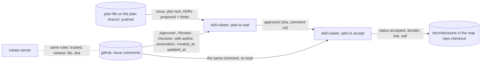

# Design: the skill waits for approval; an approval accepts the ADRs its plan pins (#90)

Plan: [../90.md](../90.md) · ADR 0035 (*proposed*). Moved from the small to the full track after the
design review: a boundary with no seam (now `skill-github`), a new polling job, and a change to who
accepts an ADR. Choices answered by Mattias Jonsson 2026-11-12: self-approval allowed and recorded;
the plan pins ADR blob shas; the ADR write covers the map repo only; add the seam.

## Where it sits on the map

Nothing here runs on the server or the companion. It is the developer's own session using the
developer's own `gh` (ADR 0001, 0004).

## 1. One reading of an approval, on both sides

`skills/rubato/scripts/lib/comments.ts` mirrors the server, with references kept in the code:

| Rule | Server | TypeScript |
| --- | --- | --- |
| First line `Approved:`, words `plan <sha>`, `on <branch>` | `ApprovalRecord::parse_body`, `crates/rubato-protocol/src/github.rs:265-286` | `parseApproval` |
| sha token: 7–40 hex, trimmed of backticks and punctuation, lower-cased | `sha_token`, `github.rs:201-205` | `shaToken` |
| sha matches when the full sha starts with it | `crates/rubato-server/src/plans/hash.rs:54-56` | `shaMatches` |
| trusted: OWNER, MEMBER, COLLABORATOR, not a Bot | `trusted_author`, `github.rs:112-114`; Bot from `user.type` (`kernel/github/api.rs:604`) | `trustedAuthor` |
| the newest trusted approval on the issue is the one that counts | `overview/build.rs:85-87` | `currentApproval` |

The shared fixtures in `schema/fixtures/comments/` gain a subfolder `authors/` with JSON comments
(author, association, `user.type`, `created_at`, `updated_at`, body). The Rust fixture test that
counts the folder's files (`github.rs:359-364`) keeps counting the top level; a new Rust test reads
`authors/` through `trusted_author`, so both sides check the same trust cases.

## 2. `plan.ts wait [plan] [--interval 30] [--once]`

1. Reads the plan path (default from the issue in the current branch) and its front matter issue.
2. Requires the plan to be pushed: `git rev-parse @{upstream}` exists and the plan file at
   `origin/<branch>` equals the working tree's (`git show origin/<branch>:<path>`). Otherwise it
   prints `exited` with `reason: not_pushed` or `local_edit` and exits 4. The sha is computed from
   the pushed text with `planSha` (`scripts/lib/plan-sha.ts`).
3. Requires `plan.ts check` on that text to pass (ADR 0029: an approval of a plan that does not fit
   counts for nothing); otherwise `exited` with `reason: does_not_fit`, exit 5.
4. Prints `started` (`rubato.issue`, `sha`, `interval`), then polls
   `gh api --paginate repos/<o>/<r>/issues/<n>/comments` every interval. Each new comment produces at
   most one line: `review`, `decision`, `untrusted` (an `Approved:` from a Bot or non-member),
   `edited` (a trusted `Approved:` whose `updated_at` differs from `created_at`), `approved_earlier`
   (a trusted approval of another sha), and `poll_failed` (with `gh`'s exit code and first stderr
   line; after 5 failures in a row it prints `exited` with `reason: gh_failed`, exit 6).
5. Returns with `approved` (`author`, `self`, `url`, `sha`) and exit 0 when the newest trusted,
   unedited `Approved:` names the current sha. If the plan on the branch changes while waiting, it
   prints `exited` with `reason: plan_changed`, exit 7, so the session re-asks for approval.
6. `--once` checks once: exit 0 approved, 3 not yet, or the codes above.

Every line is one JSON object with `event: "rubato.plan.wait"`. `self` is true when the author
equals `gh api user --jq .login`.

## 3. `adrs.ts accept --comment <url> [--plan <path>]`

1. Re-reads the comment from GitHub (`gh api` on its id) and the plan as in §2, and applies every
   rule of §1–§2 again: trusted, unedited, the newest trusted approval, the current pushed sha, fits.
   Any failure prints `rubato.adrs.accept` with `refused` and the reason and writes nothing.
2. Requires the checkout to be the map repo (its `origin` equals `workspace.yml`'s map repo) on the
   plan's branch. Otherwise prints `refused: not_map_repo` with the ADRs the approval would accept,
   and writes nothing (connected repos, v0).
3. Reads the plan's `## ADRs proposed` table (`ADR | File | Blob`). For each row: the file exists in
   **this checkout's** `docs/decisions/`, its status is `proposed`, and `git hash-object` of it equals
   the pinned blob. Any mismatch refuses that ADR (`adr_changed`, `not_proposed`, `missing`); a
   `proposed` ADR naming the issue but not listed is reported as `unpinned` and left alone.
4. Rewrites only the `Status:` and `Decided by:` lines of accepted ADRs: `accepted`, and
   `<login>, accepted <date> by approval comment <url>` with `(self)` when it applies. Prints
   `rubato.adrs.accept` with `accepted`, `refused` and `self`. Running it twice changes nothing.

The `## ADRs proposed` section is optional and read only by the skill; plan-check and the server
ignore sections they do not know, so `plan.schema.json` does not change. `plan.ts init` writes it
with "None.", and `plan.ts adrs-pin` fills the Blob column from the files.

## 4. The skill

SKILL.md step 6 becomes: after `Review:` and asking, run `plan.ts wait` in the background (in
Claude Code: a background command, or Monitor on its output), and keep doing what does not need the
approval. On `approved`, run `adrs.ts accept --comment <url>`, commit the ADR change on the plan
branch with the comment link in the message, push, and go on. On `exited`, act on the reason
(push, fix the fit, ask again). `review-template.md` gains "ADRs this approval accepts: NNNN@blob".
AGENTS.md "Decisions are records" states the new rule; "What stays human" is unchanged, since the
person still decides.

## 5. Caveats

| Caveat | Answer |
| --- | --- |
| Spoofing | Same rule as ADR 0027: an agent with a team member's `gh` could post one; the skill forbids it, a test checks the shipped scripts post no comments, and `self` is recorded. |
| Edited comment | A trusted `Approved:` with `updated_at != created_at` never counts for acceptance (`edited`). The server's counting of edited approvals is unchanged here and noted for #82's follow-up. |
| ADR text | Pinned by blob in the approved plan; any change refuses. |
| Wrong checkout | `accept` writes only the current checkout, only when it is the map repo on the plan branch. |
| Concurrency | Re-running `accept` is idempotent; two sessions on one issue would race on the same branch, as any two pushes do. |
| Silence | `started` and `exited` lines; `gh` failures counted and surfaced; the server's Approvals panel shows the same approval from the team's side. |
| Budget | One paginated comments read per 30 s on the developer's own token. |
