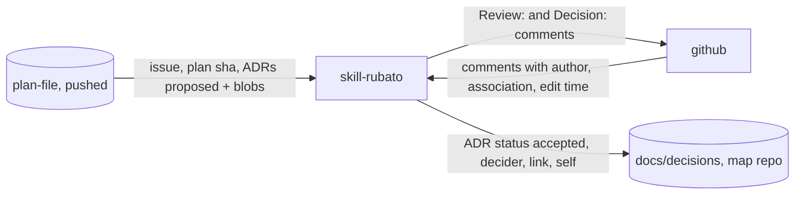

# Wait for approval in the rubato skill; an approval comment accepts the plan's ADRs

Issue: #90 · Design: [90-approval-wait/design.md](90-approval-wait/design.md) · ADR 0035
(*proposed*). Full track after the design review (five blockers, all taken): a new seam
`skill-github`, a polling job, and a change to who accepts an ADR.

Mattias, while planning #82: waiting for the approval "should be automatically. as a part of the
rubato skill/setup", and "a comment on an issue from a teammember IS acceptance". He then chose:
self-approval allowed and recorded; the plan pins each ADR it proposes by blob sha; the ADR write
covers the map repo only; and a seam for the skill's use of GitHub. Rubato telling a launched
session is #91.

## What the change does

- **The session waits by itself.** `plan.ts wait` checks the plan is pushed and fits, prints
  `started`, then polls the issue's comments with the developer's `gh` and returns when the newest
  trusted, unedited `Approved:` names the sha of the plan on the branch. On the way it reports
  reviews, decisions, untrusted or edited approvals, approvals of an earlier sha, and `gh` failures,
  and it exits with a reason when it cannot go on (not pushed, local edit, does not fit, plan
  changed, `gh` failing).
- **The approval accepts the plan's ADRs.** A plan lists the ADRs it proposes with their blob shas
  under `## ADRs proposed`, so the approval covers their text. `adrs.ts accept` re-reads the comment
  and re-checks everything, then moves exactly those ADRs, still at their pinned blobs, to
  `accepted`, naming the approver, the date, the comment and `self` when the approver runs the
  agent. Only in the map repo's checkout on the plan branch; elsewhere it says what it would accept.
- **The skill does it unasked.** SKILL.md step 6 starts the wait in the background after asking for
  approval, records the acceptance on `approved`, and acts on each exit reason. The review template
  names the ADRs an approval accepts.
- **The map shows it.** Seam `skill-github` (skill-rubato → github), owner skill-rubato.

## How we'll know it works

- [ ] The TS parser reads `schema/fixtures/comments/*.md` to the same sha and branch as `ApprovalRecord::parse_body`; the new `schema/fixtures/comments/authors/*.json` give the same trusted/untrusted answers in Rust (`trusted_author`) and TS (both suites; a Bot fixture expected to count makes the TS test fail on purpose).
- [ ] `wait --once` with a stub `gh` on `PATH`: `approved` for the newest trusted unedited approval of the pushed sha and for a 7-character prefix; `approved_earlier`, `untrusted` (Bot, CONTRIBUTOR), `edited`, `review`, `decision` once each; a newer approval of another sha after a current one is not `approved`; exit 3 when nothing counts (Vitest).
- [ ] `wait` exits with `not_pushed`, `local_edit`, `does_not_fit` and `plan_changed` on their own temporary repos, and with `gh_failed` after 5 stub failures, each printing `exited` (Vitest).
- [ ] Comments past the first page are read (stub serves two pages; `--paginate` asserted).
- [ ] `adrs.ts accept` on a temporary map-repo checkout accepts only pinned ADRs at their blobs, writes `self` when the stub `gh api user` is the author, refuses `adr_changed`, `not_proposed`, `missing`, `edited`, an earlier sha, an untrusted author and a plan that does not fit without writing, reports `unpinned`, refuses `not_map_repo` in another repo, and leaves every other file byte-identical (Vitest).
- [ ] `install.ts` copies every shipped file byte-identical (the install test compares bytes, not existence) and the installed copy runs `wait --once` with a `node_modules` link (extended install test).
- [ ] The map loads with `skill-github` (server map tests; `map.ts` lists it).
- [ ] Manual run: this plan's approval returns `wait` in the session, and `adrs.ts accept` moves ADR 0035 to accepted with the approver's login and the comment's link.

## What it must not break

- ADR 0027: approval is a person's comment; the shipped scripts post no comment except `Review:`/`Decision:` from the documented commands (a test greps `scripts/` for `issue comment` and `comments` POSTs outside them).
- The server's approval rules: the TS reading follows `parse_body`, `sha_token`, `hash.rs` prefix matching, `trusted_author` and newest-wins (shared fixtures).
- ADR 0029: an approval of a plan that does not fit accepts nothing (`does_not_fit` tests).
- "Status moves, text does not": `accept` changes only the `Status:` and `Decided by:` lines (byte test of the rest of the file).
- `plan.ts init`, `check`, `sha` and `adrs.ts` listing behave as today (existing `skill.test.ts`); plan-check and the server parse plans with an `## ADRs proposed` section as before (a shared fixture with the section, both parsers).
- The Rust comment-fixture test's file count (`github.rs:359-364`): new fixtures go in `authors/`.

## How we'll debug it at 3 am

See the O-rows. New: `rubato.plan.wait` lines (`started`, `exited` with `reason`, and one per event)
and the `rubato.adrs.accept` line (`accepted`, `refused` with reasons, `self`), both registered in
`crates/rubato-protocol/src/otel.rs`. They are printed in the developer's session; the team-side
signal for the same approval is the server's approval badge and the Approvals panel.

## Affected parts

| Node | Status | What changes | Seams |
| --- | --- | --- | --- |
| skill-rubato | affected | `plan.ts wait`, `plan.ts adrs-pin`, `adrs.ts accept`, `scripts/lib/comments.ts`, SKILL.md step 6, review template, `plan.ts init` writes `## ADRs proposed` | skill-github, skill-plan-file |
| github | affected | issue comments read by the session with the developer's `gh` | skill-github |
| plan-file | affected | optional `## ADRs proposed` section, read only by the skill | skill-plan-file |
| rubato-protocol | affected | event names `rubato.plan.wait`, `rubato.adrs.accept` in `otel.rs`; a test over `schema/fixtures/comments/authors/` | |
| system-map | affected | seam `skill-github` added to `docs/design/rubato-map.yml` | |

## Data models

| Model | Kind | Part | Change | Crosses | Note |
| --- | --- | --- | --- | --- | --- |
| `rubato.plan.wait` line | event | skill-rubato | new | skill-github | started, exited, one per comment event |
| `rubato.adrs.accept` line | event | skill-rubato | new | | accepted, refused, self |
| `## ADRs proposed` section | file | plan-file | new | skill-plan-file | `ADR, File, Blob`; optional |
| ADR status and decider lines | file | skill-rubato | changed | | written by `adrs.ts accept` |
| `schema/fixtures/comments/authors/` | file | rubato-protocol | new | | trust cases shared by Rust and TS |
| seam `skill-github` | file | system-map | new | | `docs/design/rubato-map.yml` |

## Data flow

## Tasks

- [ ] **PR 0** `issue/90-approval-wait`: this plan, design note, ADR 0035 (*proposed*), seam `skill-github`; `plan.ts check`; review; `Review:` on #90
- [ ] Shared fixtures first: `schema/fixtures/comments/authors/*.json` and a plan fixture with `## ADRs proposed`; Rust test over `authors/` with `trusted_author`; TS parser test (fails on purpose with a Bot expected to count); then `scripts/lib/comments.ts`
- [ ] `wait` tests first with a stub `gh` (an executable on `PATH` in a temp dir serving paged fixture JSON) and temporary git repos with an `origin`; then `plan.ts wait`
- [ ] `adrs.ts accept` and `plan.ts adrs-pin` tests first on a temporary map-repo checkout; then the commands
- [ ] Event names in `otel.rs` and `all_names()`; install test compares bytes and runs the installed `wait --once`
- [ ] SKILL.md step 6, `review-template.md`, `plan.ts init` template, AGENTS.md "Decisions are records", skills README capability table
- [ ] After approval: record ADR 0035's acceptance by hand from the approval comment (its mechanism is what this plan builds), then use `adrs.ts accept` on the next plan that pins ADRs

## Assumed, not yet approved

| # | Decision | Chosen | Alternatives | Scope |
| --- | --- | --- | --- | --- |
| Q1 | Self-approval of one's own agent's ADRs | allowed, recorded as `self`; chosen by Mattias Jonsson 2026-11-12 | a second member for seam ADRs; always a second member | seam (skill-github): settled, in ADR 0035 |
| Q2 | Pinning ADR text | the plan lists ADR blob shas; chosen by Mattias Jonsson 2026-11-12 | the comment names ADRs and blobs | seam (skill-plan-file): settled, in ADR 0035 |
| Q3 | Connected repos | the ADR write covers the map repo's checkout only; chosen by Mattias Jonsson 2026-11-12 | open a map-repo PR | seam (skill-github): settled, in ADR 0035 |
| Q4 | The skill's use of GitHub | a seam `skill-github`; chosen by Mattias Jonsson 2026-11-12 | no seam | seam (skill-github): settled |
| A1 | Poll interval | 30 s, `--interval` to change | 60 s | node (skill-rubato) |
| A2 | `gh` failures before giving up | 5 in a row, then `exited: gh_failed` | wait forever | node (skill-rubato) |
| A3 | Edited approvals | never count for acceptance | count if the editor is the author (needs GraphQL) | node (skill-rubato) |

## O-rows

| Seam | Breaks like | Signal | Panel | Owner |
| --- | --- | --- | --- | --- |
| skill-github | the wait never returns on a real approval, returns on one that does not count, or dies silently | `rubato.plan.wait` lines in the session (`started`, `exited` with `reason`, `approved` with `author`, `self`, `url`, `sha`; `poll_failed` with `gh`'s exit code); the server's approval badge for the same comment (`ApprovalVersion`) | Approvals (server side, exists); the session's own output | skill-rubato |
| skill-plan-file | the wrong ADRs are accepted, or an ADR changed after approval is accepted | `rubato.adrs.accept` line (`accepted`, `refused` with `adr_changed`, `not_proposed`, `missing`, `unpinned`, `not_map_repo`; `self`); the ADR file's `Decided by:` line with the comment link | Plans, reviews and approvals (exists); the commit on the plan branch | plan-file |

## Flows

| From | To | Seam | Kind | Carries |
| --- | --- | --- | --- | --- |
| github | skill-rubato | skill-github | data | issue comments with author, association and edit time, read for an approval |
| skill-rubato | github | skill-github | control | Review: and Decision: comments, as the developer |
| skill-rubato | plan-file | skill-plan-file | data | the ADRs proposed section with blob shas |

## ADRs proposed

| ADR | File | Blob |
| --- | --- | --- |
| 0035 | docs/decisions/0035-approval-comment-accepts-the-plans-adrs.md | 149daff203427193112d0521afe6bbd72bb30180 |

## Review map

1. `scripts/lib/comments.ts` against `github.rs` (`parse_body`, `sha_token`, `trusted_author`), `plans/hash.rs:54-56` and `overview/build.rs:85-87`: one comment, one reading.
2. `adrs.ts accept`: re-reads the comment, refuses before writing, writes only pinned ADRs at their blobs, only in the map repo's checkout.
3. SKILL.md step 6 and `wait`'s exit reasons: the session waits in the background, never posts an approval, and never waits silently.
