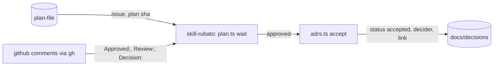

# Wait for approval in the rubato skill; an approval comment accepts the plan's ADRs

Issue: #90 · ADR 0035 (*proposed*). Small track: one part (`skill-rubato`), no seam contract or
schema change, no migration.

Mattias, while planning #82: waiting for the approval "should be automatically. as a part of the
rubato skill/setup", and "a comment on an issue from a teammember IS acceptance". Today the skill
ends at "ask a person for approval", and accepting a plan's ADRs is a second, separate edit. After
this change a planning session starts waiting by itself, and a trusted `Approved:` comment naming
the current plan approves it and accepts the ADRs the plan proposes, which the session records.
Rubato telling a launched session is #91.

## What the change does

- **`plan.ts wait [plan]`** reads the plan's issue from its front matter, computes the plan's sha,
  and polls the issue's comments with `gh api` (default every 30 s). It prints one
  `rubato.plan.wait` JSON line per new event: `review`, `decision`, `approved_earlier` (a trusted
  approval of another sha), `untrusted` (an `Approved:` from a Bot or non-member), `poll_failed`. It
  exits 0 with `approved` when a trusted `Approved:` names the current sha (a 7–40 character prefix,
  as the server reads it). `--once` checks once and exits 0 or 3 (not yet), for scripts and tests.
- **`adrs.ts accept --issue <owner/name#n> --comment <url>`** re-reads that comment from GitHub,
  refuses unless it is a trusted approval of the current plan, then rewrites each ADR in
  `docs/decisions/` with status `proposed` and `Issue:` naming that issue: `Status: accepted`, and
  `Decided by:` gains `<login>, accepted <date> by approval comment <url>`. It prints one
  `rubato.adrs.accept` line with the ADRs it accepted, and changes no other file.
- **The skill** (SKILL.md step 6): after posting `Review:` and asking for approval, run `plan.ts wait`
  in the background (in Claude Code: a background command or Monitor), keep working on what does not
  need the approval, and when it returns run `adrs.ts accept`, commit the ADR change on the plan
  branch, and go on to code. The review template gains a line naming the ADRs an approval will accept.
- **AGENTS.md** "Decisions are records": a person accepts an ADR by approving the plan that proposes
  it, or by editing it; the agent records the approval.

## How we'll know it works

- [ ] The TypeScript approval parser reads the shared fixtures `schema/fixtures/comments/approved.md`, `approved-on-branch.md`, `approved-no-sha.md`, `not-a-signal.md` to the same sha and branch as `ApprovalRecord::parse_body` (Vitest; the Rust test already reads them).
- [ ] `wait --once` against a stub `gh` returns `approved` for a MEMBER approving the current sha and for a 7-character prefix; reports `approved_earlier` for another sha, `untrusted` for a Bot and for a CONTRIBUTOR, `review` and `decision` once each; exits 3 when nothing counts (Vitest with a fixture comments JSON, fails on purpose with a Bot fixture expected to count).
- [ ] `adrs.ts accept` on a temporary decisions folder accepts only `proposed` ADRs naming the issue, cites the comment, leaves accepted ADRs and ADRs of other issues byte-identical, and refuses an earlier-sha or untrusted comment without writing (Vitest).
- [ ] `install.ts` ships the new scripts; the installed copy runs `wait --once` (existing install test, extended).
- [ ] Manual run on #82: Mattias's `Approved:` comment returns `wait`, and `adrs.ts accept` moves ADRs 0033 and 0034 to accepted with his login and the comment's link.

## What it must not break

- ADR 0027: approval is a person's comment; nothing here posts one (no `gh issue comment` in `wait` or `accept`; a test greps the scripts for comment-posting calls).
- The server's approval rules: the TypeScript parser follows `ApprovalRecord::parse_body`, `sha_token` and `trusted_author` (shared fixtures above).
- `plan.ts init`, `check`, `sha` and `adrs.ts` listing behave as today (existing `skill.test.ts`).
- Files `install.ts` copies stay byte-identical to the repo copy (existing install test).

## How we'll debug it at 3 am

See the O-row. New: the `rubato.plan.wait` line (`event`, `rubato.issue`, `sha`, `author`, `url`)
and the `rubato.adrs.accept` line (`accepted`, `refused` with the reason).

## Affected parts

| Node | Status | What changes | Seams |
| --- | --- | --- | --- |
| skill-rubato | affected | `plan.ts wait`, `adrs.ts accept`, a shared comment parser in `scripts/lib/comments.ts`, SKILL.md step 6, review template line | skill-plan-file |
| plan-file | quiet | read for its issue and sha; unchanged | skill-plan-file |

## Data models

| Model | Kind | Part | Change | Crosses | Note |
| --- | --- | --- | --- | --- | --- |
| `rubato.plan.wait` line | event | skill-rubato | new | | one JSON line per event the wait sees |
| `rubato.adrs.accept` line | event | skill-rubato | new | | the ADRs accepted or the refusal |
| ADR status and decider lines | file | skill-rubato | changed | | written by `adrs.ts accept` on acceptance |

## Data flow

## Tasks

- [ ] **PR 0** `issue/90-approval-wait`: this plan and ADR 0035 (*proposed*); `plan.ts check`; review; `Review:` on #90
- [ ] Fixture test first (TS parser against `schema/fixtures/comments/`; add `approved-bot.json`-style comment fixtures with author and association), then `scripts/lib/comments.ts` (`parseApproval`, `trustedAuthor`, `shaMatches`)
- [ ] `wait --once` tests first against a stub `gh` (an executable on `PATH` in a temp dir printing fixture JSON), then `plan.ts wait` with the poll loop, `--interval`, `--once`
- [ ] `adrs.ts accept` tests first on a temp decisions folder, then the command
- [ ] SKILL.md step 6, `review-template.md` line ("ADRs this approval accepts"), AGENTS.md "Decisions are records", `install.ts` file list unchanged unless a new top-level file is added; README capability table

## Assumed, not yet approved

| # | Decision | Chosen | Alternatives | Scope |
| --- | --- | --- | --- | --- |
| A1 | How the skill reads GitHub | `gh api`, as the skill already posts `Review:` and `Decision:` with `gh`; no seam `skill-rubato` → `github` exists in the map, and none is added here | add that seam through a map draft first | seam (none in the map): blocks until the approval answers it |
| A2 | Poll interval | 30 s, `--interval` to change | 60 s | node (skill-rubato) |
| A3 | Which ADRs an approval accepts | status `proposed` and `Issue:` naming the issue | ADRs listed in the plan's header line | node (skill-rubato) |
| A4 | Who writes the ADR edit | the session, committed on the plan branch with the comment link in the message | a person edits it | node (skill-rubato), settled by ADR 0035 on approval |

## O-rows

| Seam | Breaks like | Signal | Panel | Owner |
| --- | --- | --- | --- | --- |
| skill-plan-file | the wait never returns on a real approval, returns on one that does not count, or accepts the wrong ADRs | `rubato.plan.wait` lines in the session's output (`event`, `rubato.issue`, `sha`, `author`); `rubato.adrs.accept` line (`accepted`, `refused`); the approval badge Rubato already shows (`ApprovalVersion`) for the same comment | Plans, reviews and approvals (exists); Plan check log lines (exists) | plan-file |

## Flows

| From | To | Seam | Kind | Carries |
| --- | --- | --- | --- | --- |
| plan-file | skill-rubato | skill-plan-file | data | the plan's issue and sha, read by plan.ts wait |

## Review map

1. `scripts/lib/comments.ts` against `ApprovalRecord::parse_body` and `trusted_author` in `crates/rubato-protocol/src/github.rs`: the TS and Rust readings of one comment must agree.
2. `adrs.ts accept`: it re-reads the comment and refuses before writing; it touches only `proposed` ADRs of this issue.
3. SKILL.md step 6: the session waits in the background and never posts an approval.
