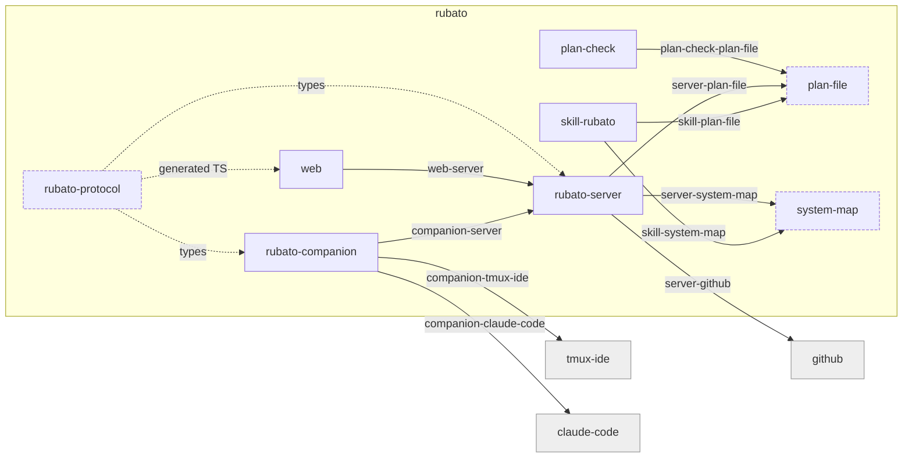

# Rubato v0 — implementation plan

> `docs/design/v0.md` is not in the repo. This plan is derived from `AGENTS.md` alone and
> `docs/prompts/v0-planning.md`. Where the design note would have settled something, the
> choice is listed under *Assumed, not yet approved*.

## 1. Goal

Each developer orchestrates their own agents. Rubato keeps the whole picture and keeps
teammates, human and agent, aligned. v0 is the smallest build that proves it: one shared map
above several repos, every issue pinned to a node or seam of that map, a session started on
an issue in the developer's own tmux and nowhere else, the agent's plan coming back as a
file whose affected-parts section lights the map, progress derived from signals that already
exist, decisions kept as issue comments, and two plans on one seam visible before they
collide. Control stays federated; understanding is shared.

## 2. The map

Proposed as `docs/design/rubato-map.yml`; its shape is the first draft of
`schema/system-map.schema.json`. Ids below are the only ids this plan may use.



Owner rule: the owner side of a seam is the node whose team is woken when it breaks. For a
seam with an external node the owner is always the Rubato side.

| Seam | From → to | Carries | Owner | Guard |
| --- | --- | --- | --- | --- |
| `companion-server` | rubato-companion → rubato-server | `CompanionMessage` / `ServerMessage` envelopes, JSON over one outbound websocket | rubato-server | protocol JSON Schema snapshot test; both binaries' suites replay the same fixtures from `crates/rubato-protocol/fixtures/` |
| `server-github` | rubato-server → github | OAuth login, REST (issues, comments, PRs, checks, contents), Projects v2 GraphQL (later) | rubato-server | one `GitHubApi` trait with recorded-response tests; `rubato.github.rate_limit.remaining` metric and alert |
| `companion-tmux-ide` | rubato-companion → tmux-ide | `worktree create` (worktree + adopted session), `events --follow --json` (push), `team --json` (reconcile), `send` (launch script), `wait` | rubato-companion | Gherkin suite against real tmux-ide on `tmux -L rubato-test`; tmux-ide version pinned (2.9.x) and reported as `rubato.tmux_ide.version`; states with `confidence` below hook level render *unknown* |
| `companion-claude-code` | rubato-companion → claude-code | hook stdin JSON (`SessionStart`, `UserPromptSubmit`, `PreToolUse`, `PostToolUse`, `PostToolUseFailure`, `Notification`, `Stop`, `StopFailure`, `SessionEnd`), `async: true`; launch flags `--session-id`, `--settings`, `--permission-mode`; OTel env | rubato-companion | Gherkin scenarios replay recorded hook payloads per event name from `features/fixtures/hooks/`, refreshed on Claude Code upgrade |
| `skill-plan-file` | skill-rubato → plan-file | plan Markdown at the agreed path with the agreed sections | plan-file | skill Vitest writes a plan and validates it with the plan check |
| `server-plan-file` | rubato-server → plan-file | plan parsed from the branch | plan-file | cross-language fixtures in `schema/fixtures/plans/` parsed identically by Rust and TS |
| `plan-check-plan-file` | plan-check → plan-file | plan parsed in the Action | plan-check | same fixtures; a fixture that must fail, asserted in CI |
| `skill-system-map` | skill-rubato → system-map | node and seam ids offered to the session | system-map | skill validates the map against the schema before use; `rubato.map.version` attribute on every launch |
| `server-system-map` | rubato-server → system-map | map loaded, pins and plans resolved against it | system-map | schema validation on load; `rubato.map.load_failures` counter |
| `web-server` | web → rubato-server | REST + websocket; TS types generated from the protocol schema | rubato-server | generated `web/src/protocol.ts` diffed in CI |

## 3. Affected parts

Everything is new in v0; the table is still filled because this is what Rubato will render.

| Node | Status | What changes | Seams touched |
| --- | --- | --- | --- |
| rubato-protocol | new | serde types, JSON Schema export, `otel.rs`, `limits.rs`, fixtures | companion-server, web-server |
| rubato-companion | new | pairing, websocket client, `team --json` poll, hook receiver, worktree + launch, stale detection, spend cap | companion-server, companion-tmux-ide, companion-claude-code |
| rubato-server | new | GitHub OAuth, device-code pairing, event intake, SQLite, progress derivation, plan + decision polling, websocket fan-out, embedded web | companion-server, server-github, server-plan-file, server-system-map, web-server |
| web | new | map render (React Flow + ELK), pin issue, sessions and progress per node, start-session for own companion only | web-server |
| skill-rubato | new | load map and ADRs, write plan at agreed path, ship hook config, launch prompt | skill-plan-file, skill-system-map |
| plan-check | new | Node script + Action: unknown ids, missing O-rows, one log line per plan, a must-fail fixture | plan-check-plan-file |
| plan-file | new | `schema/plan.schema.json` + parser fixtures | skill-plan-file, server-plan-file, plan-check-plan-file |
| system-map | new | `schema/system-map.schema.json`; this repo's map | skill-system-map, server-system-map |
| github | quiet | used as is | server-github |
| tmux-ide | quiet | used as is, version pinned | companion-tmux-ide |
| claude-code | quiet | used as is; hooks and OTel export | companion-claude-code |

## 4. Data flow

Identity comes from the branch: pane cwd (`agents[].dir` from `team --json`, `cwd` in the
hook) → worktree → branch `issue/<n>-<slug>` → issue in the repo named by `origin`. The
companion also assigns the Claude Code `--session-id` at launch, so `session_id → issue` is
known before the first hook fires.

```mermaid
sequenceDiagram
  participant W as web
  participant S as rubato-server
  participant C as rubato-companion
  participant T as tmux-ide / claude-code
  participant G as github
  W->>S: IssuePin (issue → node|seam)            %% Planned
  W->>S: start session (own companion only)
  S->>C: LaunchCommand (issue, branch, nodes, caps, otel attrs)
  C->>T: tmux-ide worktree create; send launcher script (claude --session-id …)
  C->>S: LaunchResult::Started + SessionState    %% Started
  T-->>C: HookEvent (UserPromptSubmit, PreToolUse …)
  C->>S: SessionState{Working}                   %% Designing
  T->>G: push docs/plans/<n>.md on branch
  S->>G: poll contents → Plan                    %% Designed, nodes lit
  T-->>C: HookEvent (Notification: permission/idle) or CapHit
  C->>S: SessionState{Blocked}                   %% Blocked
  S->>G: poll PR + checks → PullRequestState     %% In review → Done
  S-->>W: websocket fan-out of Progress per issue
```

| State | Signal | Protocol type |
| --- | --- | --- |
| Planned | issue pinned to node or seam | `IssuePin { issue: IssueRef, target: MapRef }` |
| Started | companion acked the launch | `LaunchCommand` → `LaunchResult::Started { session_id }` |
| Designing | session working, no plan on branch | `HookEvent { UserPromptSubmit | PreToolUse | PostToolUse }` or tmux-ide `events` → `SessionState { status: Working, source: Hook }` |
| Designed | plan file on branch | `Plan { affected_parts, o_rows, assumed }` |
| Building | session working after the plan | `SessionState` + `Plan` present |
| Blocked | `Notification` hook (`permission_prompt`, `idle_prompt`), `StopFailure`, cap or attempt limit hit | `HookEvent { kind: Notification | StopFailure }`, `CapHit { issue, kind: Spend | Attempts }` |
| In review | PR open, checks green | `PullRequestState { number, open, checks: Green | Red | Pending }` |
| Done | merged | `PullRequestState { merged_at }` |
| unknown | `last_seen` older than the stale threshold, or state not hook-derived (`source: Scraped`) | `Progress::Unknown { last_seen }` |

Derived in `rubato-server` from the latest of each signal with its `last_seen`; never
stored. Trust check first: a stale `SessionState` renders *unknown*, not *working*.

## 5. Work breakdown

Argument with the expected order: the skill moves from sixth to third. It is the cheapest
piece, it locks the two file contracts (plan path, map ids) that companion and server tests
both consume as fixtures, and it has no dependency on either binary. Companion (4) and
server (5) are independent after the protocol and can run as two sessions in parallel, which
is also the first dogfood of Rubato on itself.

| # | Task · branch | Inputs | Outputs | Seams | Check that proves it | h |
| --- | --- | --- | --- | --- | --- | --- |
| 1 | `rubato-protocol` · `issue/1-protocol` | AGENTS.md types list, §4 above | crate with serde types, `schemars` JSON Schema export to `schema/protocol/`, `otel.rs`, `limits.rs`, fixtures | companion-server, web-server | snapshot test fails when the exported schema changes without the snapshot; `cargo clippy -D warnings` | 8 |
| 2 | schemas + plan check · `issue/2-schemas-plan-check` | `rubato-map.yml`, this plan | `schema/system-map.schema.json`, `schema/plan.schema.json`, `actions/plan-check` (Node, `--experimental-strip-types`), `schema/fixtures/plans/` | plan-check-plan-file | Vitest: valid fixture passes, unknown-id fixture fails, missing-O-row fixture fails; log line reports counts | 8 |
| 3 | `skills/rubato` · `issue/3-skill` | schemas, plan path (Q1), map location (Q2) | SKILL.md, `scripts/map.ts`, `scripts/plan.ts`, `hooks.json`, launch prompt text | skill-plan-file, skill-system-map | Vitest: plan written to the agreed path validates; map load rejects a map that fails the schema | 8 |
| 4 | `rubato-companion` · `issue/4-companion` | protocol, tmux-ide ≥ 2.9 and tmux ≥ 3.7 installed, hook fixtures | six `.feature` files first (pairing; refusing launch for another user; worktree per issue via `tmux-ide worktree create`; forwarding hook events; stale session; discovery from `team --json` and `events --follow`), then the binary | companion-server, companion-tmux-ide, companion-claude-code | cucumber-rs suite green on `tmux -L rubato-test` with temp repos; each suite reports scenarios run; one scenario asserts a refusal; one asserts a scraped state renders *unknown* | 24 |
| 5 | `rubato-server` minimum · `issue/5-server` | protocol, SQLite migrations | OAuth login, device-code pairing, websocket intake, map + pins in SQLite, progress derivation, plan and decision polling, fan-out | companion-server, server-github, server-plan-file, server-system-map | integration test: replay protocol fixtures → expected `Progress` per issue; recorded GitHub responses; derived state never written to a table | 28 |
| 6 | `web` minimum · `issue/6-web` | generated TS types, server API | map render, pin an issue, sessions and progress on nodes, start-session button for own companion only | web-server | Vitest + Playwright: button absent for another user's companion; map renders `rubato-map.yml` | 20 |
| 7 | end to end · `issue/7-e2e` | all above, two test repos (auth provider + consumer) | three issues through the flow; OTLP resource attributes set; dashboard `observability/dashboards/rubato-overview.json`; five alert rules with tests | all | dashboard shows issue → node → session → cost for all three; `promtool test rules` fires each alert on purpose | 16 |

Total 112 h. Tasks 4 and 5 may run in parallel; 6 depends on 5; 7 depends on all.

## 6. Assumed, not yet approved

*Node* = inside one node, assumed and labelled. *Seam* = blocks until a human answers (§7).

| # | Decision | Chosen | Alternatives | Scope |
| --- | --- | --- | --- | --- |
| A1 | Plan file path in connected repos | `docs/plans/<issue>.md`, overridable per repo in the map (`repos[].plan_path`) | fixed path; PantryPilot's `features/<issue>-<slug>/plan.md`; `.rubato/plans/` | seam (Q1) |
| A2 | Plan machine-readable form | Markdown tables under `## Affected parts` and `## O-rows` with fixed columns, parsed to JSON and validated by `plan.schema.json`; frontmatter only for `issue`, `spend_cap_usd`, `attempt_limit` | all-YAML frontmatter (duplicates the human table) | seam (Q1, same ADR) |
| A3 | Where the team's map lives and how the skill gets it | one designated map repo; skill reads the local clone named in `workspace.yml`; server reads it via GitHub | server as source, skill fetches `/api/map`; copy per repo | seam (Q2) |
| A4 | Companion auth after pairing | opaque pairing token from the device-code flow, hashed server-side, 0600 file client-side, bearer on websocket upgrade, revocable in web | user's GitHub token; short-lived JWT + refresh | seam (Q3) |
| A5 | Companion ↔ server transport | one outbound websocket, JSON envelopes, resume cursor on reconnect | HTTP POST + SSE; gRPC | seam (Q4) |
| A6 | Hook delivery into the companion | `curl` posts the hook stdin to the companion on `127.0.0.1:<port>` with a per-start bearer token; `hooks.json` template in the skill rendered per launch and injected with `--settings`; events while the daemon is down are lost and made visible by the O-row | `rubato-companion hook` over a unix socket with spool; JSONL file tailed | seam (Q5, decided: loopback HTTP) |
| A7 | `Decision:` comment template | first line `Decision: <title>`, then `Context`, `Options`, `Chosen`, `Why` headings | key: value block; label-driven form | seam (Q6) |
| A8 | Poll vs push for tmux-ide state | push: follow `tmux-ide events --follow --json` (streams only for adopted sessions, which `worktree create` opens; `serve --socket` is the alternative push path); reconcile with `team --json` every 30 s; our own hooks are the fast path for Claude Code events; a change from any source emits `SessionState` with its `source` | poll `team --json` every 5 s only; MCP | node (companion) |
| A9 | Session ↔ issue match when the branch does not follow the convention | companion assigns `--session-id` at launch and remembers `session_id → issue`; otherwise the session shows as *unpinned* on its machine and never attaches to an issue; no manual tags | heuristics on cwd or prompt text | node (companion) |
| A10 | What *stale* means | companion heartbeat 30 s; session *working* with no hook for 120 s → `rubato.session.stale`, rendered *unknown*; a tmux-ide state with no hook authority (`since: null` in `team --json`, `authority.state: null` in `agent explain`; its screen-matching fallback, also used after a ~10 min stale stamp) is `source: Scraped` and renders *unknown*; companion silent 10 min → alert; all in `limits.rs`, overridable in config | 60 s / 300 s; trust scraped state | node (protocol limits) |
| A11 | Spend measurement | companion sums usage from the transcript named by the hook's `transcript_path` after each event; dashboard cross-checks `claude_code.cost.usage`; server counts attempts and refuses the launch past the limit | OTel backend queried by the companion | node (companion) |
| A12 | Worktree location | tmux-ide's default: `<repo>-worktrees/<branch>` beside the clone, created with `tmux-ide worktree create issue/<n>-<slug> --from origin/<default>` | own `git worktree add`; inside the repo | node (companion) |
| A16 | Launch mechanics | `worktree create` opens an adopted session; the companion writes a launcher script under its state dir (exports `CLAUDE_CODE_ENABLE_TELEMETRY=1`, `OTEL_*_EXPORTER=otlp`, `OTEL_EXPORTER_OTLP_PROTOCOL`, `OTEL_EXPORTER_OTLP_ENDPOINT`, `OTEL_RESOURCE_ATTRIBUTES=rubato.repo=…,rubato.issue=…,rubato.branch=…,rubato.node=…`; runs `claude --session-id <uuid> --settings <hooks.json> "<prompt>"`) and starts it with `tmux-ide send`; never `--bare` | type the command into the pane; `tmux-ide start` with a `workspace.yml` layout | node (companion) |
| A17 | Coexistence with tmux-ide's own Claude hooks | tmux-ide's user-level hooks keep stamping pane options; ours are added via `--settings` and are `async`; verify in task 4 that hooks merge rather than replace under `--settings`, else `hooks.json` also carries tmux-ide's entries | drop tmux-ide's hooks | node (companion) |
| A13 | Plan discovery | poll the branch's plan path every 60 s while a session is live; webhook later | webhook only | node (server) |
| A14 | Frontend graph library | React Flow + ELK | Cytoscape | node (web) |
| A15 | Alert rule format | Prometheus rule YAML tested with `promtool test rules`; importable into Mimir | Grafana-managed JSON | node (observability) |

## 7. Questions for the team

1. **Plan file path and form in connected repos** (A1, A2): decided 2026-11-08, option (a).
   (a) `docs/plans/<issue>.md` by default, `repos[].plan_path` in the map overrides, tables parsed to JSON — recommended;
   (b) fixed `docs/plans/<issue>.md` everywhere;
   (c) PantryPilot's `features/<issue>-<slug>/plan.md`;
   (d) `.rubato/plans/<issue>.md`.
2. **Where the map lives** (A3): decided 2026-11-08, option (a).
   (a) one map repo, read as a file by the skill and via GitHub by the server — recommended;
   (b) the server is the source, the skill fetches `/api/map`;
   (c) a copy in every repo, plan-check compares.
3. **Companion auth after pairing** (A4): decided 2026-11-08, option (a).
   (a) opaque pairing token, hashed, revocable — recommended;
   (b) the user's GitHub OAuth token;
   (c) short-lived JWT with refresh.
4. **Companion ↔ server transport** (A5): decided 2026-11-08, option (a).
   (a) one outbound websocket with resume cursor — recommended;
   (b) HTTP POST for events, SSE for commands;
   (c) gRPC (tonic).
5. **Hook delivery** (A6): decided 2026-11-08, option (b).
   (a) `rubato-companion hook` → unix socket, spool when down, config via `--settings` at launch;
   (b) curl to loopback HTTP with a per-start token — chosen;
   (c) JSONL file the daemon tails.
6. **`Decision:` template** (A7): decided 2026-11-08, option (a).
   (a) `Decision: <title>` + Context / Options / Chosen / Why — recommended;
   (b) key: value block;
   (c) issue form via a `decision` label.

## 8. Review map

1. **§6 A1–A7 and §7** — every seam-level choice; each is a proposed ADR and blocks a task.
2. **§5 task 4 and task 5 checks** — no mocks of tmux or git, derived progress never stored; if these checks are weak, the lab proves nothing.
3. **§9 O-rows for `companion-claude-code` and `companion-tmux-ide`** — the two seams we do not own either side of and where silence is most likely.

## 9. O-rows

All attributes live in `crates/rubato-protocol/src/otel.rs`. Panels are on
`observability/dashboards/rubato-overview.json`.

| Seam | Breaks like | Signal | Panel | Owner |
| --- | --- | --- | --- | --- |
| companion-server | companion disconnected or rejected; events dropped | gauge `rubato.companion.heartbeat` (`rubato.companion_id`, `rubato.user`) flat; counter `rubato.events.dropped` (`rubato.reason` = auth / schema / overflow) | Companions · Events dropped | rubato-server |
| server-github | token expired, rate limited, API shape changed | span `rubato.github.call` (`rubato.github.endpoint`, `http.response.status_code`); gauge `rubato.github.rate_limit.remaining` | GitHub calls · Rate limit | rubato-server |
| companion-tmux-ide | `team --json` or `events` fail or change shape; sessions vanish or degrade to scraped state | span `rubato.team_poll` (`rubato.companion_id`, `rubato.tmux_ide.version`, `error.type`); gauge `rubato.sessions.discovered` (`rubato.session.source` = hook / scraped) | Sessions discovered | rubato-companion |
| companion-claude-code | hooks stop firing or payload changed | counter `rubato.hook.forwarded` (`rubato.hook_event`, `rubato.session_id`) at zero while a session is *working*; event `rubato.session.stale` | Hooks/min vs working sessions | rubato-companion |
| skill-plan-file | plan at wrong path or shape | log `rubato.plan.check` (`rubato.repo`, `rubato.issue`, `rubato.plan.unknown_ids`, `rubato.plan.o_rows_missing`) | Plan checks | plan-file |
| server-plan-file | Rust parser disagrees with TS parser | counter `rubato.plan.parse_failures` (`rubato.plan.path`, `rubato.repo`) | Plan checks | plan-file |
| plan-check-plan-file | Action never runs or fails every PR | count of `rubato.plan.check` log lines per day = 0 while PRs open; GitHub check conclusion | Plan checks | plan-check |
| skill-system-map | skill offers ids from a stale map | `rubato.map.version` on `rubato.launch` span differs from the server's; `rubato.plan.unknown_id_count` > 0 | Map | system-map |
| server-system-map | server cannot load the map | gauge `rubato.map.loaded` (`rubato.map.version`); counter `rubato.map.load_failures` | Map | system-map |
| web-server | generated types drift; fan-out stalls | span `rubato.ws.fanout` (`rubato.subscribers`); gauge `rubato.ws.clients`; CI diff of `protocol.ts` | Web clients | rubato-server |

Alert rules v0 ships with, under `observability/alerts/`, each with a `promtool` unit test:

| Rule | Fires when | Test fires it by |
| --- | --- | --- |
| `CompanionSilent` | `time() - rubato_companion_heartbeat_seconds > 600` per companion | heartbeat series flat for 15 m |
| `SessionWorkingNoHooks` | `rubato_sessions_by_state{state="working"} > 0 and rate(rubato_hook_forwarded_total[2m]) == 0` per companion | working gauge 1, hook counter flat |
| `PlanUnknownNodes` | `rubato_plan_unknown_id_count > 0` | gauge set to 1 for one issue |
| `SeamCollision` | `rubato_seam_open_plans > 1` per seam | two issues on one seam |
| `GitHubRateLimitLow` | `rubato_github_rate_limit_remaining / rubato_github_rate_limit_limit < 0.10` | remaining 400 of 5000 |

Cost is a signal: `claude_code.cost.usage` carries `rubato.repo`, `rubato.issue`,
`rubato.branch`, `rubato.node` as resource attributes; the dashboard sums it per issue, node
and seam next to progress. A cap hit is a `CapHit` event, not a log line.

## 10. Cost

Rough budget for executing this plan with Claude Code, one session per task. An *attempt* is
one session on the task that ends without the task's check green. After the attempt limit
the task stops and asks.

| Task | Tokens (M) | USD | Wall clock (h) | Attempts |
| --- | --- | --- | --- | --- |
| 1 protocol | 4 | 25 | 8 | 3 |
| 2 schemas + plan check | 4 | 25 | 8 | 3 |
| 3 skill | 4 | 25 | 8 | 3 |
| 4 companion | 15 | 90 | 24 | 3 |
| 5 server | 18 | 110 | 28 | 3 |
| 6 web | 12 | 70 | 20 | 3 |
| 7 end to end | 10 | 60 | 16 | 2 |
| **Total** | **67** | **≈ 405** | **112** | |

The plan's `spend_cap_usd: 400` is the sum; each task's launch carries its own row.

## 11. Decision records

Accepted (already made in `AGENTS.md`; v0 depends on each): 0001 planning-time tool, not an
orchestrator; 0002 Rust and TypeScript; 0003 Claude Code only, tmux required, tmux-ide the
runner; 0004 own tmux only, no inbound access; 0005 plan travels as a file; 0006 issue
identity from the branch; 0007 versioned map with ids; 0008 SQLite join first.

Accepted 2026-11-08 after the team answered §7 (seam decisions A1–A7): 0009 plan path and form; 0010 map location; 0011 companion
pairing token; 0012 websocket transport; 0013 hook delivery; 0014 `Decision:` template.
